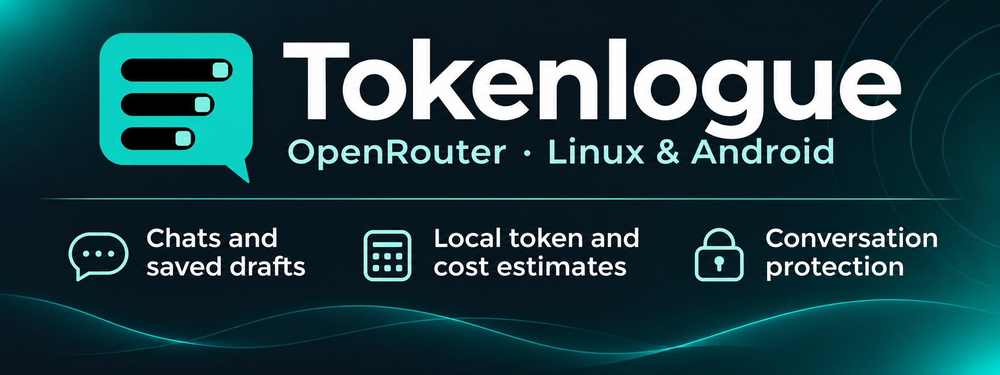
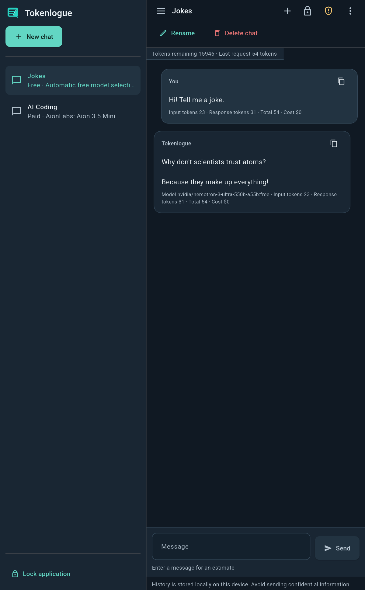

  

<h1 align="center">
  
</h1>

     

<h3 align="left">Use OpenRouter models from your Android phone or tablet. Tokenlogue keeps your chats, drafts and model choices in one mobile workspace.</h3>

##  A look inside

<table>
<tr><th>🔑 First connection</th><th>💬 Your conversation</th></tr>
<tr>
<td align="center"><a href="docs/assets/screenshots/android-start.png"> 
 
</a></td>
<td align="center"><a href="docs/assets/screenshots/android-chat-en.png"> 
 
</a></td>
</tr>
</table>

Illustrations from an earlier Tokenlogue preview on an Android tablet. Available controls in newer builds can differ.

New previews keep the displayed application version `0.1.0` until a separately designated official release. Unique tags and increasing build numbers distinguish individual previews.

##  Install or update

You need **ARM64 Android 7.0 / API 24 or later**. This minimum does not mean every Android version has been tested. Static 16 KiB checks passed, while operation on a native ARM64 device with a 16 KiB kernel has not yet been checked.

For Tokenlogue 0.1.0, download [`Tokenlogue-0.1.0-android-arm64-v8a-v43.apk`](https://github.com/Umichata/tokenlogue/releases/download/v0.1.0-preview.a981db9/Tokenlogue-0.1.0-android-arm64-v8a-v43.apk) and [`SHA256SUMS`](https://github.com/Umichata/tokenlogue/releases/download/v0.1.0-preview.a981db9/SHA256SUMS) from <a href="https://github.com/Umichata/tokenlogue/releases/tag/v0.1.0-preview.a981db9" title="Releases">Releases&nbsp;</a>. Check only the APK against its manifest entry as explained in the Android guide below. You do not need a separate Python or Flutter installation or the source archives to run Tokenlogue.

Allow installation from your chosen file manager or browser, open the verified APK and follow Android's prompts. For an update, install over a compatible previous version with the same signing certificate. Do not uninstall or clear application data as a routine update step.

##  Start a conversation

1. Add your own OpenRouter key and complete its online check.
2. Set an application PIN.
3. Create a chat and select a model.

The draft and model choice remain with that conversation. Open the chat actions to rename or delete it.

OpenRouter balance comes from the account API and appears in free and paid chats. Its refresh state shows whether the value is current. A failed refresh leaves it explicitly stale or unavailable, rather than replacing it with a local calculation. Choose `Refresh key and balance` in `⋮` for a manual update. The API key limit and the saved chat budget remain separate values.

Before a paid request could leave 10% or less of its chat spending limit according to the upper estimate, Tokenlogue asks whether to cancel, send this request once or change the chat limit. Cancel keeps the draft, and saving a new limit sends nothing. A one-off overrun does not raise the saved limit. Ordinary paid confirmations can be disabled from the first request in the selected chat, while the budget warning and other restrictions remain active. Cost and token estimates remain approximate.

 

##  Know what is protected

Selected local conversation fields are encrypted, not the whole device. System recovery needs a supported and configured Android screen lock and access to the original protected encryption key. Deleting the local profile is irreversible and does not refund or delete your OpenRouter account.

Ready-to-use packages are separate downloads from sources. The project archive identified in `PROVENANCE.json` matches the delivered build, while `Tokenlogue-0.1.0-dependency-sources.tar.gz` collects identified third-party materials without a chain of older releases. The source guide explains its contents and the remaining gaps in linking some native binaries to their sources. An archive or license alone does not establish a wheel's build provenance.

  

##  Documentation

<table>
<tr><th align="left">Category</th><th align="left">Documents</th></tr>
<tr>
<td><strong>Start here</strong></td>
<td>  </td>
</tr>
<tr>
<td><strong>Use and protect</strong></td>
<td>  </td>
</tr>
<tr>
<td><strong>Sources and licenses</strong></td>
<td>  </td>
</tr>
</table>

The full documentation map also includes packaging documents and the current source-materials guide.
