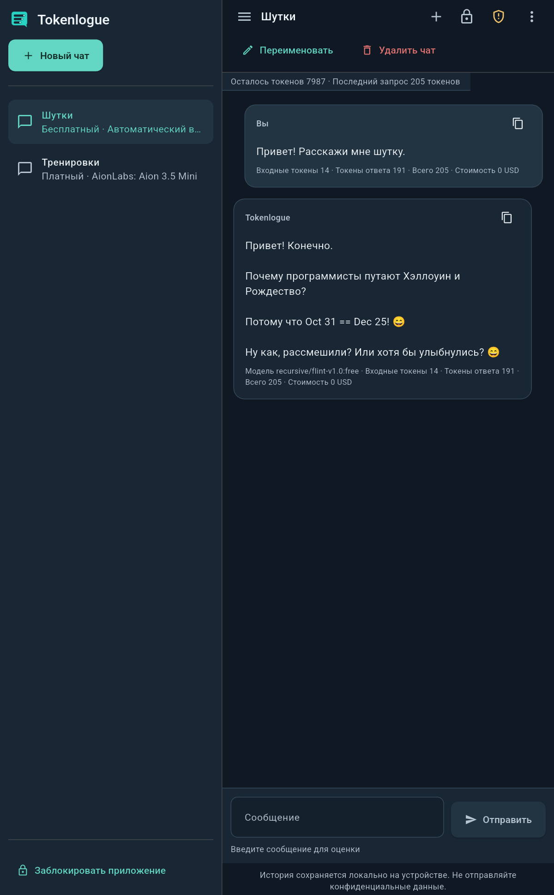

  

# Tokenlogue

[English](#english) · [Русский](#russian)

[**Home / Главная**](https://github.com/Umichata/tokenlogue/tree/main) · [Android](https://github.com/Umichata/tokenlogue/tree/android) · [Linux](https://github.com/Umichata/tokenlogue/tree/linux)

## English

Chat with OpenRouter models on **Linux and Android**. Keep conversations and drafts together, choose a model for each chat and see an estimate before sending a paid request.

[Features](#en-features) · [Screenshots](#en-screenshots) · [Get started](#en-start) · [Guide](docs/user-guide.md#english)

### Your chat workspace

- Separate chats, model selection and drafts that stay with the conversation.
- English and Russian interface with a compact layout for desktop and mobile.
- Free and paid models, per-chat budgets and a live estimate while you write.
- PIN access and local protection for supported conversation fields, with platform-specific recovery options.

### A look inside

<table>
<tr><th>Linux</th><th>Android</th></tr>
<tr>
<td></td>
<td></td>
</tr>
<tr><td>Linux chat with local demonstration messages</td><td>Tokenlogue chat on an Android tablet</td></tr>
</table>

Screenshots show the current interface with demonstration data. Earlier downloads retain their own release notes.

### Get started

| Platform | Package and requirements | Installation |
| --- | --- | --- |
| Linux | x86_64 AppImage, x86-64-v2 CPU, compatible desktop libraries | [Linux guide](docs/linux-appimage.md#english) · [Available downloads](https://github.com/Umichata/tokenlogue/releases) |
| Android | ARM64 APK, Android 7.0 / API 24 or later | [Android guide](docs/android.md#english) · [Available downloads](https://github.com/Umichata/tokenlogue/releases) |

Choose the package for your platform and download `RELEASE_SHA256SUMS` with it. The platform guide explains how to check only your selected package.

- Android — `Tokenlogue-0.1.0-65aa62f-arm64-v8a-v41-test.apk`.
- Linux — `Tokenlogue-0.1.0-65aa62f-linux-x86_64.AppImage`.

[Releases](https://github.com/Umichata/tokenlogue/releases) lists publicly available files. If this preview is not listed, its downloads are not public yet. The [earlier Linux preview](https://github.com/Umichata/tokenlogue/releases/tag/v0.1.0-linux-preview.2b1f7d3) remains a historical package with its own release notes.

You do not need a separate Python or Flutter installation or the source archives to run Tokenlogue. The Linux AppImage is unsigned.

For Linux updates, close earlier copies before launching the new file. For Android, install a compatible APK with the same signing certificate over the existing application. Removing the application or clearing its data is not an update step.

1. Add your own OpenRouter API key and let the application check it.
2. Set a PIN. Read the recovery options for your platform before you need them.
3. Create a chat, choose a model and write your first message.

See [first connection and chat controls](docs/user-guide.md#english) for the full walkthrough.

### Costs and local protection

A chat budget, an OpenRouter key limit and your account balance are different amounts. The local token and price estimate is approximate. It is not the model's exact tokenizer or a promise of the final charge. Disabling paid-request confirmation applies from the first request in that chat, while the limits remain in effect.

PIN and encryption protect access and selected local fields. They do not encrypt your whole device. Recovery depends on the saved keys and the configured platform method. When you send a message, the selected conversation content goes to OpenRouter and the chosen model provider. Tokenlogue is independent of OpenRouter.

[Using chats and estimates](docs/user-guide.md#english) · [Protecting your conversations](docs/security.md#english)

### Sources and licenses

Tokenlogue's code uses the [MIT license](LICENSE). [Source materials](docs/source-materials.md#english) explain the available archives and the remaining gaps in linking some native binaries to their sources. [Third-party notices](THIRD_PARTY_NOTICES.md#english) preserve the original terms for libraries and fonts.

## Русский

Общайтесь с моделями OpenRouter на **Linux и Android**. Храните чаты и черновики вместе, выбирайте модель для каждого разговора и смотрите оценку перед платным запросом.

[Возможности](#ru-features) · [Скриншоты](#ru-screenshots) · [Начало работы](#ru-start) · [Руководство](docs/user-guide.md#russian)

### Всё для переписки

- Отдельные чаты, выбор модели и черновики, которые остаются в своём разговоре.
- Английский и русский интерфейс с компактным видом для компьютера и телефона.
- Бесплатные и платные модели, бюджет каждого чата и оценка затрат во время набора.
- Вход по PIN и защита поддерживаемых полей переписки с восстановлением, зависящим от платформы.

### Как выглядит приложение

<table>
<tr><th>Linux</th><th>Android</th></tr>
<tr>
<td></td>
<td></td>
</tr>
<tr><td>Чат Linux с локальными демонстрационными сообщениями</td><td>Рабочий чат Tokenlogue на планшете Android</td></tr>
</table>

На снимках показан текущий интерфейс с демонстрационными данными. Прежние загрузки описаны в собственных примечаниях к выпуску.

### Начало работы

| Платформа | Пакет и требования | Установка |
| --- | --- | --- |
| Linux | AppImage x86_64, процессор x86-64-v2, совместимые библиотеки рабочего стола | [Руководство Linux](docs/linux-appimage.md#russian) · [Доступные загрузки](https://github.com/Umichata/tokenlogue/releases) |
| Android | APK ARM64, Android 7.0 / API 24 или новее | [Руководство Android](docs/android.md#russian) · [Доступные загрузки](https://github.com/Umichata/tokenlogue/releases) |

Выберите пакет для своей платформы и скачайте вместе с ним `RELEASE_SHA256SUMS`. Руководство платформы объясняет, как проверить только выбранный пакет.

- Android — `Tokenlogue-0.1.0-65aa62f-arm64-v8a-v41-test.apk`.
- Linux — `Tokenlogue-0.1.0-65aa62f-linux-x86_64.AppImage`.

На странице [Releases](https://github.com/Umichata/tokenlogue/releases) перечислены общедоступные файлы. Если этой предварительной версии нет в списке, её загрузки ещё не опубликованы. [Прежний Linux preview](https://github.com/Umichata/tokenlogue/releases/tag/v0.1.0-linux-preview.2b1f7d3) остаётся историческим пакетом с собственными примечаниями к выпуску.

Для запуска Tokenlogue не нужны отдельная установка Python или Flutter и архивы исходников. AppImage Linux не подписана.

Для обновления Linux закройте прежние копии перед запуском нового файла. На Android устанавливайте совместимый APK с прежним сертификатом поверх приложения. Удаление приложения и очистка его данных не являются обычным шагом обновления.

1. Добавьте свой API-ключ OpenRouter и дождитесь его проверки приложением.
2. Задайте PIN. Заранее ознакомьтесь с восстановлением для вашей платформы.
3. Создайте чат, выберите модель и напишите первое сообщение.

Полный порядок действий описан в [руководстве по подключению и чату](docs/user-guide.md#russian).

### Затраты и локальная защита

Бюджет чата, лимит ключа OpenRouter и баланс аккаунта — разные величины. Локальная оценка токенов и стоимости приблизительна. Это не точный токенизатор модели и не обещание итогового списания. Отключение подтверждения платного запроса действует с первого запроса выбранного чата, а лимиты продолжают работать.

PIN и шифрование защищают доступ и отдельные локальные поля. Они не шифруют всё устройство. Восстановление зависит от сохранённых ключей и настроенного платформенного способа. При отправке сообщения выбранное содержимое разговора передаётся OpenRouter и провайдеру модели. Tokenlogue разрабатывается независимо от OpenRouter.

[Чаты и оценка затрат](docs/user-guide.md#russian) · [Защита переписки](docs/security.md#russian)

### Исходники и лицензии

Код Tokenlogue доступен по [лицензии MIT](LICENSE). В [исходных материалах](docs/source-materials.md#russian) описаны архивы и оставшиеся пробелы в связи части нативных бинарников с исходниками. [Сторонние уведомления](THIRD_PARTY_NOTICES.md#russian) сохраняют оригинальные условия библиотек и шрифтов.
