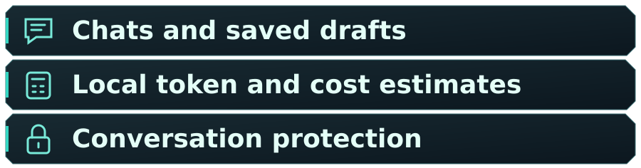
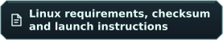
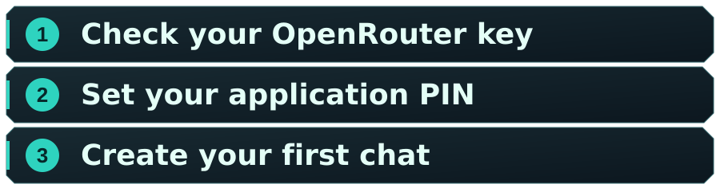

&nbsp;&nbsp;

<h1 align="center">
  
</h1>

Chat with OpenRouter models from your Linux desktop. Tokenlogue provides a compact conversation workspace with saved drafts, model selection and a live cost estimate.

**** · **** · ****

 ·  · 

  

## 🖼️ A look inside

<a href="docs/assets/screenshots/linux-chat.png"> 
 
</a>

Linux chat with local demonstration messages.

## 🚀 Download and launch

The package is an **unsigned x86_64 AppImage**. You need an x86-64-v2 CPU, compatible desktop libraries and graphics drivers. Ubuntu 22.04 is the system-library baseline. Normal startup uses FUSE, with an extract-and-run option when FUSE is unavailable.

For this preview, choose `Tokenlogue-0.1.0-65aa62f-linux-x86_64.AppImage` and `RELEASE_SHA256SUMS` from <a href="https://github.com/Umichata/tokenlogue/releases" title="Releases">Releases&nbsp;</a>. If this preview is not listed, its downloads are not public yet. The [earlier published Linux preview](https://github.com/Umichata/tokenlogue/releases/tag/v0.1.0-linux-preview.2b1f7d3) remains a historical package with its own release notes. The screenshot above shows the current interface.

Check only the selected AppImage against its entry in `RELEASE_SHA256SUMS` as explained in the Linux guide below, make it executable and run it as a normal user. For updates, close earlier copies before starting the replacement file. No separate Python, Flutter or Java installation or source archives are needed.

## 💬 Start a conversation

  

Add your OpenRouter key, let the application check it and set a PIN. Create a chat and choose a model. Drafts stay with each chat. Rename and delete controls are available beneath the conversation title.

The local estimate is approximate. A per-chat budget, an OpenRouter key limit and the account balance are different values. Disabling paid-request confirmation applies from the first request in that chat, while limits remain active.

## 🛡️ Protect the local profile

A working Secret Service in your desktop session stores protected key material. Save the portable recovery code when offered and keep it separate from your computer. PIN and local field encryption do not encrypt the entire device. Without the required keys or recovery material, the application cannot promise to restore encrypted conversations.

 ·  ·  · 

## 🧭 Find your document

- **Start here**
  - .
  - .
  - .
- **Use and protect**
  - .
  - .
  - .
- **Sources and licenses**
  - .
  - .
  - .

<a href="docs/README.md#english" title="Full documentation map">Full documentation map&nbsp;</a> includes packaging documents and historical release records.
