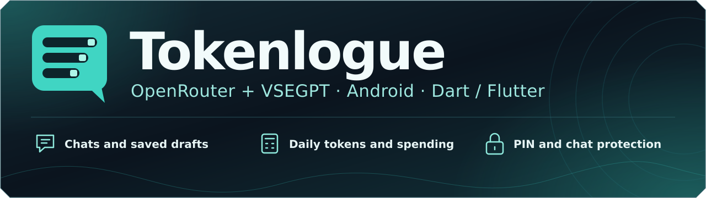

<h1 align="center"></h1>

 
   
  

**Tokenlogue Dart** is an Android client for OpenRouter and VSEGPT. Choose a service and model for each conversation. Return to an unfinished draft after reviewing tokens or spending.

To install Dart, [build the ARM64 APK](apps/android_dart/README.md). Android installs it alongside Tokenlogue on Python and keeps a separate profile for each app.

## Features

- Each provider has its own saved credential. OpenRouter offers free and paid model choices. VSEGPT opens its model catalogue directly.
- The app stores chats and drafts on your device. Sending a message shares the selected conversation context with its provider. An app PIN unlocks the local profile.
- Statistics use the request journal. OpenRouter USD and VSEGPT RUB are shown separately.

##  Android interface

The chat, daily token chart and budget dialog were captured on Android Dart 0.1.1+13.

| Chat and draft | Tokens by day | Chat budget |
| --- | --- | --- |
|  |  |  |

[Browse the app screens](docs/android-dart/gallery.md)

## Install and connect

Build the ARM64 APK with the [Android build guide](apps/android_dart/README.md). Android 7.0 or later is required. The launcher entry is **Tokenlogue Dart**. It can be installed alongside the Python edition. Each edition has its own PIN, keys and history. There is no automatic transfer between the two.

Open the new profile, enter the key for the service you want to use and choose **Check key**. Set and repeat a four-digit PIN. To update, install a Dart APK with a higher build number and the same signing certificate over your existing Dart app.

The budget applies to one chat. The provider balance belongs to the account, and an OpenRouter key can have its own limit. Local token and cost estimates are approximate. Keep your PIN. On Android 7–10 it is the only way to unlock an existing Dart profile.

## Guides

| Guide | Contents |
| --- | --- |
| [Using the app](docs/android-dart/README.md) | Providers, chats, limits, statistics and recovery |
| [Android build](apps/android_dart/README.md) | Toolchain, signing and local package verification |
| [Download Tokenlogue on Python 0.1.1, APK56](https://github.com/Umichata/tokenlogue/releases/download/v0.1.1-preview.1/Tokenlogue-0.1.1-android-arm64-v8a-v56.apk) | Android ARM64 installer for the Python edition and its profile. |

[Tokenlogue license](LICENSE)
