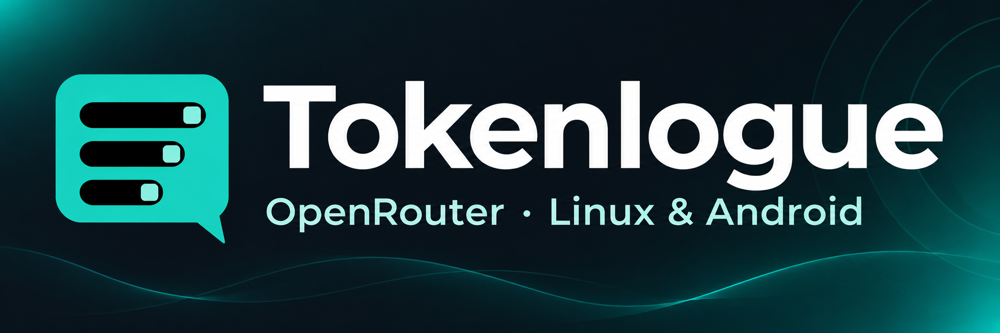
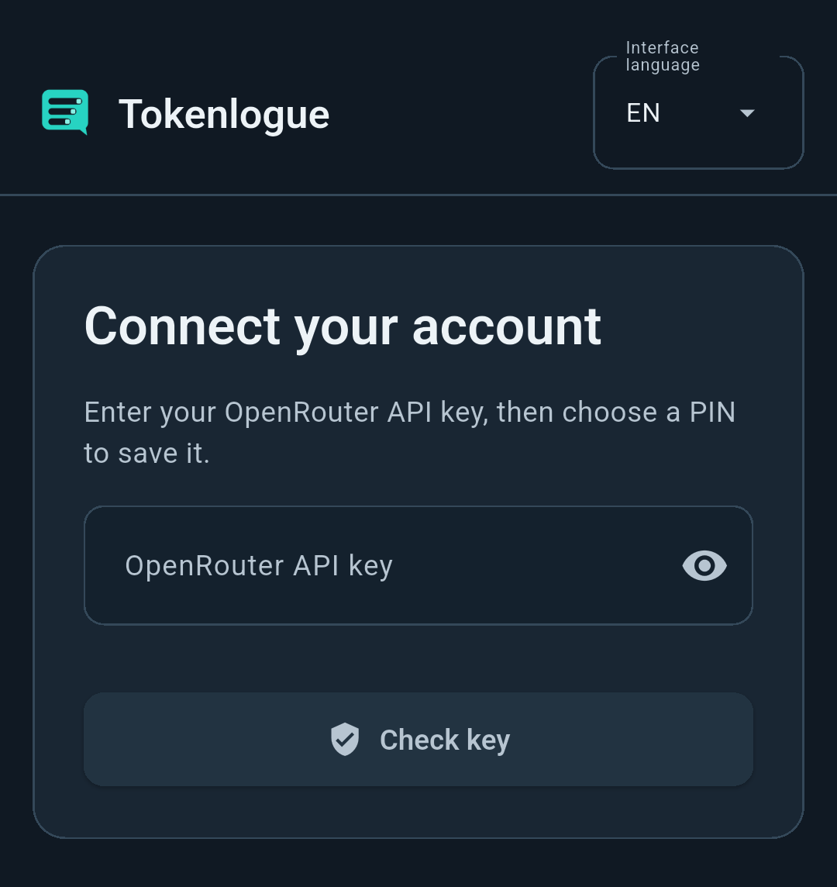
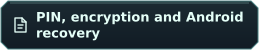

&nbsp;&nbsp;

<h1 align="center">
  
</h1>

Use OpenRouter models from your Android phone or tablet. Tokenlogue keeps your chats, drafts and model choices in one mobile workspace.

**** · **** · ****

 ·  · 

  

## 🖼️ A look inside

<table>
<tr><th>🔑 First connection</th><th>💬 Your conversation</th></tr>
<tr>
<td align="center"><a href="docs/assets/screenshots/android-start.png"> 
 
</a></td>
<td align="center"><a href="docs/assets/screenshots/android-chat-en.png"> 
 
</a></td>
</tr>
</table>

Tokenlogue chat on an Android tablet.

## 🚀 Install or update

You need **ARM64 Android 7.0 / API 24 or later**. This minimum does not mean every Android version has been tested. Static 16 KiB checks passed, while operation on a native ARM64 device with a 16 KiB kernel has not yet been checked.

For this preview, choose `Tokenlogue-0.1.0-65aa62f-arm64-v8a-v41-test.apk` and `RELEASE_SHA256SUMS` from <a href="https://github.com/Umichata/tokenlogue/releases" title="Releases">Releases&nbsp;</a>. If this preview is not listed, its downloads are not public yet. Check only the APK against its manifest entry as explained in the Android guide below. You do not need a separate Python or Flutter installation or the source archives to run Tokenlogue.

Allow installation from your chosen file manager or browser, open the verified APK and follow Android's prompts. For an update, install over a compatible previous version with the same signing certificate. Do not uninstall or clear application data as a routine update step.

## 💬 Start a conversation

  

Add your own OpenRouter key, complete its online check and set a PIN. Create a chat and select a model. The draft and model choice remain with that conversation. Open the chat actions to rename or delete it.

A chat budget, the key's OpenRouter limit and the account balance are separate. Token and cost estimates are approximate. Turning off paid-request confirmation applies from the first request in that chat, while limits remain active.

 · 

## 🛡️ Know what is protected

Selected local conversation fields are encrypted, not the whole device. System recovery needs a supported and configured Android screen lock and access to the original protected encryption key. Deleting the local profile is irreversible and does not refund or delete your OpenRouter account.

 ·  · 

## 🧭 Find your document

- **Start here**
  - .
  - .
  - .
- **Use and protect**
  - .
  - .
  - .
- **Sources and licenses**
  - .
  - .
  - .

<a href="docs/README.md#english" title="Full documentation map">Full documentation map&nbsp;</a> includes packaging documents and historical release records.
