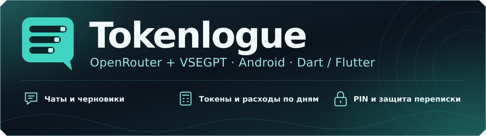
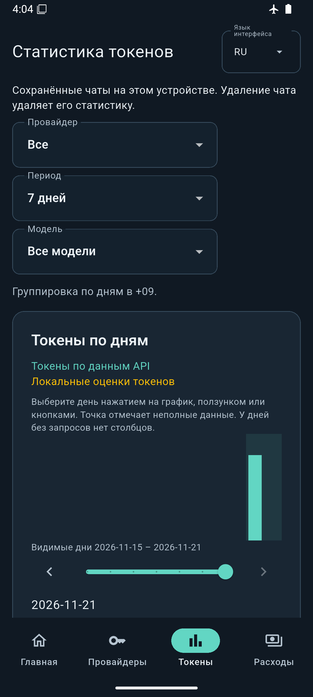

<h1 align="center"></h1>

 
  
  

**Tokenlogue Dart** — клиент OpenRouter и VSEGPT для Android. Выбирайте сервис и модель для каждого чата. Возвращайтесь к черновику после просмотра токенов или расходов.

Установить Dart можно по [инструкции сборки ARM64 APK](apps/android_dart/README.ru.md). Пакет Dart устанавливается рядом с Tokenlogue на Python. У каждого приложения свой профиль.

## Возможности

- У каждого провайдера свой сохранённый ключ. Для OpenRouter доступны бесплатные и платные модели. У VSEGPT открывается каталог моделей.
- Чаты, заголовки и черновики хранятся на устройстве. PIN открывает профиль приложения.
- Статистика использует журнал запросов. Суммы OpenRouter в USD и VSEGPT в RUB показаны отдельно.

##  Интерфейс Android

Переписка и график токенов за день сняты на Android Dart 0.1.1+13.

| Переписка и черновик | Токены по дням |
| --- | --- |
|  |  |

[Все экраны приложения](docs/android-dart/gallery.ru.md)

## Установка и первое подключение

Соберите ARM64 APK по [инструкции сборки](apps/android_dart/README.ru.md). Нужен Android 7.0 или новее. В меню приложений он называется **Tokenlogue Dart**. Его можно установить рядом с Python-версией. У каждой версии собственные PIN, ключи и история. Перенос между ними не выполняется автоматически.

Откройте новый профиль, введите ключ выбранного сервиса и нажмите **Проверить ключ**. Задайте и повторите PIN из четырёх цифр. Для обновления откройте APK Dart с тем же сертификатом и большим номером сборки поверх установленной Dart-версии.

Бюджет ограничивает выбранный чат. Баланс относится к аккаунту провайдера, а у ключа OpenRouter может быть свой лимит. Местная оценка токенов и стоимости приблизительна. Храните материалы восстановления и не удаляйте профиль для обычного обновления.

## Руководства

| Руководство | Содержание |
| --- | --- |
| [Использование приложения](docs/android-dart/README.ru.md) | Провайдеры, чат, лимиты, статистика и восстановление |
| [Сборка Android](apps/android_dart/README.ru.md) | Инструменты, подпись и локальная проверка пакета |
| [Скачать Tokenlogue на Python 0.1.1, APK56](https://github.com/Umichata/tokenlogue/releases/download/v0.1.1-preview.1/Tokenlogue-0.1.1-android-arm64-v8a-v56.apk) | Установочный APK для Android ARM64. Открывает профиль Python. |

[Лицензия Tokenlogue](LICENSE)
