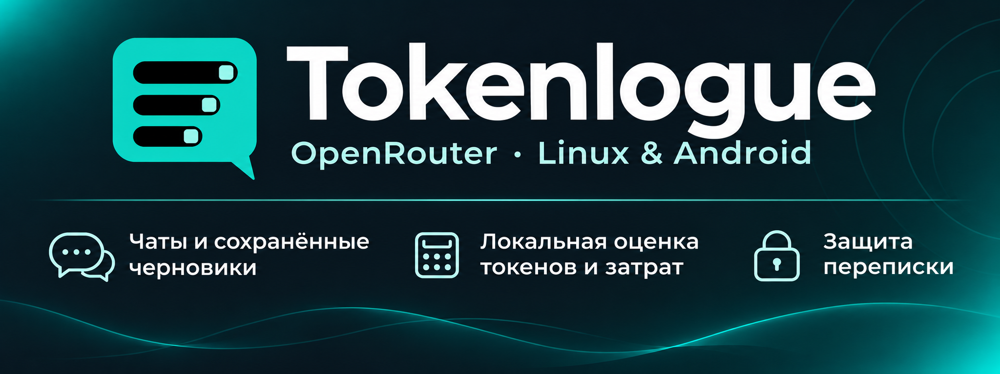

  

<h1 align="center">
  
</h1>

     

> **Начальная предварительная версия 0.1.0 — черновик.** Пока выпуск находится в черновике, пакеты приложения недоступны для публичного скачивания. Публикация выполняется только по прямому указанию владельца проекта.

<h3 align="left">Общайтесь с моделями OpenRouter на компьютере Linux. Tokenlogue предоставляет компактное пространство для переписки с черновиками, выбором модели и оценкой затрат во время набора.</h3>

##  Как выглядит приложение

<a href="docs/assets/screenshots/linux-chat.png"> 
 
</a>

Чат Linux с локальными демонстрационными сообщениями.

##  Загрузка и запуск

Пакет поставляется как **неподписанная AppImage x86_64**. Нужны процессор x86-64-v2, совместимые библиотеки рабочего стола и видеодрайверы. Базовая версия системных библиотек соответствует Ubuntu 22.04. Обычный запуск использует FUSE, при его отсутствии можно запустить с распаковкой.

В черновике подготовлены [`Tokenlogue-0.1.0-a981db9-linux-x86_64.AppImage`](https://github.com/Umichata/tokenlogue/releases/download/v0.1.0-preview.a981db9/Tokenlogue-0.1.0-a981db9-linux-x86_64.AppImage) и [`SHA256SUMS`](https://github.com/Umichata/tokenlogue/releases/download/v0.1.0-preview.a981db9/SHA256SUMS). Пока выпуск находится в черновике, ссылки доступны сопровождающим репозитория. Иллюстрация рабочего пространства чата с демонстрационными данными. Точный набор элементов зависит от выбранного чата и доступного места.

Начальная серия предварительных выпусков использует отображаемую версию приложения `0.1.0` до отдельно объявленного официального релиза. Отдельные теги и возрастающие номера сборок идентифицируют подготовленные пакеты.

Проверьте только выбранную AppImage по её записи в `SHA256SUMS`, как описано в руководстве Linux ниже. Разрешите выполнение и запустите её от обычного пользователя. При обновлении закройте прежние копии перед открытием нового файла. Отдельная установка Python, Flutter или Java и архивы исходников не нужны.

##  Начало переписки

1. Добавьте свой ключ OpenRouter и дождитесь его проверки приложением.
2. Задайте PIN приложения.
3. Создайте чат и выберите модель.

Черновики сохраняются для каждого чата. Действия переименования и удаления расположены под названием разговора.

Баланс OpenRouter поступает из API аккаунта и виден в бесплатных и платных чатах. Состояние обновления показывает, актуально ли значение. При ошибке оно помечается устаревшим или недоступным, а не заменяется локальным расчётом. Для ручного обновления выберите `Обновить ключ и баланс` в `⋮`. Лимит API-ключа и сохранённый бюджет чата остаются отдельными величинами.

Перед платным запросом, после которого по верхней оценке останется не больше 10% денежного лимита чата, появляется предупреждение. Можно отменить отправку, отправить этот запрос один раз или изменить лимит чата. Отмена сохраняет черновик, а сохранение нового лимита ничего не отправляет. Разовое превышение не повышает сохранённый лимит. Обычные подтверждения можно отключить с первого запроса выбранного чата, но предупреждение о бюджете и остальные ограничения продолжают работать. Оценка стоимости и токенов остаётся приблизительной.

##  Защита локального профиля

Работающий Secret Service в сеансе рабочего стола хранит защищённые материалы ключей. Сохраните переносимый резервный код, когда приложение предложит его, и храните отдельно от компьютера. PIN и шифрование отдельных полей не шифруют всё устройство. Без необходимых ключей или материалов восстановления нельзя обещать восстановление зашифрованной переписки.

Готовый пакет скачивается отдельно от исходников. Архив проекта из `PROVENANCE.json` соответствует поставленной сборке, а `Tokenlogue-0.1.0-dependency-sources.tar.gz` объединяет идентифицированные сторонние материалы. Руководство по исходникам объясняет состав и оставшиеся ограничения связи некоторых нативных бинарников с исходниками. Наличие архива или лицензии само по себе не доказывает происхождение wheel.

   

##  Документация

<table>
<tr><th align="left">Раздел</th><th align="left">Документы</th></tr>
<tr>
<td><strong>Начало работы</strong></td>
<td>  </td>
</tr>
<tr>
<td><strong>Переписка и защита</strong></td>
<td>  </td>
</tr>
<tr>
<td><strong>Исходники и лицензии</strong></td>
<td>  </td>
</tr>
</table>

Полная карта документации также содержит материалы упаковки и актуальное руководство по исходным материалам.
