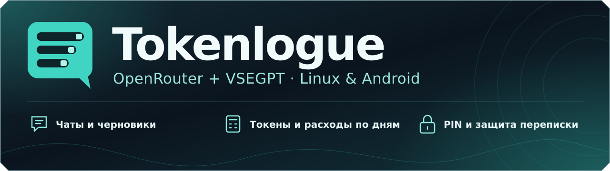
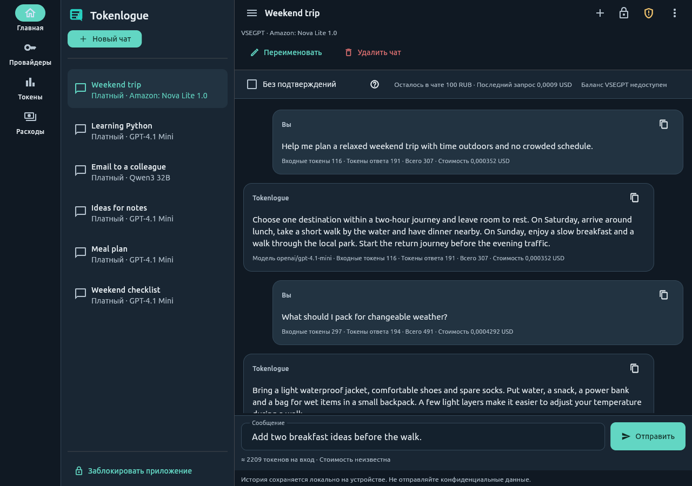
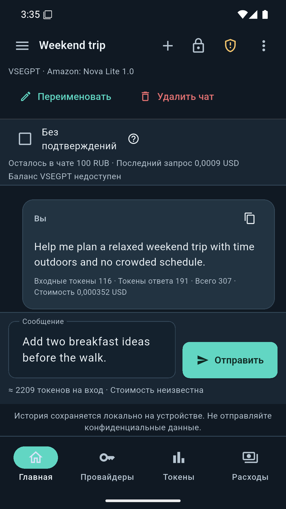

 
   

<h1 align="center"></h1>

     

<h3><strong>Чаты OpenRouter и VSEGPT для Linux и Android.</strong> Храните разговоры и черновики вместе, выбирайте модель для каждого чата и следите за токенами и расходами.</h3>

> **[0.1.1 Preview](https://github.com/Umichata/tokenlogue/releases/tag/v0.1.1-preview.1)** содержит APK версии на Python для Android ARM64 (сборка 56) и настольный bundle Linux x86_64. Перед установкой проверьте требования платформы и сумму скачанного файла.

##  Возможности

- Храните ключи OpenRouter и VSEGPT отдельно в защищённом хранилище.
- Проверяйте провайдера и маску общего ключа в **⋮** и [явно меняйте провайдера выбранного чата](docs/user-guide.ru.md#ru-chat-connection).
- Смотрите токены по дням отдельно для usage API и местных оценок и выбирайте сервис для каждого нового чата.
- Переходите между **Главной**, **Провайдерами**, **Токенами** и **Расходами**, сохраняя текущий чат и черновик.
- В выпадающем списке **Провайдер** выбирайте **Все**, **OpenRouter** или **VSEGPT** для просмотра. Фильтр просмотра не меняет провайдера чата.
- Смотрите местную статистику токенов и дневных расходов по сервису и модели. USD и RUB остаются раздельными.
- Проверяйте приблизительную стоимость и предупреждения бюджета перед платной отправкой.
- Используйте русский или английский язык, вход по PIN и шифрование сохранённых полей переписки.

##  Интерфейс

| Linux | Эмулятор Android |
| --- | --- |
| <a href="docs/assets/screenshots/v011-55-linux-home-ru.png">  </a> | <a href="docs/assets/screenshots/v011-55-android-home-ru.png">  </a> |

*Демонстрационные данные. Кадры Android сняты в эмуляторе.* [Вид на планшете](docs/assets/screenshots/v011-55-android-chat-after-change-ru.png).

##  Установка и обновление

| Платформа | Пакет | Установка |
| --- | --- | --- |
| Android ARM64 · Python | APK 0.1.1, versionCode 56, API 24 или новее |   |
| Android ARM64 · Dart | 0.1.1+18, API 24 или новее, отдельный профиль | [Установка и обновление](https://github.com/Umichata/tokenlogue/blob/android-dart/README.ru.md) |
| Linux x86_64 | Настольный bundle 0.1.1+56 |   |

На странице выпуска выберите подходящий пакет и проверьте его сумму по руководству платформы. Linux поставляется полным bundle, а не AppImage. Архив не подписан. Для готового приложения не нужны Python, Flutter и исходные архивы.

Совместимый APK с прежней подписью устанавливайте поверх приложения с сохранением данных. В Linux закройте старые копии перед запуском замены от той же учётной записи ОС.

### Первое подключение

1. Введите поддерживаемый ключ и нажмите **Проверить ключ**. Если бесплатная проверка VSEGPT недоступна, можно явно сохранить его непроверенным.
2. Выберите и повторите PIN приложения. Сохраните предложенные для платформы материалы восстановления.
3. Через **+** создайте чат, выберите модель и лимиты, затем напишите сообщение.

Подробнее о [чатах](docs/user-guide.ru.md), [настройках провайдеров](docs/providers.ru.md) и [статистике токенов и расходов](docs/analytics.ru.md).

##  Что означают суммы

Баланс сервиса, остаток лимита ключа OpenRouter и бюджет чата — разные значения. Для VSEGPT отдельный лимит ключа не поддерживается. Неизвестные суммы остаются недоступными. Местные оценки токенов и стоимости приблизительны.

PIN и шифрование защищают отдельные локальные поля. Они не шифруют всё устройство. При отправке нужный контекст получает сервис, закреплённый за чатом, и его поставщик модели. В разделе [защиты и восстановления](docs/security.ru.md) описаны требования и последствия удаления профиля.

##  Документация

<table>
<tr><th align="left">Раздел</th><th align="left">Документы</th></tr>
<tr><td><strong>Установка</strong></td><td> </td></tr>
<tr><td><strong>Провайдеры и чаты</strong></td><td> </td></tr>
<tr><td><strong>Токены и расходы</strong></td><td></td></tr>
<tr><td><strong>Защита и восстановление</strong></td><td></td></tr>
<tr><td><strong>Исходники и лицензии</strong></td><td>  </td></tr>
<tr><td><strong>Версии</strong></td><td></td></tr>
</table>

##  Исходники и лицензии

Tokenlogue распространяется по [лицензии MIT](LICENSE). [Исходные материалы](docs/source-materials.ru.md) и [сторонние уведомления](THIRD_PARTY_NOTICES.ru.md) описывают компоненты и ограничения подтверждённого происхождения бинарников. См. [изменения 0.1.1](CHANGELOG.ru.md).
