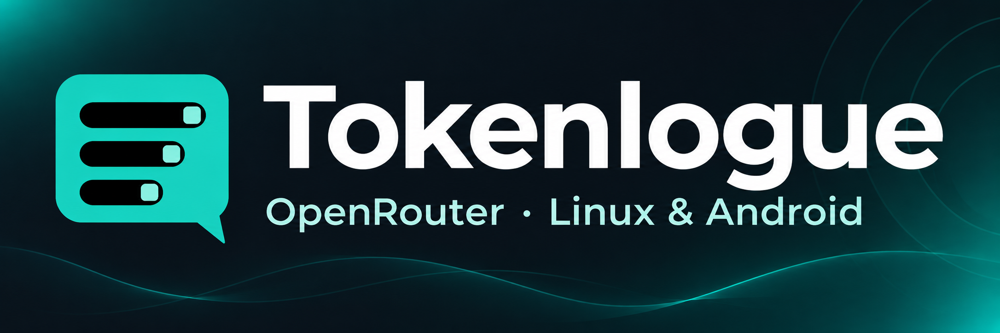
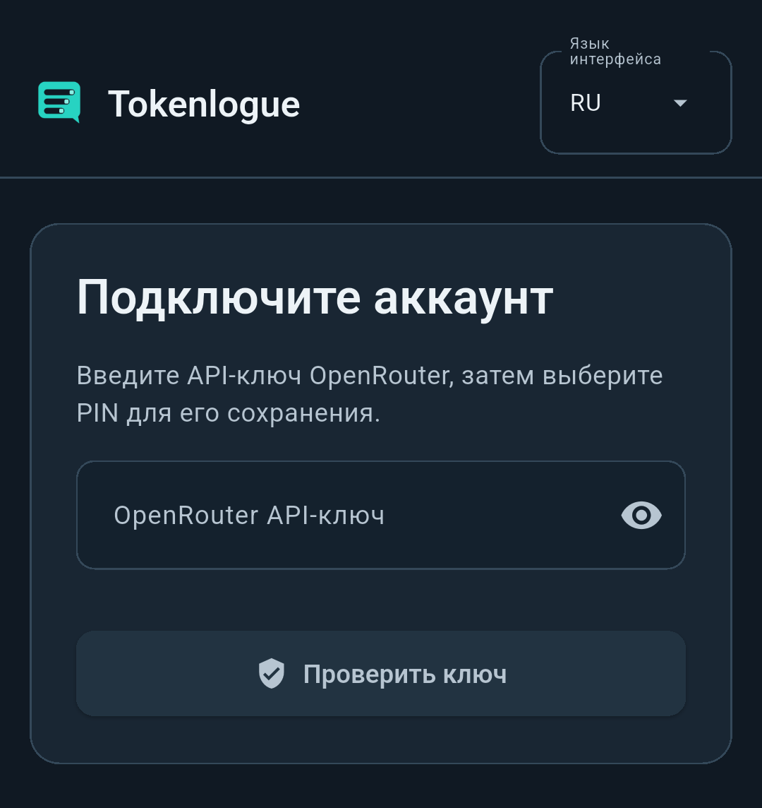
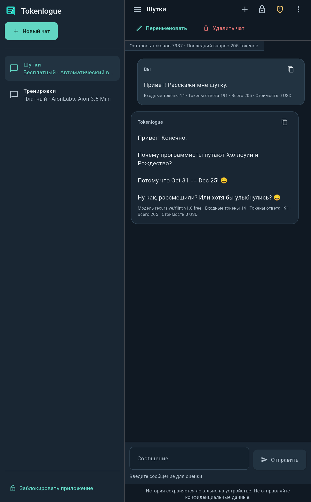
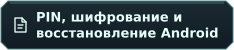
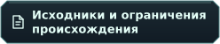

&nbsp;&nbsp;

<h1 align="center">
  
</h1>

Общайтесь с моделями OpenRouter на телефоне или планшете Android. Tokenlogue объединяет чаты, черновики и выбор модели в одном мобильном рабочем пространстве.

**** · **** · ****

 ·  · 

  

## 🖼️ Как выглядит приложение

<table>
<tr><th>🔑 Первое подключение</th><th>💬 Переписка</th></tr>
<tr>
<td align="center"><a href="docs/assets/screenshots/android-start-ru.png"> 
 
</a></td>
<td align="center"><a href="docs/assets/screenshots/android-chat-ru.png"> 
 
</a></td>
</tr>
</table>

Рабочий чат Tokenlogue на планшете Android.

## 🚀 Установка и обновление

Нужен **Android 7.0 / API 24 или новее с ARM64**. Поддерживаемый минимум не означает проверку каждой версии Android. Статические проверки 16 КиБ пройдены, но работа на нативном ARM64-устройстве с ядром 16 КиБ пока не проверена.

Для этой предварительной версии выберите `Tokenlogue-0.1.0-65aa62f-arm64-v8a-v41-test.apk` и `RELEASE_SHA256SUMS` на странице <a href="https://github.com/Umichata/tokenlogue/releases" title="Releases">Releases&nbsp;</a>. Если этой версии нет в списке, её загрузки ещё не опубликованы. Проверьте только APK по его записи в манифесте, как описано в руководстве Android ниже. Для запуска Tokenlogue не нужны отдельная установка Python или Flutter и архивы исходников.

Разрешите установку выбранному файловому менеджеру или браузеру, откройте проверенный APK и следуйте подсказкам Android. Для обновления устанавливайте его поверх совместимой прежней версии с тем же сертификатом. Не удаляйте приложение и не очищайте данные как обычный шаг обновления.

## 💬 Начало переписки

  

Добавьте собственный ключ OpenRouter, дождитесь его проверки через сеть и задайте PIN. Создайте чат и выберите модель. Черновик и выбор модели сохраняются для этого разговора. Действия чата позволяют переименовать или удалить его.

Бюджет чата, лимит ключа OpenRouter и баланс аккаунта различаются. Оценка токенов и стоимости приблизительна. Отключение подтверждения платного запроса действует с первого запроса выбранного чата, а лимиты продолжают работать.

 · 

## 🛡️ Что защищено

Шифруются отдельные локальные поля переписки, а не всё устройство. Для системного восстановления нужны поддерживаемая и настроенная блокировка Android и доступ к исходному защищённому ключу шифрования. Удаление локального профиля необратимо и не возвращает средства и не удаляет аккаунт OpenRouter.

 ·  · 

## 🧭 Найдите нужный документ

- **Начало работы**
  - .
  - .
  - .
- **Переписка и защита**
  - .
  - .
  - .
- **Исходники и лицензии**
  - .
  - .
  - .

<a href="docs/README.ru.md#russian" title="Полная карта документации">Полная карта документации&nbsp;</a> также содержит материалы упаковки и историю выпусков.
