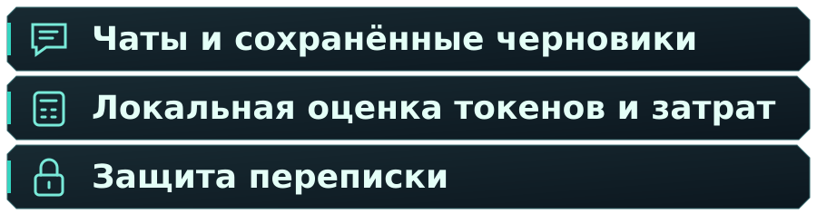
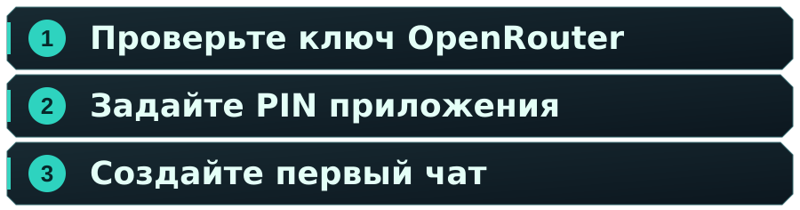

&nbsp;&nbsp;

<h1 align="center">
  
</h1>

Общайтесь с моделями OpenRouter на **Linux и Android**. Храните чаты и черновики вместе, выбирайте модель для каждого разговора и смотрите оценку перед платным запросом.

**** · **** · ****

 ·  · 

  

## ✨ Всё для переписки

- Отдельные чаты, выбор модели и черновики, которые остаются в своём разговоре.
- Английский и русский интерфейс с компактным видом для компьютера и телефона.
- Бесплатные и платные модели, бюджет каждого чата и оценка затрат во время набора.
- Вход по PIN и защита поддерживаемых полей переписки с восстановлением, зависящим от платформы.

## 🖼️ Как выглядит приложение

<table>
<tr><th align="center">Linux</th><th align="center">Android</th></tr>
<tr>
<td align="center"><a href="docs/assets/screenshots/linux-chat.png"> 
 
</a></td>
<td align="center"><a href="docs/assets/screenshots/android-chat-ru.png"> 
 
</a></td>
</tr>
<tr><td>Чат Linux с локальными демонстрационными сообщениями</td><td>Рабочий чат Tokenlogue на планшете Android</td></tr>
</table>

На снимках показан текущий интерфейс с демонстрационными данными. Прежние загрузки описаны в собственных примечаниях к выпуску.

## 🚀 Начало работы

| Платформа | Пакет и требования | Установка |
| --- | --- | --- |
| Linux | AppImage x86_64, процессор x86-64-v2, совместимые библиотеки рабочего стола | <a href="docs/linux-appimage.ru.md#russian" title="Руководство Linux">Руководство Linux&nbsp;</a> · <a href="https://github.com/Umichata/tokenlogue/releases" title="Доступные загрузки">Доступные загрузки&nbsp;</a> |
| Android | APK ARM64, Android 7.0 / API 24 или новее | <a href="docs/android.ru.md#russian" title="Руководство Android">Руководство Android&nbsp;</a> · <a href="https://github.com/Umichata/tokenlogue/releases" title="Доступные загрузки">Доступные загрузки&nbsp;</a> |

Выберите пакет для своей платформы и скачайте вместе с ним `RELEASE_SHA256SUMS`. Руководство платформы объясняет, как проверить только выбранный пакет.

- Android — `Tokenlogue-0.1.0-65aa62f-arm64-v8a-v41-test.apk`.
- Linux — `Tokenlogue-0.1.0-65aa62f-linux-x86_64.AppImage`.

На странице <a href="https://github.com/Umichata/tokenlogue/releases" title="Releases">Releases&nbsp;</a> перечислены общедоступные файлы. Если этой предварительной версии нет в списке, её загрузки ещё не опубликованы. [Прежний Linux preview](https://github.com/Umichata/tokenlogue/releases/tag/v0.1.0-linux-preview.2b1f7d3) остаётся историческим пакетом с собственными примечаниями к выпуску.

Для запуска Tokenlogue не нужны отдельная установка Python или Flutter и архивы исходников. AppImage Linux не подписана.

Для обновления Linux закройте прежние копии перед запуском нового файла. На Android устанавливайте совместимый APK с прежним сертификатом поверх приложения. Удаление приложения и очистка его данных не являются обычным шагом обновления.

  

1. Добавьте свой API-ключ OpenRouter и дождитесь его проверки приложением.
2. Задайте PIN. Заранее ознакомьтесь с восстановлением для вашей платформы.
3. Создайте чат, выберите модель и напишите первое сообщение.

Полный порядок действий описан в <a href="docs/user-guide.ru.md#russian" title="руководстве по подключению и чату">руководстве по подключению и чату&nbsp;</a>.

## 🧭 Найдите нужный документ

- **Начало работы**
  - .
  - .
  - .
- **Переписка и защита**
  - .
  - .
  - .
- **Исходники и лицензии**
  - .
  - .
  - .

<a href="docs/README.ru.md#russian" title="Полная карта документации">Полная карта документации&nbsp;</a> также содержит материалы упаковки и историю выпусков.

## 🛡️ Затраты и локальная защита

Бюджет чата, лимит ключа OpenRouter и баланс аккаунта — разные величины. Локальная оценка токенов и стоимости приблизительна. Это не точный токенизатор модели и не обещание итогового списания. Отключение подтверждения платного запроса действует с первого запроса выбранного чата, а лимиты продолжают работать.

PIN и шифрование защищают доступ и отдельные локальные поля. Они не шифруют всё устройство. Восстановление зависит от сохранённых ключей и настроенного платформенного способа. При отправке сообщения выбранное содержимое разговора передаётся OpenRouter и провайдеру модели. Tokenlogue разрабатывается независимо от OpenRouter.

 · 

## 📚 Исходники и лицензии

Код Tokenlogue доступен по <a href="LICENSE" title="лицензии MIT">лицензии MIT&nbsp;</a>. В <a href="docs/source-materials.ru.md#russian" title="исходных материалах">исходных материалах&nbsp;</a> описаны архивы и оставшиеся пробелы в связи части нативных бинарников с исходниками. <a href="THIRD_PARTY_NOTICES.ru.md#russian" title="Сторонние уведомления">Сторонние уведомления&nbsp;</a> сохраняют оригинальные условия библиотек и шрифтов.
