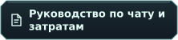

&nbsp;&nbsp;

<h1 align="center">
  
</h1>

Общайтесь с моделями OpenRouter на компьютере Linux. Tokenlogue предоставляет компактное пространство для переписки с черновиками, выбором модели и оценкой затрат во время набора.

**** · **** · ****

 ·  · 

  

## 🖼️ Как выглядит приложение

<a href="docs/assets/screenshots/linux-chat.png"> 
 
</a>

Чат Linux с локальными демонстрационными сообщениями.

## 🚀 Загрузка и запуск

Пакет поставляется как **неподписанная AppImage x86_64**. Нужны процессор x86-64-v2, совместимые библиотеки рабочего стола и видеодрайверы. Базовая версия системных библиотек соответствует Ubuntu 22.04. Обычный запуск использует FUSE, при его отсутствии можно запустить с распаковкой.

Для этой предварительной версии выберите `Tokenlogue-0.1.0-65aa62f-linux-x86_64.AppImage` и `RELEASE_SHA256SUMS` на странице <a href="https://github.com/Umichata/tokenlogue/releases" title="Releases">Releases&nbsp;</a>. Если этой версии нет в списке, её загрузки ещё не опубликованы. [Прежний опубликованный Linux preview](https://github.com/Umichata/tokenlogue/releases/tag/v0.1.0-linux-preview.2b1f7d3) остаётся историческим пакетом с собственными примечаниями к выпуску. На снимке выше показан текущий интерфейс.

Проверьте только выбранную AppImage по её записи в `RELEASE_SHA256SUMS`, как описано в руководстве Linux ниже. Разрешите выполнение и запустите её от обычного пользователя. При обновлении закройте прежние копии перед открытием нового файла. Отдельная установка Python, Flutter или Java и архивы исходников не нужны.

## 💬 Начало переписки

  

Добавьте свой ключ OpenRouter, дождитесь его проверки приложением и задайте PIN. Создайте чат и выберите модель. Черновики сохраняются для каждого чата. Действия переименования и удаления расположены под названием разговора.

Локальная оценка приблизительна. Бюджет чата, лимит ключа OpenRouter и баланс аккаунта — разные величины. Отключение подтверждения платного запроса действует с первого запроса выбранного чата, а лимиты продолжают работать.

## 🛡️ Защита локального профиля

Работающий Secret Service в сеансе рабочего стола хранит защищённые материалы ключей. Сохраните переносимый резервный код, когда приложение предложит его, и храните отдельно от компьютера. PIN и шифрование отдельных полей не шифруют всё устройство. Без необходимых ключей или материалов восстановления нельзя обещать восстановление зашифрованной переписки.

 ·  ·  · 

## 🧭 Найдите нужный документ

- **Начало работы**
  - .
  - .
  - .
- **Переписка и защита**
  - .
  - .
  - .
- **Исходники и лицензии**
  - .
  - .
  - .

<a href="docs/README.ru.md#russian" title="Полная карта документации">Полная карта документации&nbsp;</a> также содержит материалы упаковки и историю выпусков.
