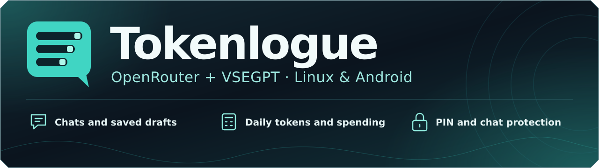

 
  

    

# Documentation

> **[0.1.1 Preview](https://github.com/Umichata/tokenlogue/releases/tag/v0.1.1-preview.1)** provides an Android ARM64 APK and a Linux x86_64 desktop bundle. Read the platform requirements and verify the downloaded file before installing.

For the separate Tokenlogue Dart app, see the [Android Dart guide](android-dart/README.md). The guides below describe the Python editions.

##  Start here

| Task | Guide |
| --- | --- |
| Install or update |   |
| Connect a key and start chatting |  |
| Check or replace a provider key |  |
| Read token usage and daily costs |  |
| Lock, recover or delete a profile |  |
| Review the changes |  |

##  Downloads and requirements

[0.1.1 Preview](https://github.com/Umichata/tokenlogue/releases/tag/v0.1.1-preview.1) provides an Android ARM64 APK and a complete Linux x86_64 desktop bundle. The platform guides identify the exact files, checksums and update steps. The earlier 0.1.0 release remains available separately.

Android requires API 24 or later. Linux requires a compatible graphical desktop and secure key storage. Follow the platform guide before starting. Source archives are optional for application users.

##  Sources and notices

[Source materials](source-materials.md) explain project snapshots, locks and dependency provenance. [Third-party notices](../THIRD_PARTY_NOTICES.md) identify original legal texts. Packaging details cover [Linux](../packaging/linux/appimage/README.md), the [AppImage startup runtime](../packaging/linux/appimage/runtime/README.md), [Android native inputs](../packaging/android/crypto/README.md) and [libraries and fonts](../packaging/notices/README.md). [Brand assets](../branding/README.md) contain the original logo.

##  Help

When [reporting a problem](https://github.com/Umichata/tokenlogue/issues), include your app version, platform and the action that failed. Remove keys, PINs, recovery codes, private conversations and personal paths.
