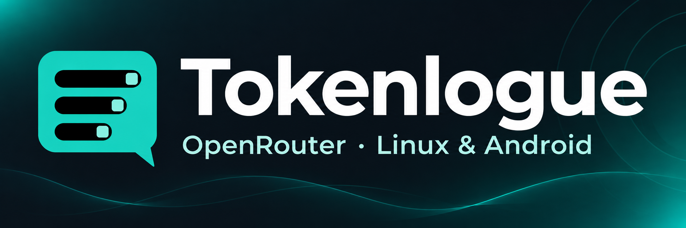
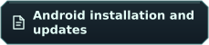
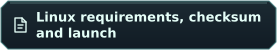
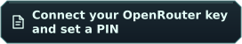
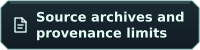
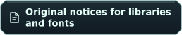
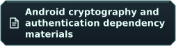
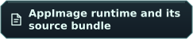

&nbsp;

  

# 🧭 Documentation

 ·  · 

Choose a document below. Installation and everyday use come first. Technical materials and historical records are grouped separately.

## 🚀 Start here

- **Get Tokenlogue**
  - .
  - .
  - .
- **Your first conversation**
  - .
  - .
  - .

## 💬 Use and protect

- **Chats and costs**
  - .
  - .
  - .
  - .
  - .
  - .
- **Local protection**
  - .
  - .
  - .
  - .
  - .
  - .
- **Get help**
  - .
  - .
  - .

## 📚 Sources and licenses

- **Inspect the materials**
  - .
  - .
  - .
- **Read package notices**
  - .
  - .

<strong>Developer and packaging documents</strong>

- **Sources and dependencies**
  - .
  - .
- **Linux package**
  - .
  - .
- **Visual identity**
  - .

<strong>Historical release records</strong>

- .
- .

These documents describe their own earlier packages. Use the installation guides above for the current preview.

