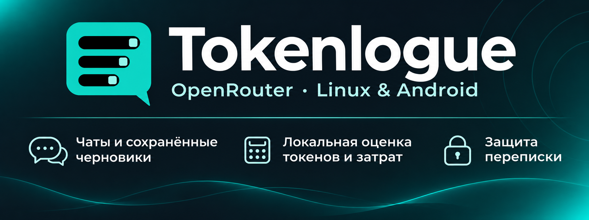

 

  

# 🧭 Документация

  

Выберите нужный документ. Сначала расположены установка и повседневная работа. Технические материалы и история выпусков собраны отдельно.

##  Начало работы

###  Получение Tokenlogue

  

###  Первый разговор

  

##  Переписка и защита

###  Чаты и расходы

  

  

###  Локальная защита

  

  

###  Получение помощи

  

##  Исходники и лицензии

###  Изучение материалов

  

###  Уведомления в пакетах

 

<strong>Документы для разработки и упаковки</strong>

###  Исходники и зависимости

 

###  Пакет Linux

 

###  Оформление

<strong>История выпусков</strong>

 

Эти документы описывают соответствующие прежние пакеты. Для текущей предварительной версии используйте руководства по установке выше.

