

&nbsp;

  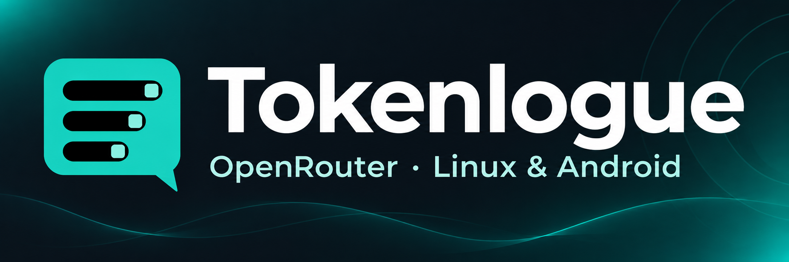

# 🧭 Документация

 ·  · 

Выберите нужный документ. Сначала расположены установка и повседневная работа. Технические материалы и история выпусков собраны отдельно.

## 🚀 Начало работы

- **Получение Tokenlogue**
  - .
  - .
  - <a href="linux-appimage.ru.md#russian" title="Требования Linux, проверка суммы и запуск">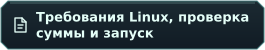</a>.
- **Первый разговор**
  - .
  - <a href="user-guide.ru.md#ru-chats" title="Создание чатов и управление ими">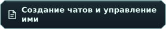</a>.
  - <a href="user-guide.ru.md#ru-workspace" title="Настройка рабочего пространства">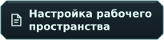</a>.

## 💬 Переписка и защита

- **Чаты и расходы**
  - <a href="user-guide.ru.md#russian" title="Полное руководство пользователя">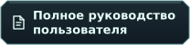</a>.
  - <a href="user-guide.ru.md#ru-drafts" title="Сообщения и сохранённые черновики">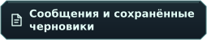</a>.
  - .
  - <a href="user-guide.ru.md#ru-paid-confirmation" title="Подтверждение платных запросов">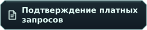</a>.
  - .
  - .
- **Локальная защита**
  - .
  - .
  - .
  - .
  - .
  - <a href="security.ru.md#ru-delete" title="Удаление локального профиля">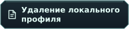</a>.
- **Получение помощи**
  - .
  - .
  - .

## 📚 Исходники и лицензии

- **Изучение материалов**
  - <a href="source-materials.ru.md#russian" title="Архивы исходников и ограничения подтверждения происхождения">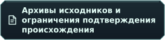</a>.
  - .
  - .
- **Уведомления в пакетах**
  - .
  - <a href="../packaging/notices/README.ru.md#russian" title="Оригинальные уведомления библиотек и шрифтов">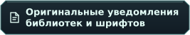</a>.

<strong>Документы для разработки и упаковки</strong>

- **Исходники и зависимости**
  - .
  - <a href="../packaging/android/crypto/README.ru.md#russian" title="Материалы зависимостей криптографии и аутентификации Android">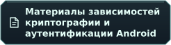</a>.
- **Пакет Linux**
  - .
  - .
- **Оформление**
  - .

<strong>История выпусков</strong>

- <a href="releases/v0.1.0-linux-preview.1.ru.md#russian" title="Прежняя предварительная Linux-версия">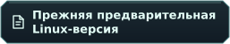</a>.
- <a href="releases/14b87ac-source-materials.ru.md#russian" title="Исторический комплект исходников">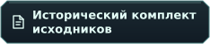</a>.

Эти документы описывают соответствующие прежние пакеты. Для текущей предварительной версии используйте руководства по установке выше.

