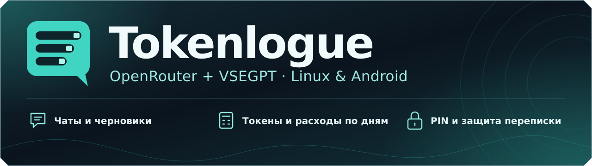

 
   

    

# Документация

> **[0.1.1 Preview](https://github.com/Umichata/tokenlogue/releases/tag/v0.1.1-preview.1)** содержит два APK для Android ARM64 (Python +56 и Dart +18) и комплект для Linux x86_64. Перед установкой проверьте требования платформы и сумму скачанного файла.

##  С чего начать

| Задача | Руководство |
| --- | --- |
| Установить или обновить |   |
| Установить Android Dart рядом с версией на Python | [Скачать APK Dart +18](https://github.com/Umichata/tokenlogue/releases/download/v0.1.1-preview.1/Tokenlogue-0.1.1-android-dart-arm64-v8a-v18.apk) · [Установка и обновление](https://github.com/Umichata/tokenlogue/blob/android-dart/README.ru.md) · [Руководство Dart](https://github.com/Umichata/tokenlogue/blob/android-dart/docs/android-dart/README.ru.md) |
| Подключить ключ и начать чат |  |
| Проверить или заменить ключ |  |
| Посмотреть токены и дневные расходы |  |
| Заблокировать, восстановить или удалить профиль |  |
| Посмотреть изменения |  |

##  Загрузки и требования

[0.1.1 Preview](https://github.com/Umichata/tokenlogue/releases/tag/v0.1.1-preview.1) содержит версии для Android ARM64 на Python (+56) и Dart (+18), а также полный комплект для Linux x86_64. Точные имена, суммы и правила обновления приведены в руководствах платформ. Прежний выпуск 0.1.0 остаётся доступен отдельно.

Android требует API 24 или новее. Для Linux нужны совместимый рабочий стол и защищённое хранилище ключей. Перед запуском прочитайте руководство платформы. Архивы исходников для использования приложения не нужны.

##  Исходники и уведомления

Раздел [исходных материалов](source-materials.ru.md) описывает снимки проекта, lock-файлы и происхождение зависимостей. [Сторонние уведомления](../THIRD_PARTY_NOTICES.ru.md) помогут найти оригинальные юридические тексты. Об упаковке рассказано в материалах [Linux](../packaging/linux/appimage/README.ru.md), [стартового runtime AppImage](../packaging/linux/appimage/runtime/README.ru.md), [нативных входов Android](../packaging/android/crypto/README.ru.md) и [библиотек и шрифтов](../packaging/notices/README.ru.md). В [фирменных материалах](../branding/README.ru.md) есть оригинальный логотип.

##  Помощь

В [сообщении о проблеме](https://github.com/Umichata/tokenlogue/issues) укажите версию, платформу и действие, которое не удалось выполнить. Уберите ключи, PIN, резервные коды, личную переписку и персональные пути.
