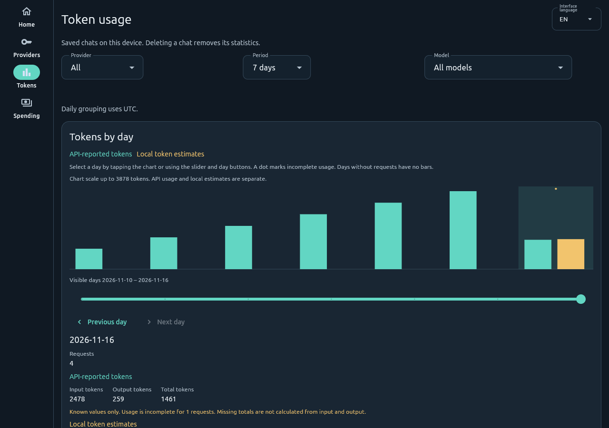
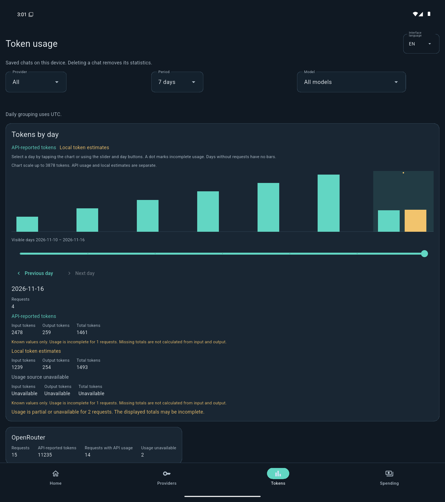
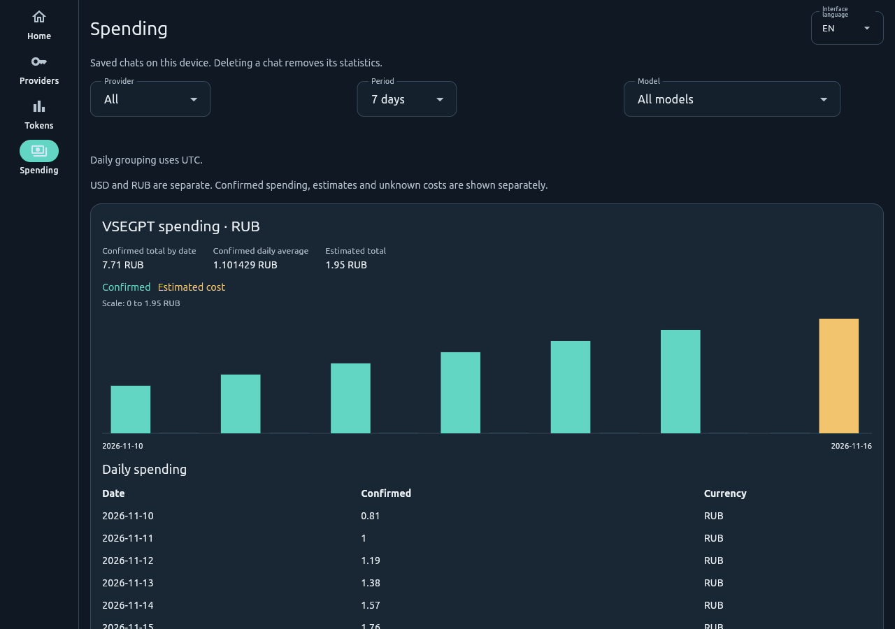
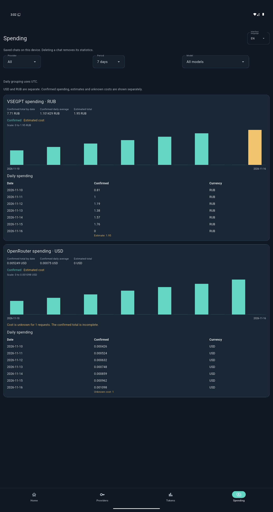

[English](analytics.md#english) · [Русский](analytics.ru.md#russian)

# Daily tokens and spending

[Home](../README.md) · [Documentation](../docs/README.md)

> **[0.1.1 Preview](https://github.com/Umichata/tokenlogue/releases/tag/v0.1.1-preview.1)** provides an Android ARM64 APK and a Linux x86_64 desktop bundle. Read the platform requirements and verify the downloaded file before installing.

## Scope and filters

**Tokens** and **Spending** read the request journal of saved chats on this device. Activity from other applications is excluded. Deleting a chat also deletes its local statistics.

A chat can contain requests made through both services. Each recorded attempt keeps the provider, model, currency and known dispatch date used for that request. Changing the chat’s current connection does not relabel earlier activity. USD and RUB stay separate after returning to a previously used provider.

Each page retains its own **Provider** dropdown selection, period and compatible model filter. Choose **All**, **OpenRouter** or **VSEGPT**. Choose **7 days**, **30 days** or **All time**. Viewing a service does not change its key, the default for new chats or the provider of the open chat.

The model list follows the selected service and period. The same model ID from OpenRouter and VSEGPT remains two choices. An incompatible model filter is reset when you change the provider.

## Tokens

| Linux | Android emulator |
| --- | --- |
|  |  |

*Demonstration journal, not paid requests. Android images show an emulator.*

**Tokens by day** groups saved attempts by their known dispatch date in the time zone shown on the page, using the same filters as the model table. API usage and local estimates have different colours. Tap a day or use the day controls to inspect input, output and total tokens, their source and partial coverage. Longer histories use a movable window. A request with unknown usage is distinct from a day without requests. Missing total is not reconstructed as an API value.

Inspect a selected day on [Linux](assets/screenshots/v011-55-linux-daily-tokens-day-en.png) or in an [Android emulator](assets/screenshots/v011-55-android-selected-token-day-en.png).

The page also shows separate provider totals, requests, API-reported input/output/total tokens and a model table. The most-used-model bars show usage for the selected filters.

API usage, local estimates and missing values remain separate. Estimated tokens do not inflate API-reported totals. Cached and reasoning details are not added a second time. Known tokens remain visible when a cost is unknown. API fields are not an independent tokenizer check. Character prices are not converted into token counts.

Historical requests without a reliable dispatch date appear only in **All time**. They do not acquire an invented day. Empty results mean that no saved requests match the filters.

## Daily spending

| Linux | Android emulator |
| --- | --- |
|  |  |

*Demonstration journal, not paid requests. Android images show an emulator.*

The examples use **All**, **7 days** and **All models**. Each currency has its own panel and scale. Scroll to compare the panels and their dated tables. The [additional Linux view](assets/screenshots/v011-55-linux-spending-table-en.png) shows another part of the same demonstration journal.

**All** shows separate OpenRouter USD and VSEGPT RUB panels. A single-service selection shows only that service. There is no combined monetary total, shared currency scale or exchange-rate conversion.

Each panel includes a daily chart, confirmed dated total, confirmed daily average and date/amount/currency table. Estimated costs have their own series and total. Days without requests show zero. Requests with unknown cost mark the total as incomplete rather than becoming free requests.

Requests are grouped by the timezone shown on the page using their original dispatch time. A later accounting update stays on that day. Undated historical amounts remain separate and are excluded from the chart and daily average.

These figures describe local recorded activity. They are not a provider account statement or a substitute for its billing information. A retry that reaches the service is another request. [Chat budgets](user-guide.md) and [provider balances](providers.md) describe different values.
