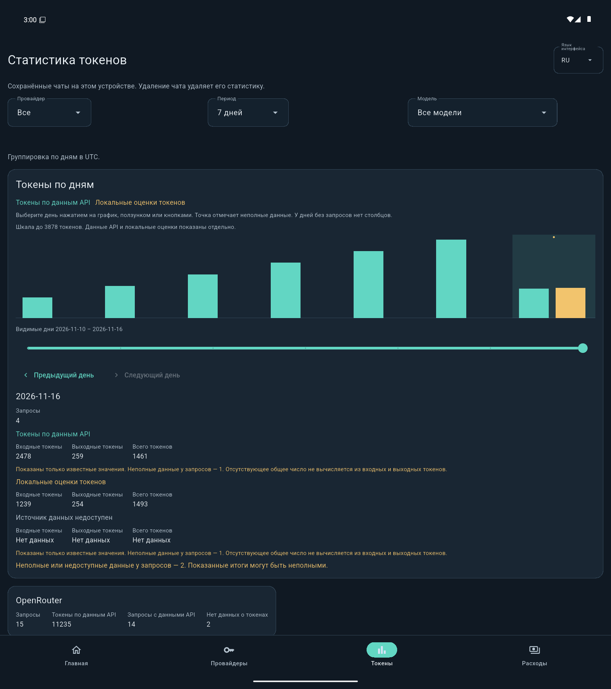
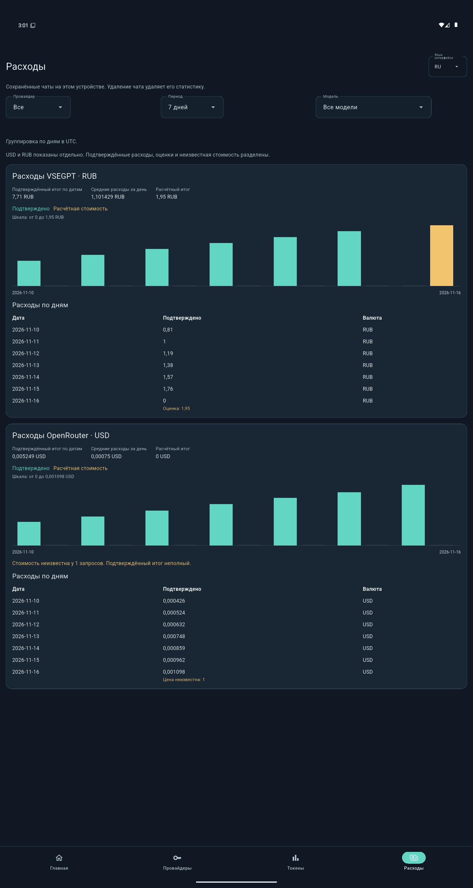

[English](analytics.md#english) · [Русский](analytics.ru.md#russian)

# Токены и дневные расходы

[Главная](../README.ru.md) · [Документация](../docs/README.ru.md)

> **0.1.1 доступна локально.** Руководство описывает текущие исходники и локальные сборки. [Опубликованный 0.1.0 Preview](https://github.com/Umichata/tokenlogue/releases/tag/v0.1.0-preview.a981db9) — прежний выпуск. По его ссылкам нельзя скачать 0.1.1.

## Область и фильтры

**Токены** и **Расходы** читают журнал запросов сохранённых чатов этого устройства. Активность других приложений не включается. Удаление чата также удаляет его местную статистику.

Один чат может содержать запросы к обоим сервисам. Каждая попытка сохраняет провайдера, модель, валюту и достоверно известную дату отправки. Смена текущего подключения не переписывает прежнюю статистику. USD и RUB остаются раздельными и после возврата к ранее использованному провайдеру.

Каждая страница сохраняет собственный выбор в списке **Провайдер**, период и совместимый фильтр модели. В списке есть **Все**, **OpenRouter** и **VSEGPT**. Доступны **7 дней**, **30 дней** и **Всё время**. Просмотр сервиса не меняет ключ, провайдера новых чатов или сервис открытого разговора.

Список моделей учитывает выбранный сервис и период. Одинаковый ID модели в OpenRouter и VSEGPT остаётся двумя вариантами. При смене провайдера несовместимый выбор модели сбрасывается.

## Токены

| Linux | Эмулятор Android |
| --- | --- |
|  |  |

*Демонстрационный журнал, не оплаченные запросы. Кадры Android сняты в эмуляторе.*

График **Токены по дням** группирует сохранённые попытки по известной дате отправки в показанном часовом поясе с теми же фильтрами, что и таблица моделей. Цвета отличают значения API от местных оценок. Нажмите день или используйте кнопки выбора дня, чтобы увидеть входные, выходные и общие токены, их источник и неполноту. Длинная история просматривается окном. Запрос с неизвестным количеством токенов отличается от дня без запросов. Отсутствующее общее количество не восстанавливается как значение API.

Просмотрите выбранный день в [Linux](assets/screenshots/v011-55-linux-daily-tokens-day-ru.png) или в [эмуляторе Android](assets/screenshots/v011-55-android-selected-token-day-ru.png).

Страница показывает отдельные итоги провайдеров, число запросов, входные, выходные и общие токены по данным API и таблицу моделей. Полосы популярных моделей учитывают выбранные фильтры.

Данные API, местные оценки и отсутствие сведений разделены. Оценки не увеличивают сумму токенов API. Сведения о кэше и рассуждениях не прибавляются повторно. Известные токены видны даже при неизвестной стоимости. Поля API не являются независимой проверкой токенизатора. Цены за символы не пересчитываются в токены.

Исторические запросы без достоверной даты отправки доступны только за **Всё время**. Им не присваивается выдуманный день. Пустой результат означает отсутствие сохранённых запросов по выбранным условиям.

## Дневные расходы

| Linux | Эмулятор Android |
| --- | --- |
|  |  |

*Демонстрационный журнал, не оплаченные запросы. Кадры Android сняты в эмуляторе.*

В примерах выбраны **Все**, **7 дней** и **Все модели**. У каждой валюты своя панель и шкала. Прокрутите страницу для сравнения панелей и таблиц по датам. [Дополнительный кадр Linux](assets/screenshots/v011-55-linux-spending-table-ru.png) показывает другую часть того же демонстрационного журнала.

В режиме **Все** показаны отдельные панели OpenRouter в USD и VSEGPT в RUB. При выборе одного сервиса остаётся только он. Общей денежной суммы, единой валютной шкалы и пересчёта курса нет.

В каждой панели есть дневной график, подтверждённая сумма датированных расходов, средний расход за день и таблица даты, суммы и валюты. Оценки имеют отдельный ряд и итог. Дни без запросов показывают ноль. Неизвестная стоимость помечает сумму как неполную и не превращается в бесплатный запрос.

Группировка использует указанный на странице часовой пояс и исходное время отправки. Позднее уточнение учёта остаётся на том же дне. Недатированные исторические суммы вынесены отдельно и не участвуют в графике и среднем за день.

Это местная записанная активность. Она не заменяет выписку и биллинг сервиса. Повтор, дошедший до провайдера, считается новым запросом. [Бюджет чата](user-guide.ru.md) и [балансы провайдеров](providers.ru.md) описывают другие значения.
