[English](gallery.md) · [Русский](gallery.ru.md)

# Tokenlogue Dart screens

These Android screenshots follow a demonstration profile from the first connection to a working chat. Select an image to open it at full size.

##  Connect a provider

| First connection | Saved OpenRouter key | Saved VSEGPT key |
| --- | --- | --- |
| <a href="images/v10/onboarding-en.png">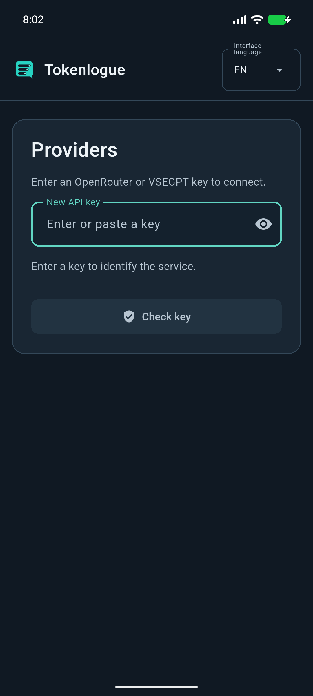</a> | <a href="images/v10/openrouter-saved-en.png">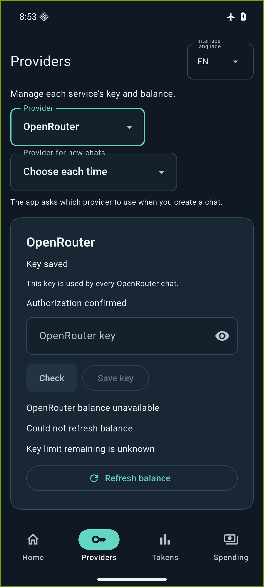</a> | <a href="images/v10/vsegpt-saved-en.png">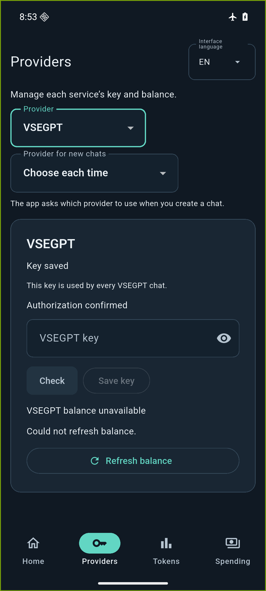</a> |

| Check a saved key |
| --- |
| <a href="images/v10/openrouter-check-en.png">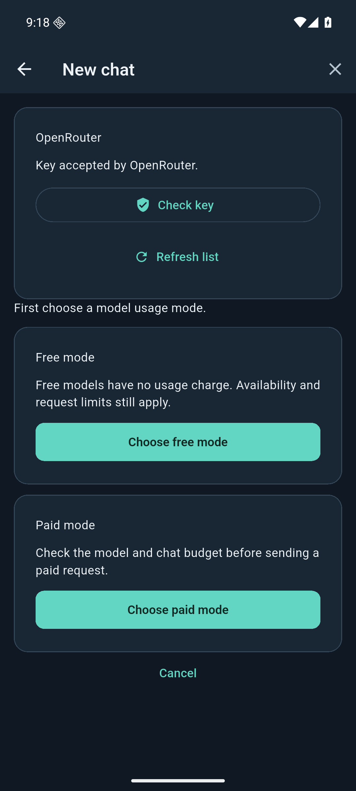</a> |

##  Chat and drafts

| Conversation and draft | Large text and the on-screen keyboard | Chat menu and demonstration key mask |
| --- | --- | --- |
| <a href="images/v10/chat-en.png">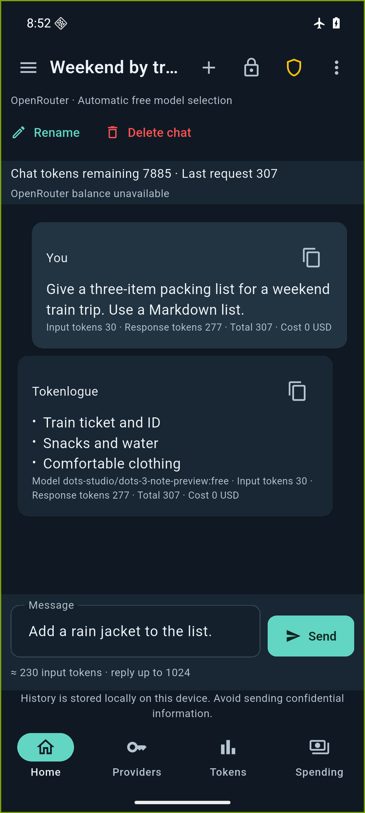</a> | <a href="images/v10/chat-large-keyboard-en.png">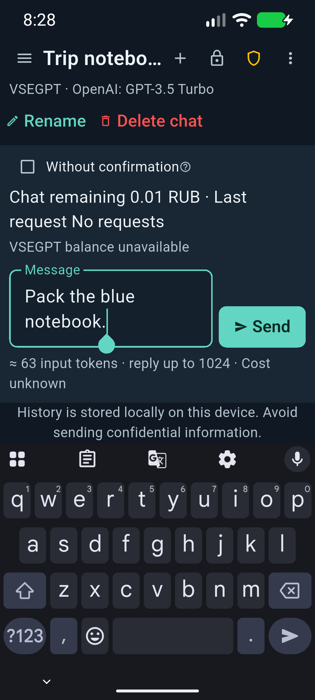</a> | <a href="images/v10/demo-connection-en.png">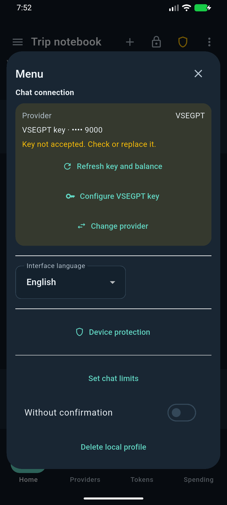</a> |

| Review the new chat connection |
| --- |
| <a href="images/v10/connection-review-en.png">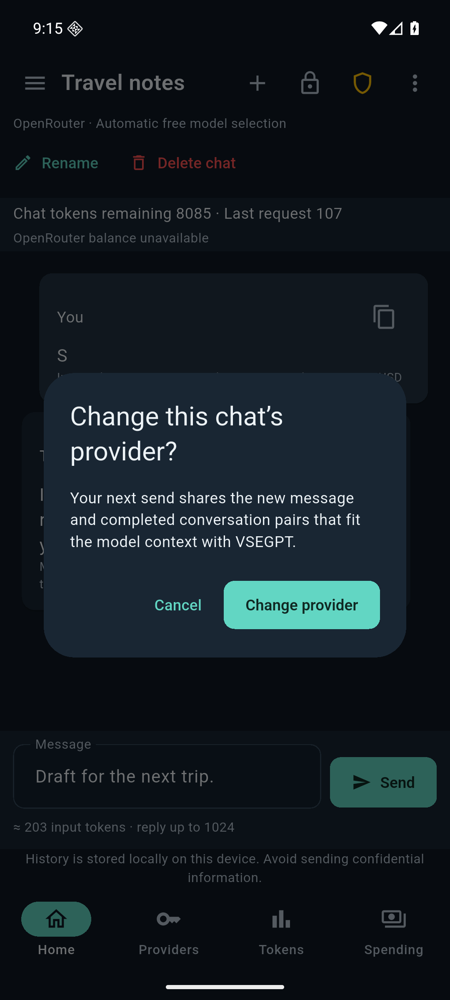</a> |

##  Choose a model

| Choose a service for a new chat | OpenRouter modes | Free OpenRouter models |
| --- | --- | --- |
| <a href="images/v10/choose-provider-en.png">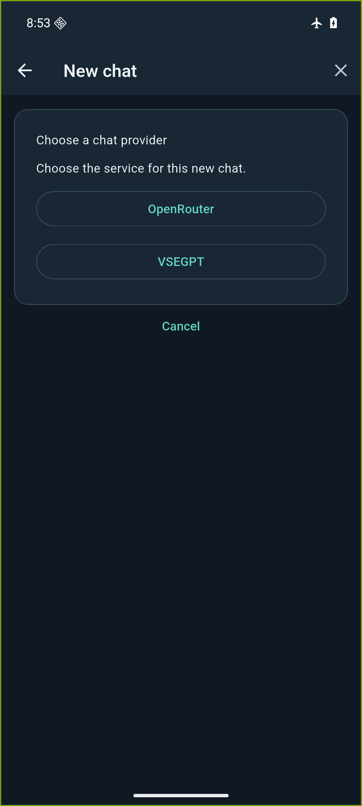</a> | <a href="images/v10/openrouter-mode-en.png">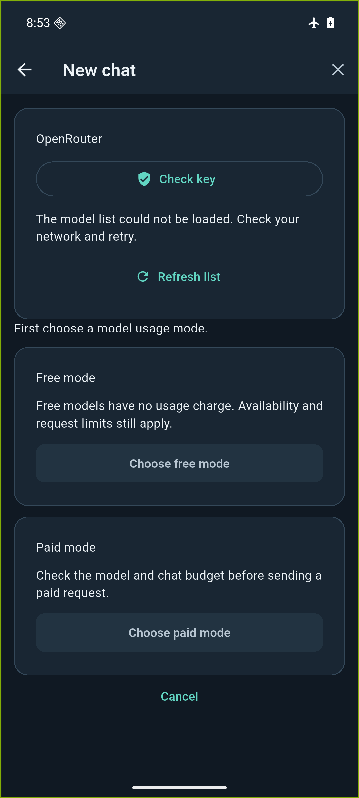</a> | <a href="images/v10/openrouter-free-en.png">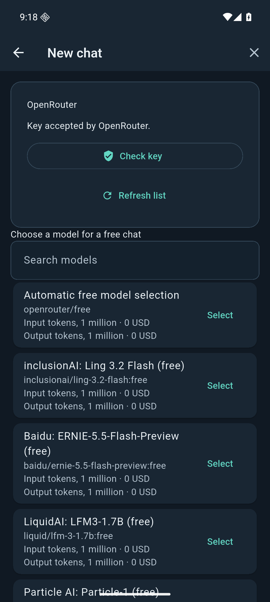</a> |

| Paid OpenRouter models | Refreshed VSEGPT catalogue |
| --- | --- |
| <a href="images/v10/openrouter-paid-en.png">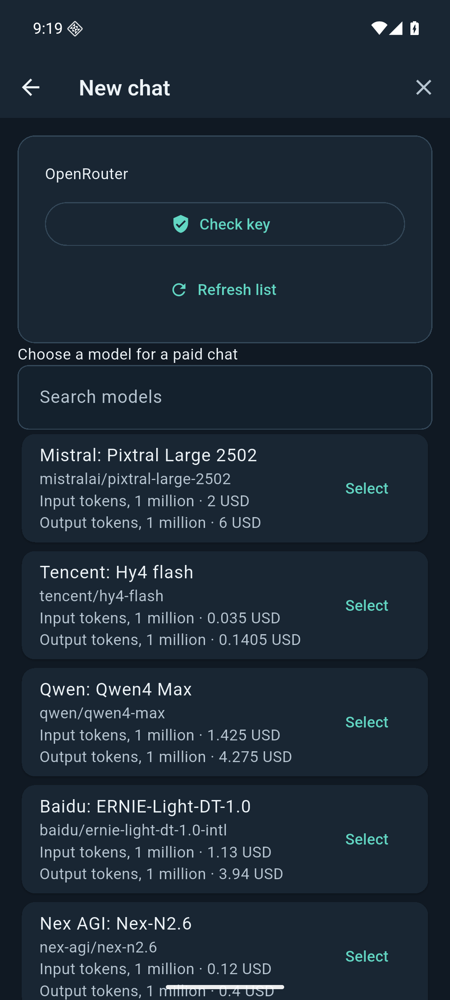</a> |  |

##  Tokens, spending and limits

| Tokens by day | Spending by day | Budget warning before sending |
| --- | --- | --- |
| <a href="images/v10/tokens-en.png">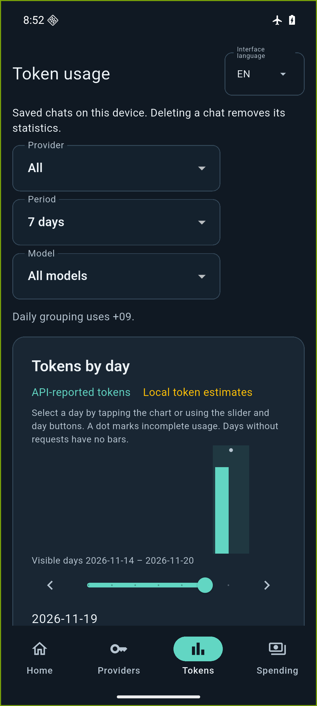</a> | <a href="images/v10/spending-en.png">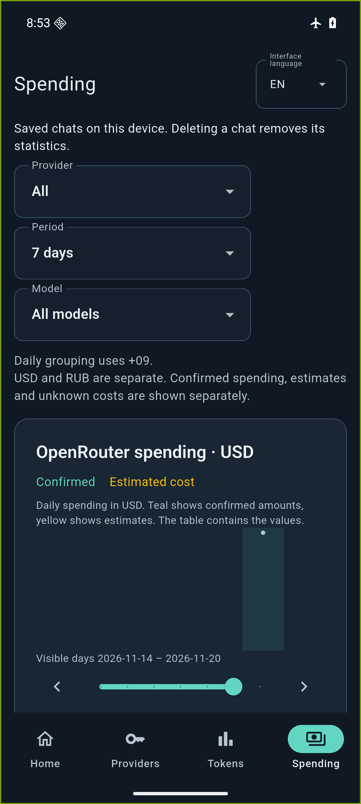</a> | <a href="images/v10/warning-en.png">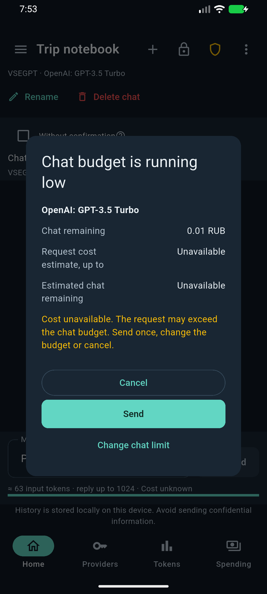</a> |

| Edit the chat limit |
| --- |
| <a href="images/v10/edit-budget-en.png">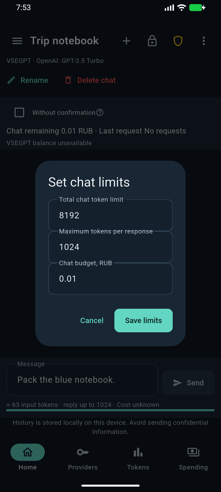</a> |

| Daily details in USD | Ruble spending with no requests |
| --- | --- |
| <a href="images/v10/usd-day-en.png">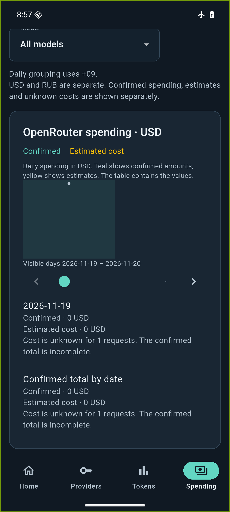</a> | <a href="images/v10/rub-empty-en.png">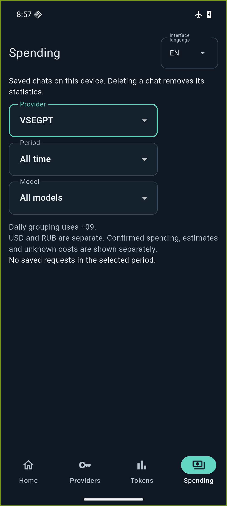</a> |

##  Protect your profile

| Recover access with Android |
| --- |
| <a href="images/v10/recovery-en.png">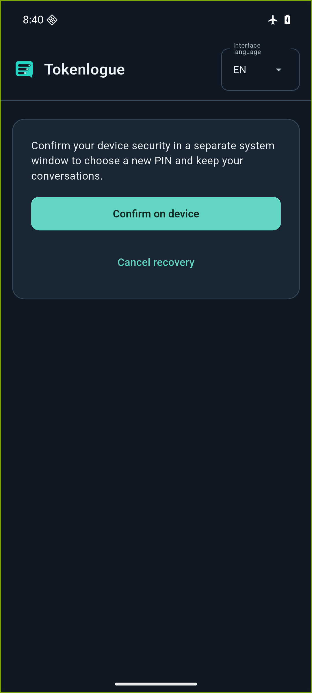</a> |

| Confirm local profile deletion |
| --- |
| <a href="images/v10/delete-confirm-en.png">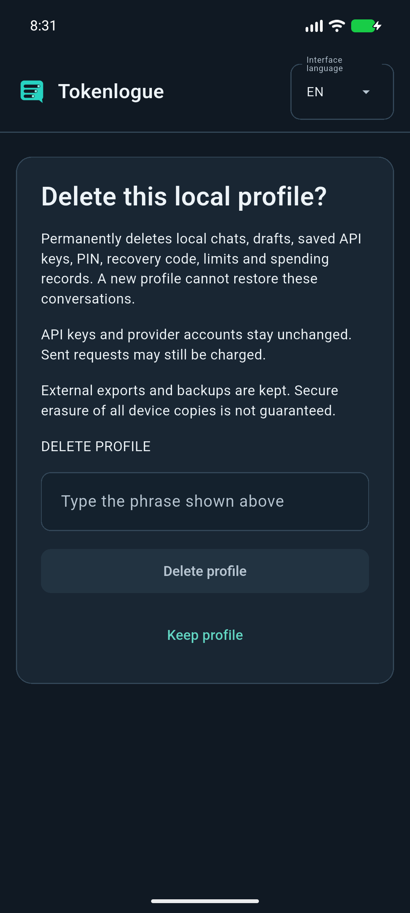</a> |

| Unlock your profile |
| --- |
| <a href="images/v10/sign-in-en.png">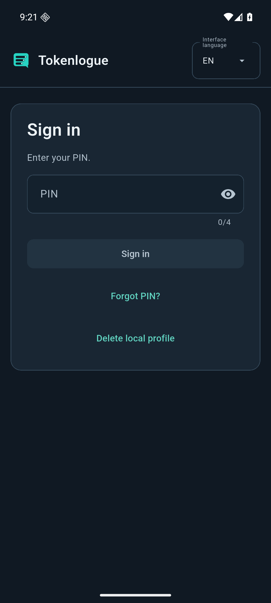</a> |

[Using the app](README.md) · [Project overview](../../README.md)
