[English](gallery.md) · [Русский](gallery.ru.md)

# Tokenlogue Dart screens

These Android screenshots follow a demonstration profile from the first connection to a working chat. Select an image to open it at full size.

The [image register](screenshots.csv) lists each capture and its build. The provider picker, model catalogues and filters are from 0.1.1+15. The chat limits form is from 0.1.1+18. The populated conversation and its usage charts were captured on 0.1.1+13.

##  Connect a provider

<table width="100%">
  <tr><td colspan="2" align="center"></td></tr>
  <tr>
    <td width="50%" align="center" valign="top">
       
      <strong>First connection</strong>
    </td>
    <td width="50%" align="center" valign="top">
       
      <strong>Check the key</strong>
    </td>
  </tr>
  <tr>
    <td width="50%" align="center" valign="top">
       
      <strong>OpenRouter key</strong>
    </td>
    <td width="50%" align="center" valign="top">
       
      <strong>VSEGPT key</strong>
    </td>
  </tr>
  <tr><td colspan="2" align="center"></td></tr>
</table>

##  Chat and drafts

<table width="100%">
  <tr><td colspan="3" align="center"></td></tr>
  <tr>
    <td width="33%" align="center" valign="top">
      <a href="images/v13/chat-en.png">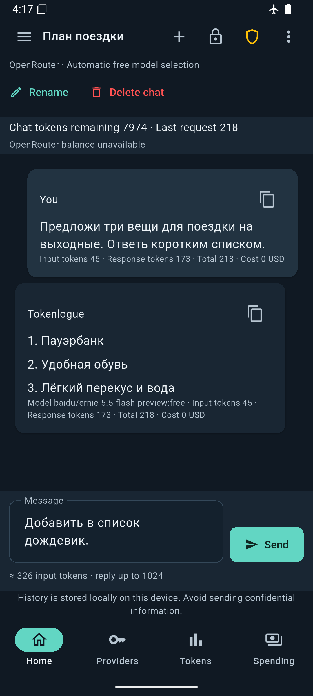</a> 
      <strong>Chat and draft</strong>
    </td>
    <td width="33%" align="center" valign="top">
       
      <strong>Chat menu and key</strong>
    </td>
    <td width="33%" align="center" valign="top">
      <a href="images/v13/connection-review-en.png">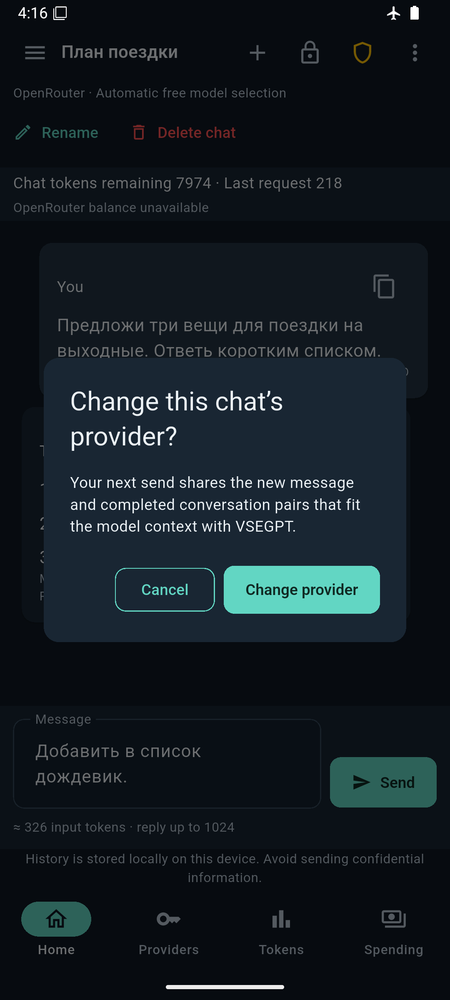</a> 
      <strong>Switch service</strong>
    </td>
  </tr>
  <tr>
    <td colspan="3" width="100%" align="center" valign="top">
       
      <strong>Large text and keyboard</strong>
    </td>
  </tr>
  <tr><td colspan="3" align="center"></td></tr>
</table>

##  Choose a model

<table width="100%">
  <tr><td colspan="6" align="center"></td></tr>
  <tr>
    <td colspan="3" width="50%" align="center" valign="top">
      <a href="images/v15/manual-provider-en-phone.png">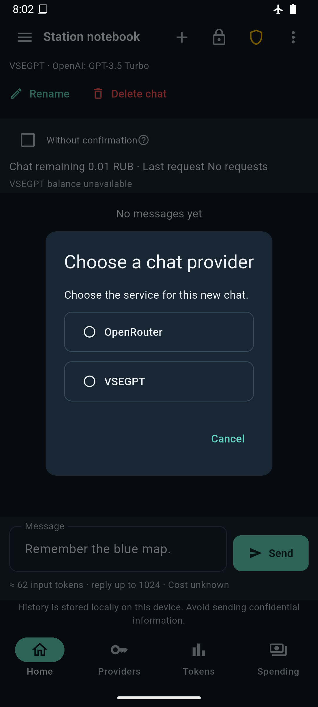</a> 
      <strong>Choose a service</strong>
    </td>
    <td colspan="3" width="50%" align="center" valign="top">
      <a href="images/v15/vsegpt-models-en-phone.png">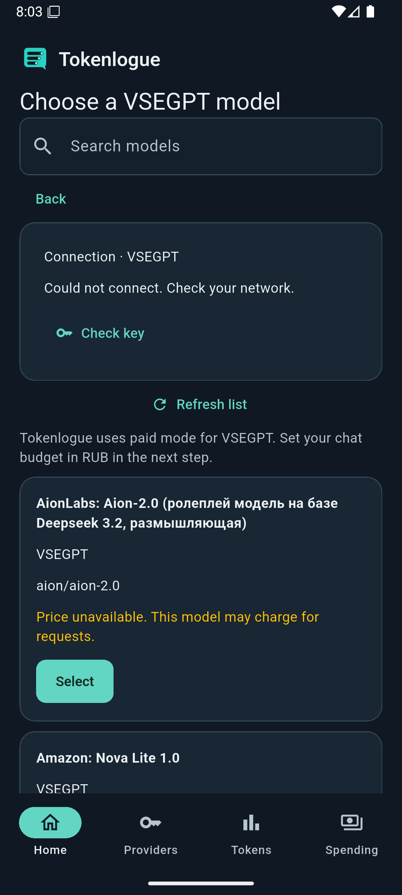</a> 
      <strong>VSEGPT catalogue</strong>
    </td>
  </tr>
  <tr>
    <td colspan="2" width="33%" align="center" valign="top">
      <a href="images/v15/openrouter-mode-en-phone.png">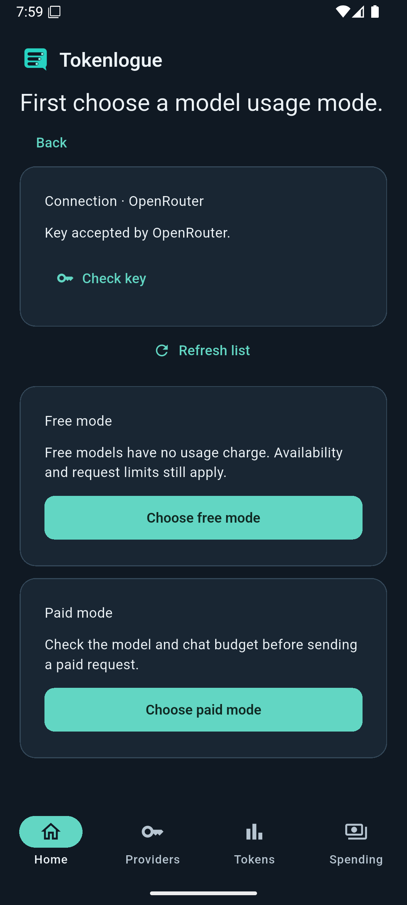</a> 
      <strong>Choose a mode</strong>
    </td>
    <td colspan="2" width="33%" align="center" valign="top">
      <a href="images/v15/openrouter-free-en-phone.png">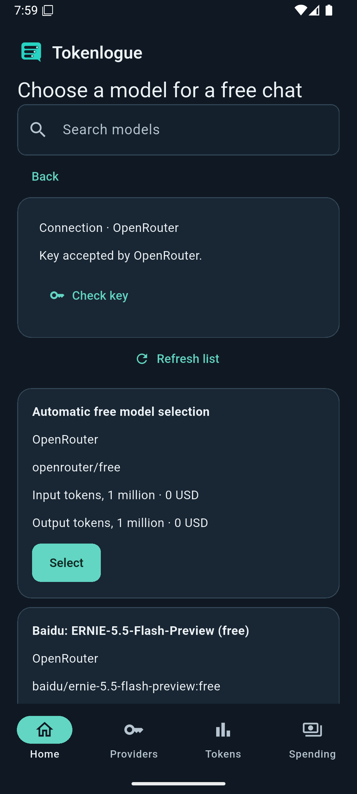</a> 
      <strong>Free models</strong>
    </td>
    <td colspan="2" width="33%" align="center" valign="top">
      <a href="images/v15/openrouter-paid-en-phone.png">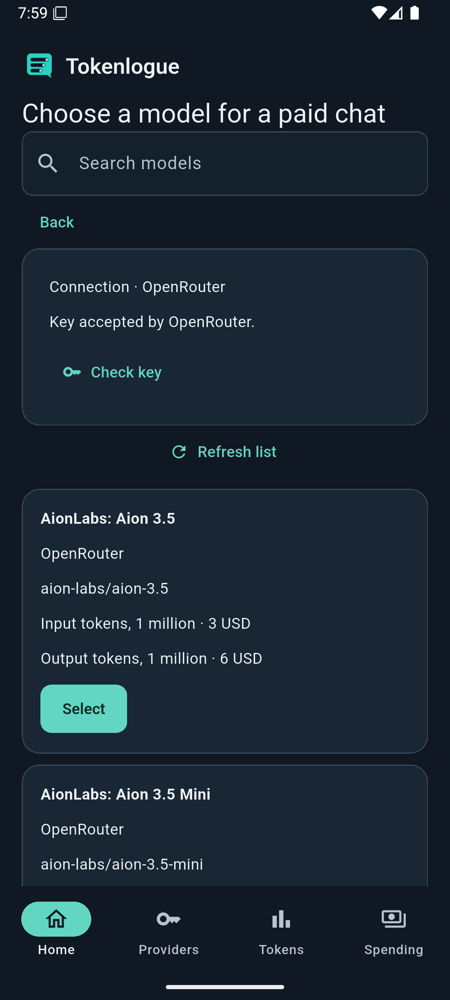</a> 
      <strong>Paid models</strong>
    </td>
  </tr>
  <tr><td colspan="6" align="center"></td></tr>
</table>

##  Tokens, spending and limits

<table width="100%">
  <tr><td colspan="6" align="center"></td></tr>
  <tr>
    <td colspan="2" width="33%" align="center" valign="top">
      <a href="images/v13/tokens-filled-en.png">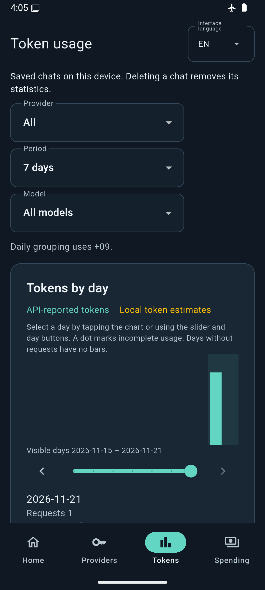</a> 
      <strong>Tokens by day</strong>
    </td>
    <td colspan="2" width="33%" align="center" valign="top">
      <a href="images/v13/spending-filled-en.png">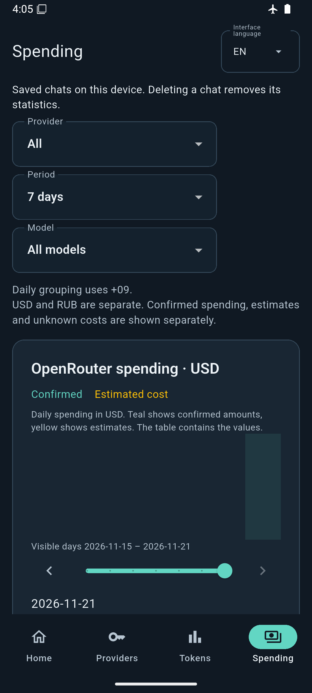</a> 
      <strong>Spending by day</strong>
    </td>
    <td colspan="2" width="33%" align="center" valign="top">
      <a href="images/v13/usd-day-en.png">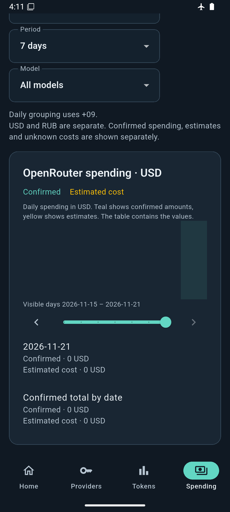</a> 
      <strong>Daily USD total</strong>
    </td>
  </tr>
  <tr>
    <td colspan="3" width="50%" align="center" valign="top">
      <a href="images/v13/budget-en.png">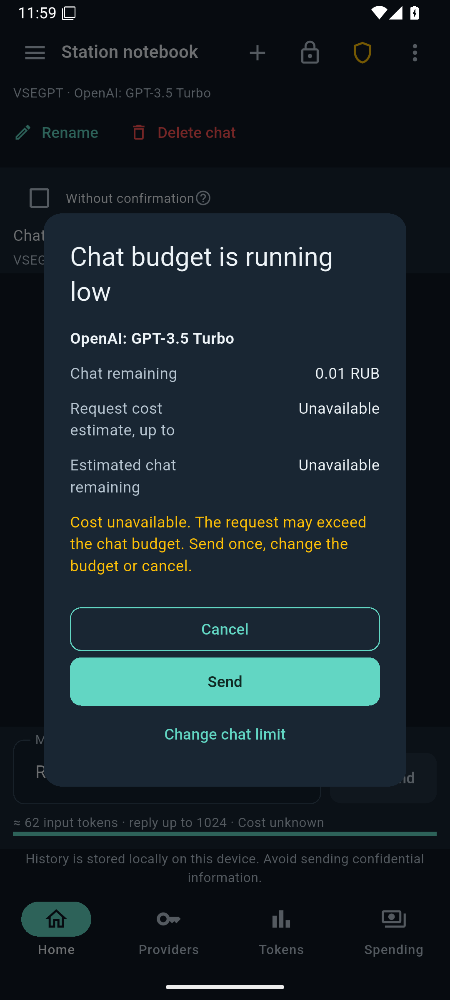</a> 
      <strong>Budget warning</strong>
    </td>
    <td colspan="3" width="50%" align="center" valign="top">
      <a href="images/v13/edit-limits-en.png">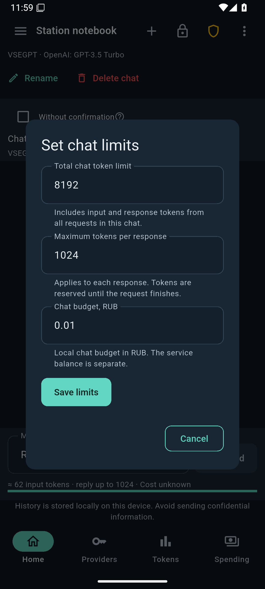</a> 
      <strong>Edit chat budget</strong>
    </td>
  </tr>
  <tr>
    <td colspan="3" width="50%" align="center" valign="top">
      <a href="images/v13/rub-empty-en.png">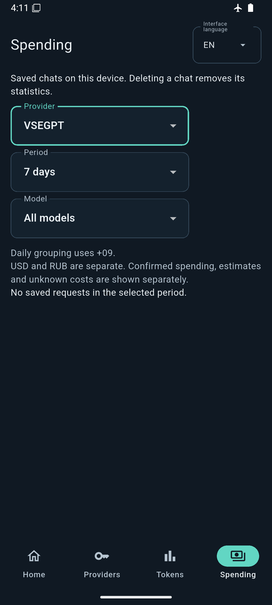</a> 
      <strong>Days with no requests</strong>
    </td>
    <td colspan="3" width="50%" align="center" valign="top">
      <a href="images/qa-v13/ruble-day-en.png">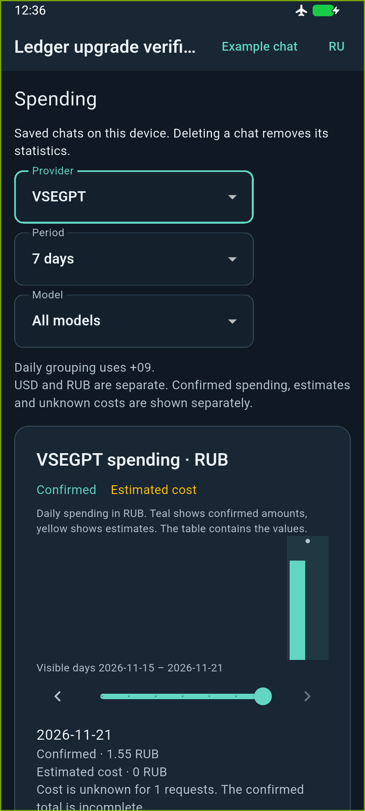</a> 
      <strong>RUB spending · QA example</strong>
    </td>
  </tr>
  <tr><td colspan="6" align="center"></td></tr>
</table>

The separate QA build 0.1.1+13 displays two demonstration entries of 1.20 and 0.35 RUB. Their daily total is 1.55 RUB.

##  Protect your profile

<table width="100%">
  <tr><td colspan="3" align="center"></td></tr>
  <tr>
    <td width="33%" align="center" valign="top">
       
      <strong>Unlock the app</strong>
    </td>
    <td width="33%" align="center" valign="top">
       
      <strong>Recover access</strong>
    </td>
    <td width="33%" align="center" valign="top">
       
      <strong>Delete the profile</strong>
    </td>
  </tr>
  <tr><td colspan="3" align="center"></td></tr>
</table>

##  Conversation and protection dialogs

<table width="100%">
  <tr><td colspan="3" align="center"></td></tr>
  <tr>
    <td width="33%" align="center" valign="top">
       
      <strong>Rename chat</strong>
    </td>
    <td width="33%" align="center" valign="top">
      <a href="images/v13/delete-chat-en.png">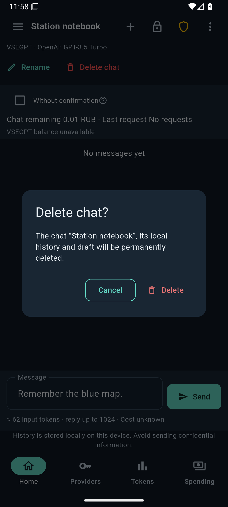</a> 
      <strong>Delete chat</strong>
    </td>
    <td width="33%" align="center" valign="top">
      <a href="images/v13/new-pin-en.png">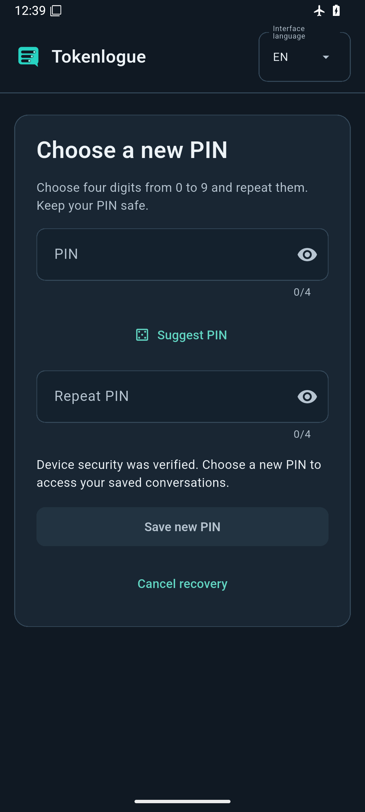</a> 
      <strong>Set a new PIN</strong>
    </td>
  </tr>
  <tr><td colspan="3" align="center"></td></tr>
</table>

##  Provider and chat setup

<table width="100%">
  <tr><td colspan="6" align="center"></td></tr>
  <tr>
    <td colspan="2" width="33%" align="center" valign="top">
       
      <strong>Choose a PIN</strong>
    </td>
    <td colspan="2" width="33%" align="center" valign="top">
      <a href="images/v13/vsegpt-unverified-en.png">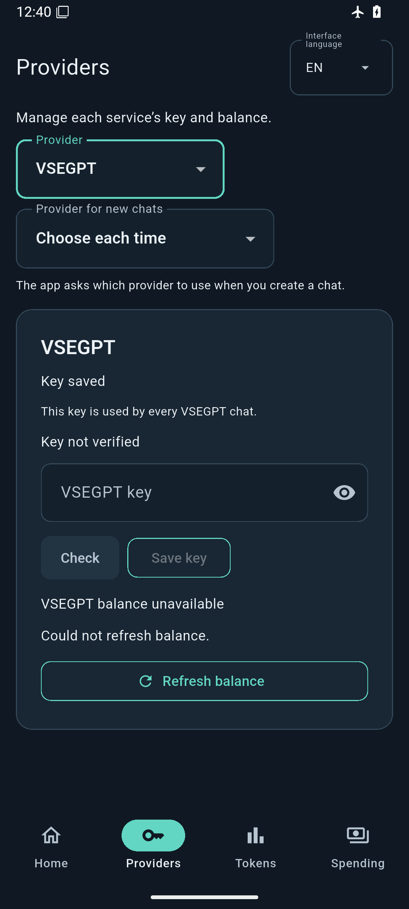</a> 
      <strong>VSEGPT key status</strong>
    </td>
    <td colspan="2" width="33%" align="center" valign="top">
       
      <strong>Start a new profile</strong>
    </td>
  </tr>
  <tr>
    <td colspan="3" width="50%" align="center" valign="top">
      <a href="images/v18/configure-limits-en.png">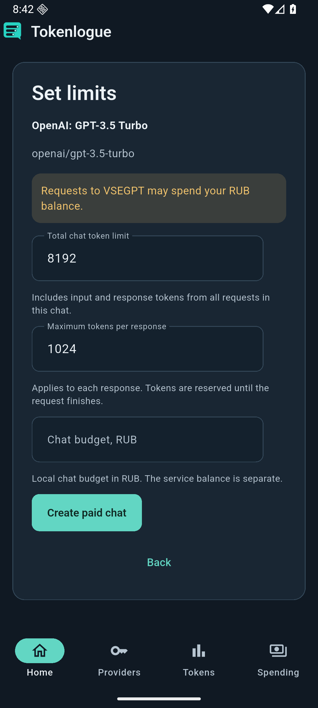</a> 
      <strong>New chat limits</strong>
    </td>
    <td colspan="3" width="50%" align="center" valign="top">
      <a href="images/v18/budget-required-en.png">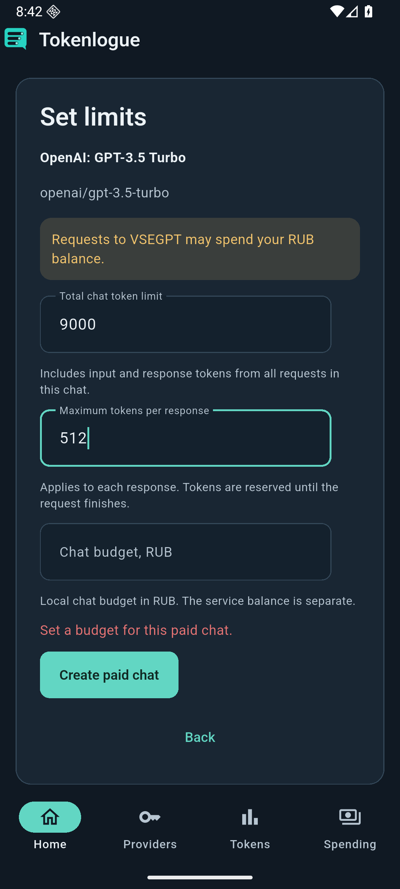</a> 
      <strong>Missing budget</strong>
    </td>
  </tr>
  <tr><td colspan="6" align="center"></td></tr>
</table>

The Android Dart 0.1.1+18 form shows the model name and ID. If the VSEGPT budget is empty, **Create paid chat** keeps the entered limits and shows which value is missing.

##  Provider selection and filters

These 0.1.1+15 screens show the current connection and the statistics filters. The filters stack on a phone and share one row on a wide tablet.

<table width="100%">
  <tr><td colspan="2" align="center"></td></tr>
  <tr>
    <td width="50%" align="center" valign="top">
      <a href="images/v15/current-provider-en-phone.png">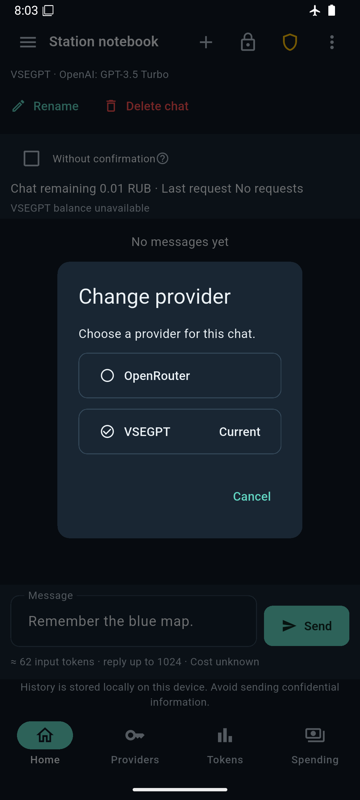</a> 
      <strong>Current service</strong>
    </td>
    <td width="50%" align="center" valign="top">
      <a href="images/v15/tokens-provider-open-en-phone.png">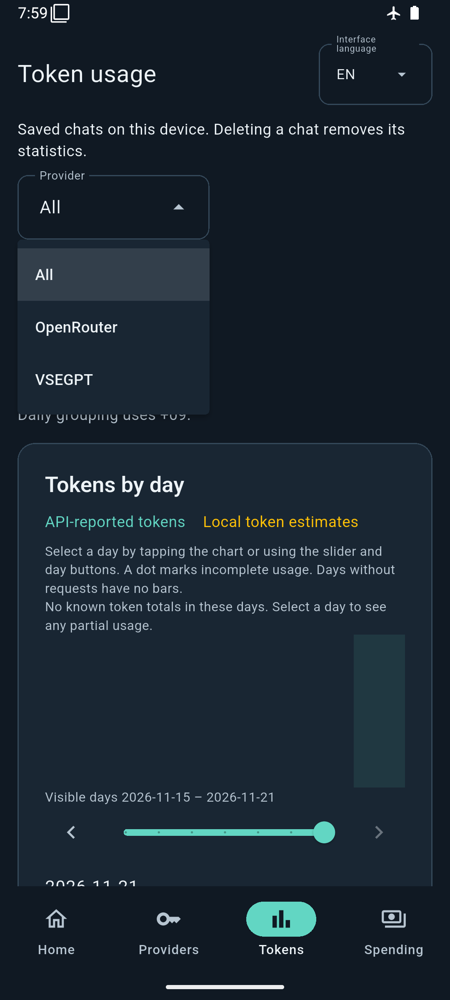</a> 
      <strong>Filter by service</strong>
    </td>
  </tr>
  <tr>
    <td colspan="2" width="100%" align="center" valign="top">
      <a href="images/v15/tokens-closed-en-tablet.png">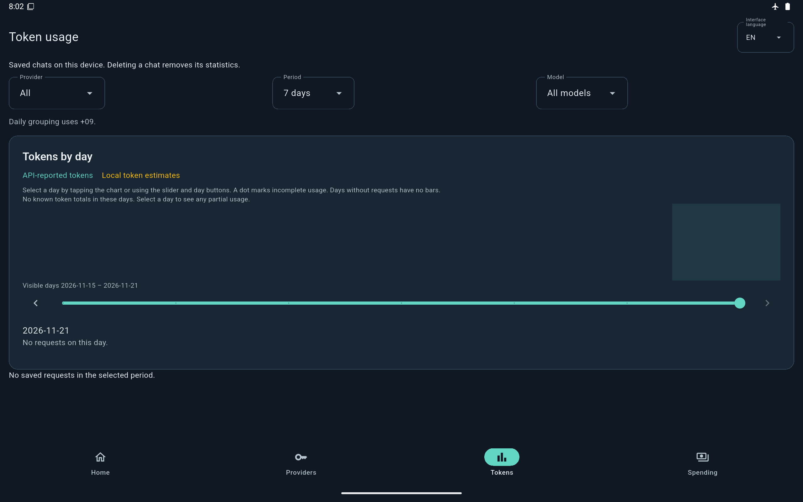</a> 
      <strong>Filters on a tablet</strong>
    </td>
  </tr>
  <tr><td colspan="2" align="center"></td></tr>
</table>

[Using the app](README.md) · [Project overview](../../README.md)
