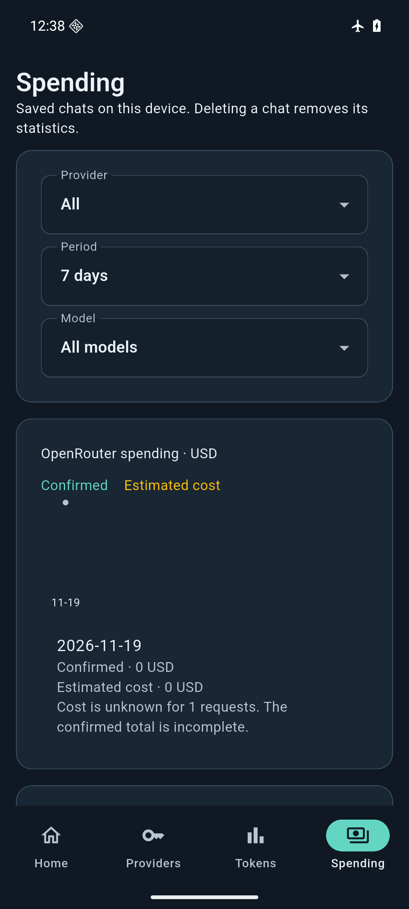
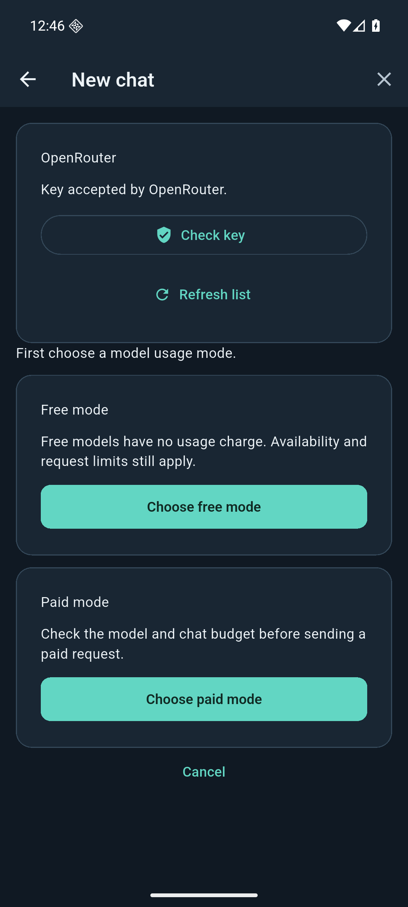
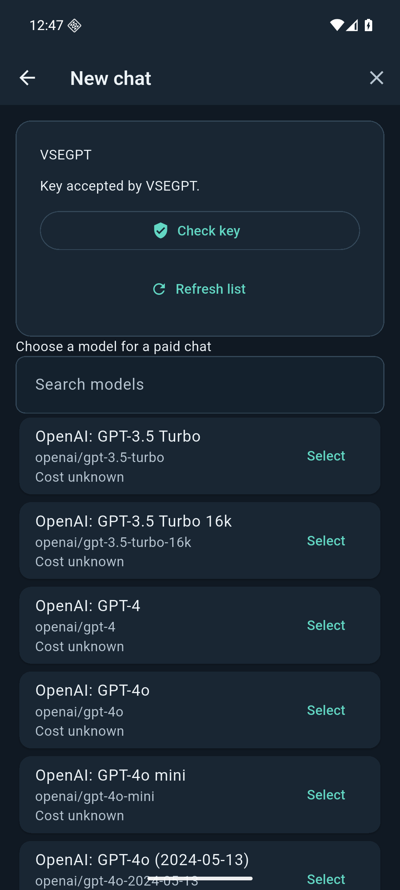
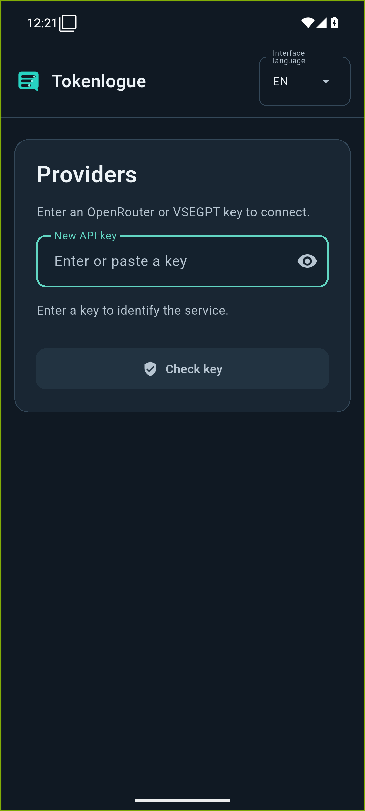
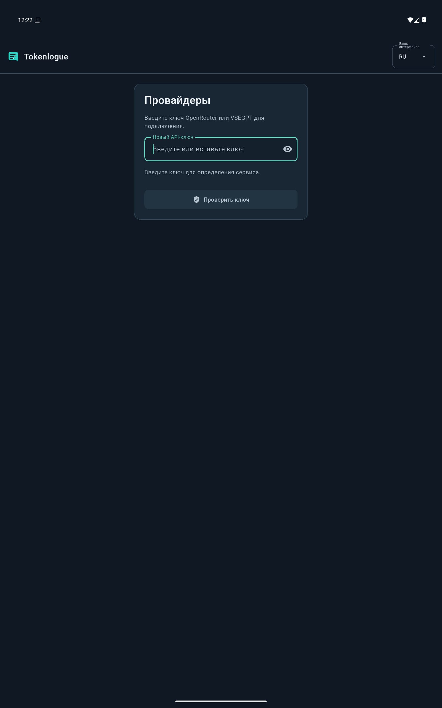
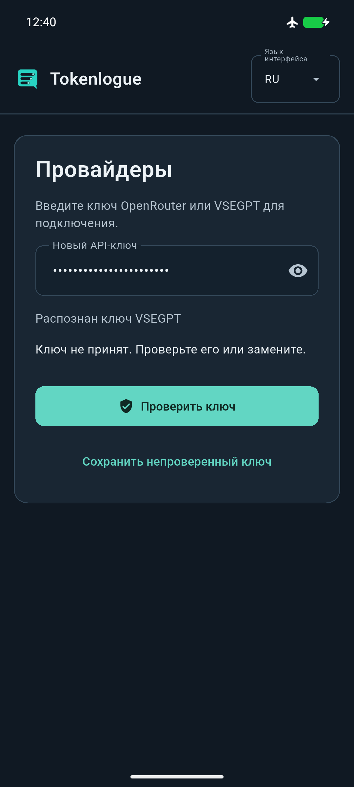
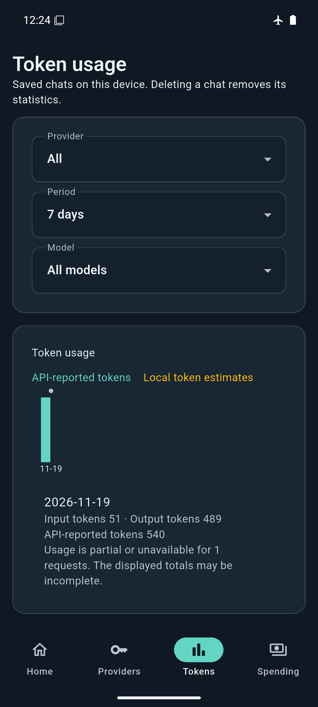
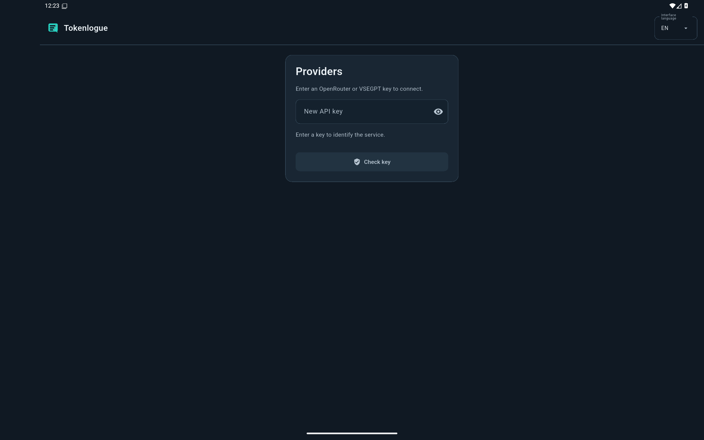

[English](gallery.md) · [Русский](gallery.ru.md)

# Tokenlogue Dart screens

These screenshots show Tokenlogue Dart 0.1.1 running on Android emulators. The travel conversation uses demonstration data. Select an image to see it at full size.

## Chat, providers and activity

These Android screens show a demonstration profile. The saved drafts and daily activity remain available offline. Refresh the provider connection when online to see current account information.

| A conversation and its saved draft | Token use by day | Spending in the provider currency |
| --- | --- | --- |
|  |  |  |

| Saved OpenRouter connection | Saved VSEGPT connection | Choose a service for a new chat |
| --- | --- | --- |
|  |  |  |

| Free and paid OpenRouter modes | Check the saved OpenRouter key | Free OpenRouter models |
| --- | --- | --- |
|  |  |  |

| Paid OpenRouter models | Refreshed VSEGPT catalogue | Chat with enlarged text and the on-screen keyboard |
| --- | --- | --- |
|  |  |  |

| Confirm your identity to recover access |
| --- |
|  |

##  Connect and protect your profile

| Initial connection on a phone · EN | Initial connection on a tablet · RU | Explicitly saving an unverified VSEGPT credential · RU |
| --- | --- | --- |
|  |  |  |

| Choosing an app PIN · EN | The same open form in Russian · RU | Device protection panel · EN |
| --- | --- | --- |
|  |  |  |

##  Chat and statistics

| A train trip conversation and an unfinished draft · EN | Daily token chart and filters · EN |
| --- | --- |
|  |  |

##  Landscape and text size

| Landscape tablet · EN | Landscape phone with enlarged text · RU |
| --- | --- |
|  |  |

[Using the app](README.md) · [Project](../../README.md)
