[English](gallery.md) · [Русский](gallery.ru.md)

# Tokenlogue Dart screens

These Android screenshots follow a demonstration profile from the first connection to a working chat. Select an image to open it at full size.

##  Connect a provider

| First connection | Saved OpenRouter key | Saved VSEGPT key |
| --- | --- | --- |
| <a href="images/v9/onboarding-en.png">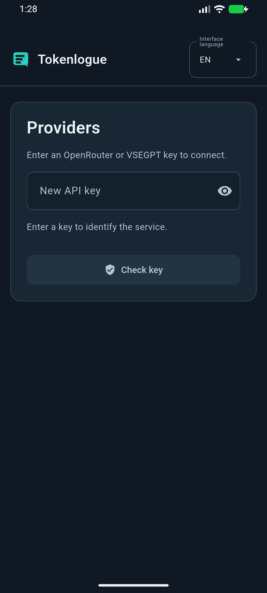</a> | <a href="images/v9/openrouter-saved-en.png">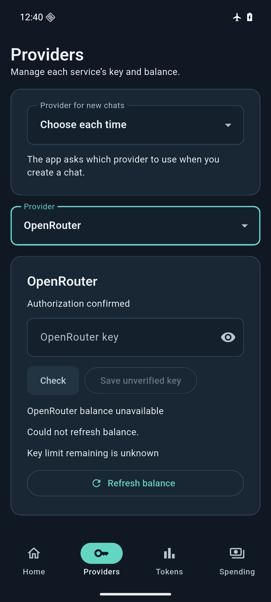</a> | <a href="images/v9/vsegpt-saved-en.png">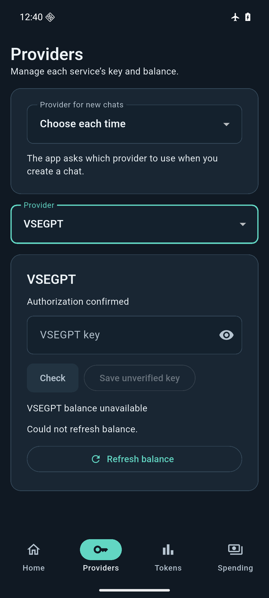</a> |

| Check a saved key |
| --- |
|  |

##  Chat and drafts

| Conversation and draft | Large text and the on-screen keyboard |
| --- | --- |
| <a href="images/v9/chat-en.png">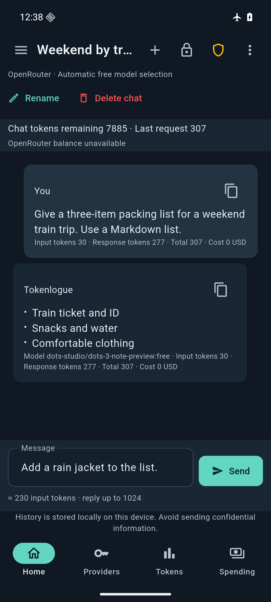</a> | <a href="images/v9/chat-large-keyboard-en.png">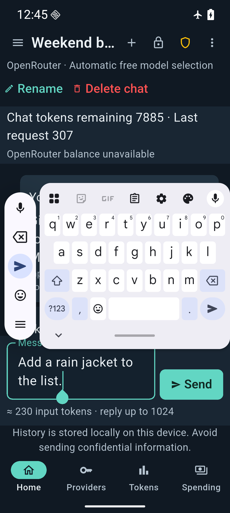</a> |

##  Choose a model

| Choose a service for a new chat | OpenRouter modes | Free OpenRouter models |
| --- | --- | --- |
| <a href="images/v9/choose-provider-en.png">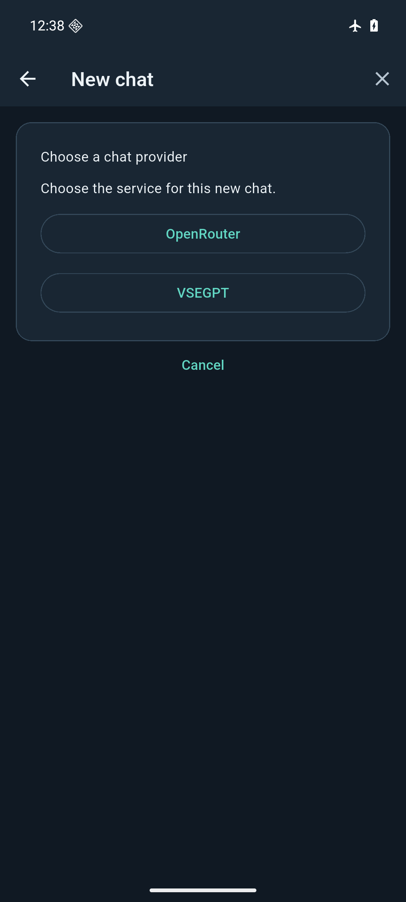</a> | <a href="images/v9/openrouter-mode-en.png">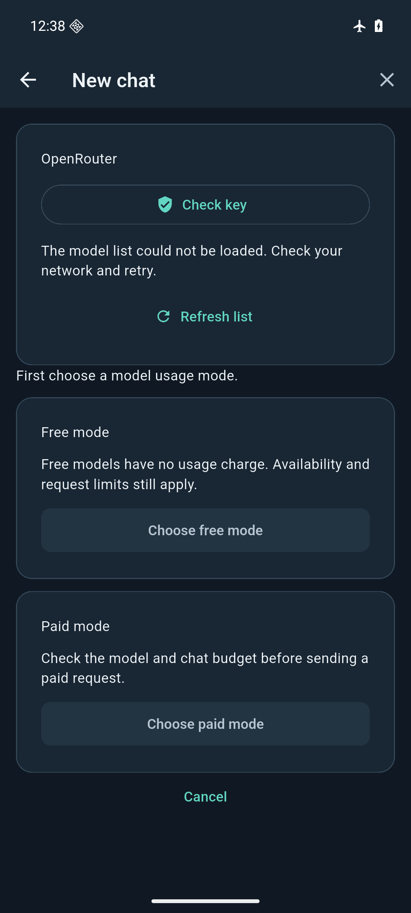</a> | <a href="images/v9/openrouter-free-en.png">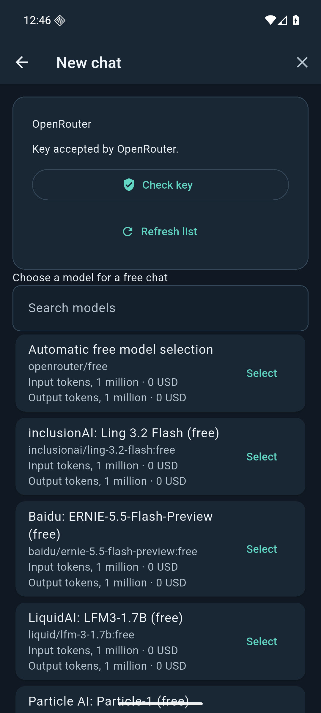</a> |

| Paid OpenRouter models | Refreshed VSEGPT catalogue |
| --- | --- |
| <a href="images/v9/openrouter-paid-en.png">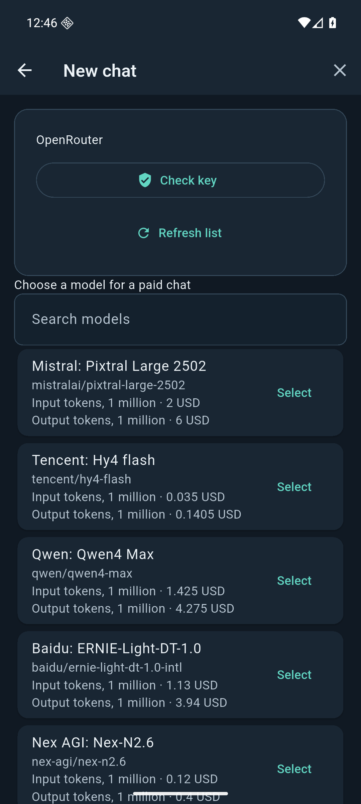</a> |  |

##  Tokens, spending and limits

| Tokens by day | Spending by day |
| --- | --- |
| <a href="images/v9/tokens-en.png">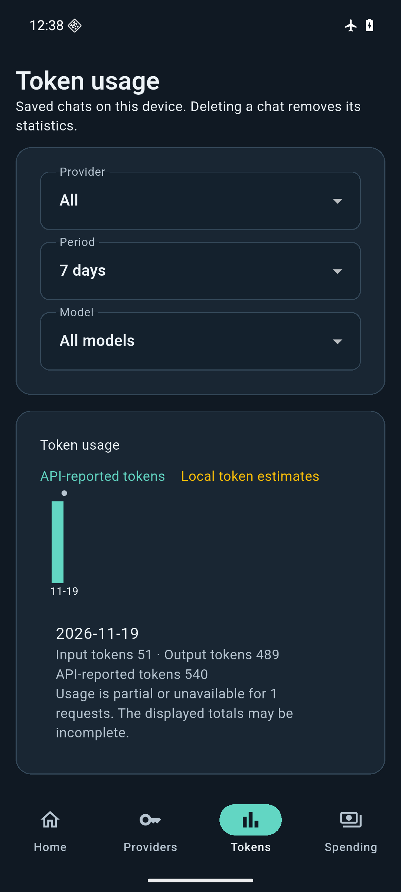</a> |  |

##  Protect your profile

| Recover access with Android |
| --- |
| <a href="images/v9/recovery-en.png">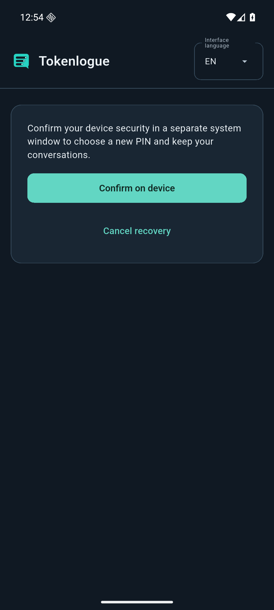</a> |

[Using the app](README.md) · [Project overview](../../README.md)
