[English](gallery.md) · [Русский](gallery.ru.md)

# Tokenlogue Dart screens

These Android screenshots follow a demonstration profile from the first connection to a working chat. Select an image to open it at full size.

##  Connect a provider

| First connection | Saved OpenRouter key | Saved VSEGPT key |
| --- | --- | --- |
| <a href="images/v13/onboarding-en.png">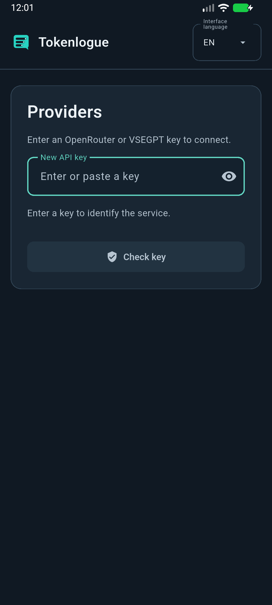</a> | <a href="images/v13/openrouter-saved-en.png">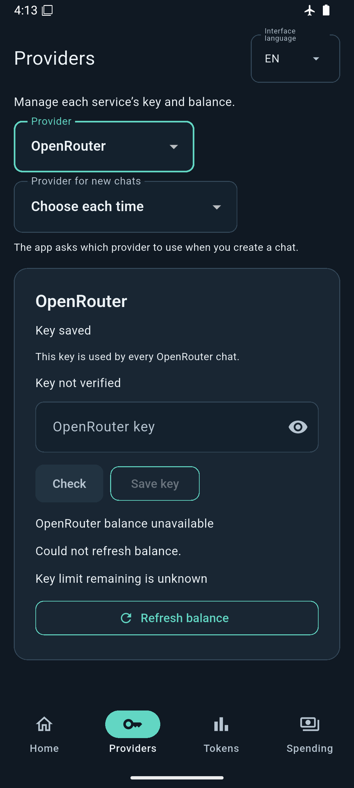</a> |  |

| Check a saved key |
| --- |
| <a href="images/v13/openrouter-check-en.png">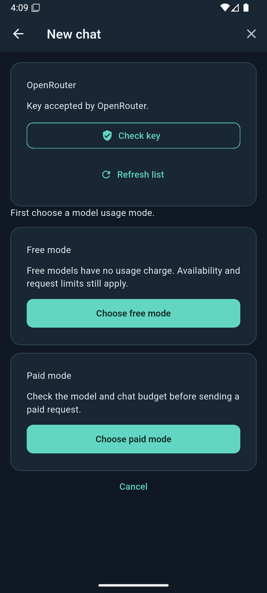</a> |

##  Chat and drafts

| Conversation and draft | Large text and the on-screen keyboard | Chat menu and demonstration key mask |
| --- | --- | --- |
|  | <a href="images/v13/chat-large-keyboard-en.png">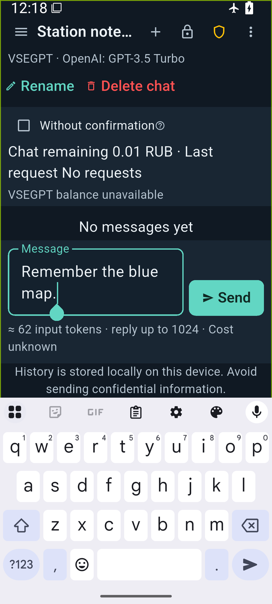</a> | <a href="images/v13/demo-connection-en.png">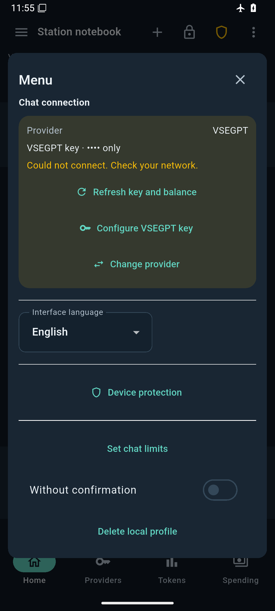</a> |

| Review the new chat connection |
| --- |
|  |

##  Choose a model

| Choose a service for a new chat | OpenRouter modes | Free OpenRouter models |
| --- | --- | --- |
| <a href="images/v13/choose-provider-en.png">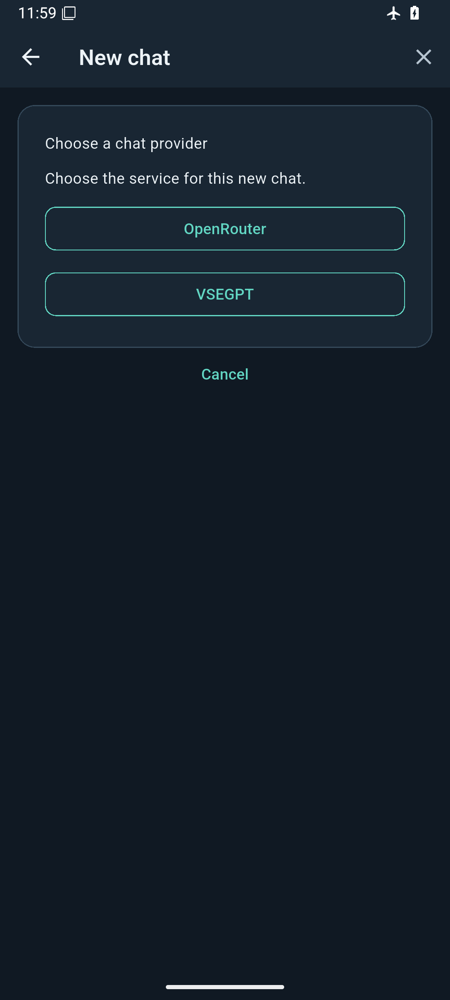</a> | <a href="images/v13/openrouter-mode-en.png">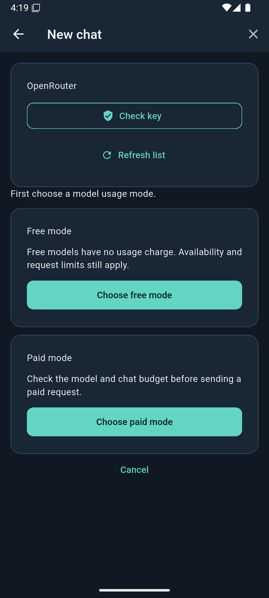</a> | <a href="images/v13/openrouter-free-en.png">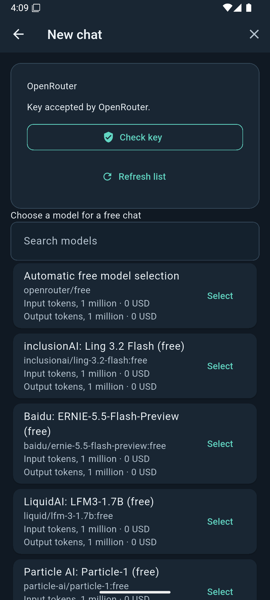</a> |

| Paid OpenRouter models | Refreshed VSEGPT catalogue |
| --- | --- |
| <a href="images/v13/openrouter-paid-en.png">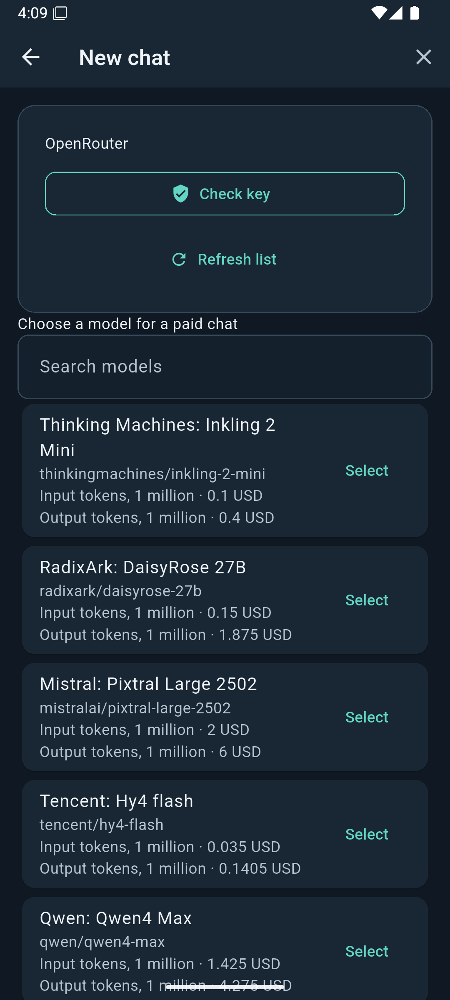</a> | <a href="images/v13/vsegpt-models-en.png">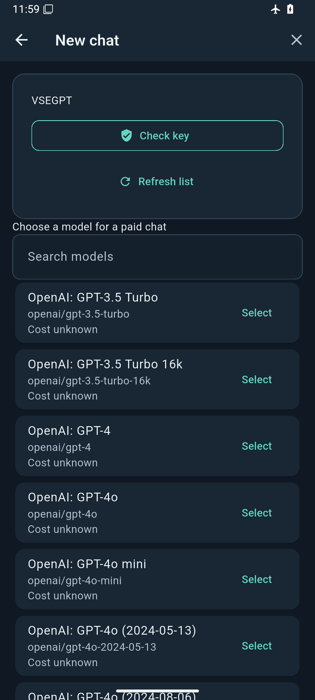</a> |

##  Tokens, spending and limits

| Tokens by day | Spending by day | Budget warning before sending |
| --- | --- | --- |
|  |  |  |

| Edit the chat limit |
| --- |
|  |

| Daily details in USD | Ruble spending with no requests |
| --- | --- |
|  |  |

##  Protect your profile

| Recover access with Android |
| --- |
| <a href="images/v13/device-recovery-en.png">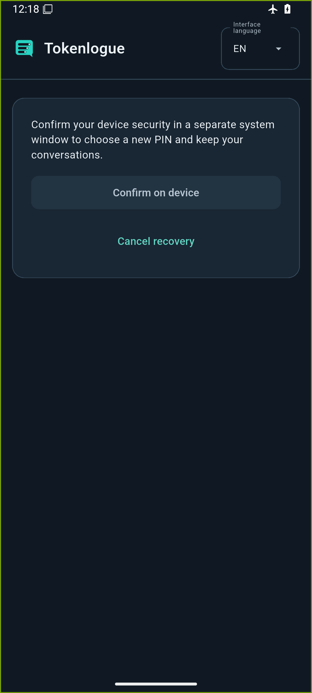</a> |

| Confirm local profile deletion |
| --- |
| <a href="images/v13/delete-confirm-en.png">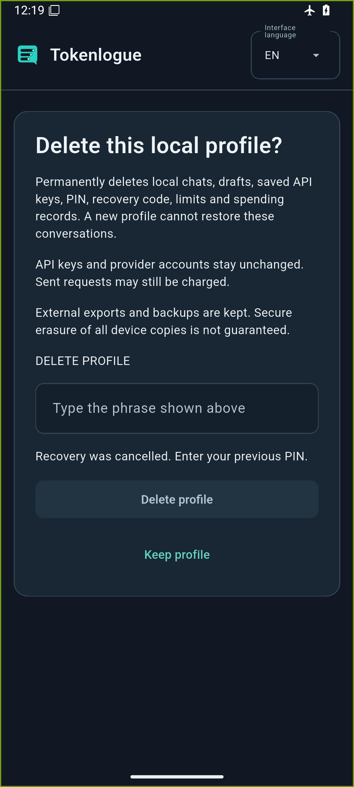</a> |

| Unlock your profile |
| --- |
| <a href="images/v13/sign-in-en.png">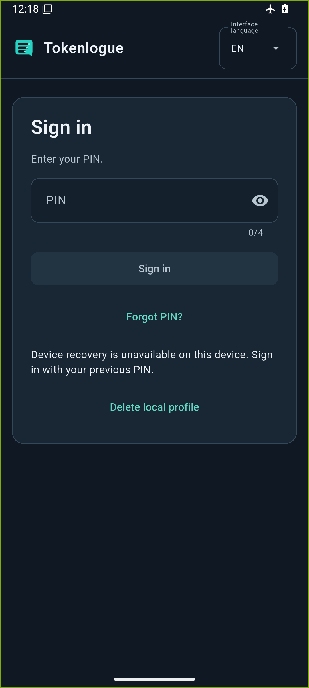</a> |

##  Conversation and protection dialogs

| Rename a conversation | Confirm chat deletion | Choose a new PIN after verification |
| --- | --- | --- |
| <a href="images/v13/rename-en.png">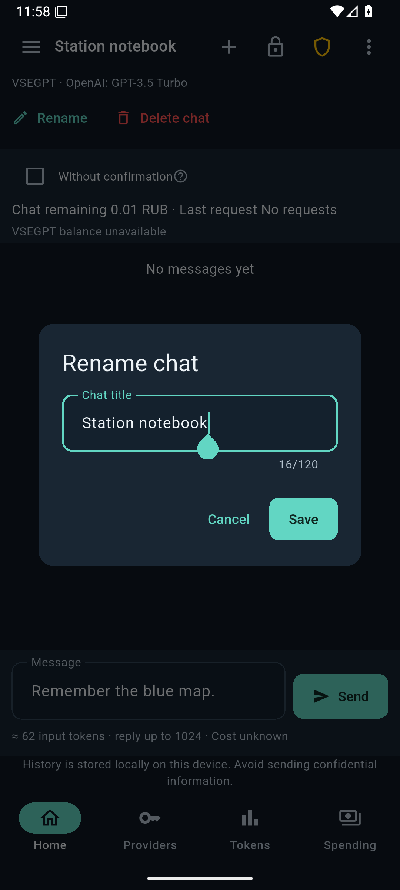</a> |  |  |

##  Provider and chat setup

| Set the limits for a new chat | Unverified VSEGPT connection | First connection after deleting a local profile |
| --- | --- | --- |
| <a href="images/v13/configure-limits-en.png">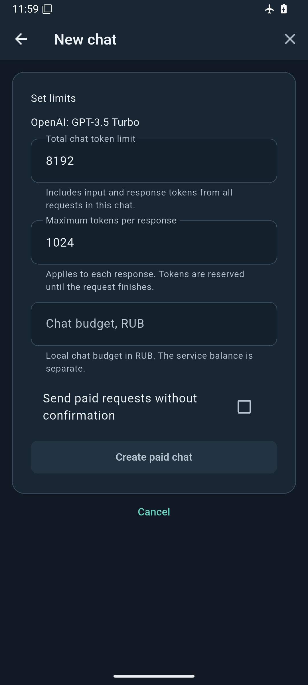</a> |  | <a href="images/v13/new-profile-en.png">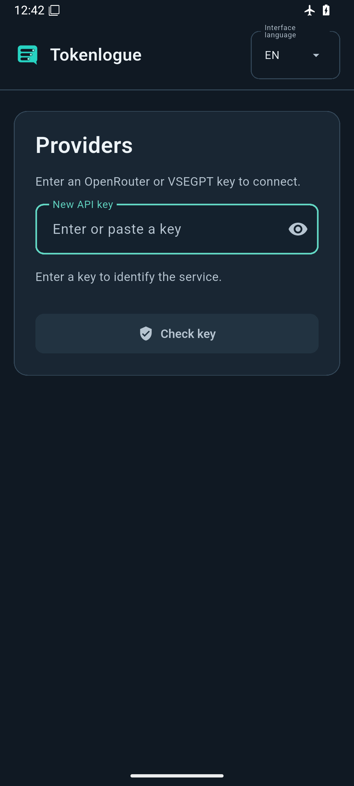</a> |

| Choose your app PIN |
| --- |
| <a href="images/v13/choose-pin-en.png">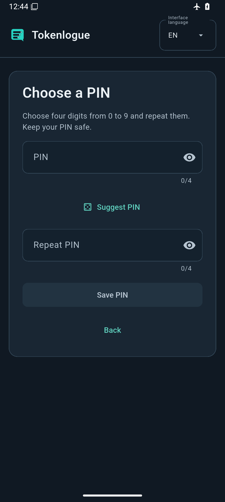</a> |

[Using the app](README.md) · [Project overview](../../README.md)
