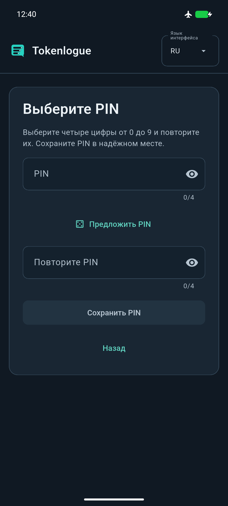
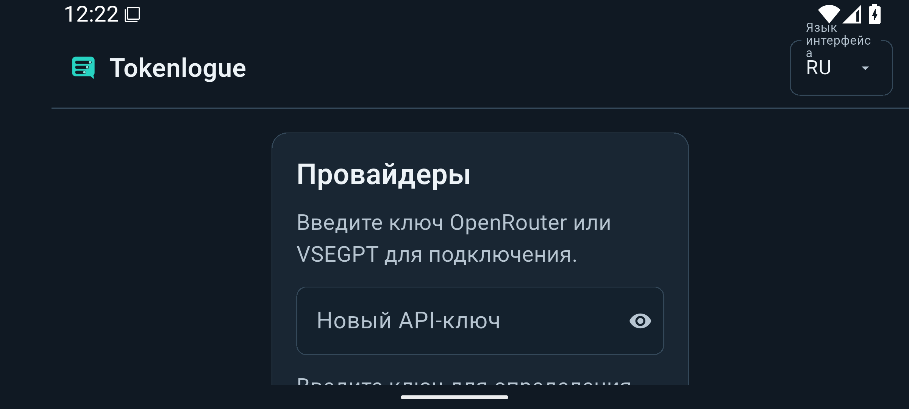

[English](gallery.md) · [Русский](gallery.ru.md)

# Tokenlogue Dart screens

These screenshots show Tokenlogue Dart 0.1.1 running on Android emulators. The travel conversation uses demonstration data. Select an image to see it at full size.

##  Connect and protect your profile

| Initial connection on a phone · EN | Initial connection on a tablet · RU | Explicitly saving an unverified VSEGPT credential · RU |
| --- | --- | --- |
|  |  |  |

| Choosing an app PIN · EN | The same open form in Russian · RU | Device protection panel · EN |
| --- | --- | --- |
|  |  |  |

##  Chat and statistics

| A train trip conversation and an unfinished draft · EN | Daily token chart and filters · EN |
| --- | --- |
|  |  |

##  Landscape and text size

| Landscape tablet · EN | Landscape phone with enlarged text · RU |
| --- | --- |
|  |  |

[Using the app](README.md) · [Project](../../README.md)
