[English](gallery.md) · [Русский](gallery.ru.md)

# Экраны Tokenlogue Dart

Эти снимки сделаны в Tokenlogue Dart 0.1.1 на эмуляторах Android. Переписка о поездке демонстрационная. Нажмите на изображение, чтобы открыть его в полном размере.

## Чат, провайдеры и статистика

На этих снимках Android открыт демонстрационный профиль. Черновики и статистика по дням доступны без сети. Чтобы увидеть актуальные сведения об аккаунте, обновите подключение к провайдеру при доступной сети.

| Переписка и сохранённый черновик | Токены по дням | Расходы в валюте провайдера |
| --- | --- | --- |
|  | <a href="images/v9/tokens-ru.png">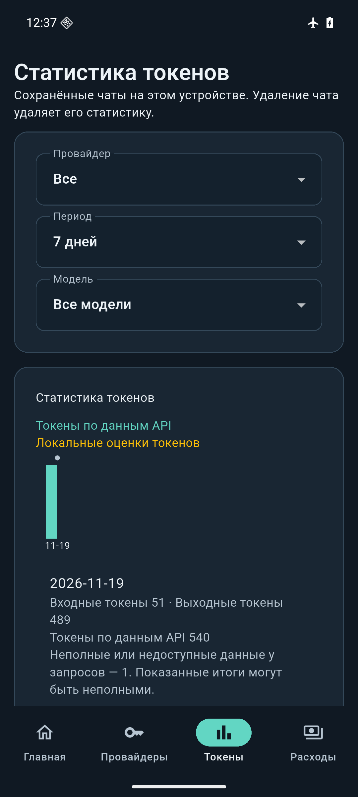</a> | <a href="images/v9/spending-ru.png">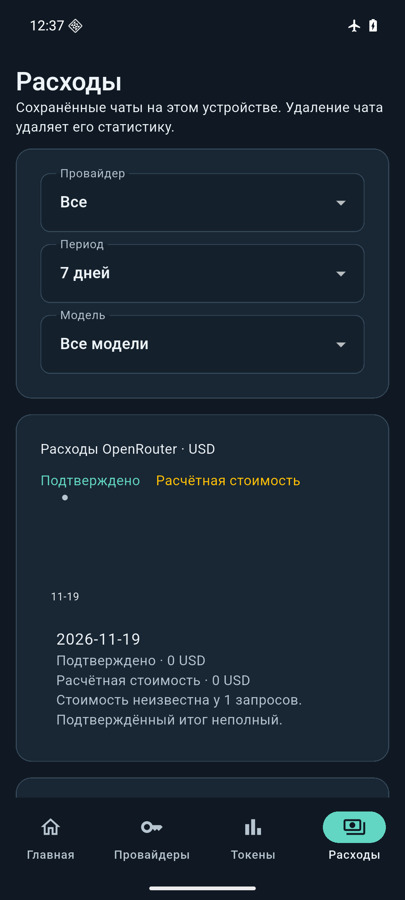</a> |

| Сохранённое подключение OpenRouter | Сохранённое подключение VSEGPT | Выбор сервиса для нового чата |
| --- | --- | --- |
|  |  | <a href="images/v9/choose-provider-ru.png">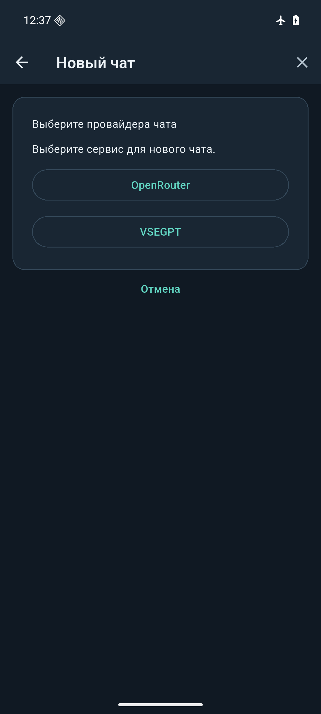</a> |

| Бесплатный и платный режимы OpenRouter | Проверка сохранённого ключа OpenRouter | Бесплатные модели OpenRouter |
| --- | --- | --- |
| <a href="images/v9/openrouter-mode-ru.png">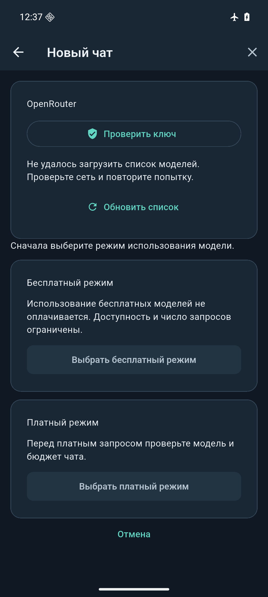</a> |  |  |

| Платные модели OpenRouter | Обновлённый каталог VSEGPT |
| --- | --- |
| <a href="images/v9/openrouter-paid-ru.png">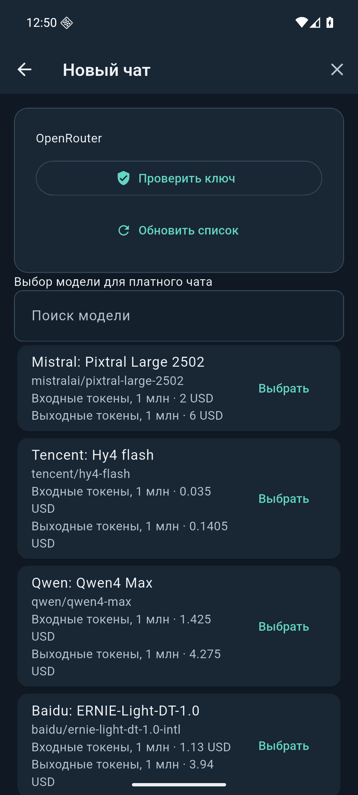</a> | <a href="images/v9/vsegpt-models-ru.png">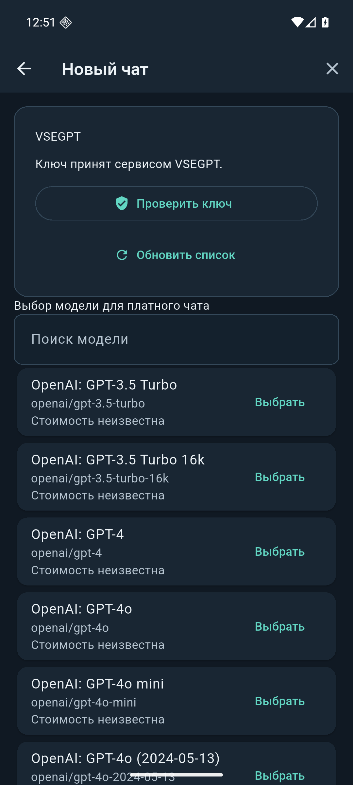</a> |

##  Подключение и защита

| Первое подключение на телефоне · EN | Первое подключение на планшете · RU | Явное сохранение непроверенного ключа VSEGPT · RU |
| --- | --- | --- |
| <a href="images/onboarding-phone-en.png">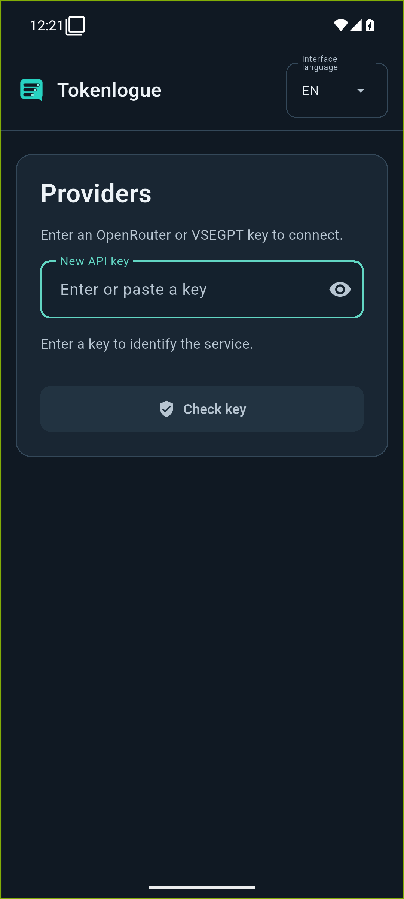</a> | <a href="images/onboarding-tablet-ru.png">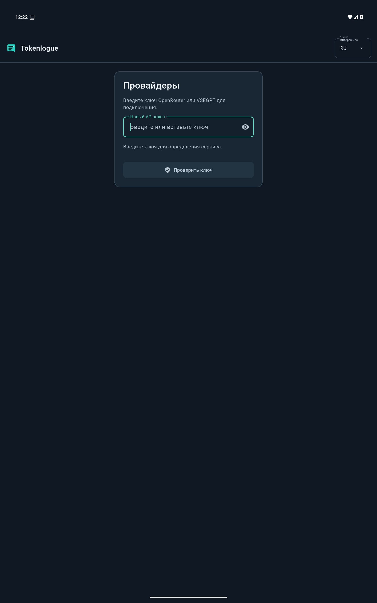</a> | <a href="images/unverified-ru.png">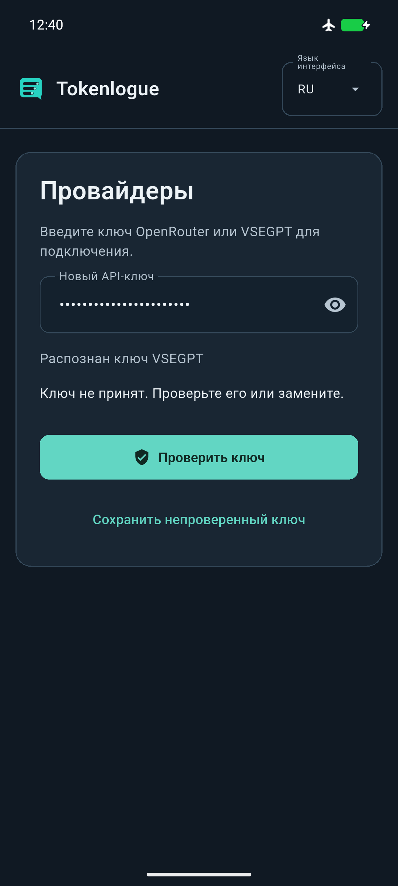</a> |

| Выбор PIN приложения · EN | Та же открытая форма на русском · RU | Панель защиты устройства · EN |
| --- | --- | --- |
| <a href="images/choose-pin-en.png">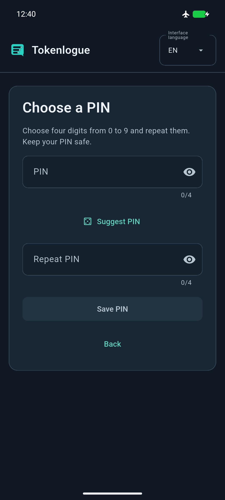</a> | <a href="images/choose-pin-ru.png">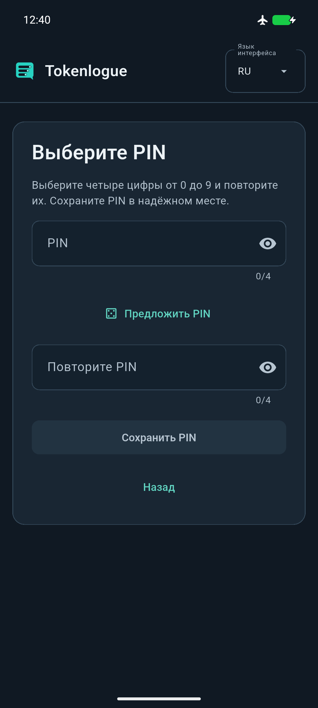</a> |  |

##  Переписка и статистика

| Переписка о поездке и сохранённый черновик · EN | Дневные токены и фильтры · EN |
| --- | --- |
|  | <a href="images/tokens-en.png">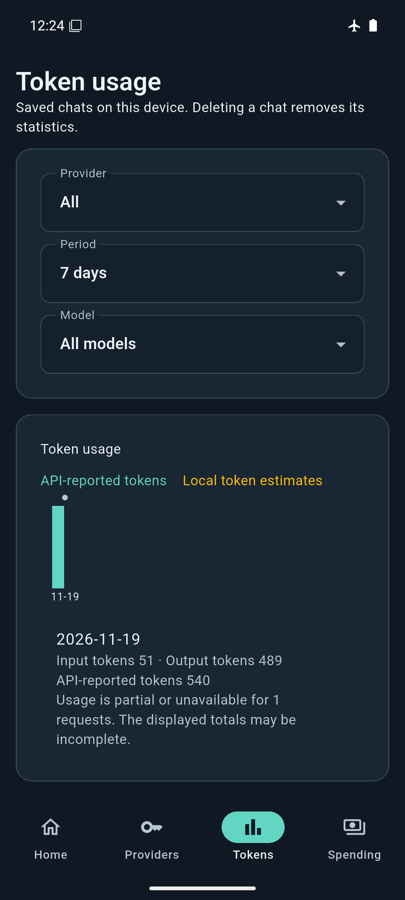</a> |

##  Альбомный режим и размер текста

| Альбомный экран планшета · EN | Альбомный экран телефона с крупным шрифтом · RU |
| --- | --- |
| <a href="images/onboarding-wide-en.png">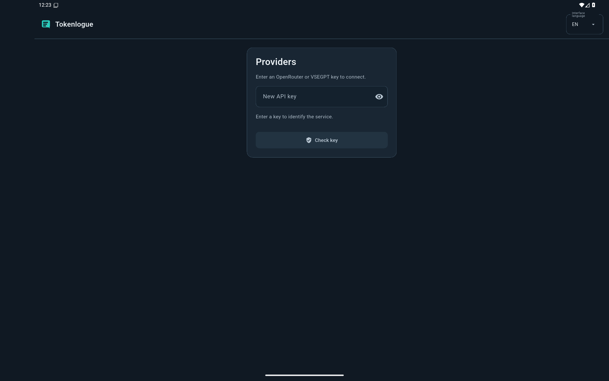</a> | <a href="images/onboarding-large-type-ru.png">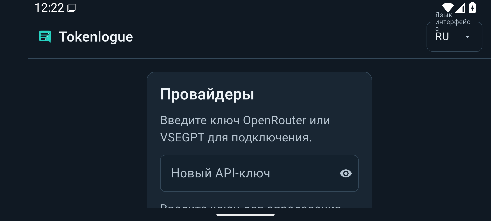</a> |

[Как пользоваться приложением](README.ru.md) · [Проект](../../README.ru.md)
