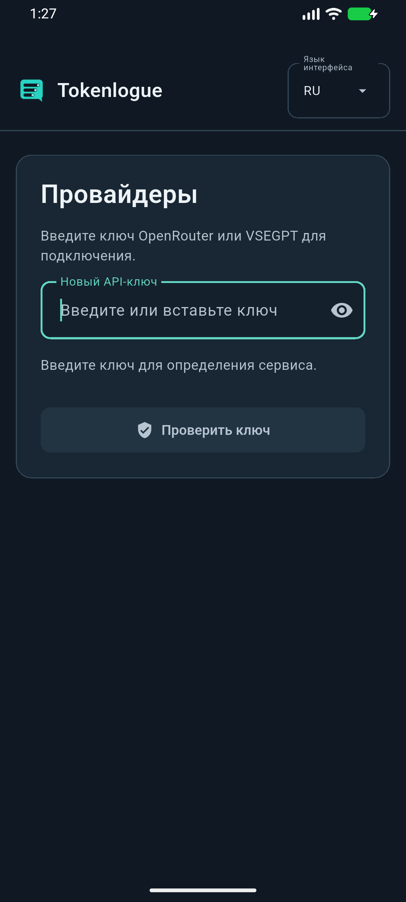
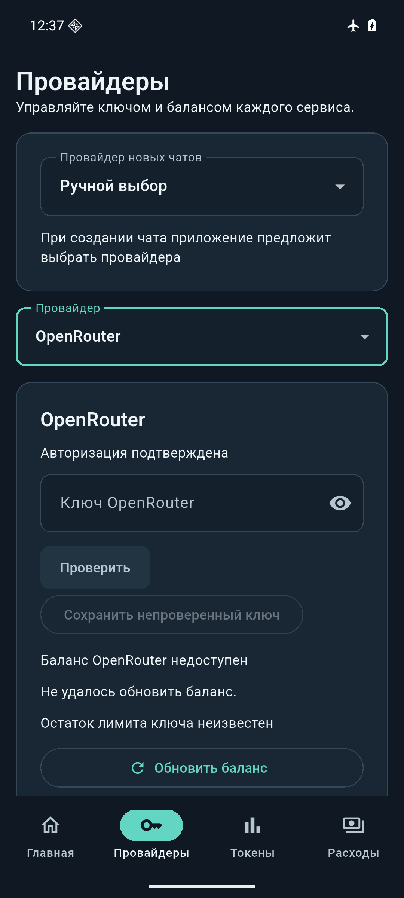
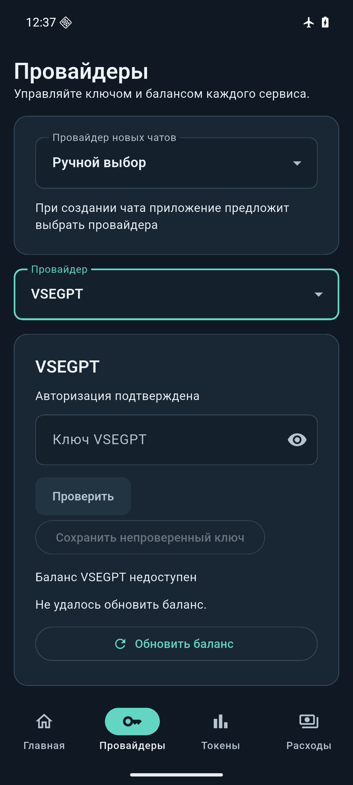
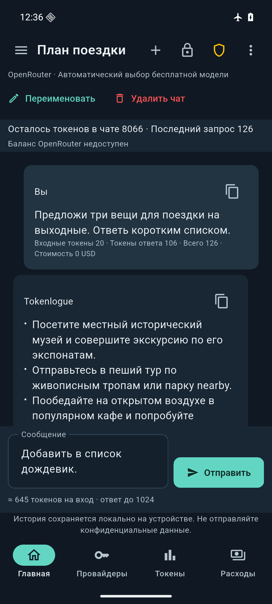
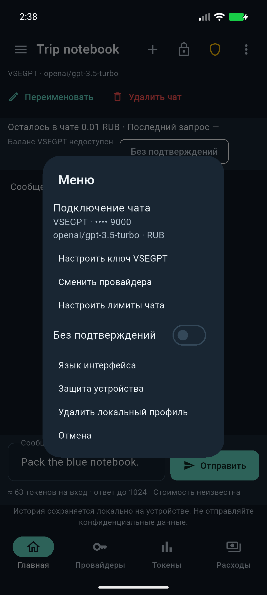
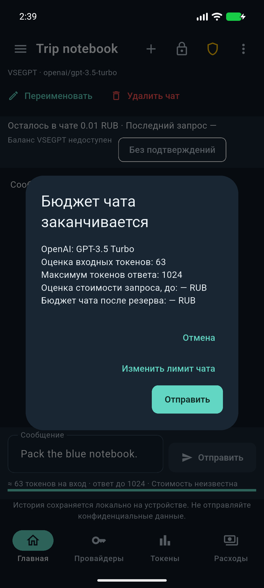
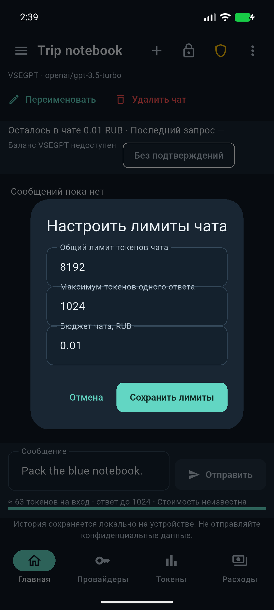

[English](gallery.md) · [Русский](gallery.ru.md)

# Экраны Tokenlogue Dart

На снимках Android показан путь от первого подключения до рабочего чата. Переписка демонстрационная. Нажмите на снимок, чтобы открыть его в полном размере.

##  Подключение провайдера

| Первое подключение | Сохранённый ключ OpenRouter | Сохранённый ключ VSEGPT |
| --- | --- | --- |
|  |  |  |

| Проверка сохранённого ключа |
| --- |
|  |

##  Чат и черновики

| Переписка и черновик | Меню чата и маска демонстрационного ключа |
| --- | --- |
|  |  |

##  Выбор модели

| Выбор сервиса для нового чата | Режимы OpenRouter | Бесплатные модели OpenRouter |
| --- | --- | --- |
|  |  |  |

| Платные модели OpenRouter | Обновлённый каталог VSEGPT |
| --- | --- |
|  |  |

##  Токены, расходы и лимиты

| Токены по дням | Расходы по дням | Предупреждение о бюджете перед отправкой |
| --- | --- | --- |
|  |  |  |

| Изменение лимита чата |
| --- |
|  |

[Как пользоваться приложением](README.ru.md) · [Проект](../../README.ru.md)
