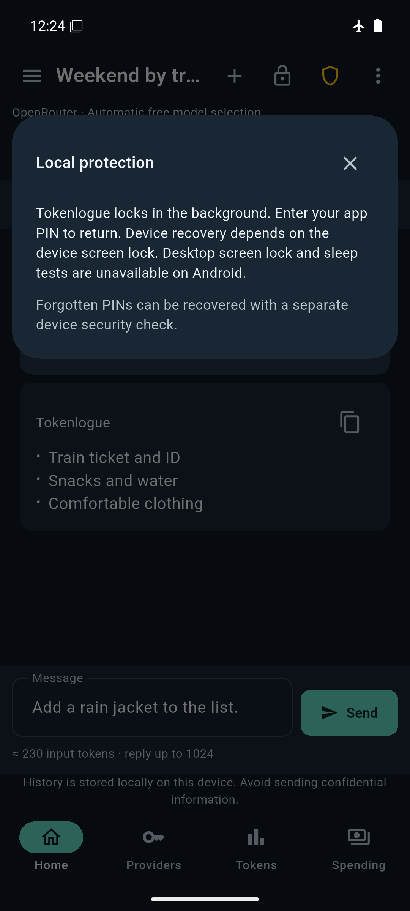
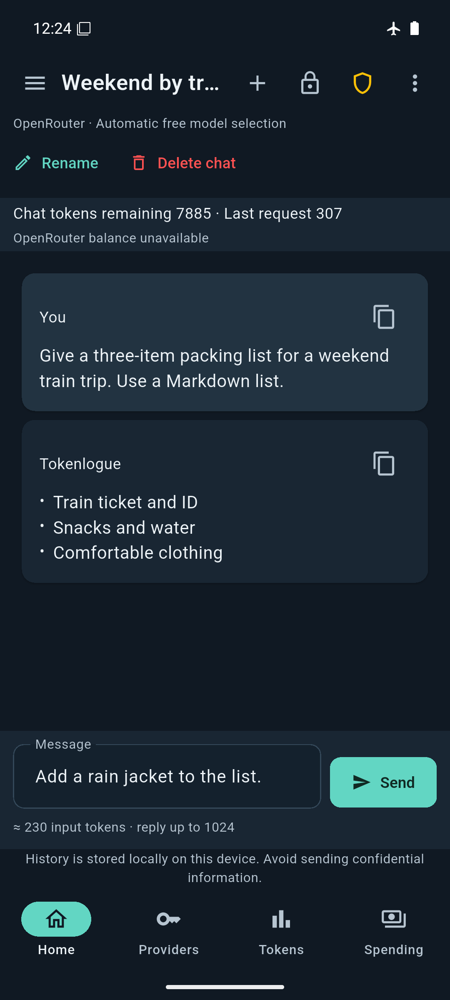

[English](gallery.md) · [Русский](gallery.ru.md)

# Экраны Tokenlogue Dart

Эти снимки сделаны в Tokenlogue Dart 0.1.1 на эмуляторах Android. Переписка о поездке демонстрационная. Нажмите на изображение, чтобы открыть его в полном размере.

##  Подключение и защита

| Первое подключение на телефоне · EN | Первое подключение на планшете · RU | Явное сохранение непроверенного ключа VSEGPT · RU |
| --- | --- | --- |
|  |  |  |

| Выбор PIN приложения · EN | Та же открытая форма на русском · RU | Панель защиты устройства · EN |
| --- | --- | --- |
|  |  |  |

##  Переписка и статистика

| Переписка о поездке и сохранённый черновик · EN | Дневные токены и фильтры · EN |
| --- | --- |
|  |  |

##  Альбомный режим и размер текста

| Альбомный экран планшета · EN | Альбомный экран телефона с крупным шрифтом · RU |
| --- | --- |
|  |  |

[Как пользоваться приложением](README.ru.md) · [Проект](../../README.ru.md)
