[English](gallery.md) · [Русский](gallery.ru.md)

# Экраны Tokenlogue Dart

На снимках Android показан путь от первого подключения до рабочего чата. Переписка демонстрационная. Нажмите на снимок, чтобы открыть его в полном размере.

Версия каждого кадра указана в [реестре снимков](screenshots.csv). Выбор провайдера, каталоги и фильтры сняты на 0.1.1+15. Форма настройки лимитов чата снята на 0.1.1+18. Примеры заполненной переписки и её статистики сняты на 0.1.1+13.

##  Подключение провайдера

<table width="100%">
  <tr><td colspan="2" align="center"></td></tr>
  <tr>
    <td width="50%" align="center" valign="top">
      <a href="images/v13/onboarding-ru.png">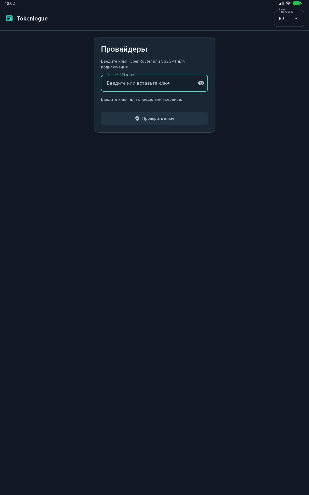</a> 
      <strong>Первый вход</strong>
    </td>
    <td width="50%" align="center" valign="top">
      <a href="images/v13/openrouter-check-ru.png">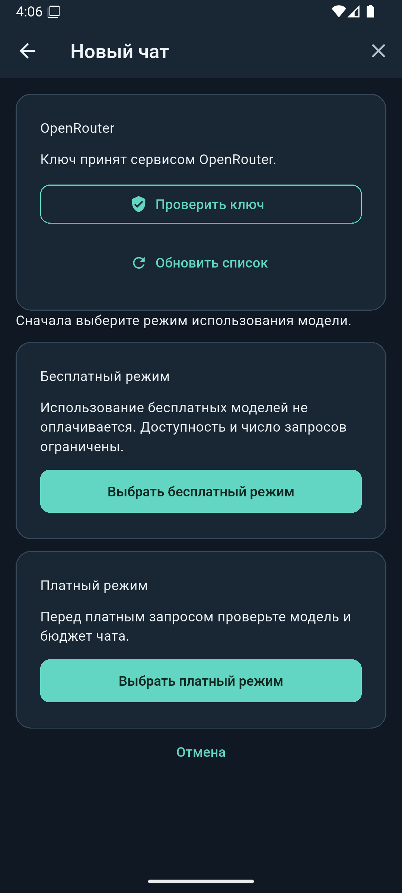</a> 
      <strong>Проверка ключа</strong>
    </td>
  </tr>
  <tr>
    <td width="50%" align="center" valign="top">
      <a href="images/v13/openrouter-saved-ru.png">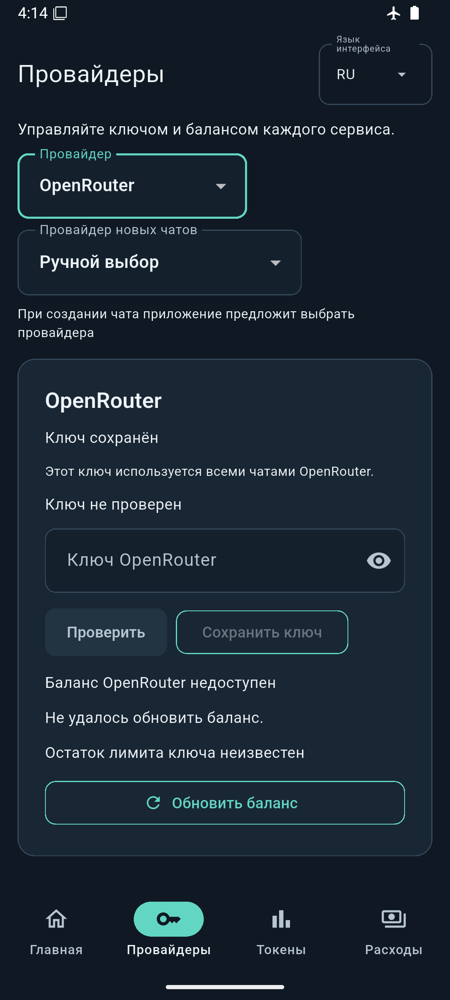</a> 
      <strong>Ключ OpenRouter</strong>
    </td>
    <td width="50%" align="center" valign="top">
       
      <strong>Ключ VSEGPT</strong>
    </td>
  </tr>
  <tr><td colspan="2" align="center"></td></tr>
</table>

##  Чат и черновики

<table width="100%">
  <tr><td colspan="3" align="center"></td></tr>
  <tr>
    <td width="33%" align="center" valign="top">
      <a href="images/v13/chat-ru.png">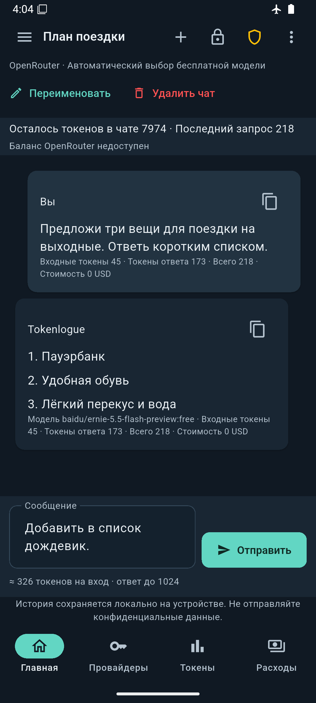</a> 
      <strong>Чат и черно&shy;вик</strong>
    </td>
    <td width="33%" align="center" valign="top">
       
      <strong>Меню чата и ключ</strong>
    </td>
    <td width="33%" align="center" valign="top">
      <a href="images/v13/connection-review-ru.png">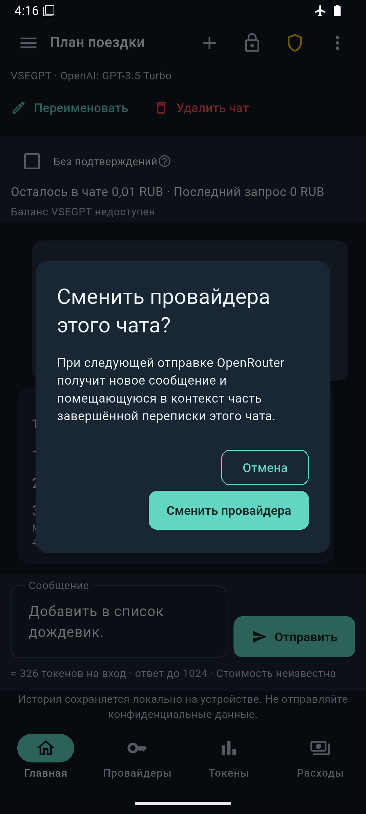</a> 
      <strong>Смена сервиса</strong>
    </td>
  </tr>
  <tr><td colspan="3" align="center"></td></tr>
</table>

##  Выбор модели

<table width="100%">
  <tr><td colspan="6" align="center"></td></tr>
  <tr>
    <td colspan="3" width="50%" align="center" valign="top">
      <a href="images/v15/manual-provider-ru-phone.png">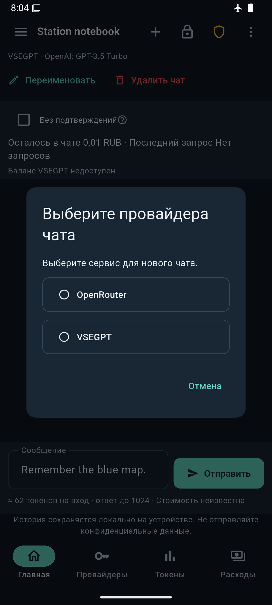</a> 
      <strong>Выбор сервиса</strong>
    </td>
    <td colspan="3" width="50%" align="center" valign="top">
      <a href="images/v15/vsegpt-models-ru-phone.png">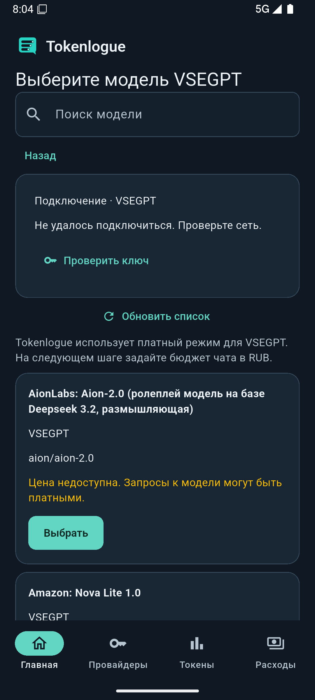</a> 
      <strong>Каталог VSEGPT</strong>
    </td>
  </tr>
  <tr>
    <td colspan="2" width="33%" align="center" valign="top">
      <a href="images/v15/openrouter-mode-ru-phone.png">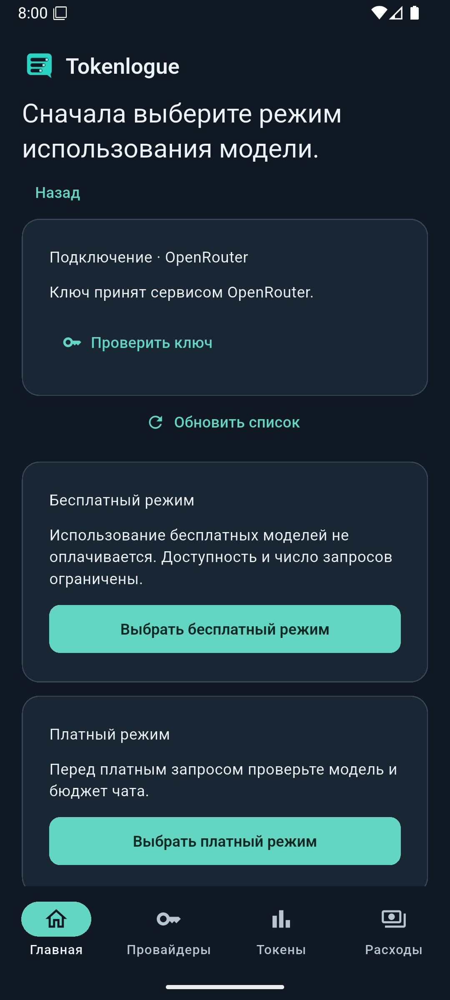</a> 
      <strong>Выбор режима</strong>
    </td>
    <td colspan="2" width="33%" align="center" valign="top">
      <a href="images/v15/openrouter-free-ru-phone.png">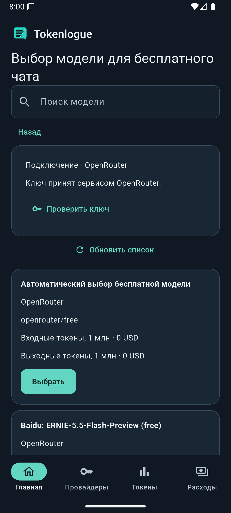</a> 
      <strong>Модели за 0 USD</strong>
    </td>
    <td colspan="2" width="33%" align="center" valign="top">
      <a href="images/v15/openrouter-paid-ru-phone.png">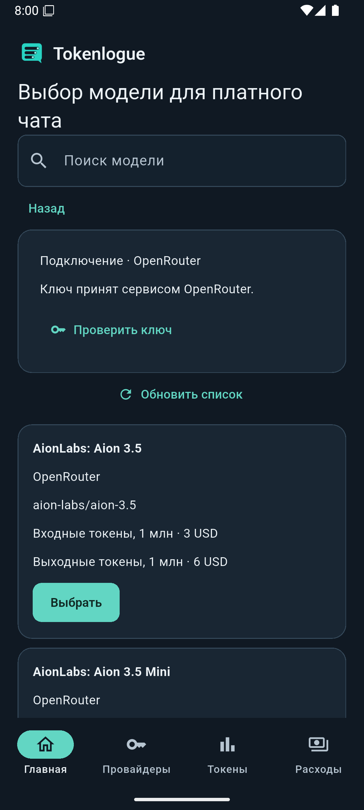</a> 
      <strong>Платные модели</strong>
    </td>
  </tr>
  <tr><td colspan="6" align="center"></td></tr>
</table>

##  Токены, расходы и лимиты

<table width="100%">
  <tr><td colspan="6" align="center"></td></tr>
  <tr>
    <td colspan="2" width="33%" align="center" valign="top">
       
      <strong>Токены по дням</strong>
    </td>
    <td colspan="2" width="33%" align="center" valign="top">
      <a href="images/v13/spending-filled-ru.png">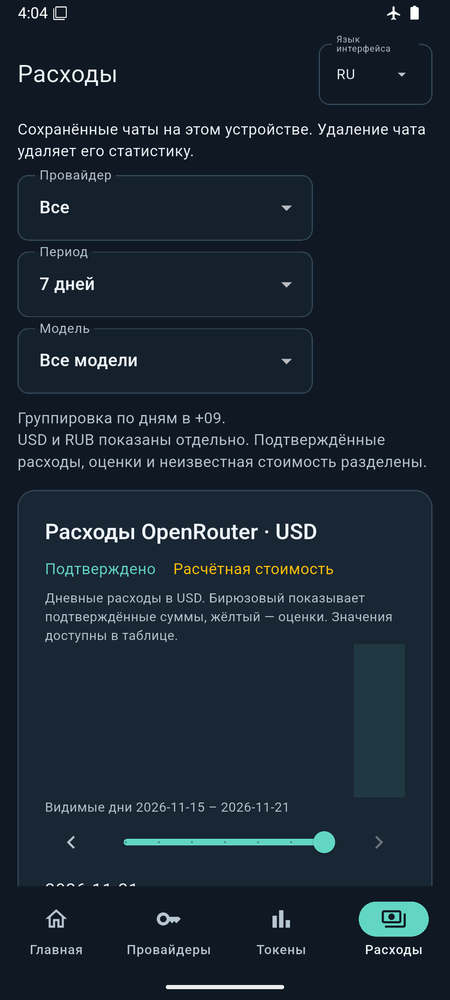</a> 
      <strong>Расходы по дням</strong>
    </td>
    <td colspan="2" width="33%" align="center" valign="top">
      <a href="images/v13/usd-day-ru.png">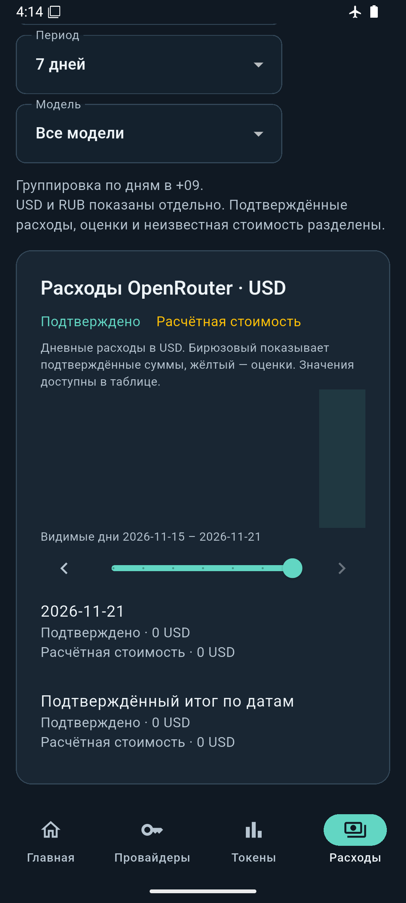</a> 
      <strong>Итог дня в USD</strong>
    </td>
  </tr>
  <tr>
    <td colspan="3" width="50%" align="center" valign="top">
       
      <strong>Бюджет на исходе</strong>
    </td>
    <td colspan="3" width="50%" align="center" valign="top">
      <a href="images/v13/edit-limits-ru.png">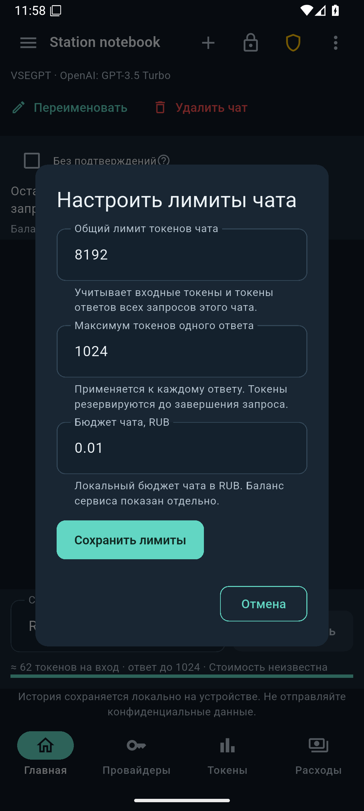</a> 
      <strong>Бюджет чата</strong>
    </td>
  </tr>
  <tr>
    <td colspan="3" width="50%" align="center" valign="top">
      <a href="images/v13/rub-empty-ru.png">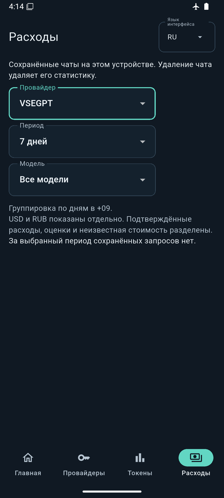</a> 
      <strong>Дни без запросов</strong>
    </td>
    <td colspan="3" width="50%" align="center" valign="top">
      <a href="images/qa-v13/ruble-day-ru.png">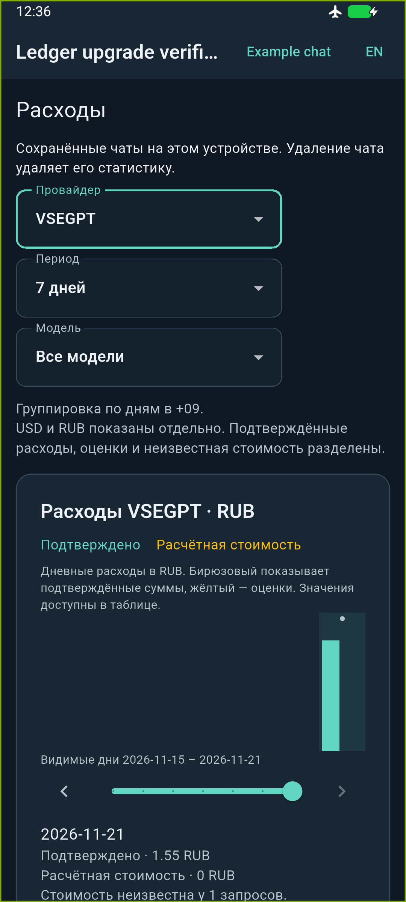</a> 
      <strong>Расходы в RUB · пример из QA-сборки</strong>
    </td>
  </tr>
  <tr><td colspan="6" align="center"></td></tr>
</table>

В отдельной QA-сборке 0.1.1+13 показаны две демонстрационные записи на 1,20 и 0,35 рубля. Сумма за день составляет 1,55 рубля.

##  Защита профиля

<table width="100%">
  <tr><td colspan="3" align="center"></td></tr>
  <tr>
    <td width="33%" align="center" valign="top">
      <a href="images/v13/sign-in-ru.png">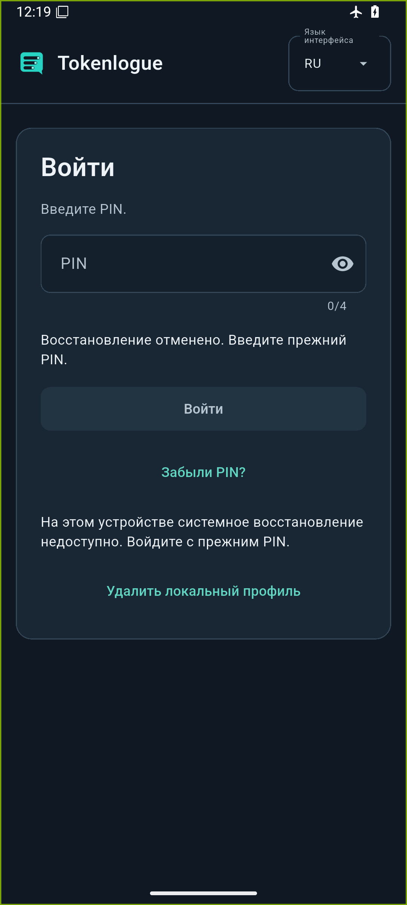</a> 
      <strong>Вход по PIN</strong>
    </td>
    <td width="33%" align="center" valign="top">
      <a href="images/v13/device-recovery-ru.png">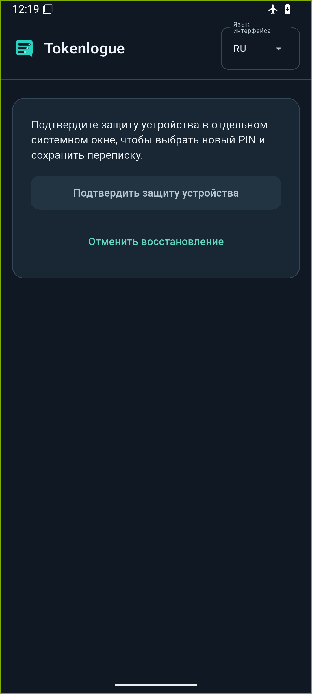</a> 
      <strong>Возврат доступа</strong>
    </td>
    <td width="33%" align="center" valign="top">
       
      <strong>Уда&shy;ление профиля</strong>
    </td>
  </tr>
  <tr><td colspan="3" align="center"></td></tr>
</table>

##  Настройки разговора и восстановление доступа

<table width="100%">
  <tr><td colspan="3" align="center"></td></tr>
  <tr>
    <td width="33%" align="center" valign="top">
       
      <strong>Имя чата</strong>
    </td>
    <td width="33%" align="center" valign="top">
       
      <strong>Уда&shy;ление чата</strong>
    </td>
    <td width="33%" align="center" valign="top">
       
      <strong>Новый PIN</strong>
    </td>
  </tr>
  <tr><td colspan="3" align="center"></td></tr>
</table>

##  Подключение и настройка чата

<table width="100%">
  <tr><td colspan="6" align="center"></td></tr>
  <tr>
    <td colspan="2" width="33%" align="center" valign="top">
      <a href="images/v13/choose-pin-ru.png">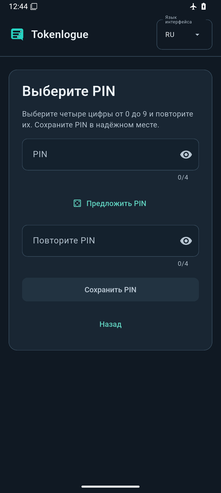</a> 
      <strong>Выбор PIN</strong>
    </td>
    <td colspan="2" width="33%" align="center" valign="top">
      <a href="images/v13/vsegpt-unverified-ru.png">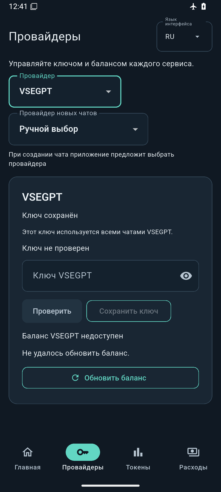</a> 
      <strong>Статус ключа VSEGPT</strong>
    </td>
    <td colspan="2" width="33%" align="center" valign="top">
       
      <strong>Новый профиль</strong>
    </td>
  </tr>
  <tr>
    <td colspan="3" width="50%" align="center" valign="top">
      <a href="images/v18/configure-limits-ru.png">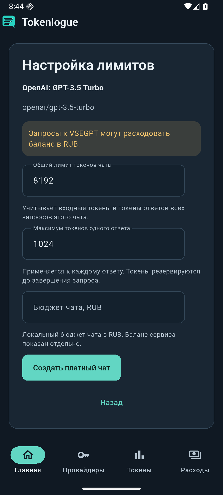</a> 
      <strong>Лимиты чата</strong>
    </td>
    <td colspan="3" width="50%" align="center" valign="top">
      <a href="images/v18/budget-required-ru.png">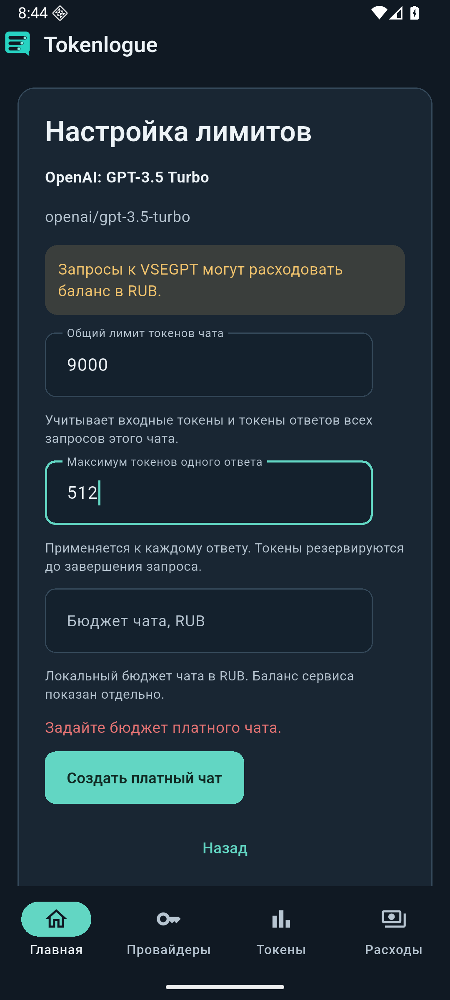</a> 
      <strong>Бюджет не указан</strong>
    </td>
  </tr>
  <tr><td colspan="6" align="center"></td></tr>
</table>

Форма на Android Dart 0.1.1+18 показывает имя и идентификатор модели. Если бюджет VSEGPT пуст, кнопка «Создать платный чат» оставляет введённые лимиты на экране и подсказывает, что заполнить.

##  Выбор провайдера и фильтры

На снимках 0.1.1+15 видны текущее подключение и фильтры статистики. На телефоне фильтры расположены друг под другом. На широком планшете они помещаются в одну строку.

<table width="100%">
  <tr><td colspan="2" align="center"></td></tr>
  <tr>
    <td width="50%" align="center" valign="top">
      <a href="images/v15/current-provider-ru-phone.png">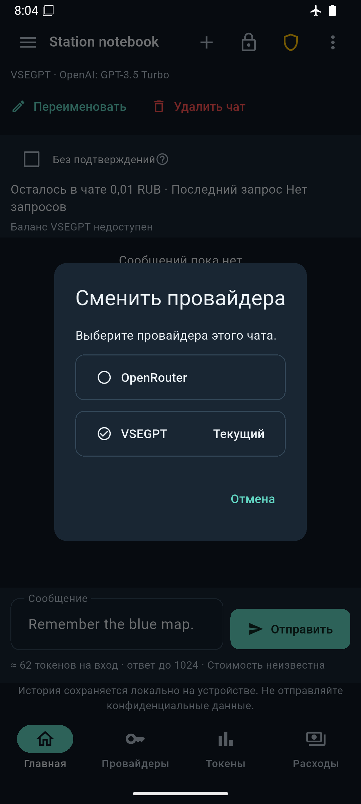</a> 
      <strong>Сервис чата</strong>
    </td>
    <td width="50%" align="center" valign="top">
      <a href="images/v15/tokens-provider-open-ru-phone.png">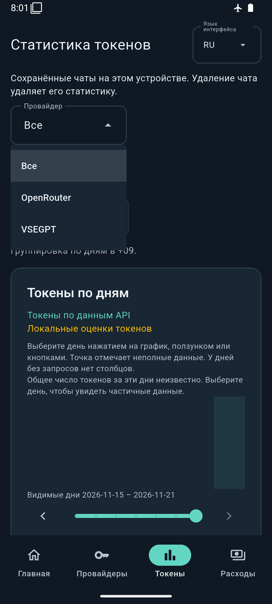</a> 
      <strong>Фильтр по сервису</strong>
    </td>
  </tr>
  <tr>
    <td colspan="2" width="100%" align="center" valign="top">
      <a href="images/v15/tokens-closed-ru-tablet.png">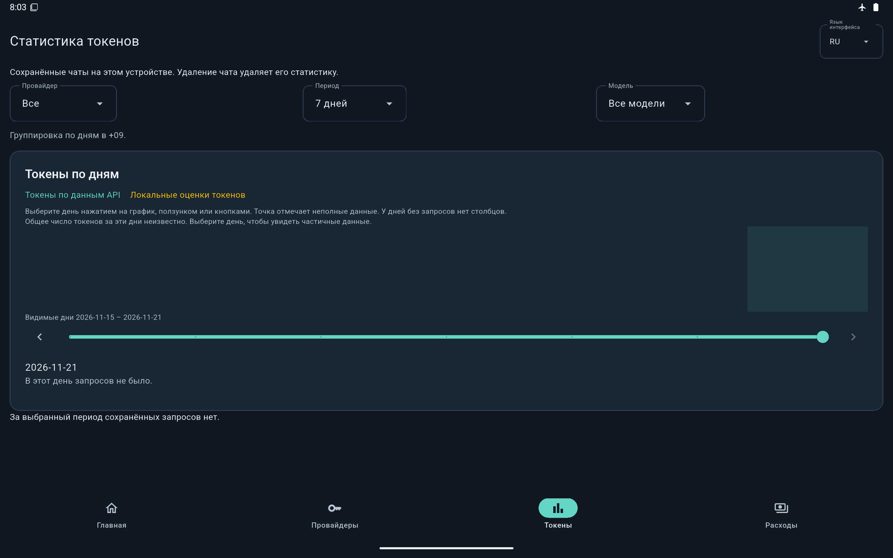</a> 
      <strong>Фильтры на планшете</strong>
    </td>
  </tr>
  <tr><td colspan="2" align="center"></td></tr>
</table>

[Как пользоваться приложением](README.ru.md) · [Проект](../../README.ru.md)
