[English](gallery.md) · [Русский](gallery.ru.md)

# Экраны Tokenlogue Dart

На снимках Android показан путь от первого подключения до рабочего чата. Переписка демонстрационная. Нажмите на снимок, чтобы открыть его в полном размере.

##  Подключение провайдера

| Первое подключение | Сохранённый ключ OpenRouter | Сохранённый ключ VSEGPT |
| --- | --- | --- |
|  | <a href="images/v10/openrouter-saved-ru.png">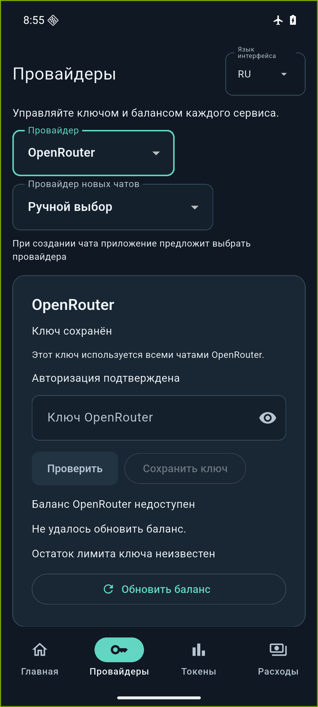</a> | <a href="images/v10/vsegpt-saved-ru.png">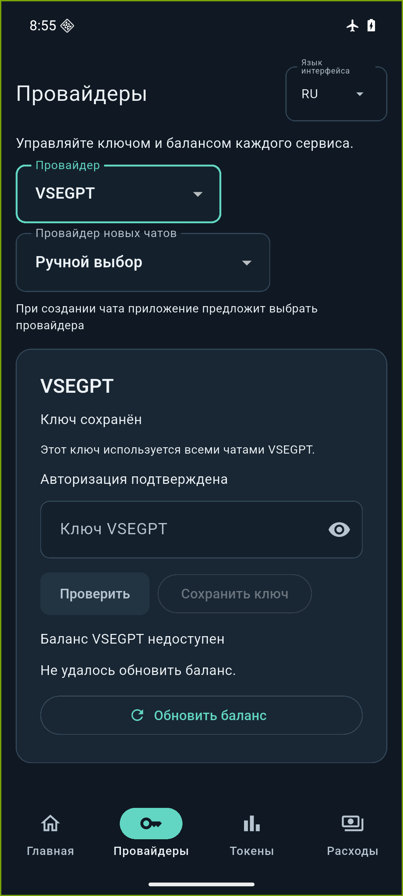</a> |

| Проверка сохранённого ключа |
| --- |
| <a href="images/v10/openrouter-check-ru.png">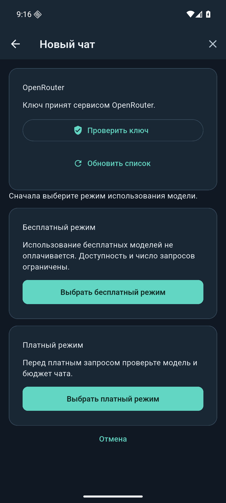</a> |

##  Чат и черновики

| Переписка и черновик | Меню чата и маска демонстрационного ключа |
| --- | --- |
|  | <a href="images/v13/demo-connection-ru.png">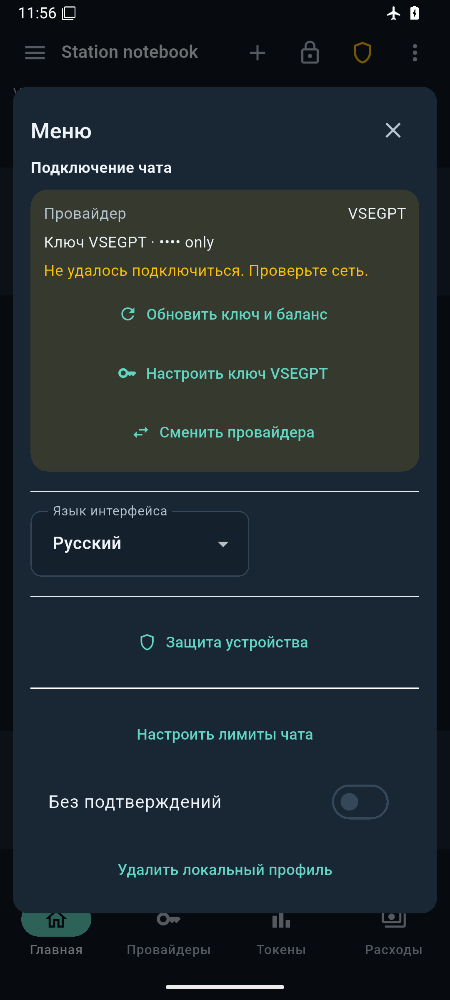</a> |

| Подтверждение смены подключения |
| --- |
| <a href="images/v10/connection-review-ru.png">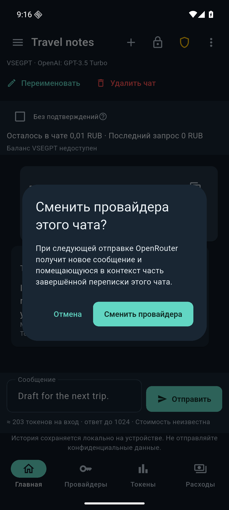</a> |

##  Выбор модели

| Выбор сервиса для нового чата | Режимы OpenRouter | Бесплатные модели OpenRouter |
| --- | --- | --- |
| <a href="images/v13/choose-provider-ru.png">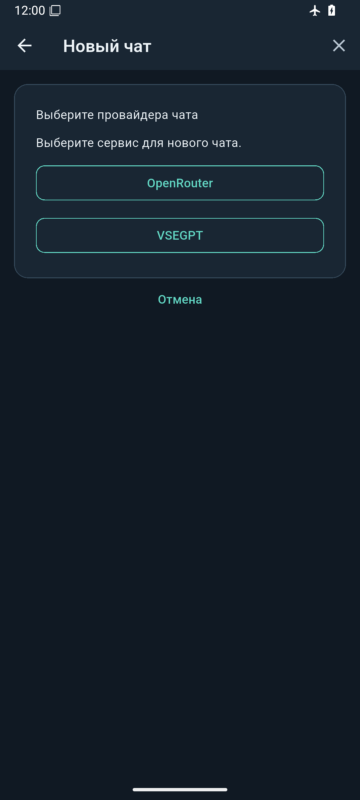</a> | <a href="images/v10/openrouter-mode-ru.png">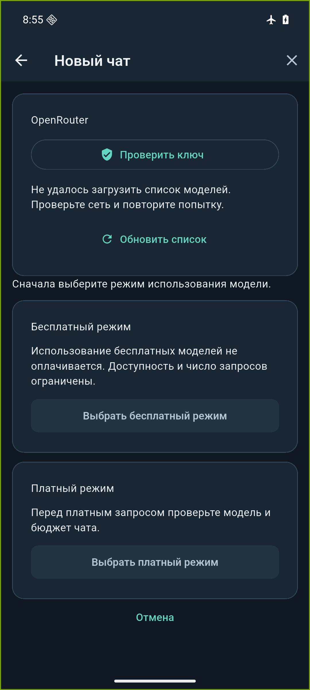</a> | <a href="images/v10/openrouter-free-ru.png">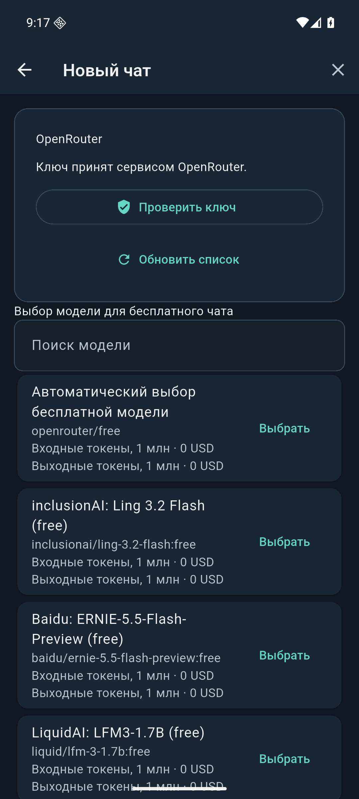</a> |

| Платные модели OpenRouter | Обновлённый каталог VSEGPT |
| --- | --- |
| <a href="images/v10/openrouter-paid-ru.png">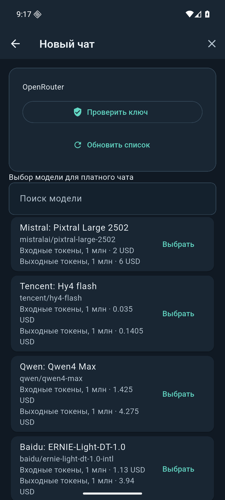</a> | <a href="images/v13/vsegpt-models-ru.png">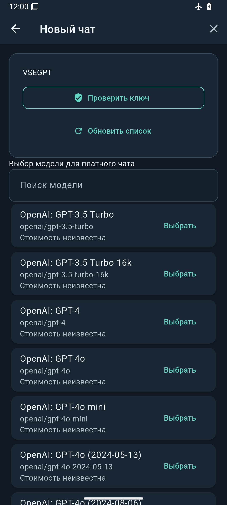</a> |

##  Токены, расходы и лимиты

| Токены по дням | Расходы по дням | Предупреждение о бюджете перед отправкой |
| --- | --- | --- |
| <a href="images/v10/tokens-ru.png">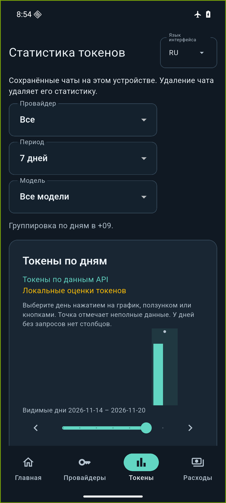</a> | <a href="images/v10/spending-ru.png">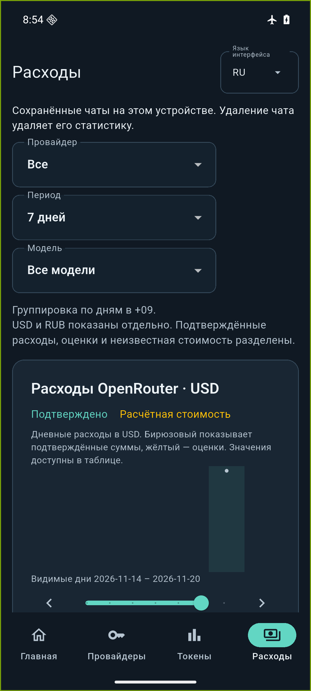</a> | <a href="images/v13/budget-ru.png">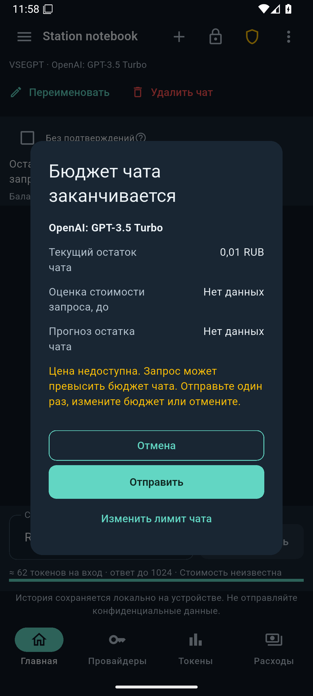</a> |

| Изменение лимита чата |
| --- |
|  |

| Подробности дня в USD | Расходы в рублях без запросов |
| --- | --- |
| <a href="images/v10/usd-day-ru.png">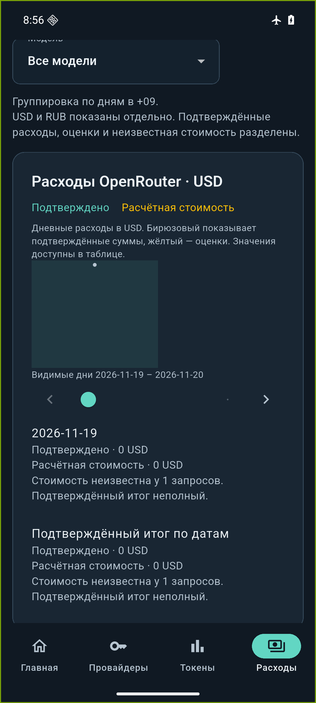</a> | <a href="images/v10/rub-empty-ru.png">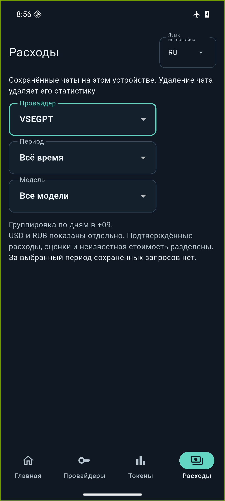</a> |

##  Защита профиля

| Подтверждение удаления локального профиля | Первое подключение после удаления профиля |
| --- | --- |
| <a href="images/v13/delete-confirm-ru.png">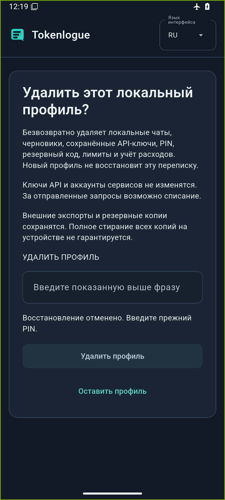</a> | <a href="images/v13/new-profile-ru.png">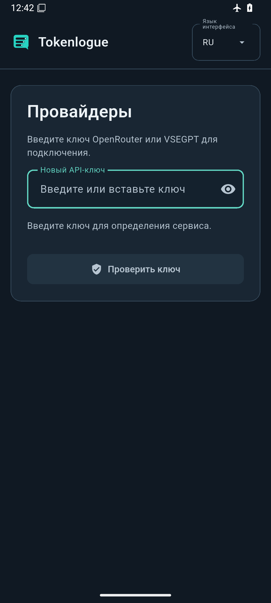</a> |

| Вход в профиль | Восстановление через Android |
| --- | --- |
|  |  |

##  Настройки разговора и восстановление доступа

| Переименование чата | Подтверждение удаления чата | Выбор нового PIN после подтверждения |
| --- | --- | --- |
| <a href="images/v13/rename-ru.png">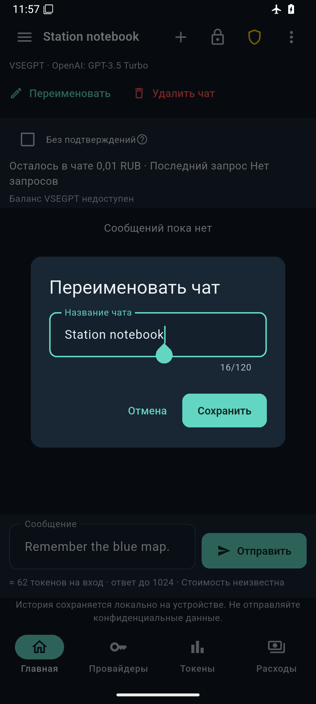</a> | <a href="images/v13/delete-chat-ru.png">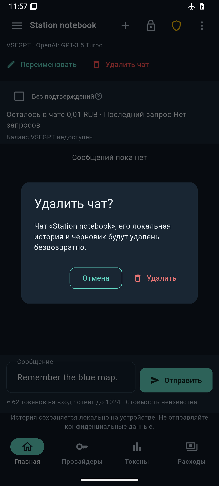</a> | <a href="images/v13/new-pin-ru.png">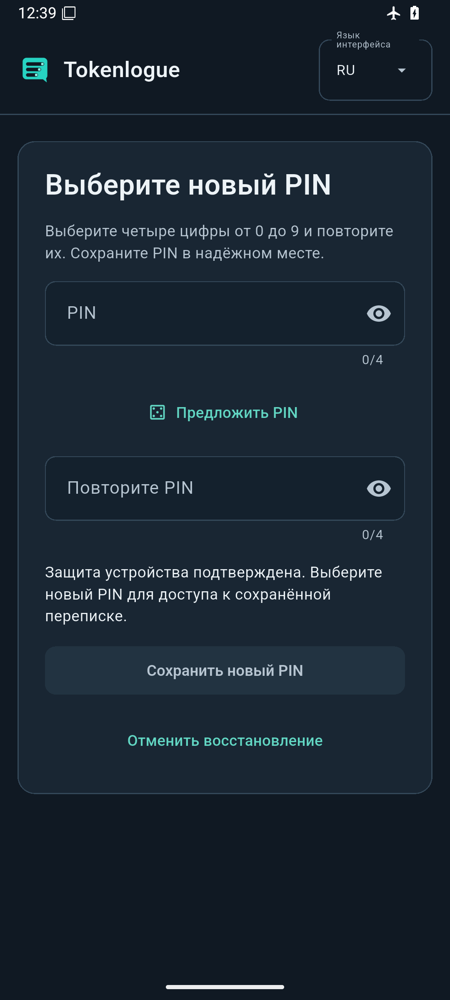</a> |

##  Подключение и настройка чата

| Лимиты нового чата | Непроверенное подключение VSEGPT | Настройка PIN приложения |
| --- | --- | --- |
| <a href="images/v13/configure-limits-ru.png">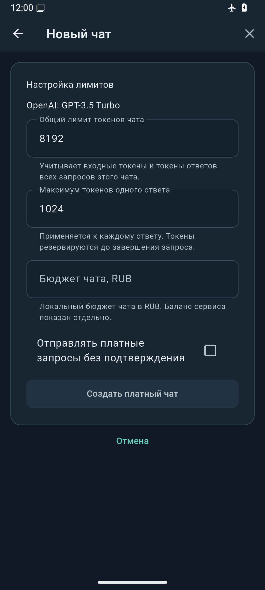</a> |  |  |

[Как пользоваться приложением](README.ru.md) · [Проект](../../README.ru.md)
