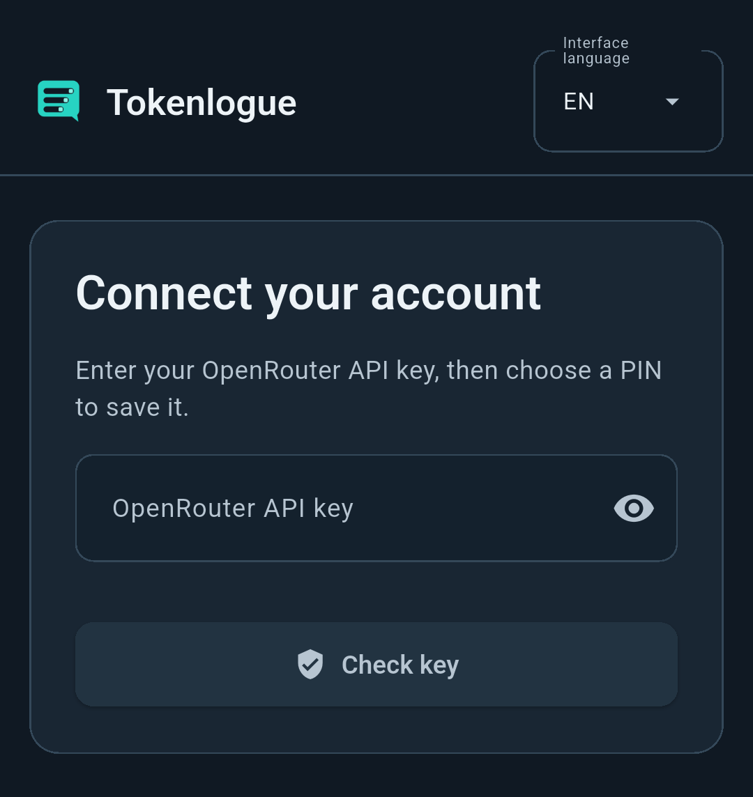
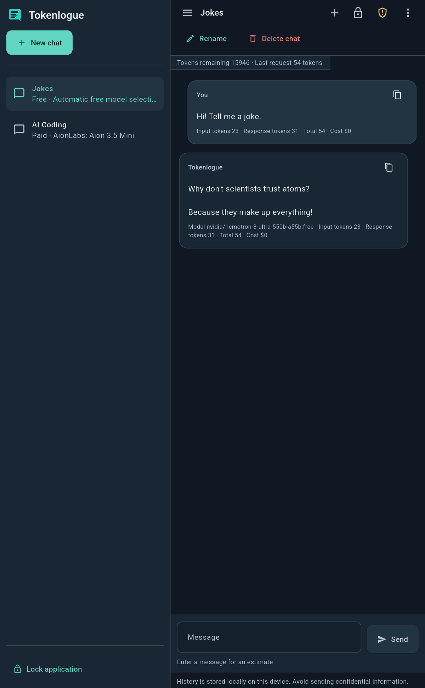

<p align="left">
<a href="android.ru.md" title="Русский"></a>
<a href="android.md" title="English"></a>
<a href="../README.md" title="Home"></a>&nbsp;<a href="README.md" title="Docs"></a>
</p>

# Tokenlogue for Android

<a id="english"></a>
<a id="lang-en"></a>

Tokenlogue brings OpenRouter chats to an ARM64 Android phone or tablet. The interface supports English and Russian, saved per-chat drafts and layouts that adapt to the available space.

<a href="#en-requirements" title="Requirements"></a> · <a href="#en-install" title="Install"></a> · <a href="#en-update" title="Update"></a> · <a href="#en-first-launch" title="First launch"></a> · <a href="security.md#english" title="Protection"></a>

<a id="en-requirements"></a>

## 🧩 Requirements and compatibility

- Android 7.0 or later, API 24 or newer.
- An ARM64 device that supports the `arm64-v8a` ABI.
- An OpenRouter API key and internet access for key validation, models and messages.
- A supported device screen lock for optional system PIN recovery on Android 11 or later.

The minimum API level does not mean that every Android version or device has been tested. The current package passed static ELF and ZIP alignment checks for 4 KiB and 16 KiB pages. Running it on a native ARM64 device with a 16 KiB kernel has not been checked. An earlier package's launch through ARM translation is not such a check for this package.

<a id="en-install"></a>

## 📦 Obtain and install the APK

The <a href="https://github.com/Umichata/tokenlogue/releases" title="Releases page">Releases page&nbsp;</a> lists publicly available downloads. For this preview, download the APK identified below and `RELEASE_SHA256SUMS`. If this preview is not listed, its downloads are not public yet. The earlier published Linux release is a separate package.


| Current Android preview | Value |
| --- | --- |
| APK | `Tokenlogue-0.1.0-65aa62f-arm64-v8a-v41-test.apk` |
| Version | `0.1.0`, versionCode `41` |
| Size | 56,160,490 bytes |
| SHA-256 | `2f7c699960e3967220f526245ca2acbf4335104a141ccf3fa2b8a04dae4709d9` |
| Signing certificate SHA-256 | `927292ad5a76ff049059d1c5d8e9497a42c03f3e995a5d9ca935c59ad8d0b09e` |


Before installation, check only the selected APK against `RELEASE_SHA256SUMS`. Save both files in the same folder. On your computer, use Bash and SHA-256 tools to run this command from that folder.
```bash
set -o pipefail
file='Tokenlogue-0.1.0-65aa62f-arm64-v8a-v41-test.apk'
awk -v wanted="$file" '$2 == wanted { entry = $0; count++ } END { if (count != 1) exit 1; print entry }' RELEASE_SHA256SUMS |
  sha256sum --check -
```

The selected APK must report `OK`. A missing or duplicate manifest entry, a changed file or a missing file makes the command fail. A checksum detects changed bytes and does not replace a publisher signature.

The original preview bundle has an internal `SHA256SUMS` for checking the complete extracted bundle. You do not need that bundle or the source archives to install or run Tokenlogue.

Transfer the verified APK to the device, open it and follow Android's installer. Android may ask to allow installations from the file manager or browser you used. Grant that permission only if you trust the package. You can turn it off again afterwards.

<a id="en-update"></a>

## 🔄 Update a compatible installation

Install the new APK over the compatible existing installation with the same application identity and signing certificate. Keep the existing application data. Uninstalling or clearing data is not an ordinary update step and can make encrypted conversations unrecoverable.

If Android refuses the update, check the package version, architecture and signing identity. Do not remove the old app just to bypass a signature error. Keep the existing data and <a href="https://github.com/Umichata/tokenlogue/issues" title="ask for help">ask for help&nbsp;</a>. Include the package filename, Android version and relevant error. Remove API keys, private messages and personal paths before sharing.

<a id="en-first-launch"></a>

## 💬 Connect and start chatting

<br>
<br>


First launch on Android.

Choose a language, enter your OpenRouter API key and select `Check key`. Choose and repeat a four-digit app PIN, then save it. Use `+` to choose free or paid mode, a model and limits. The <a href="user-guide.md#english" title="user guide">user guide&nbsp;</a> explains chats, drafts and cost information.

The top-left button opens the chat drawer. Select a chat, tap outside or press Back to close it. The keyboard can reduce the space for header actions. Dismiss it to show the rename and delete shortcuts again.

<br>
<br>


The Android chat workspace.

## 🔒 Protect the local profile

Moving Tokenlogue to the background closes access. Enter the app PIN when returning. Your saved draft is restored. Unlocking Android does not unlock Tokenlogue automatically.

On supported Android 11 or later devices, `Forgot PIN?` requests fresh system verification before letting you save a new app PIN. The old PIN and conversations remain if you cancel. See <a href="security.md#en-recovery" title="recovery and encryption">recovery and encryption&nbsp;</a>.

Android application backup is disabled. The app uses internet access and system authentication capabilities. It does not request microphone access. Changing device security, uninstalling or clearing data can affect the keys needed to read protected conversations. A copied database alone is not a portable backup.

<a href="user-guide.md#english" title="User guide"></a> · <a href="security.md#english" title="Protection"></a> · <a href="source-materials.md#english" title="Source materials"></a> · <a href="../README.md#english" title="Tokenlogue"></a>
