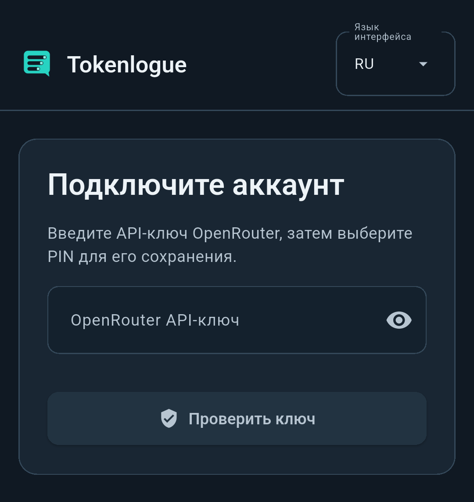
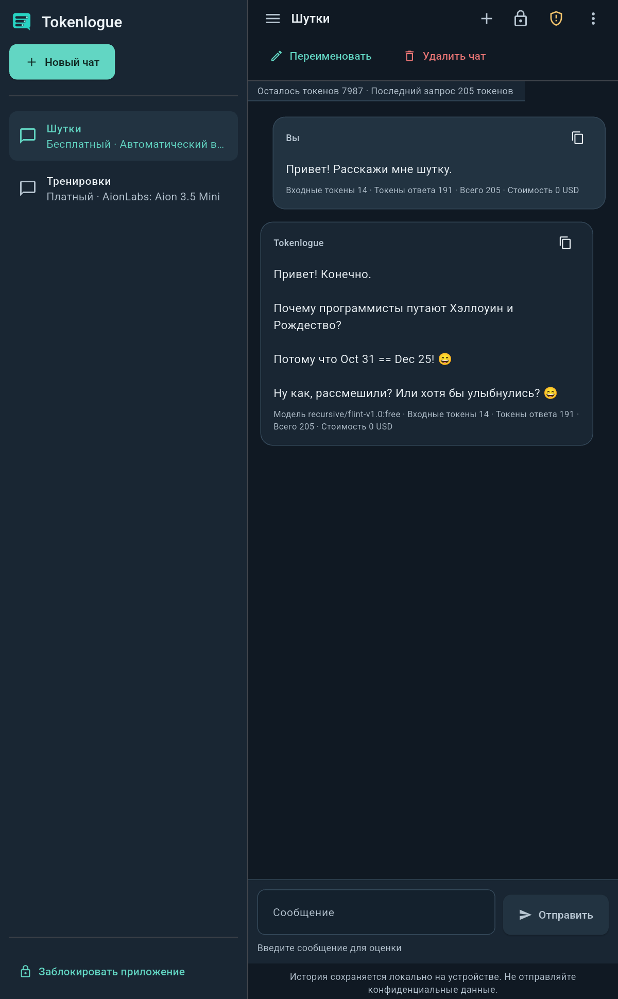

<p align="left">
<a href="android.ru.md" title="Русский"></a>
<a href="android.md" title="English"></a>
<a href="../README.ru.md" title="Главная"></a>&nbsp;<a href="README.ru.md" title="Документы"></a>
</p>

# Tokenlogue для Android

<a id="russian"></a>
<a id="lang-ru"></a>

Tokenlogue позволяет общаться с моделями OpenRouter на телефоне или планшете Android ARM64. Есть русский и английский интерфейс, отдельные черновики чатов и компоновка, которая учитывает доступное место.

<a href="#ru-requirements" title="Требования"></a> · <a href="#ru-install" title="Установка"></a> · <a href="#ru-update" title="Обновление"></a> · <a href="#ru-first-launch" title="Первый запуск"></a> · <a href="security.ru.md#russian" title="Защита"></a>

<a id="ru-requirements"></a>

## 🧩 Требования и совместимость

- Android 7.0 или новее, API 24 и выше.
- Устройство ARM64 с поддержкой ABI `arm64-v8a`.
- API-ключ OpenRouter и интернет для проверки ключа, моделей и сообщений.
- Поддерживаемая блокировка устройства для необязательного системного восстановления PIN в Android 11 и новее.

Минимальный API не означает проверку каждой версии Android или каждого устройства. Текущий пакет прошёл статические проверки выравнивания ELF и ZIP для страниц 4 КиБ и 16 КиБ. Работа на настоящем ARM64-устройстве с ядром 16 КиБ ещё не проверена. Прежний запуск другого пакета через ARM-трансляцию не подтверждает такую работу этого пакета.

<a id="ru-install"></a>

## 📦 Получение и установка APK

На странице <a href="https://github.com/Umichata/tokenlogue/releases" title="Releases">Releases&nbsp;</a> перечислены общедоступные загрузки. Для этой предварительной версии скачайте указанный ниже APK и `RELEASE_SHA256SUMS`. Если этой версии нет в списке, её загрузки ещё не опубликованы. Прежний опубликованный выпуск Linux является отдельным пакетом.


| Текущая версия Android | Значение |
| --- | --- |
| APK | `Tokenlogue-0.1.0-65aa62f-arm64-v8a-v41-test.apk` |
| Версия | `0.1.0`, versionCode `41` |
| Размер | 56 160 490 байт |
| SHA-256 | `2f7c699960e3967220f526245ca2acbf4335104a141ccf3fa2b8a04dae4709d9` |
| SHA-256 сертификата подписи | `927292ad5a76ff049059d1c5d8e9497a42c03f3e995a5d9ca935c59ad8d0b09e` |


Перед установкой сверьте только выбранный APK с `RELEASE_SHA256SUMS`. Сохраните оба файла в одной папке. На компьютере используйте Bash и средства SHA-256, чтобы выполнить из этой папки следующую команду.
```bash
set -o pipefail
file='Tokenlogue-0.1.0-65aa62f-arm64-v8a-v41-test.apk'
awk -v wanted="$file" '$2 == wanted { entry = $0; count++ } END { if (count != 1) exit 1; print entry }' RELEASE_SHA256SUMS |
  sha256sum --check -
```

Выбранный APK должен получить `OK`. Отсутствующая или повторная запись в манифесте, изменённый или отсутствующий файл вызывают ошибку команды. Контрольная сумма обнаруживает изменение байтов и не заменяет подпись издателя.

Исходный комплект предварительной версии содержит внутренний `SHA256SUMS` для проверки полного распакованного комплекта. Для установки и запуска Tokenlogue этот комплект и архивы исходников не нужны.

Передайте проверенный APK на устройство, откройте его и следуйте установщику Android. Система может попросить разрешить установку из использованного файлового менеджера или браузера. Давайте разрешение только для пакета, которому доверяете. После установки его можно отключить.

<a id="ru-update"></a>

## 🔄 Обновление совместимой установки

Установите новый APK поверх совместимой прежней версии с тем же идентификатором приложения и сертификатом подписи. Сохраните данные приложения. Удаление приложения и очистка данных не являются обычным шагом обновления и могут сделать зашифрованную переписку невосстановимой.

Если Android отказывает в обновлении, проверьте версию, архитектуру и подпись пакета. Не удаляйте прежнее приложение только для обхода ошибки подписи. Сохраните данные и <a href="https://github.com/Umichata/tokenlogue/issues" title="обратитесь за помощью">обратитесь за помощью&nbsp;</a>. Укажите имя пакета, версию Android и существенную ошибку. Перед отправкой уберите API-ключи, личную переписку и персональные пути.

<a id="ru-first-launch"></a>

## 💬 Подключение и первый чат

<br>
<br>


Первый запуск на Android.

Выберите язык, введите API-ключ OpenRouter и нажмите `Проверить ключ`. Выберите и повторите четырёхзначный PIN приложения, затем сохраните его. Через `+` выберите бесплатный или платный режим, модель и лимиты. Работа с чатами, черновиками и расходами описана в <a href="user-guide.ru.md#russian" title="руководстве пользователя">руководстве пользователя&nbsp;</a>.

Верхняя левая кнопка открывает панель чатов. Для закрытия выберите чат, нажмите вне панели или используйте Back. Клавиатура может уменьшить место для действий в шапке. Закройте её, чтобы снова показать кнопки переименования и удаления.

<br>
<br>


Рабочее пространство чата Android.

## 🔒 Защита локального профиля

Уход Tokenlogue в фон закрывает доступ. При возвращении введите PIN приложения. Сохранённый черновик восстановится. Разблокировка Android не открывает Tokenlogue автоматически.

На поддерживаемом Android 11 и новее `Забыли PIN?` запрашивает новое системное подтверждение перед сохранением нового PIN приложения. Отмена сохраняет прежний PIN и переписку. Подробнее в разделе <a href="security.ru.md#ru-recovery" title="о восстановлении и шифровании">о восстановлении и шифровании&nbsp;</a>.

Резервное копирование приложения в Android отключено. Приложение использует интернет и системные возможности аутентификации. Доступ к микрофону не запрашивается. Изменение защиты устройства, удаление приложения и очистка данных могут повлиять на ключи, нужные для чтения защищённой переписки. Одна копия базы не является переносимой резервной копией.

<a href="user-guide.ru.md#russian" title="Руководство пользователя"></a> · <a href="security.ru.md#russian" title="Защита"></a> · <a href="source-materials.ru.md#russian" title="Исходные материалы"></a> · <a href="../README.ru.md#russian" title="Tokenlogue"></a>
