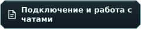

<p align="left">
<a href="linux-appimage.ru.md" title="Русский"></a>
<a href="linux-appimage.md" title="English"></a>
<a href="../README.ru.md" title="Главная"></a>&nbsp;<a href="README.ru.md" title="Документы"></a>
</p>

# Tokenlogue для Linux

<a id="russian"></a>
<a id="lang-ru"></a>

Запускайте Tokenlogue на рабочем столе Linux в формате AppImage. Для обычного использования не нужно отдельно устанавливать Python, Flutter или инструменты сборки. В текущей предварительной версии есть русский и английский интерфейс.

<br>
<br>


Текущий интерфейс Linux. На снимке показан английский язык.

<a href="#ru-requirements" title="Требования"></a> · <a href="#ru-download" title="Скачивание"></a> · <a href="#ru-run" title="Запуск"></a> · <a href="#ru-updates" title="Обновление"></a> · <a href="#ru-help" title="Помощь"></a>

<a id="ru-requirements"></a>

## 🧩 Требования

- Linux x86_64 и процессор с поддержкой x86-64-v2. Базовая среда системных библиотек — Ubuntu 22.04.
- Графический рабочий стол, GTK3 и его зависимости. Одного GTK4 недостаточно.
- Работающие графические драйверы вашего дистрибутива.
- Пользовательская сессия D-Bus и доступный разблокированный Secret Service, например GNOME Keyring. Включённый клиент libsecret сам по себе не является хранилищем ключей.
- FUSE для обычного запуска или место во временном каталоге для extract-and-run.
- API-ключ OpenRouter и интернет для проверки ключа, загрузки моделей и отправки сообщений.

Защита при блокировке экрана и сне рассчитана на поддерживаемую сессию Cinnamon/X11. В других окружениях и Wayland автоматическое наблюдение может быть ограничено. Проверяйте панель защиты приложения и при необходимости блокируйте его вручную.

<a id="ru-download"></a>

## 📦 Скачивание и проверка

На странице <a href="https://github.com/Umichata/tokenlogue/releases" title="Releases">Releases&nbsp;</a> перечислены общедоступные загрузки. Для этой предварительной версии скачайте указанную ниже AppImage и `RELEASE_SHA256SUMS`. Если этой версии нет в списке, её загрузки ещё не опубликованы.


| Файл текущей версии | Значение |
| --- | --- |
| AppImage | `Tokenlogue-0.1.0-65aa62f-linux-x86_64.AppImage` |
| Размер | 35 350 920 байт |
| SHA-256 | `227ad9991dc0b00dfd160003967de6b9a321078b89f6129d0fdd2a620cf8c1ae` |


Сохраните AppImage и `RELEASE_SHA256SUMS` в одной папке. Используйте Bash и средства SHA-256, чтобы проверить из этой папки только выбранный пакет.
```bash
set -o pipefail
file='Tokenlogue-0.1.0-65aa62f-linux-x86_64.AppImage'
awk -v wanted="$file" '$2 == wanted { entry = $0; count++ } END { if (count != 1) exit 1; print entry }' RELEASE_SHA256SUMS |
  sha256sum --check -
```

Выбранная AppImage должна получить `OK`. Отсутствующая или повторная запись в манифесте, изменённый или отсутствующий файл вызывают ошибку команды. Сумма обнаруживает изменение байтов, но не заменяет подпись издателя. Эта AppImage не подписана. Не подменяйте ожидаемую сумму хешем файла, который не прошёл проверку.

Исходный комплект предварительной версии содержит внутренний `SHA256SUMS` для проверки полного распакованного комплекта. Для запуска Tokenlogue этот комплект и архивы исходников не нужны.

[Прежний опубликованный Linux preview](https://github.com/Umichata/tokenlogue/releases/tag/v0.1.0-linux-preview.2b1f7d3) остаётся отдельной версией. Его файл называется `Tokenlogue-0.1.0-2b1f7d3-x86_64.AppImage`, а SHA-256 равен `0852f9432cb089e31fef2722d84ce7124714588afb65d6f25cd64d0616a4779d`. Русский интерфейс и прежняя защита данных отличаются от описанных здесь. Для проверки старых пакетов используйте их файл сумм и <a href="https://github.com/Umichata/tokenlogue/releases/download/v0.1.0-linux-preview.2b1f7d3/RELEASE_NOTES.md" title="примечания к выпуску">примечания к выпуску&nbsp;</a>.

<a id="ru-run"></a>

## 🚀 Запуск Tokenlogue

Один раз разрешите исполнение и запустите проверенную AppImage от своего обычного пользователя.
```bash
chmod u+x ./Tokenlogue-0.1.0-65aa62f-linux-x86_64.AppImage
./Tokenlogue-0.1.0-65aa62f-linux-x86_64.AppImage
```

Хранить файл можно в удобной папке. После выдачи прав его можно открыть через файловый менеджер, поддерживающий запуск программ. AppImage не добавляет пункт меню автоматически. Не запускайте её через `sudo` или `pkexec`.

<a id="ru-without-fuse"></a>

## 🧰 Запуск без FUSE

Если система не может монтировать AppImage через FUSE, используйте extract-and-run.
```bash
./Tokenlogue-0.1.0-65aa62f-linux-x86_64.AppImage --appimage-extract-and-run
```

Программа распакует файлы во временный каталог и запустится без FUSE. Убедитесь, что во временной файловой системе хватает места для распакованных файлов.

<a id="ru-updates"></a>

## 🔄 Обновление с сохранением профиля

Перед запуском замены закройте все прежние копии Tokenlogue. Проверьте новый файл и запустите его в той же учётной записи ОС. Автоматического обновления нет. Замена AppImage не удаляет отдельно сохранённые данные приложения.

При первом успешном входе ранее незащищённая переписка преобразуется до открытия чатов. Всё это время держите прежние копии закрытыми. Не возвращайтесь к старой версии профиля без совместимой резервной копии. Прежние версии могут не понимать обновлённую базу и её защиту.

Одна база не является полной переносимой резервной копией. Ключ шифрования остаётся в системном хранилище. Его потеря может сделать переписку невосстановимой. Перед переносом данных или изменением связки ключей прочитайте <a href="security.ru.md#ru-encryption" title="о защите переписки">о защите переписки&nbsp;</a>.

<a id="ru-current-protection"></a>
<a id="ru-system-recovery"></a>

## 🔑 Необязательное восстановление через учётную запись Linux

Основной способ восстановления PIN в Linux — заранее сохранённый <a href="security.ru.md#ru-recovery" title="резервный код">резервный код&nbsp;</a>. Для него не нужна настройка администратора. Дополнительный пункт `Системное восстановление Linux` требует policy Tokenlogue для polkit и системного агента аутентификации.

Если вы выбираете этот способ, изучите [policy](../packaging/linux/polkit/io.github.umichata.tokenlogue.policy) и [помощник установки](../packaging/linux/polkit/tokenlogue-polkit.py) из исходного комплекта, соответствующего приложению. Однократная команда установки приведена ниже. Выполняйте её из корня репозитория. Она устанавливает policy, а не приложение.
```bash
sudo /usr/bin/python3 -I packaging/linux/polkit/tokenlogue-polkit.py install
```

Проверьте установленную policy от обычного пользователя.
```bash
/usr/bin/python3 -I packaging/linux/polkit/tokenlogue-polkit.py check
```

Помощник устанавливает только проверенную policy Tokenlogue. Он отказывается заменять неожиданные файлы и не меняет пароли Linux, PAM или настройки входа. Сам Tokenlogue по-прежнему запускается обычным пользователем. Каждая попытка восстановления требует нового подтверждения вашей учётной записи в системном окне. Вводите пароль Linux только там.

Для удаления только этой policy используйте команду ниже. Данные приложения сохранятся.
```bash
sudo /usr/bin/python3 -I packaging/linux/polkit/tokenlogue-polkit.py uninstall
```

<a id="ru-help"></a>

## 🛠️ Помощь при запуске


| Проблема | Что проверить |
| --- | --- |
| Отказано в доступе | Право исполнения и возможность запуска программ на выбранной файловой системе. |
| Ошибка монтирования FUSE | Попробуйте extract-and-run выше. |
| Не найдена библиотека GTK | Восстановите GTK3 и его зависимости через пакетный менеджер дистрибутива. |
| Хранилище ключей недоступно | Разблокируйте Secret Service и проверьте пользовательскую сессию D-Bus. Сохраните файлы профиля. |
| Illegal instruction | Убедитесь, что процессор поддерживает x86-64-v2. |
| Ошибка графики | Проверьте драйверы системы и GTK3. Сообщение в терминале может объяснить причину. |
| Уже работает другая копия | Закройте другую копию с тем же каталогом данных. Не обходите блокировку профиля. |


В <a href="https://github.com/Umichata/tokenlogue/issues" title="обращении за помощью">обращении за помощью&nbsp;</a> укажите имя пакета, дистрибутив, рабочее окружение и существенную ошибку. Перед отправкой уберите API-ключи, личную переписку и персональные пути.

<a id="ru-delete"></a>

<a href="user-guide.ru.md#russian" title="Подключение и работа с чатами"></a> · <a href="security.ru.md#russian" title="PIN, восстановление и удаление профиля"></a> · <a href="source-materials.ru.md#russian" title="Исходники и лицензии"></a> · <a href="../README.ru.md#russian" title="Tokenlogue"></a>
