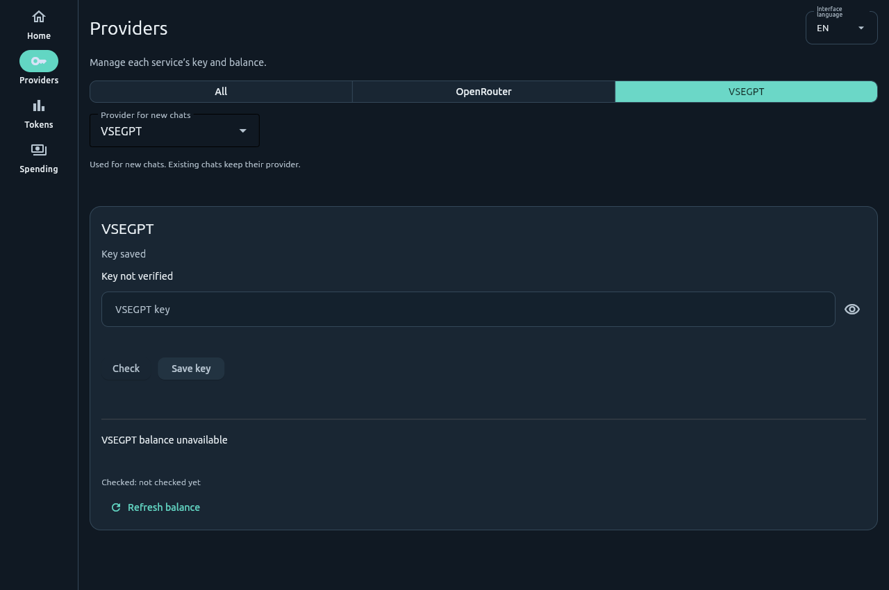
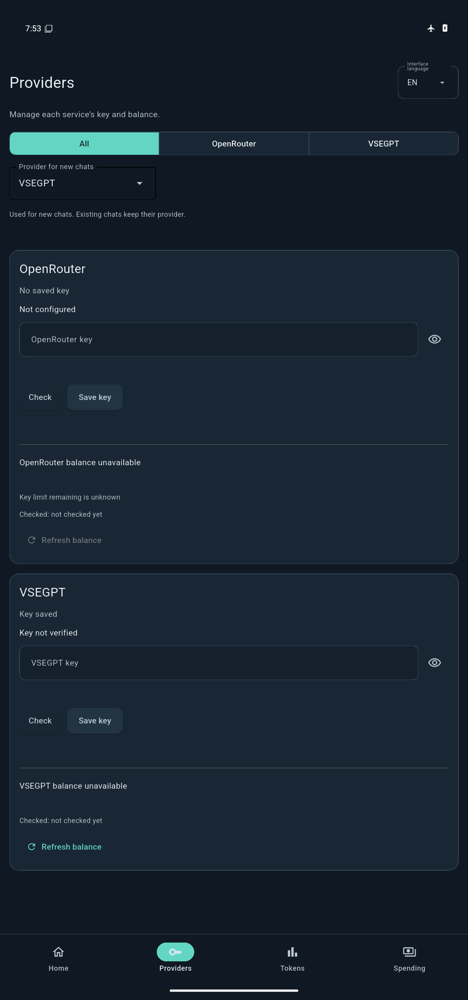

[English](providers.md#english) · [Русский](providers.ru.md#russian)

# Provider keys and balances

[Home](../README.md) · [Documentation](../docs/README.md)

> **0.1.1 is local.** These instructions describe the current source and local builds. [Published 0.1.0 Preview](https://github.com/Umichata/tokenlogue/releases/tag/v0.1.0-preview.a981db9) is the earlier release. Its download links do not provide 0.1.1.

## Choose what to view

Use **All · OpenRouter · VSEGPT** to show both service cards or one. The filter belongs to this page and is retained when you leave and return. It does not choose the provider of a chat.

| Linux | Android emulator |
| --- | --- |
|  |  |

*Demonstration data. Android images show an emulator.*

## Check or replace a key

After the first setup, each form belongs to its named service. OpenRouter accepts complete `sk-or-v1-` keys. VSEGPT accepts complete `sk-or-vv-` and `sk-or-vis` keys. The latter does not require an extra hyphen. All prefixes need a secret continuation.

1. Select the service or **All**.
2. Enter its key in that service's field. Saved secrets are never filled back into editors.
3. Choose **Check**. The app checks only the matching service through a free endpoint.
4. Choose **Save key** when authorized, or explicitly **Save unverified key** when offered.

A failed check or cancelled replacement keeps the saved key. Entering another service's key is rejected locally. It is not forwarded elsewhere. Prefix recognition alone does not prove authorization or funds.

Each card retains only its own unfinished candidate while unlocked. Changing the filter masks it. The reveal button shows your entered candidate only. Locking clears all cards, including hidden inputs. Do not share screenshots containing a key.

## Choose the provider for new chats

**Provider for new chats** is a separate setting from the viewing filter. Existing chats retain their service, currency and model. A missing key must be added for that service before sending. Tokenlogue does not move the chat history to the other provider after an error.

## Read balance and key status

| Value | Meaning |
| --- | --- |
| OpenRouter balance | Account credits minus account usage, in USD, when access is allowed. |
| Key limit remaining | The separate OpenRouter key's remaining spending cap. |
| VSEGPT balance | RUB credits accessible through that key. |
| Chat budget | A local limit for one conversation, shown on Home rather than as a provider balance. |

VSEGPT has no supported separate key-limit indicator. This does not make a working key invalid or prevent paid-model selection. OpenRouter keys can work for chats without access to account credits. Enable VSEGPT balance access in the service settings if it is disabled.

**Refresh balance** updates the named service. Loading, unavailable and outdated amounts stay distinct. A failed refresh keeps the last known amount marked as outdated. A known zero is shown as zero. Missing subscriptions, insufficient funds and authorization failures have their own states.

A free validation is not a paid generation. Saving an unverified key starts no chat request. Read [chat budgets](user-guide.md) and [data protection](security.md) before sending sensitive information.
