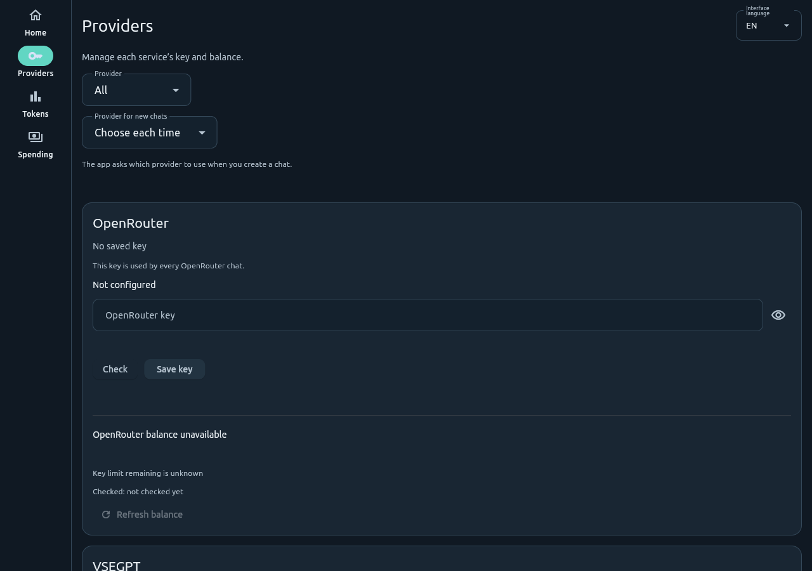
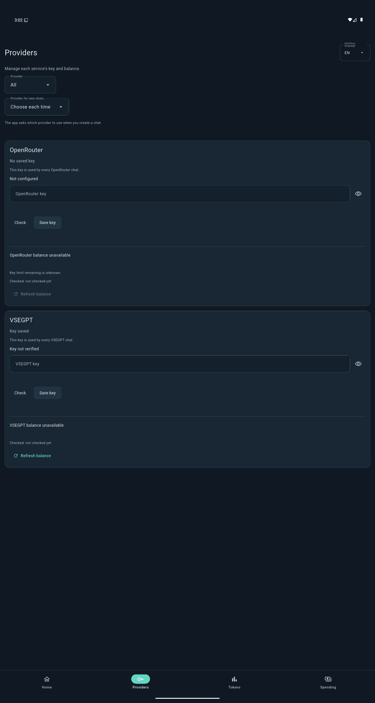

 
  

    

# Provider keys and balances

> **[0.1.1 Preview](https://github.com/Umichata/tokenlogue/releases/tag/v0.1.1-preview.1)** provides an Android ARM64 APK and a Linux x86_64 desktop bundle. Read the platform requirements and verify the downloaded file before installing.

##  Choose what to view

Use the **Provider** dropdown with **All**, **OpenRouter** and **VSEGPT** to show both service cards or one. The filter belongs to this page and is retained when you leave and return. It does not choose the provider of a chat.

| Linux | Android emulator |
| --- | --- |
| <a href="assets/screenshots/v011-55-linux-providers-en.png">  </a> | <a href="assets/screenshots/v011-55-android-providers-en.png">  </a> |

*Demonstration data. Android images show an emulator.*

##  Check or replace a key

After the first setup, each form belongs to its named service. OpenRouter accepts complete `sk-or-v1-` keys. VSEGPT accepts complete `sk-or-vv-` and `sk-or-vis` keys. The latter does not require an extra hyphen. All prefixes need a secret continuation.

1. Select the service or **All**.
2. Enter its key in that service's field. Saved secrets are never filled back into editors.
3. Choose **Check**. The app checks only the matching service through a free endpoint.
4. Choose **Save key** when authorized, or explicitly **Save unverified key** when offered.

One protected key is saved per service and shared by all its chats. Replacing it updates the connection shown in every chat of that provider. PIN, conversations, drafts and budgets are preserved.

A failed check or cancelled replacement keeps the saved key. Entering another service's key is rejected locally. It is not forwarded elsewhere. Prefix recognition alone does not prove authorization or funds.

Each card retains only its own unfinished candidate while unlocked. Changing the filter masks it. The reveal button shows your entered candidate only. Locking clears all cards, including hidden inputs. Do not share screenshots containing a key.

You can check an already saved key without re-entering it on the OpenRouter mode screen or the VSEGPT model list. Choose **Check key**. This is separate from refreshing the catalogue. The status changes only after a real check of the selected service. If VSEGPT does not allow balance access, the key stays unverified. See [Check the saved key](user-guide.md#en-check-saved-key).

##  Choose the provider for new chats

**Provider for new chats** is separate from the viewing filter and does not change existing chats. Choose **Choose each time** to select a service whenever you start a chat, or choose one service to use it directly. New profiles start with manual selection. Existing profiles retain their previous service choice, including the older default when no separate preference was saved. Choosing a service for one chat does not change this setting. If its key is missing, the app opens that service’s form. Cancel returns without creating an empty chat or losing the old draft. Use [Chat connection](user-guide.md#en-chat-connection) in a chat’s **⋮** menu to change that chat’s provider with an explicit model and budget review. Configure a missing key for the intended service before continuing. An error never moves history to another provider automatically.

##  Read balance and key status

| Value | Meaning |
| --- | --- |
| OpenRouter balance | Account credits minus account usage, in USD, when access is allowed. |
| Key limit remaining | The separate OpenRouter key's remaining spending cap. |
| VSEGPT balance | RUB credits accessible through that key. |
| Chat budget | A local limit for one conversation, shown on Home rather than as a provider balance. |

VSEGPT has no supported separate key-limit indicator. This does not make a working key invalid or prevent paid-model selection. OpenRouter keys can work for chats without access to account credits. Enable VSEGPT balance access in the service settings if it is disabled.

**Refresh balance** updates the named service. Loading, unavailable and outdated amounts stay distinct. A failed refresh keeps the last known amount marked as outdated. A known zero is shown as zero. Missing subscriptions, insufficient funds and authorization failures have their own states.

A free validation is not a paid generation. Saving an unverified key starts no chat request. Read [chat budgets](user-guide.md) and [data protection](security.md) before sending sensitive information.

If OpenRouter supplies a daily free-request count, its card shows the remaining allowance for the UTC day. This counts requests, separately from account credits, the key spending cap and chat tokens. An unavailable count is not replaced with zero.
