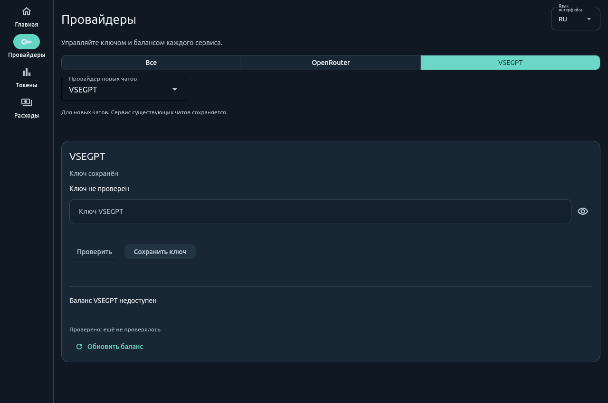
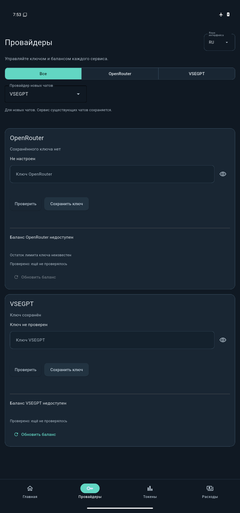

[English](providers.md#english) · [Русский](providers.ru.md#russian)

# Ключи и балансы провайдеров

[Главная](../README.ru.md) · [Документация](../docs/README.ru.md)

> **0.1.1 доступна локально.** Руководство описывает текущие исходники и локальные сборки. [Опубликованный 0.1.0 Preview](https://github.com/Umichata/tokenlogue/releases/tag/v0.1.0-preview.a981db9) — прежний выпуск. По его ссылкам нельзя скачать 0.1.1.

## Выбор просмотра

Переключатель **Все · OpenRouter · VSEGPT** показывает две карточки или один сервис. Выбор относится к этой странице и сохраняется при возвращении. Он не выбирает провайдера чата.

| Linux | Эмулятор Android |
| --- | --- |
|  |  |

*Демонстрационные данные. Кадры Android сняты в эмуляторе.*

## Проверка и замена ключа

После первого подключения каждая форма относится к указанному сервису. OpenRouter принимает полные ключи `sk-or-v1-`. VSEGPT принимает `sk-or-vv-` и `sk-or-vis`. После последнего дополнительный дефис не нужен. Для каждого начала необходимо секретное продолжение.

1. Выберите сервис или **Все**.
2. Введите ключ в поле этого сервиса. Сохранённые секреты не загружаются обратно в редактор.
3. Нажмите **Проверить**. Бесплатная проверка обращается только к соответствующему сервису.
4. Выберите **Сохранить ключ** после подтверждения или явно **Сохранить непроверенный ключ**, когда это предложено.

Для каждого сервиса сохранён один защищённый ключ, общий для всех его чатов. Замена обновляет подключение во всех чатах этого провайдера. PIN, переписка, черновики и бюджеты сохраняются.

Ошибка проверки или отмена замены сохраняют прежний ключ. Ключ другого сервиса отклоняется локально и никуда не перенаправляется. Определение по началу не подтверждает авторизацию или наличие средств.

В разблокированном сеансе карточка хранит только собственный незавершённый ввод. Смена фильтра маскирует его. Кнопка показа раскрывает только введённый кандидат. Блокировка очищает все карточки, включая скрытые. Не делитесь снимками с ключом.

## Провайдер новых чатов

**Провайдер новых чатов** задаётся отдельно от фильтра просмотра и не меняет существующие чаты. Для явной смены провайдера выбранного чата откройте [Подключение чата](user-guide.ru.md#ru-chat-connection) в **⋮** и проверьте модель и бюджет. Перед продолжением настройте отсутствующий ключ нужного сервиса. При ошибке переписка не переносится другому провайдеру автоматически.

## Баланс и состояние ключа

| Значение | Смысл |
| --- | --- |
| Баланс OpenRouter | Кредиты аккаунта за вычетом его использования в USD, если доступ разрешён. |
| Остаток лимита ключа | Остаток отдельного денежного ограничения ключа OpenRouter. |
| Баланс VSEGPT | Кредиты в RUB, доступные через данный ключ. |
| Бюджет чата | Местное ограничение одного разговора на Главной, а не баланс провайдера. |

Для VSEGPT отдельный лимит ключа не поддерживается. Это не делает рабочий ключ недействительным и не мешает выбору платной модели. Ключ OpenRouter может работать для чатов без доступа к кредитам аккаунта. Если доступ к балансу VSEGPT выключен, включите его в настройках сервиса.

**Обновить баланс** обращается к указанному сервису. Загрузка, недоступная и устаревшая сумма различаются. При ошибке последнее значение сохраняется с отметкой устаревшего. Известный ноль показывается нулём. Отсутствие подписки, недостаток средств и отказ авторизации имеют собственные состояния.

Бесплатная проверка не выполняет платную генерацию. Сохранение непроверенного ключа не отправляет запрос в чат. Перед отправкой личных сведений прочитайте о [бюджете чата](user-guide.ru.md) и [защите данных](security.ru.md).
