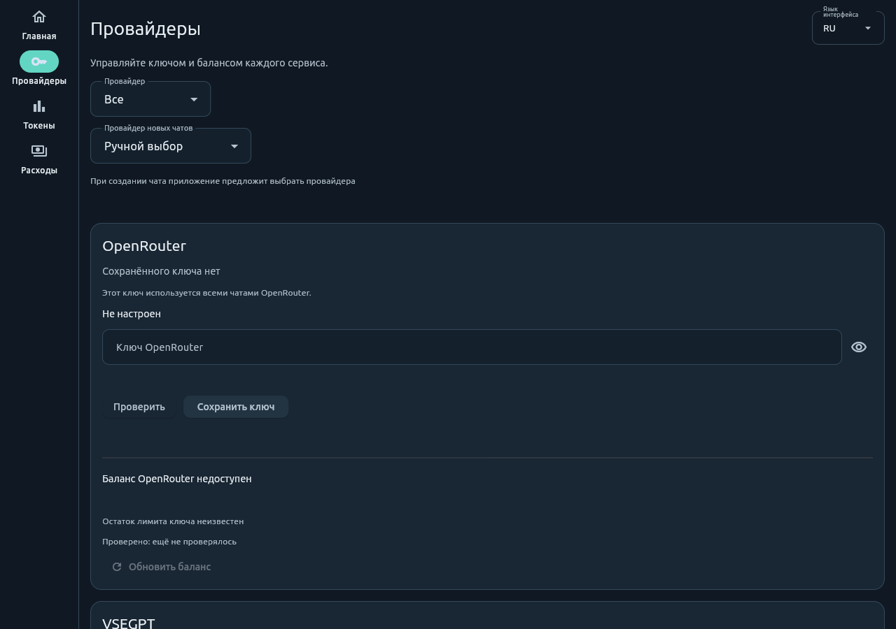
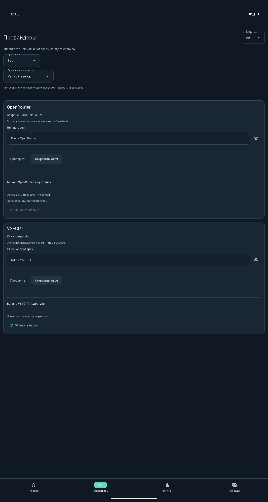

 
   

    

# Ключи и балансы провайдеров

> **[0.1.1 Preview](https://github.com/Umichata/tokenlogue/releases/tag/v0.1.1-preview.1)** содержит APK версии на Python для Android ARM64 (сборка 56) и настольный bundle Linux x86_64. Перед установкой проверьте требования платформы и сумму скачанного файла.

##  Выбор просмотра

Выпадающий список **Провайдер** с вариантами **Все**, **OpenRouter** и **VSEGPT** показывает две карточки или один сервис. Выбор относится к этой странице и сохраняется при возвращении. Он не выбирает провайдера чата.

| Linux | Эмулятор Android |
| --- | --- |
| <a href="assets/screenshots/v011-55-linux-providers-ru.png">  </a> | <a href="assets/screenshots/v011-55-android-providers-ru.png">  </a> |

*Демонстрационные данные. Кадры Android сняты в эмуляторе.*

##  Проверка и замена ключа

После первого подключения каждая форма относится к указанному сервису. OpenRouter принимает полные ключи `sk-or-v1-`. VSEGPT принимает `sk-or-vv-` и `sk-or-vis`. После последнего дополнительный дефис не нужен. Для каждого начала необходимо секретное продолжение.

1. Выберите сервис или **Все**.
2. Введите ключ в поле этого сервиса. Сохранённые секреты не загружаются обратно в редактор.
3. Нажмите **Проверить**. Бесплатная проверка обращается только к соответствующему сервису.
4. Выберите **Сохранить ключ** после подтверждения или явно **Сохранить непроверенный ключ**, когда это предложено.

Для каждого сервиса сохранён один защищённый ключ, общий для всех его чатов. Замена обновляет подключение во всех чатах этого провайдера. PIN, переписка, черновики и бюджеты сохраняются.

Ошибка проверки или отмена замены сохраняют прежний ключ. Ключ другого сервиса отклоняется локально и никуда не перенаправляется. Определение по началу не подтверждает авторизацию или наличие средств.

В разблокированном сеансе карточка хранит только собственный незавершённый ввод. Смена фильтра маскирует его. Кнопка показа раскрывает только введённый кандидат. Блокировка очищает все карточки, включая скрытые. Не делитесь снимками с ключом.

Проверить уже сохранённый ключ можно без повторного ввода на экране режимов OpenRouter и в списке моделей VSEGPT. Нажмите **Проверить ключ**. Это отдельное действие от обновления каталога. Статус меняется только после настоящей проверки выбранного сервиса. Если VSEGPT не разрешает чтение баланса, ключ остаётся непроверенным. См. [Проверка сохранённого ключа](user-guide.ru.md#ru-check-saved-key).

##  Провайдер новых чатов

В поле **Провайдер новых чатов** выберите **Ручной выбор**, чтобы выбирать сервис при каждом создании, либо укажите конкретный сервис. Новый профиль начинает с ручной политики. В существующем профиле сохраняется прежний сервис, включая старый выбор по умолчанию без отдельной настройки. Выбор сервиса для одного чата не меняет настройку. При отсутствии ключа открывается форма нужного сервиса. Отмена возвращает назад без пустого чата и потери прежнего черновика.

**Провайдер новых чатов** задаётся отдельно от фильтра просмотра и не меняет существующие чаты. Для явной смены провайдера выбранного чата откройте [Подключение чата](user-guide.ru.md#ru-chat-connection) в **⋮** и проверьте модель и бюджет. Перед продолжением настройте отсутствующий ключ нужного сервиса. При ошибке переписка не переносится другому провайдеру автоматически.

##  Баланс и состояние ключа

| Значение | Смысл |
| --- | --- |
| Баланс OpenRouter | Кредиты аккаунта за вычетом его использования в USD, если доступ разрешён. |
| Остаток лимита ключа | Остаток отдельного денежного ограничения ключа OpenRouter. |
| Баланс VSEGPT | Кредиты в RUB, доступные через данный ключ. |
| Бюджет чата | Местное ограничение одного разговора на Главной, а не баланс провайдера. |

Для VSEGPT отдельный лимит ключа не поддерживается. Это не делает рабочий ключ недействительным и не мешает выбору платной модели. Ключ OpenRouter может работать для чатов без доступа к кредитам аккаунта. Если доступ к балансу VSEGPT выключен, включите его в настройках сервиса.

**Обновить баланс** обращается к указанному сервису. Загрузка, недоступная и устаревшая сумма различаются. При ошибке последнее значение сохраняется с отметкой устаревшего. Известный ноль показывается нулём. Отсутствие подписки, недостаток средств и отказ авторизации имеют собственные состояния.

Бесплатная проверка не выполняет платную генерацию. Сохранение непроверенного ключа не отправляет запрос в чат. Перед отправкой личных сведений прочитайте о [бюджете чата](user-guide.ru.md) и [защите данных](security.ru.md).

Если OpenRouter передаёт суточный счётчик бесплатных запросов, карточка показывает остаток за день по UTC. Это число запросов, отдельное от баланса, денежного лимита ключа и токенов чата. Отсутствующее значение не заменяется нулём.
