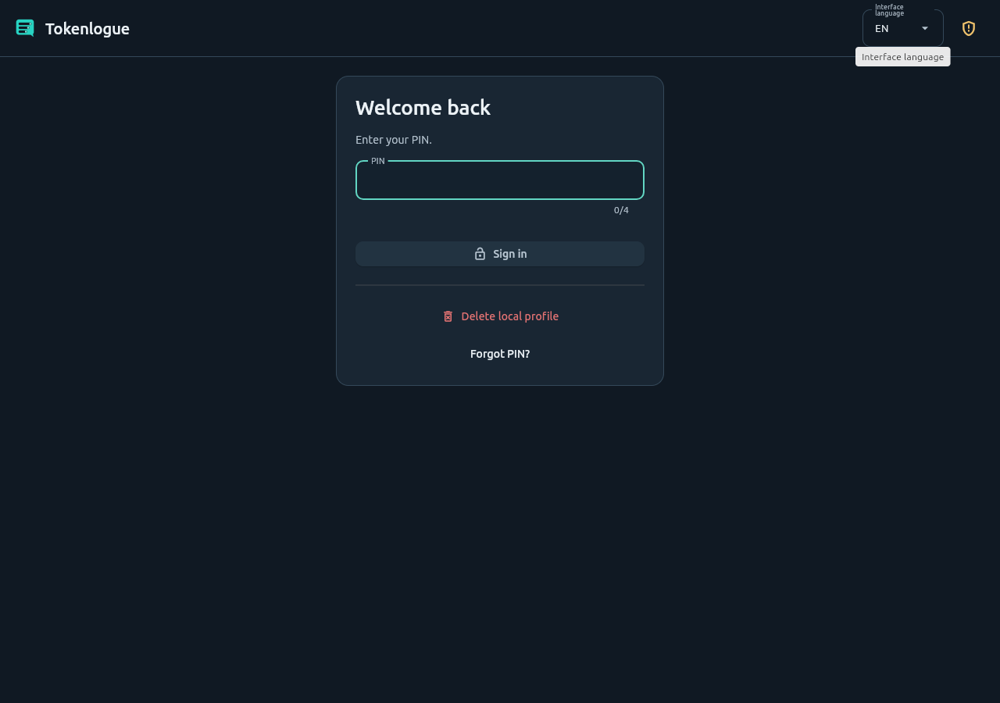
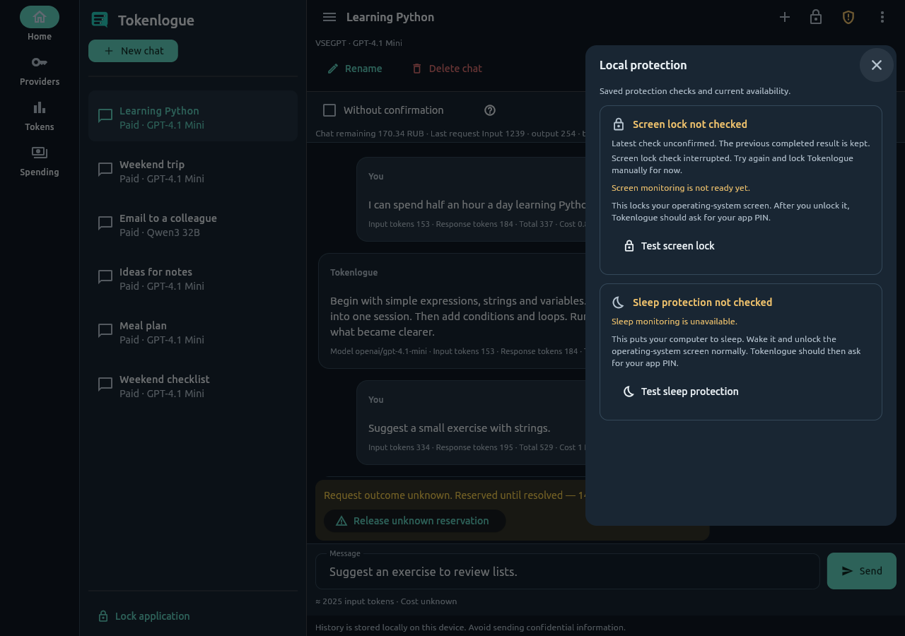
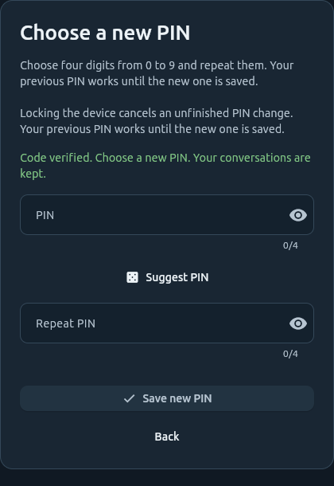
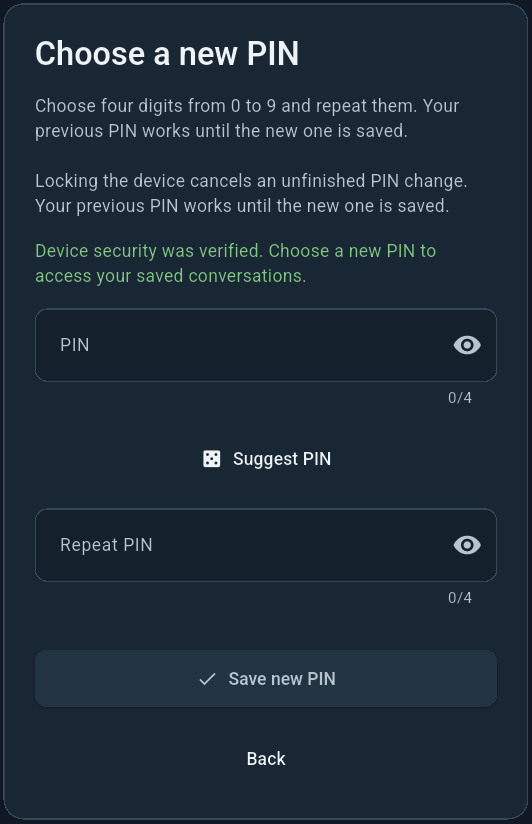
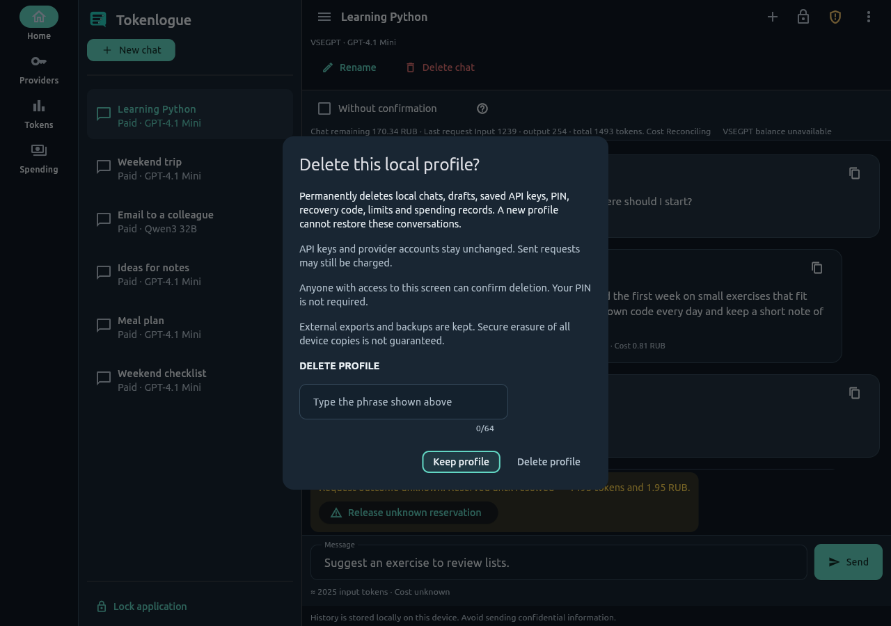

 
   

    

# Protect conversations and recover access

> **[0.1.1 Preview](https://github.com/Umichata/tokenlogue/releases/tag/v0.1.1-preview.1)** provides the Python edition for Android ARM64 (APK56) and Linux x86_64. Read the platform requirements and verify the downloaded file before installing.

##  PIN and app locking

Choose four digits `0`–`9` and repeat them during setup. A leading zero is allowed. The app PIN is separate from your operating-system password and from the encryption key.

Three incorrect PIN checks block entry for five minutes. Restarting does not reset the countdown. The same limit applies when confirming a PIN to issue a recovery code.

Use the lock button before leaving the device. Locking saves the draft and closes all private pages. Entered provider candidates and visible analytics are cleared, including hidden cards. An already dispatched request can finish and record its response once. Unlocking never sends a draft.

*Separate demonstration profile. No PIN or recovery secret is shown.*

Android backgrounding closes access. Returning or unlocking Android still requires the app PIN. On Linux, supported Cinnamon/X11 monitoring can lock the app on a screen lock, session change or suspend. Minimizing alone does not lock it. Other desktops and Wayland can limit monitoring, so use manual app locking when needed.

##  Check Linux protection

After first setup, **Check local protection** introduces the check. The PIN is already saved. **Start check** requests a normal system lock. Unlock Linux, then enter your app PIN and review the result. You can continue with manual app locking and check later.

The shield opens the protection panel without locking or suspending the computer. Screen-lock and sleep checks have separate results. A saved result does not prove that current monitoring remains available. Enter your Linux password only in the operating system's authentication window.

<a href="assets/screenshots/v011-55-linux-local-protection-en.png">  </a>

*This example has no confirmed system monitoring. Use manual app locking when monitoring is unavailable.*

##  Recover a forgotten PIN

Recovery replaces an app PIN while keeping the original protected encryption key. It cannot rebuild a lost key or restore a database from a code alone. Cancelling before saving keeps the old PIN.

### Linux recovery code

After signing in, choose **Recovery code** in **⋮** and confirm your app PIN. Save the displayed 32-character code separately and repeat it to confirm storage. Anyone with the code can replace the app PIN. Clipboard history can keep a copied code.

The old code remains valid until a replacement is confirmed. You cannot reveal the same code later. Choose **Forgot PIN?**, enter your saved code, then choose and save a new PIN. Letter case, ordinary spaces and hyphens are accepted. Five wrong code checks block code entry for 30 seconds.

Saving a replacement PIN consumes the used code. Save and confirm the replacement offered afterwards. If you close the app first, sign in with the new PIN and issue another code. Creating a code for an already locked profile requires valid access first.

<a href="assets/screenshots/v011-55-linux-recovery-verified-en.png">  </a>

*Separate demonstration profile. No recovery code or PIN is shown.*

The [code-entry form](assets/screenshots/v011-55-linux-recovery-en.png).

### Linux system recovery

The separate **Use Linux system recovery** option needs the Tokenlogue polkit policy and desktop authentication agent. It requests fresh confirmation of your own Linux account. An already unlocked keyring or another administrator does not replace this proof. See [optional Linux setup](linux-appimage.md).

### Android system recovery

On supported Android 11 or later devices, **Forgot PIN?** requests fresh system verification with the device PIN, pattern, password or supported biometrics. Fingerprint is not required. Android 7–10 can run the app but do not provide this recovery method. Set an Android screen lock before using it.

After confirmation, choose and repeat a new app PIN and save it. Cancelling before saving keeps the old PIN and conversations. If the device check is unavailable, use the current app PIN.

<a href="assets/screenshots/v011-55-android-recovery-new-pin-en.png">  </a>

*Android emulator after normal device verification. Both new-PIN fields are empty. Availability depends on the device and its screen lock.*

##  Encryption and separate storage

Saved chat titles, messages and drafts are encrypted. A random key is stored separately in platform secure storage. It is not derived from the four-digit PIN or provider key. Linux needs an available Secret Service such as GNOME Keyring.

Provider and model identifiers, dates, currencies, token counts, budgets and accounting states remain readable. This protects selected fields rather than the entire database or device. It is not end-to-end encryption with a provider. Sending shares the required content with the service assigned to the chat and its selected model provider.

Changing a chat’s provider requires an explicit review of the new service, model and budget. No history is sent while configuring. The next ordinary send shares only the new message and completed pairs that fit the model context with that service. Cancel before confirming to keep the existing connection. Changing the connection preserves local encryption and does not change the PIN or encryption key.

OpenRouter and VSEGPT keys occupy separate protected entries. Preferences and conversation fields do not store them. Matching a prefix does not confirm authorization. A key is never retried on the other service, forwarded to another host on redirect or used for an automatic paid check.

When storage or its key is unavailable, conversations remain closed. Restore the system key store and retry your PIN rather than deleting files. A supported plaintext profile is encrypted during the first successful sign-in without discarding its chats or accounting. Keep other copies closed.

A database copy does not contain its separate encryption key. Android backup is disabled. Uninstalling, clearing data, losing the key store or invalidating Android Keystore can make conversations unrecoverable. PIN recovery cannot recover a lost encryption key. Locking also cannot protect an already compromised OS or promise erasure of every copy from memory, swap or old backups.

##  Delete a local profile

**Deletion is irreversible in Tokenlogue.** Use recovery if you want to keep the conversations.

**Delete local profile** is available from the PIN screen or **⋮**, including during PIN lockout. It needs no old PIN or network access. Anyone able to use this screen can confirm it. Read the warning, type **DELETE PROFILE** exactly and choose **Delete profile**. **Keep profile** cancels before acceptance.

*Separate demonstration profile. The typed confirmation is an intent check, not an identity check.*

Deletion removes both local provider keys, PIN, recovery material, encryption key, chats, drafts, limits and statistics. Language and layout preferences remain. External copies remain too, and secure physical erasure is not guaranteed.

If accepted deletion is interrupted, use **Finish deletion** or restart to continue. Chats remain closed until removal finishes. Deletion does not revoke remote keys, cancel dispatched requests or refund charges. Use [Providers](providers.md) to replace a key while keeping the profile.
