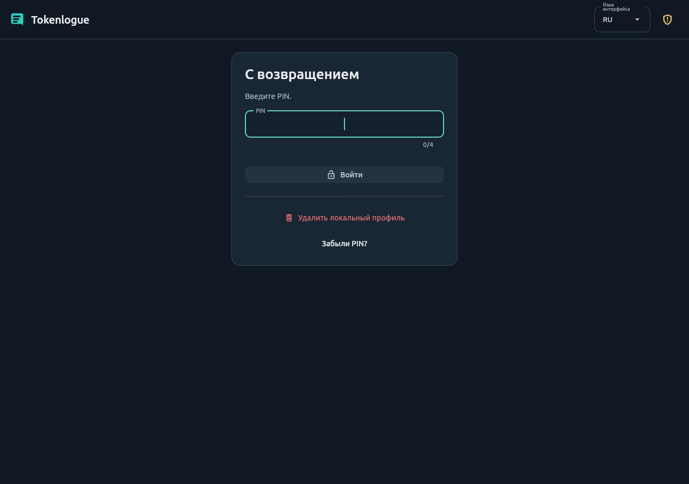
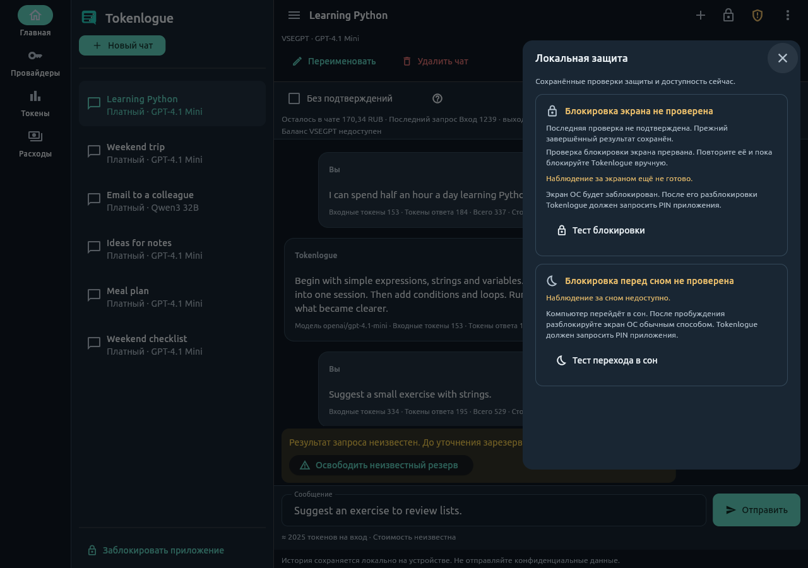
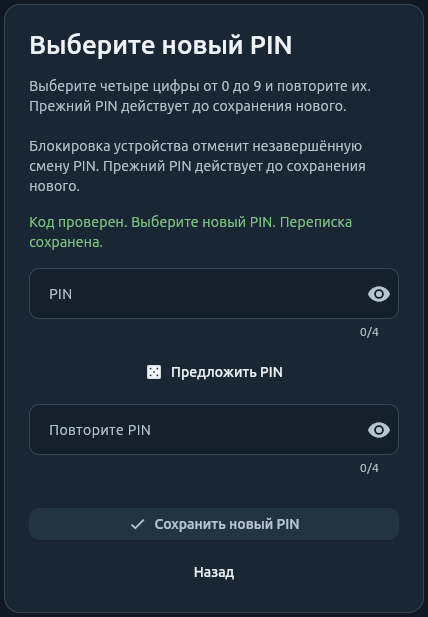
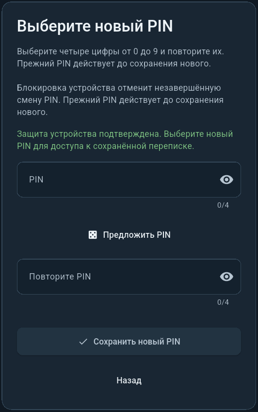
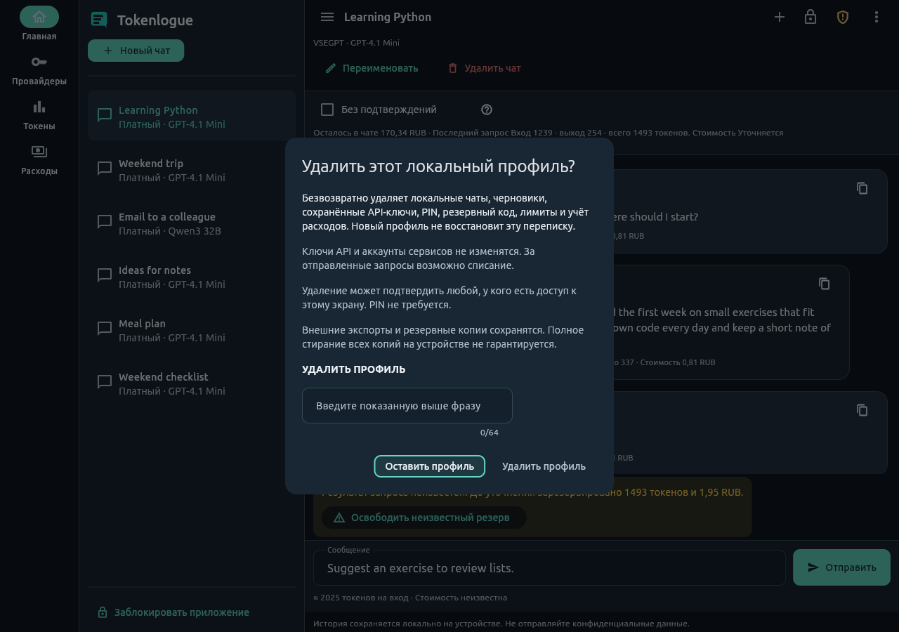

 
  

    

# Защита переписки и восстановление доступа

> **[0.1.1 Preview](https://github.com/Umichata/tokenlogue/releases/tag/v0.1.1-preview.1)** содержит APK Android ARM64 и настольный bundle Linux x86_64. Перед установкой проверьте требования платформы и сумму скачанного файла.

##  PIN и блокировка

Выберите четыре цифры `0`–`9` и повторите их при настройке. Начальный ноль допустим. PIN приложения отличается от пароля ОС и ключа шифрования.

После трёх неверных проверок ввод блокируется на пять минут. Перезапуск не сбрасывает отсчёт. То же ограничение действует при подтверждении PIN для выпуска резервного кода.

Перед уходом используйте кнопку блокировки. Черновик сохраняется, все приватные страницы закрываются. Введённые кандидаты ключей и видимая аналитика очищаются, включая скрытые карточки. Уже отправленный запрос может один раз завершиться и сохранить ответ. Разблокировка не отправляет черновик.

*Отдельный демонстрационный профиль. PIN и секрет восстановления не показаны.*

Android закрывает доступ при уходе в фон. Возвращение или разблокировка Android по-прежнему требуют PIN приложения. В Linux поддерживаемое наблюдение Cinnamon/X11 закрывает доступ при блокировке, смене сеанса или сне. Одно сворачивание не блокирует приложение. Другие окружения и Wayland могут ограничивать наблюдение. При необходимости используйте ручную блокировку.

##  Проверка защиты Linux

После начальной настройки **Проверка локальной защиты** объясняет порядок действий. PIN уже сохранён. **Начать проверку** запрашивает обычную блокировку системы. Разблокируйте Linux, введите PIN приложения и посмотрите результат. Можно продолжить с ручной блокировкой и проверить позднее.

Щит открывает панель без блокировки или сна компьютера. Проверки экрана и сна имеют разные результаты. Сохранённый результат не гарантирует доступность наблюдения сейчас. Пароль Linux вводится только в системном окне аутентификации.

<a href="assets/screenshots/v011-55-linux-local-protection-ru.png">  </a>

*В этом примере системное наблюдение не подтверждено. Если оно недоступно, блокируйте приложение вручную.*

##  Восстановление забытого PIN

Восстановление заменяет PIN приложения с сохранением исходного защищённого ключа шифрования. Оно не воссоздаёт потерянный ключ и не восстанавливает базу по одному коду. Отмена до сохранения оставляет прежний PIN.

### Резервный код Linux

После входа выберите **Резервный код** в **⋮** и подтвердите PIN. Сохраните показанный код из 32 символов отдельно и повторите для подтверждения. Любой обладатель кода может заменить PIN. История буфера обмена может сохранить скопированный код.

Прежний код действует до подтверждения замены. Повторно показать его нельзя. Выберите **Забыли PIN?**, введите сохранённый код, затем выберите и сохраните новый PIN. Допускаются разный регистр букв, обычные пробелы и дефисы. После пяти неверных проверок ввод кода блокируется на 30 секунд.

Сохранение нового PIN расходует использованный код. Сохраните и подтвердите предложенную замену. Если приложение сначала закрыто, войдите с новым PIN и выпустите другой код. Для создания кода в уже закрытом профиле сначала нужен действующий способ входа.

<a href="assets/screenshots/v011-55-linux-recovery-verified-ru.png">  </a>

*Отдельный демонстрационный профиль. Резервный код и PIN не показаны.*

[Форма ввода кода](assets/screenshots/v011-55-linux-recovery-ru.png).

### Системное восстановление Linux

Отдельное **Системное восстановление Linux** требует policy Tokenlogue для polkit и агента аутентификации. Оно запрашивает новое подтверждение вашей учётной записи Linux. Разблокированная связка ключей и другой администратор не заменяют подтверждение. См. [дополнительную настройку Linux](linux-appimage.ru.md).

### Системное восстановление Android

На поддерживаемом Android 11 и новее **Забыли PIN?** запрашивает новую системную проверку PIN, графического ключа, пароля или поддерживаемой биометрии устройства. Отпечаток пальца необязателен. Android 7–10 могут запускать приложение, но этого способа восстановления нет. На устройстве должна быть настроена блокировка экрана.

После подтверждения выберите и повторите новый PIN приложения, затем сохраните. Отмена до сохранения оставляет прежний PIN и переписку. При недоступной системной проверке используйте текущий PIN приложения.

<a href="assets/screenshots/v011-55-android-recovery-new-pin-ru.png">  </a>

*Эмулятор Android после обычной системной проверки. Оба поля нового PIN пусты. Доступность зависит от устройства и его блокировки экрана.*

##  Шифрование и раздельное хранение

Сохранённые названия чатов, сообщения и черновики шифруются. Случайный ключ находится отдельно в платформенном защищённом хранилище. Он не выводится из четырёхзначного PIN или ключа провайдера. В Linux нужен доступный Secret Service, например GNOME Keyring.

ID провайдеров и моделей, даты, валюты, счётчики токенов, бюджеты и состояния учёта остаются читаемыми. Защищены отдельные поля, а не вся база или устройство. Это не сквозное шифрование с провайдером. При отправке нужное содержимое получает сервис выбранного чата и его поставщик модели.

Для смены провайдера чата нужно явно проверить новый сервис, модель и бюджет. Во время настройки переписка не передаётся. При следующей обычной отправке сервис получит только новое сообщение и завершённые пары, помещающиеся в контекст модели. Отмена до подтверждения сохраняет прежнее подключение. Смена подключения сохраняет местное шифрование и не меняет PIN или ключ шифрования.

Ключи OpenRouter и VSEGPT находятся в разных защищённых записях. В настройках и полях переписки они не хранятся. Подходящее начало не подтверждает авторизацию. Ключ не проверяется на другом сервисе, не передаётся иному хосту при перенаправлении и не используется для автоматической платной проверки.

Если хранилище или ключ недоступны, переписка остаётся закрытой. Восстановите доступ к системному хранилищу и повторите PIN, не удаляя файлы. Поддерживаемый открытый профиль шифруется при первом успешном входе с сохранением чатов и учёта. Другие копии приложения должны быть закрыты.

Одна копия базы не содержит отдельный ключ шифрования. Резервное копирование Android отключено. Удаление приложения, очистка данных, потеря хранилища и недействительность Android Keystore могут сделать переписку невосстановимой. Восстановление PIN не воссоздаёт потерянный ключ шифрования. Блокировка также не защищает скомпрометированную ОС и не гарантирует удаления всех копий из памяти, swap и прежних резервных копий.

##  Удаление локального профиля

**Удаление необратимо средствами Tokenlogue.** Для сохранения переписки используйте восстановление.

**Удалить локальный профиль** доступно с экрана PIN и из **⋮**, в том числе при блокировке ввода PIN. Прежний PIN и сеть не нужны. Подтвердить удаление может любой с доступом к экрану. Прочитайте предупреждение, точно введите **УДАЛИТЬ ПРОФИЛЬ** и нажмите **Удалить профиль**. **Сохранить профиль** отменяет до принятия.

*Отдельный демонстрационный профиль. Фраза подтверждает намерение, а не личность.*

Удаляются оба локальных ключа провайдеров, PIN, материалы восстановления, ключ шифрования, чаты, черновики, лимиты и статистика. Язык и компоновка сохраняются. Внешние копии остаются. Надёжное физическое стирание не гарантируется.

При прерывании принятого удаления используйте **Завершить удаление** или перезапустите приложение. Чаты остаются закрытыми до завершения. Удаление не отзывает удалённые ключи, не отменяет отправленные запросы и не возвращает списания. Для замены ключа с сохранением профиля откройте [Провайдеры](providers.ru.md).
