

 
   

    

# Chat guide

> **[0.1.1 Preview](https://github.com/Umichata/tokenlogue/releases/tag/v0.1.1-preview.1)** includes the [Python APK +56](https://github.com/Umichata/tokenlogue/releases/download/v0.1.1-preview.1/Tokenlogue-0.1.1-android-arm64-v8a-v56.apk) and [Dart APK +18](https://github.com/Umichata/tokenlogue/releases/download/v0.1.1-preview.1/Tokenlogue-0.1.1-android-dart-arm64-v8a-v18.apk) for Android ARM64 and the [desktop bundle +56](https://github.com/Umichata/tokenlogue/releases/download/v0.1.1-preview.1/Tokenlogue-0.1.1%2B56-linux-x86_64-bundle.tar.gz) for Linux x86_64. Check the platform requirements and checksum before installing.

##  First connection

1. Select English or Russian and enter a provider key. OpenRouter begins with `sk-or-v1-`. VSEGPT begins with `sk-or-vv-` or `sk-or-vis`. A secret continuation is required. `sk-or-vis` does not require an extra hyphen.
2. Choose **Check key**. Recognition happens locally and checking uses a free endpoint. If VSEGPT cannot confirm authorization, explicitly choose **Save unverified key** when offered. No chat message is sent during setup.
3. Choose four digits, repeat them and save your app PIN. A leading zero is allowed. Keep it safe.
4. On Linux, follow the local-protection introduction and save a recovery code when offered. Manual locking remains available.
5. Create a chat with **+**.

A VSEGPT-only profile needs no OpenRouter key. Add the second service later through [Providers](providers.md). Subsequent sign-ins and recovery use your existing protected profile rather than opening a new registration.

| Linux | Android emulator |
| --- | --- |
| <a href="assets/screenshots/v011-55-linux-first-run-en.png"> 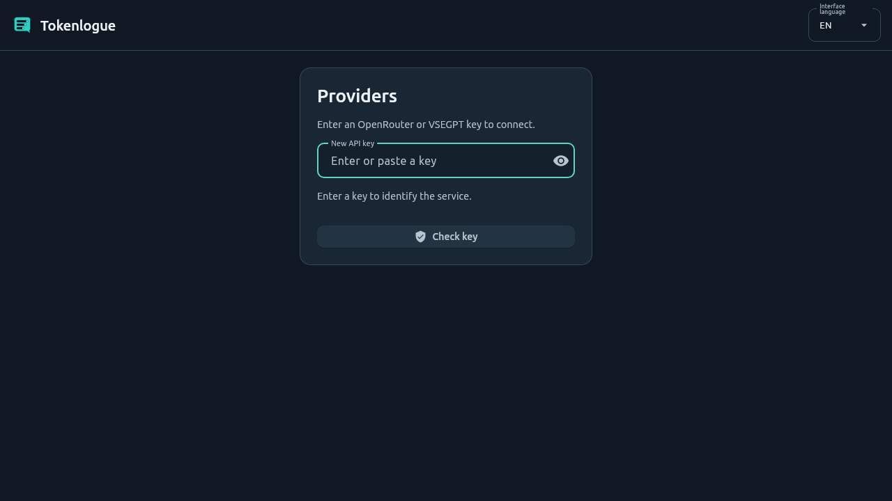 </a> | <a href="assets/screenshots/v011-55-android-start-en.png"> 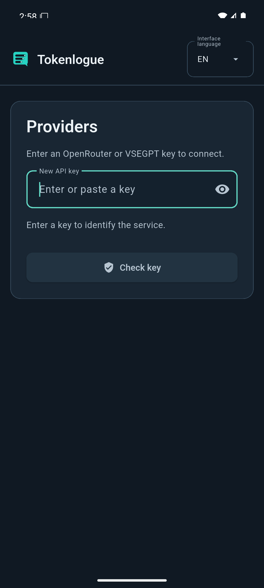 </a> |

*Separate demonstration profiles before entering a key.*

[Choosing an app PIN](assets/screenshots/v011-android-pin-setup-en.png) shows the next step without displaying a PIN. See also the [Linux PIN setup](assets/screenshots/v011-55-linux-pin-setup-en.png).

##  Navigate without losing your place

**Home**, **Providers**, **Tokens** and **Spending** belong to the whole app. On wide Linux windows they appear in a dark navigation rail. Android and narrow windows use bottom navigation. The separate chat panel belongs to Home.

Switching pages saves the draft and keeps the current chat. Android Back returns to Home from an auxiliary page. A dispatched request can finish once while another page is open. Navigation never sends the draft.

##  Create and manage a chat

Use **+** to start a chat. With **Choose each time**, first choose OpenRouter or VSEGPT. A saved service preference skips that question. OpenRouter offers free and paid modes. VSEGPT opens its paid model list directly. After choosing a model, review its limits. This creation policy applies only to new chats. Use **Chat connection** to change the service of an existing chat explicitly. To use a different model within the same service, create another chat.

OpenRouter free mode uses automatic selection or models whose applicable prices are all zero. Access still depends on authorization, model availability and service limits. A negative account balance can block free requests. Zero and an unknown balance are different states. See the current [OpenRouter limits](https://openrouter.ai/docs/api_reference/limits).

VSEGPT works only in paid mode in Tokenlogue. There is no separate mode step. Choose a model, then set a RUB budget and confirm the terms in the limits form. Billing may use other units, and an unknown price is not zero. Opening the model list does not create a chat or send anything.

When a catalogue cannot load, the app shows a specific reason and **Refresh list**. Refreshing a list never retries a chat message automatically. OpenRouter automatic free selection remains available without the list, subject to the same access rules.

Use the conversation list to reopen a chat. **Rename** preserves its history and draft. **Delete chat** asks for confirmation and removes that chat, its draft and its local statistics. Header shortcuts can hide when the keyboard leaves too little height. The **⋮** menu holds model details, limits, key information and profile actions.

   

*Demonstration conversation actions in an Android emulator. Model names come from the service catalogue.*

[Rename on Linux](assets/screenshots/v011-55-linux-rename-chat-en.png).

### Choose a provider for a new chat

| Linux | Android emulator |
| --- | --- |
| <a href="assets/screenshots/v011-55-linux-new-chat-provider-en.png"> 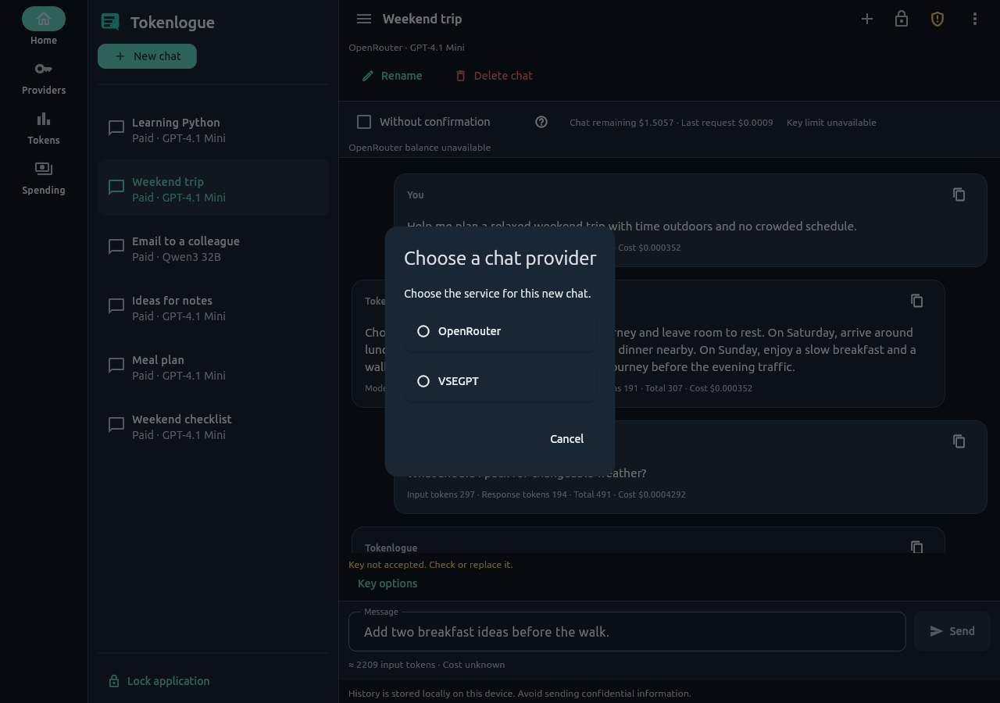 </a> | <a href="assets/screenshots/v011-55-android-new-chat-provider-en.png"> 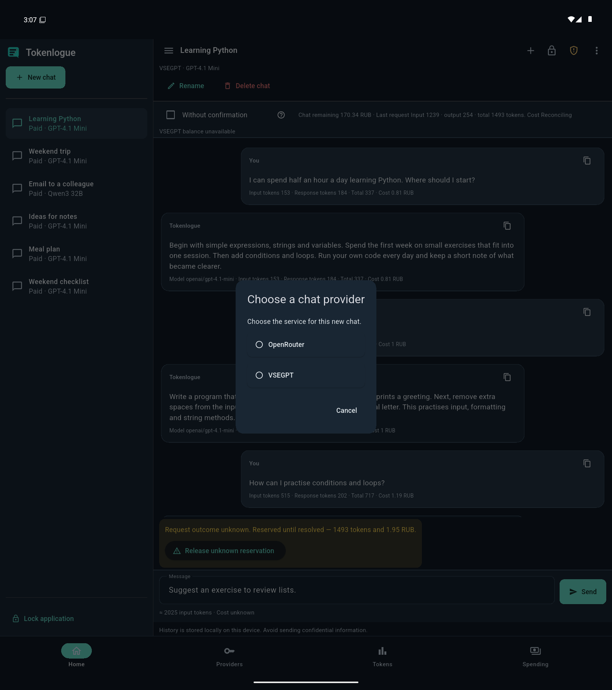 </a> |

| Linux | Android emulator |
| --- | --- |
| <a href="assets/screenshots/v011-55-linux-vsegpt-models-search-en.png"> 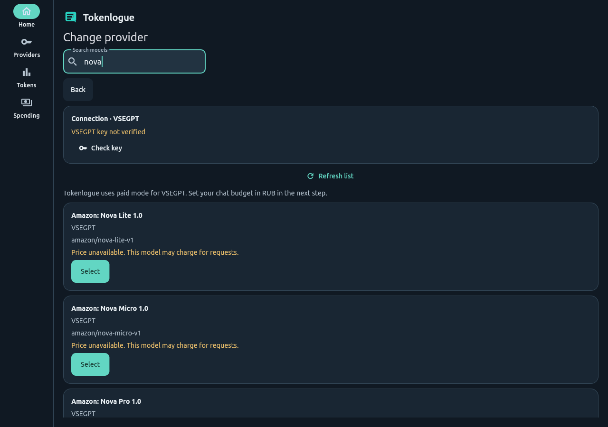 </a> | <a href="assets/screenshots/v011-55-android-vsegpt-models-en.png"> 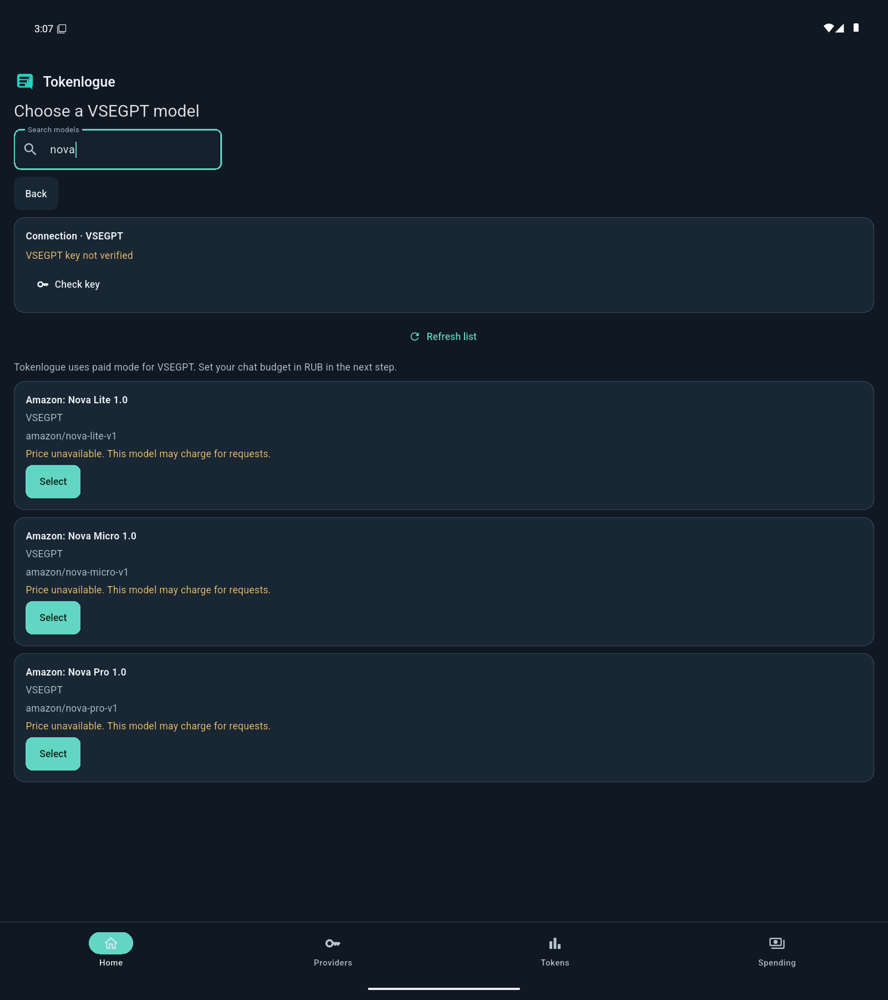 </a> |

*Demonstration profiles. The Linux model list is shown during a provider change, and the Android list during new-chat creation. Both open VSEGPT models directly. No paid request was sent.*

### Check the saved key

On the OpenRouter mode screen or the VSEGPT model list, choose **Check key** beside the connection status. The app checks the saved key of the selected service. You do not need to enter it again. **Refresh list** separately loads the model catalogue and does not confirm authorization.

A progress indicator and **Checking key…** appear while the request is running. Success updates the status and available actions in the same screen. Network, timeout, TLS, access refusals and invalid keys have distinct messages. You can retry a failed check. Cancel and system Back remain available. Checking sends no chat message and does not select a model.

When VSEGPT balance access is disabled in the service settings, the key stays unverified. Successful authorization does not guarantee funds or available quota. An unavailable OpenRouter balance alone does not revoke a key's chat access.

| Linux | Android emulator |
| --- | --- |
| <a href="assets/screenshots/v011-linux-openrouter-key-check-en.png"> 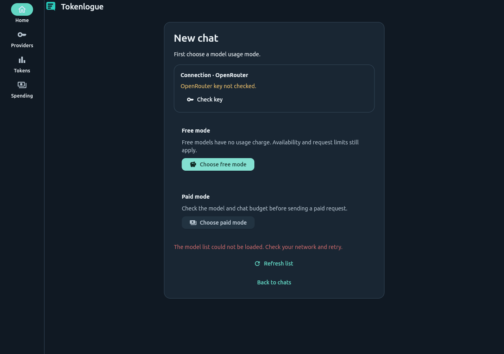 </a> | <a href="assets/screenshots/v011-android-openrouter-key-check-en.png"> 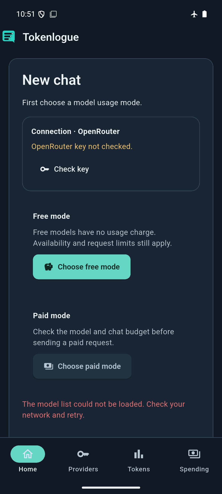 </a> |

| Linux | Android emulator |
| --- | --- |
| <a href="assets/screenshots/v011-linux-openrouter-key-result-en.png"> 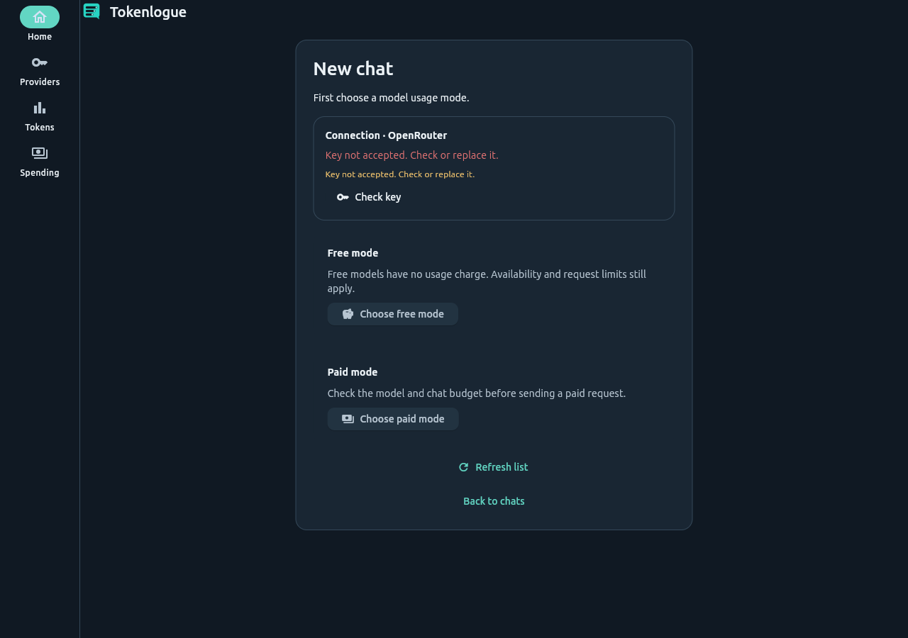 </a> | <a href="assets/screenshots/v011-android-openrouter-key-result-en.png"> 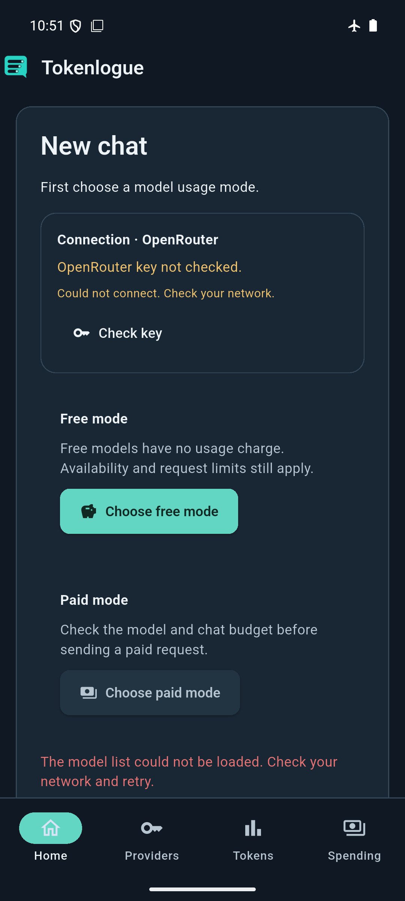 </a> |

*Demonstration profiles. Linux shows a real rejection of a deliberately fake key. Android shows an intentional offline network error. Neither image shows successful authorization.*

### After a successful saved-key check

<a href="assets/screenshots/v011-55-linux-openrouter-key-accepted-en.png"> 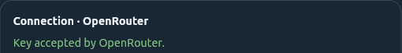 </a>

<a href="assets/screenshots/v011-55-android-openrouter-accepted-en.png"> 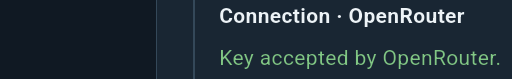 </a>

*Details from the real app after checking the saved key. The figures show the provider and result, excluding personal amounts and key limits. The mode examples above show the controls.*

During manual creation, Back from VSEGPT models returns to the provider choice. With a fixed VSEGPT preference, it cancels creation and returns to chats. While changing a connection, Back returns to the service choice and keeps the existing connection. Back from the limits form returns to the model list. Cancel preserves the previous draft.

##  Chat connection and provider changes

Open **⋮** in the selected chat. **Chat connection** shows its provider and key status, with a masked reference when a key is saved. Each provider has one protected key shared by all its chats. A sufficiently long key shows only its last four characters, otherwise it stays fully masked. **Configure OpenRouter key** or **Configure VSEGPT key** opens the matching service card.

1. Choose **Change provider**, then select OpenRouter or VSEGPT. The current provider is marked.
2. If the target key is missing, configure it in the offered service card. Return to Home and explicitly choose the provider again to continue.
3. For OpenRouter, choose free or paid mode. For VSEGPT, choose a model directly. Review the limits. A paid model needs a budget in its own currency. A matching model ID from another service is not selected automatically.
4. Choose **Review change**. Check the provider, model, currency, amount already spent and remaining chat budget, then choose **Change provider**.

The app checks the catalogue again at confirmation. If it is unavailable or the selected model has changed, the previous connection stays in place. Try later or review the current model before confirming again.

Configuration sends no message. Your next ordinary **Send** shares the new message and completed conversation pairs that fit the selected model’s context with the new service.

The chat title, messages, draft and protection stay intact. Its token limit and tokens already used remain shared across services. The shared token limit is read-only during this change. USD and RUB money limits, spending and reserves stay separate. Returning to a provider restores its existing money state. **Without confirmation** is turned off after a change, so the new service needs fresh paid-request consent.

Before final confirmation, Cancel or Back leaves the stored connection unchanged. Selecting the current provider changes nothing. Other chats and the default for new chats stay as they were. Wait for an active request to finish and resolve unsettled accounting before changing a connection. An error never switches the chat to another service automatically.

| Connection | Linux | Android |
| --- | --- | --- |
| OpenRouter | <a href="assets/screenshots/v011-55-linux-chat-connection-openrouter-en.png"> 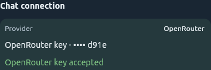 </a> | <a href="assets/screenshots/v011-55-android-chat-connection-openrouter-en.png"> 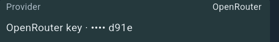 </a> |
| VSEGPT | <a href="assets/screenshots/v011-55-linux-chat-connection-vsegpt-en.png"> 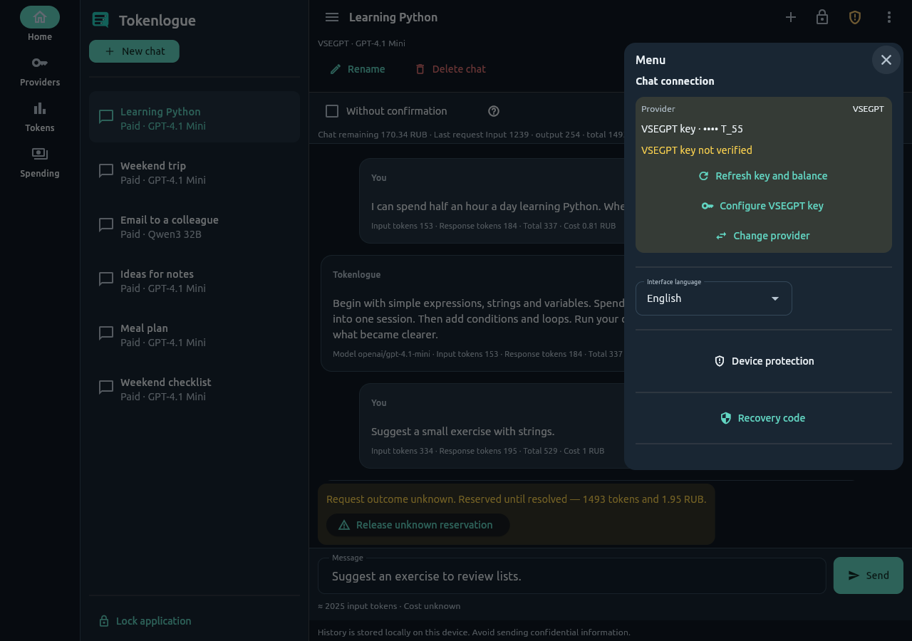 </a> | <a href="assets/screenshots/v011-55-android-chat-connection-vsegpt-en.png"> 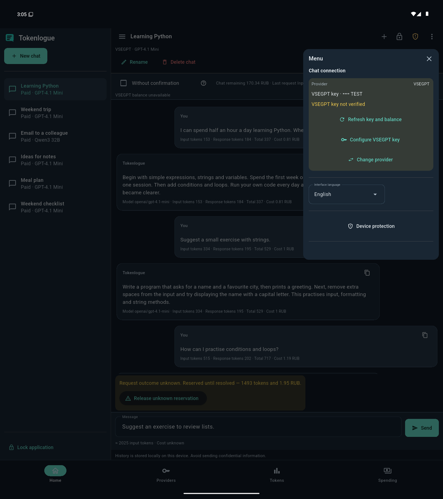 </a> |

*Separate demonstration profiles. Only masked key references are shown. Sending requires a valid key for the chosen service. Changing the interface language does not translate existing messages.*

- Linux examples show [provider choice](assets/screenshots/v011-55-linux-chat-provider-picker-en.png), [the final review](assets/screenshots/v011-55-linux-chat-connection-review-en.png) and [the chat after a change](assets/screenshots/v011-55-linux-home-en.png).
- Android examples show [provider choice](assets/screenshots/v011-55-android-chat-change-provider-en.png), [the final review](assets/screenshots/v011-55-android-chat-change-confirm-en.png) and [the chat after a change](assets/screenshots/v011-55-android-chat-after-change-en.png).

OpenRouter connection actions for key settings and changing provider

[Linux](assets/screenshots/v011-55-linux-chat-connection-openrouter-actions-en.png).

##  Messages and drafts

Type a message and select **Send**. With a keyboard, Enter sends and Shift+Enter inserts a line break. Sending shares the message and relevant history with the service assigned to that chat and its selected model provider.

Each chat saves its own draft. Switching chats or pages, resizing, locking and restarting keep it. Drafts do not count as sent messages, context or spending. A successfully submitted draft is cleared. Text entered while an earlier request is waiting remains after its response arrives.

If a pre-send check fails or you cancel a confirmation, the original draft stays. Check the status of an interrupted request before retrying because another dispatch can incur another charge.

##  Set chat limits

Open **Set limits** or **Edit limits** in **⋮**.

| Setting | Meaning |
| --- | --- |
| Chat token limit | Input and answer tokens used across this chat’s providers, including repeated context. |
| Response maximum | The requested answer-token ceiling. The answer can be shorter. |
| Chat spending limit | A separate local limit for this chat’s current provider in USD or RUB. An increase needs confirmation. |

Available chat budget subtracts used tokens or money and active reservations. Reservations protect the local budget while accounting is pending. They are not a separate provider charge. Provider restrictions and OpenRouter key limits still apply.

##  Review a budget warning

A paid request that could leave 10% or less of the chat's spending limit shows a warning. A zero remainder can exhaust the chat budget. A negative remainder can exceed it. This calculation uses the chat limit, its costs, active reserves and the planned request estimate.

| Action | Result |
| --- | --- |
| Cancel | Keeps the draft and sends nothing. Back, Escape or closing the dialog also cancel. |
| Send | Approves only this reviewed request. It can permit an overrun without increasing the saved chat limit. |
| Change chat limit | Opens this chat's settings. Saving does not send the draft. Review it again before sending. |

Unknown pricing requires explicit review too. A changed draft, model, price or budget can require new consent. An estimate cannot guarantee the final charge.

If model prices have changed, review the old and current prices. With ordinary confirmations enabled, **Confirm new prices** checks the request again before opening its confirmation. It does not send the message.

The following examples use known current catalogue prices and demonstration chat budgets. No message was sent.

| Forecast | Linux | Android emulator |
| --- | --- | --- |
| Almost exhausted |  |  |
| Projected overrun |  |  |

<a href="assets/screenshots/v011-55-linux-price-unknown-en.png"> 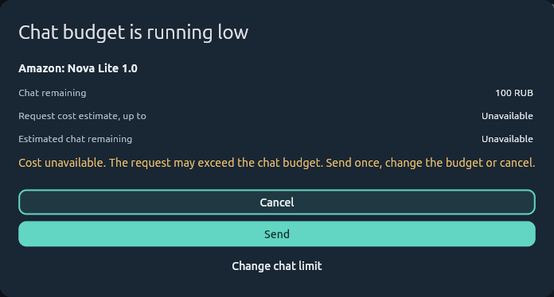 </a>

*Demonstration chat in the Linux app. This separate example asks for review because the model price is unavailable. The remainder belongs to the local chat budget.*

[Android unknown-price example](assets/screenshots/v011-55-android-price-unknown-en.png).

##  Ordinary paid confirmation

Paid chats normally request confirmation before sending. **Without confirmation** disables that ordinary dialog for the selected chat from its first request, including retries. Known current model prices can then be accepted without another price-change dialog.

Chat-budget warnings, token limits, key checks and unknown-price protection continue to apply. Switching the option does not send anything. Turn it off to review the next paid request again.

Ordinary confirmation before a paid request

[Linux](assets/screenshots/v011-55-linux-paid-confirmation-en.png) · [Android emulator](assets/screenshots/v011-55-android-paid-confirmation-en.png).

 

The examples show **Without confirmation** and its explanation in a demonstration chat. Switching this option sends no message.

##  Read tokens and money

The full-width metrics strip shows values for the open chat and its provider. Hover or long-press for details.

| Display | Source |
| --- | --- |
| Chat budget remaining | Local spending limit minus recorded costs and current reserves. |
| Tokens remaining | This chat's token budget, not a provider-wide free quota. |
| Last request | Its recorded cost or tokens and accounting status. |
| OpenRouter balance | The account amount returned by OpenRouter credits. |
| VSEGPT balance | The RUB amount returned through VSEGPT balance access. |
| Key limit remaining | The remaining separate OpenRouter key cap. VSEGPT has no supported separate key cap. |

The last request keeps its original currency after a provider change.

A known zero, negative remainder, unset key cap and unavailable value are different states. An unset cap does not promise available funds. Stale service balances keep their last amount and are marked as outdated.

The estimate below the editor includes eligible history and the response limit. It is local and approximate. It is not exact model tokenization. Missing prices produce an unavailable cost estimate. Calculating it sends no request and reserves no money.

##  Refresh or replace a key

Use **Refresh key and balance** in **⋮** for current provider data. A completed chat request also starts its own balance refresh. The answer does not wait for that refresh. Failed balance access does not replace the answer or turn an unknown amount into zero.

Use [Providers](providers.md) to check or replace the correct service's key. The old saved key remains until the replacement is accepted and saved. This keeps the PIN, chats, drafts and budgets. Revoke an old key in the service account if needed.

##  Interrupted requests

Retrying after a connection change uses a new attempt with the current provider and model. Check that destination before retrying. The previous attempt keeps its original service and accounting.

A lost connection can leave the provider charge uncertain. The protective reserve stays in the chat budget. Check the provider request and billing before retrying. **Release unknown reservation** releases only that local reserve. It does not cancel the remote request or refund a charge.

##  Statistics and protection

[Tokens and Spending](analytics.md) show saved activity on this device. Deleting a chat removes its statistics. [Protection and recovery](security.md) explains locking, PIN recovery and irreversible profile deletion. A database copy alone cannot preserve its separately stored encryption key.
