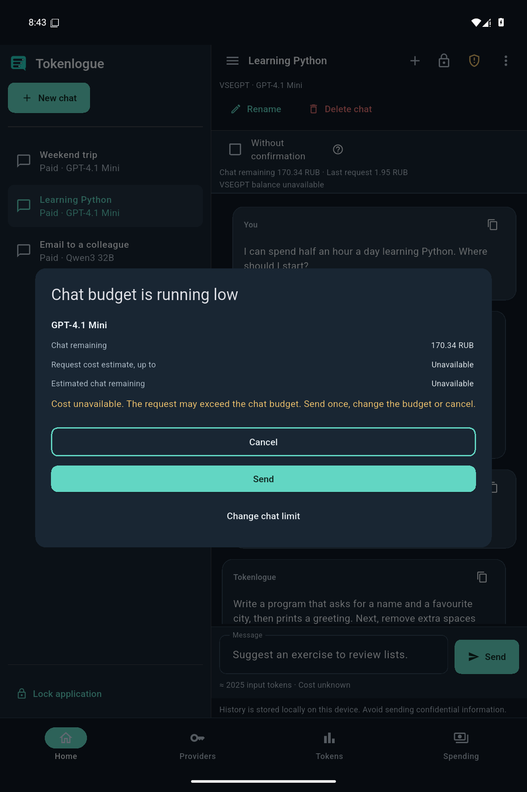

[English](user-guide.md#english) · [Русский](user-guide.ru.md#russian)

# Chat guide

[Home](../README.md) · [Documentation](../docs/README.md)

> **0.1.1 is local.** These instructions describe the current source and local builds. [Published 0.1.0 Preview](https://github.com/Umichata/tokenlogue/releases/tag/v0.1.0-preview.a981db9) is the earlier release. Its download links do not provide 0.1.1.

## First connection

1. Select English or Russian and enter a provider key. OpenRouter begins with `sk-or-v1-`. VSEGPT begins with `sk-or-vv-` or `sk-or-vis`. A secret continuation is required. `sk-or-vis` does not require an extra hyphen.
2. Choose **Check key**. Recognition happens locally and checking uses a free endpoint. If VSEGPT cannot confirm authorization, explicitly choose **Save unverified key** when offered. No chat message is sent during setup.
3. Choose four digits, repeat them and save your app PIN. A leading zero is allowed. Keep it safe.
4. On Linux, follow the local-protection introduction and save a recovery code when offered. Manual locking remains available.
5. Create a chat with **+**.

A VSEGPT-only profile needs no OpenRouter key. Add the second service later through [Providers](providers.md). Subsequent sign-ins and recovery use your existing protected profile rather than opening a new registration.

*Demonstration setup with a masked synthetic key.*

[Choosing an app PIN](assets/screenshots/v011-android-pin-setup-en.png) shows the next step without displaying a PIN.

## Navigate without losing your place

**Home**, **Providers**, **Tokens** and **Spending** belong to the whole app. On wide Linux windows they appear in a dark navigation rail. Android and narrow windows use bottom navigation. The separate chat panel belongs to Home.

Switching pages saves the draft and keeps the current chat. Android Back returns to Home from an auxiliary page. A dispatched request can finish once while another page is open. Navigation never sends the draft.

## Create and manage a chat

Use **+** to choose free or paid mode, an available model and limits. The default provider applies only to new chats. Existing conversations keep their provider, model and currency. Create another chat to choose a different model or service.

OpenRouter free mode can use automatic model selection or models whose applicable prices are all zero. VSEGPT pricing can use other billing units. An unknown price is not a free model.

Use the conversation list to reopen a chat. **Rename** preserves its history and draft. **Delete chat** asks for confirmation and removes that chat, its draft and its local statistics. Header shortcuts can hide when the keyboard leaves too little height. The **⋮** menu holds model details, limits, key information and profile actions.

[New chat and model choice](assets/screenshots/v011-android-models-en.png) · [Rename](assets/screenshots/v011-android-rename-en.png) · [Delete chat](assets/screenshots/v011-android-delete-chat-en.png) · [Chat limits](assets/screenshots/v011-android-chat-limits-en.png)

*Demonstration conversation actions in an Android emulator. Model names come from the service catalogue.*

## Messages and drafts

Type a message and select **Send**. With a keyboard, Enter sends and Shift+Enter inserts a line break. Sending shares the message and relevant history with the service assigned to that chat and its selected model provider.

Each chat saves its own draft. Switching chats or pages, resizing, locking and restarting keep it. Drafts do not count as sent messages, context or spending. A successfully submitted draft is cleared. Text entered while an earlier request is waiting remains after its response arrives.

If a pre-send check fails or you cancel a confirmation, the original draft stays. Check the status of an interrupted request before retrying because another dispatch can incur another charge.

## Set chat limits

Open **Set limits** or **Edit limits** in **⋮**.

| Setting | Meaning |
| --- | --- |
| Chat token limit | Input and answer tokens used by this conversation, including repeated context. |
| Response maximum | The requested answer-token ceiling. The answer can be shorter. |
| Chat spending limit | A local USD or RUB limit for this paid chat. An increase needs confirmation. |

Available chat budget subtracts used tokens or money and active reservations. Reservations protect the local budget while accounting is pending. They are not a separate provider charge. Provider restrictions and OpenRouter key limits still apply.

## Review a budget warning

A paid request that could leave 10% or less of the chat's spending limit shows a warning. A zero remainder can exhaust the chat budget. A negative remainder can exceed it. This calculation uses the chat limit, its costs, active reserves and the planned request estimate.

| Action | Result |
| --- | --- |
| Cancel | Keeps the draft and sends nothing. Back, Escape or closing the dialog also cancel. |
| Send | Approves only this reviewed request. It can permit an overrun without increasing the saved chat limit. |
| Change chat limit | Opens this chat's settings. Saving does not send the draft. Review it again before sending. |

Unknown pricing requires explicit review too. A changed draft, model, price or budget can require new consent. An estimate cannot guarantee the final charge.

*Demonstration data in an Android emulator. This example asks for review because the model price is unavailable. The displayed remainder belongs to the chat budget.*

## Ordinary paid confirmation

Paid chats normally request confirmation before sending. **Without confirmation** disables that ordinary dialog for the selected chat from its first request, including retries. Known current model prices can then be accepted without another price-change dialog.

Chat-budget warnings, token limits, key checks and unknown-price protection continue to apply. Switching the option does not send anything. Turn it off to review the next paid request again.

## Read tokens and money

The full-width metrics strip shows values for the open chat and its provider. Hover or long-press for details.

| Display | Source |
| --- | --- |
| Chat budget remaining | Local spending limit minus recorded costs and current reserves. |
| Tokens remaining | This chat's token budget, not a provider-wide free quota. |
| Last request | Its recorded cost or tokens and accounting status. |
| OpenRouter balance | The account amount returned by OpenRouter credits. |
| VSEGPT balance | The RUB amount returned through VSEGPT balance access. |
| Key limit remaining | The remaining separate OpenRouter key cap. VSEGPT has no supported separate key cap. |

A known zero, negative remainder, unset key cap and unavailable value are different states. An unset cap does not promise available funds. Stale service balances keep their last amount and are marked as outdated.

The estimate below the editor includes eligible history and the response limit. It is local and approximate. It is not exact model tokenization. Missing prices produce an unavailable cost estimate. Calculating it sends no request and reserves no money.

## Refresh or replace a key

Use **Refresh key and balance** in **⋮** for current provider data. A completed chat request also starts its own balance refresh. The answer does not wait for that refresh. Failed balance access does not replace the answer or turn an unknown amount into zero.

Use [Providers](providers.md) to check or replace the correct service's key. The old saved key remains until the replacement is accepted and saved. This keeps the PIN, chats, drafts and budgets. Revoke an old key in the service account if needed.

## Interrupted requests

A lost connection can leave the provider charge uncertain. The protective reserve stays in the chat budget. Check the provider request and billing before retrying. **Release unknown reservation** releases only that local reserve. It does not cancel the remote request or refund a charge.

## Statistics and protection

[Tokens and Spending](analytics.md) show saved activity on this device. Deleting a chat removes its statistics. [Protection and recovery](security.md) explains locking, PIN recovery and irreversible profile deletion. A database copy alone cannot preserve its separately stored encryption key.
