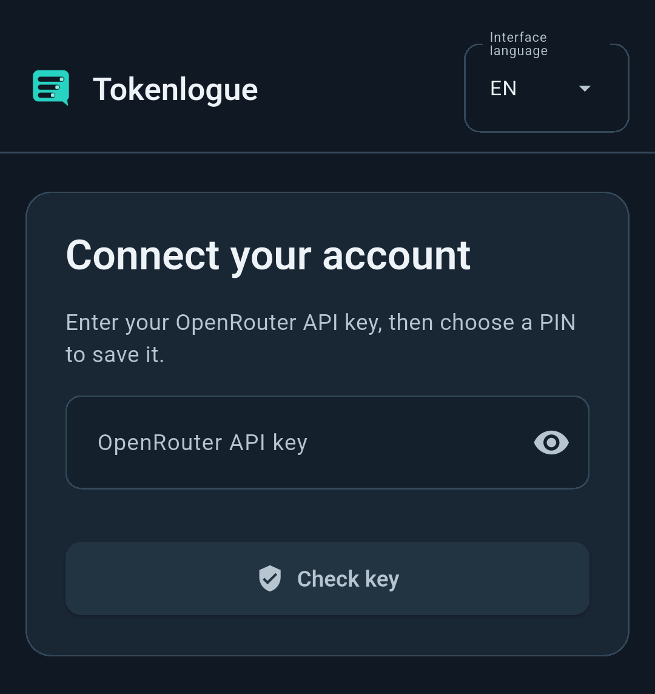

 

# 📘 User guide

Tokenlogue lets you chat with OpenRouter models on Linux and Android. Start with the <a href="linux-appimage.md#english" title="Linux installation guide">Linux installation guide&nbsp;</a> or <a href="android.md#english" title="Android installation guide">Android installation guide&nbsp;</a>.

**Download Tokenlogue 0.1.0 Preview**

  <a href="https://github.com/Umichata/tokenlogue/releases/download/v0.1.0-preview.a981db9/SHA256SUMS">SHA256SUMS</a>

Source archives are not needed to install the app.

##  Current source: providers and analytics

**This section describes the current source checkout and new local builds made from it.** The download links above still point to the published OpenRouter preview. They do not include these source changes. Use the instructions below with the current source application or a new local package. Existing profile protection, chats, drafts and budgets are preserved during the source migration. Keep a compatible installation and its secure storage. Do not uninstall or clear application data to update.

After signing in, choose **Home**, **Providers**, **Tokens** or **Spending**. A wide Linux window uses a navigation rail. Android and narrow windows use bottom navigation. Home is the existing chat workspace. Its separate chat-list button opens or hides conversations. Page changes save the draft and do not submit it. A request already dispatched can finish once in the background and update history and statistics. Back returns from an auxiliary page to Home. Chat setup and dialogs retain their own Back/cancel behavior.

### Connect OpenRouter or VSEGPT

1. On first setup, enter a key from the provider account. A complete `sk-or-v1-` key selects **OpenRouter**. A complete `sk-or-vv-` key selects **VSEGPT**. Recognition happens locally before checking. An unknown or incomplete prefix is rejected locally. Only accidental whitespace at the ends is removed. The key content and case are retained.
2. Choose **Check key**. This requests a free provider endpoint, never an automatic paid generation. Prefix recognition alone does not confirm authorization, permissions or funds. If a free authorization check is unavailable, choose **Save unverified key** explicitly when offered. This allows PIN setup and does not send a chat message.
3. Set and repeat the application PIN, then complete any local-protection steps. A VSEGPT-only profile does not require an OpenRouter key. At later launches use the same profile PIN. Changing providers does not replace PIN or recovery checks.
4. Open **Providers** after sign-in to configure the other service or replace a key. Each card has its own masked input, explicit reveal button, check, save/replace action, connection status, account balance, check time and manual refresh. Saved key values are never loaded back into these fields. If the recognized key belongs to another card, use its matching provider field before checking.
5. Check the candidate, then save it. **Save unverified key** is a separate decision for an unconfirmed candidate. A failed check or cancelled replacement keeps the previous working key. Both provider keys can be saved at once.
6. Choose the default provider for **new chats**. Existing chats keep their provider, model and currency. Changing the default or a key does not relabel historical requests. If a chat's provider key is missing, configure that service before sending. Tokenlogue does not silently send its history to the other provider.

OpenRouter uses **USD**. VSEGPT uses **RUB**. Account balance, API key limit and remaining chat budget are separate values. Unknown balance is not zero. OpenRouter account credits may require management-key permissions even when an ordinary key works for chat. VSEGPT balance access may need to be enabled in account settings. Authorization errors, restricted balance access, missing subscription, network failures and insufficient funds are distinct states. A low-balance warning alone is not an invalid key.

### Chat and approve costs

On Home, create a chat with `+`, choose an available model and set token/response limits and, for paid chats, a budget in the displayed currency. Home shows the chat's provider and model. OpenRouter's automatic free router belongs to OpenRouter. It is not a universal free VSEGPT model. A model with unconfirmed pricing or billing units is shown with an unavailable cost estimate, not a zero price. VSEGPT can bill by characters. Character prices are not token prices.

A request with a projected chat remainder of 10% or less, zero or a negative remainder receives a budget warning. Unknown pricing also requires explicit conservative review. **Cancel** sends nothing and preserves the draft. **Send once** approves only the reviewed request without raising its saved budget. **Change chat limit** opens settings and never sends automatically after saving. These warnings still apply when ordinary paid confirmations are disabled. Changing the draft, provider, model, prices or budget invalidates earlier consent. Estimates cannot guarantee the eventual charge or strict compliance with the local budget.

Typing, navigating and refreshing statistics do not send requests. A retry that reaches the service is another attempt and can incur another charge. After a timeout or interruption, an unknown charge stays unknown. It is never converted to a free request. Known API tokens remain visible even if cost is unavailable. Review uncertain requests in the provider account before retrying or releasing a local reserve.

### Token usage

Open **Tokens** and select **7 days**, **30 days** or **All time**, then filter by provider and model. Rows are grouped by provider plus model and sorted by usage. The same model ID at two services remains two groups. The page shows request counts, input/output/total tokens, compact period totals and the most used models.

The scope is **saved chats on this device**, not the whole provider account or other clients. API usage, local estimates and unknown values are separate. Estimated tokens do not inflate confirmed totals. Cached/reasoning details are not counted twice in total tokens. Known tokens still count when cost is unknown. Missing values are unavailable rather than invented zeros, and characters are never labeled as actual tokens. Undated historical attempts are excluded from a dated range and shown separately in All time.

### Daily spending

Open **Spending** and apply its period, provider and model filters. Native daily bar charts have separate **USD** and **RUB** panels, each with an accessible date/amount/currency table, confirmed dated total and confirmed daily average. There is no exchange-rate conversion or combined USD/RUB total. Estimated costs form a separately labeled series and total.

The chart uses the local request journal. Empty days in the selected range have zero bars. Requests with unknown cost carry an incompleteness indicator, including when the known amount is zero. Sending times are stored in UTC and grouped in the timezone named on the page. A later cost update stays on the original dispatch day. Historical amounts without a reliable dispatch time have their own undated total and do not acquire an invented day or enter the daily average.

Deleting a chat also deletes its local request statistics. Deleting the profile removes both provider keys and all profile statistics. Locking, including Android backgrounding, closes every private page and clears entered/revealed key fields and visible analytics. Returning never unlocks the profile or resends the draft automatically.

The remaining walkthrough and screenshots describe the linked published OpenRouter preview. Its downloads do not receive source changes automatically.

     

##  First connection

1. Choose English or Russian on the sign-in screen.
2. Enter an API key created in your [OpenRouter account](https://openrouter.ai/settings/keys) and choose `Check key`. This contacts OpenRouter. A connection error alone does not mean that the key is invalid.
3. Choose a four-digit PIN, repeat it and select `Save PIN`. Use digits `0`–`9`. A leading zero is allowed. `Suggest PIN` fills a random suggestion that you can change. Both fields must match before saving.
4. Keep the PIN somewhere safe. The eye button reveals it when needed. Tokenlogue does not copy it automatically.
5. On Linux, follow the local-protection introduction and save a recovery code when offered. You can choose to continue with manual app locking and check automatic protection later. See <a href="security.md#en-locking" title="protecting your conversations">protecting your conversations&nbsp;</a>.
6. Choose `+` to create a chat.

 
 

*Android first-launch illustration. The instructions above apply to both platforms.*

At later launches, enter your app PIN and choose `Sign in`. Updating a compatible installation preserves that PIN. Three incorrect checks temporarily block PIN entry for five minutes. Restarting does not clear the countdown. See <a href="security.md#en-pin" title="access and recovery">access and recovery&nbsp;</a>.

##  Conversations

Choose free or paid mode, search by model name or ID, then set the chat limits. Each chat keeps its mode and model. Create another chat to choose a different model.

Free mode includes automatic model selection and models whose applicable prices are all zero. Automatic selection lets OpenRouter choose the model for each request. Free availability and service request limits still apply. Paid mode needs a valid key and known model prices. OpenRouter checks account funds when processing requests.

Use the chat list to return to a conversation. `Rename` and `Delete chat` sit below its title when there is enough vertical space. Renaming preserves messages and the draft. Deletion asks for confirmation and removes that chat's local history and draft. It does not delete the whole profile. These actions and limit editing are unavailable while sending.

The `⋮` menu contains key status, model details, token prices, budget details and limit settings. It also provides language selection, key replacement and profile actions. Opening the menu does not send a message or automatically refresh the key. Scroll inside the menu if it does not fit.

##  Workspace

The top-left button hides or shows the chat list in a wide Linux window. Tokenlogue remembers that choice. On a narrow screen it opens a drawer. Choose a chat, tap outside, or use Back or Escape to close the drawer. Changing to a narrow layout does not overwrite the saved wide-window choice.

Choose `Interface language` in `⋮` to switch between English and Russian. The choice is remembered. Chat titles, your messages and model replies are not translated. Changing language preserves ordinary editor input and drafts. For safety, an unfinished recovery-code or profile-deletion confirmation must be started again in the selected language.

Long titles are shortened visually. When the keyboard or a short window leaves little room, the rename and delete shortcuts are hidden. Dismiss the keyboard or make the window taller to show them again. The conversation and editor use the remaining space.

##  Messages and drafts

Type in `Message` and choose `Send`. With a keyboard, Enter sends and Shift+Enter inserts a line break. Empty messages cannot be sent. Tokenlogue sends the message and eligible conversation context to OpenRouter and the selected model provider.

Each chat saves its own draft locally. Switching chats, resizing, renaming, locking and restarting preserve the saved text. A draft is separate from message history. Typing does not send it, spend funds or add it to model context.

Once a message is accepted for sending, its submitted draft is cleared. You can start a new draft while waiting. Completion of the previous request will not erase the newer text. A failed pre-send check or cancelled paid confirmation keeps the original draft.

If a reply is incomplete or a request fails, read its status before retrying. Retrying a request that already reached the service can cause another charge.

##  Chat limits

Configure limits before the first request. Use `Set limits` or `Edit limits` in `⋮` to change them later.

| Setting | What it controls |
| --- | --- |
| Total chat token limit | Input and response tokens across this chat's requests. Repeated conversation context also uses tokens. |
| Maximum tokens per response | The requested upper bound for each answer. An answer can be shorter. |
| Chat spending limit, USD | The local spending cap for a paid chat. Increasing it asks for confirmation. |

Before sending, Tokenlogue reserves tokens and, in paid mode, money. The available chat budget subtracts actual use and active reservations. A local reservation is not an OpenRouter charge. Token, context, provider and API key limits still apply to every request. Unknown request accounting must be resolved before another request can use that chat's budget.

The chat budget is a local setting. The API key limit belongs to that key, while the OpenRouter account balance comes from the account API. Neither account balance nor key limit changes your saved chat spending limit.

##  Budget warnings

A paid request triggers a warning when its upper cost estimate is positive and its projected chat remainder is 10% of the saved spending limit or less. The calculation subtracts actual costs, active monetary reservations and the planned request's upper estimate. It includes the history sent, model prices, fixed request costs and the response limit.

The risk is calculated before a chat-money cap could shorten the planned response and hide a possible overrun. Token, context, provider and API key restrictions remain in force. The warning is about the chat budget, not the account balance or API key limit. An exactly free request needs no monetary warning.

| Action | Result |
| --- | --- |
| Cancel | Sends nothing, creates no reserve and keeps the draft. Closing the dialog, Escape and Android Back cancel too. |
| Send | Confirms this exact request once. It can permit exceeding the local chat spending limit without raising that saved limit or disabling later warnings. |
| Change chat limit | Opens this chat's limits and preserves the draft. Saving a limit does not send anything. Review the new estimate before sending. |

A projected zero can exhaust the budget. A negative projection can exceed it, and the warning says so. After a confirmed overrun, the actual remaining chat amount can stay negative. It is not rounded up to zero or turned into a higher saved limit. Changing the draft, model, limits, prices or risk makes an earlier decision expire and can require a fresh warning.

##  Paid request confirmation

New paid chats ask for confirmation before sending. Review the model, estimated input, response maximum and spending reserve. Cancel to leave the message unsent.

`Without confirmation` above the conversation turns off the ordinary paid-request dialog for the selected chat, including its first request and retries. It also accepts known current model prices for each send, including increases, without a separate new-price confirmation. Turn it off if you want to review price changes before sending. Chat-budget warnings, token limits, key checks, rejection of unknown or unsafe prices and unknown-accounting protection still apply. Enabling it sends nothing by itself. Raising the saved spending limit keeps its separate confirmation.

Turn the option off to require confirmation from the next request onward. The choice is saved per chat. Locking or changing this setting never submits a queued message automatically. Choose `Send` when ready.

##  OpenRouter balance

`OpenRouter balance` shows the account balance received from OpenRouter for the current API key. It can be positive, zero or negative. It is not calculated from the locally tracked cost of a chat.

The balance appears in free and paid chats. Loading, a current snapshot, an outdated snapshot and `Balance unavailable` are distinct states. A saved session snapshot includes its receipt time. If a refresh fails, a previous value is explicitly marked outdated. Without a successful snapshot, no artificial zero is shown.

The balance refreshes after sign-in or unlock and after a sent request finishes, including retries and interrupted requests. The model response appears without waiting for the balance update. Switching chats keeps the account refresh active.

Choose `Refresh key and balance` in `⋮` for a manual update. Balance access depends on the key permissions. An unavailable balance does not necessarily prevent model requests, and it does not change your chats or PIN.

##  Tokens and costs

| Display | Meaning |
| --- | --- |
| Chat available | Paid-chat budget remaining after actual costs and active reservations. |
| Tokens remaining | Free-chat token budget remaining after use and active reservations. This is not OpenRouter's global free quota. |
| Last request | Confirmed cost for a paid chat or total input-and-response tokens for a free chat. Retries count as new attempts. |
| Key remaining | The current API key's known remaining spending limit, separate from the chat budget and account balance. |
| OpenRouter balance | The account snapshot received from OpenRouter, with its refresh state. |

`Key limit not set` means that the key has no separate cap. `Key data unavailable` means its remainder is unknown. An exhausted limit is shown explicitly. Hover or long-press a metric for details and the key-data receipt time when available. Use `Refresh key and balance` in `⋮` to request fresh data. Typing or reopening the display does not make old data fresh.

`No requests`, `In progress`, `Reconciling` and `Unknown` describe different states. An unknown result is not treated as zero cost.

The estimate under the editor changes as you type. It includes eligible history and the effective response maximum. It is an approximate local estimate, not exact model tokenization or a prediction of reply length. The possible cost is an upper estimate for known prices before any chat-money cap could hide a budget risk. Missing or expired pricing produces `Cost unknown`. Actual usage and cost are determined after sending.

Calculating an estimate makes no network request and reserves no budget. The normal checks still run when you send.

##  Interrupted requests

A lost connection can leave uncertainty about whether OpenRouter processed a request. Tokenlogue keeps its protective reserve rather than treating it as free. Check the request and billing in your OpenRouter account before retrying.

After checking, `Release unknown reservation` returns that local reserve to the chat budget. It does not cancel a remote request or refund a charge. A retry can create another charge.

##  API key replacement

Sign in with your existing PIN, open `⋮` and choose `Replace OpenRouter key`. This works with or without a selected chat. Finish any current send or key check first.

The old key stays saved until the replacement passes validation and is stored. Cancellation or a failed check keeps it. Your PIN, encryption key, chats, drafts and budgets stay the same. This action neither recovers a forgotten PIN nor revokes the old key at OpenRouter. Revoke a key in your OpenRouter account if needed.

##  Conversation protection

Use the header lock button before leaving the device. On Android, moving the app to the background closes access. Linux screen-lock and sleep monitoring depends on the desktop session.

Read <a href="security.md#english" title="conversation protection and recovery">conversation protection and recovery&nbsp;</a> before relying on a PIN or changing device security. It explains encrypted fields, the Linux recovery code, Android system recovery, local-protection checks and irreversible profile deletion. Copying a database alone does not back up its separate encryption key.

   

