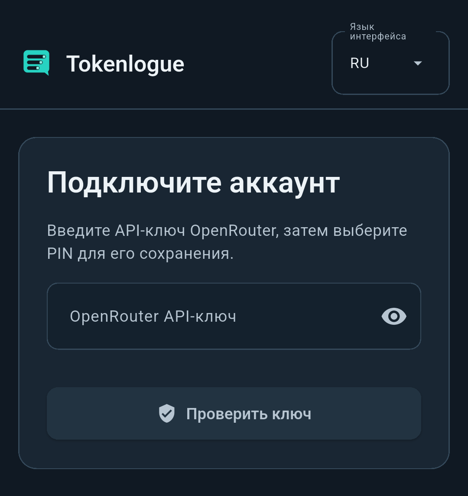

 

# 📘 Работа с Tokenlogue

Tokenlogue позволяет общаться с моделями OpenRouter в Linux и Android. Руководство описывает текущую предварительную версию. В прежних опубликованных выпусках возможностей может быть меньше. Начните с <a href="linux-appimage.ru.md#russian" title="установки в Linux">установки в Linux&nbsp;</a> или <a href="android.ru.md#russian" title="установки в Android">установки в Android&nbsp;</a>.

     

###  Начало работы

1. Выберите русский или английский язык на экране входа.
2. Введите API-ключ из своего [аккаунта OpenRouter](https://openrouter.ai/settings/keys) и нажмите `Проверить ключ`. Для этого нужен доступ к OpenRouter. Ошибка соединения сама по себе не означает, что ключ неверный.
3. Выберите четырёхзначный PIN, повторите его и нажмите `Сохранить PIN`. Используйте цифры `0`–`9`. Ноль в начале допустим. Кнопка `Предложить PIN` заполняет случайный вариант, который можно изменить. Для сохранения значения обоих полей должны совпадать.
4. Сохраните PIN в надёжном месте. Кнопка с глазом позволяет увидеть его. Tokenlogue не копирует PIN автоматически.
5. В Linux пройдите начальную проверку локальной защиты и сохраните резервный код, когда приложение предложит это. Можно продолжить с ручной блокировкой приложения и проверить автоматическую защиту позднее. Подробнее в разделе <a href="security.ru.md#ru-locking" title="о защите переписки">о защите переписки&nbsp;</a>.
6. Нажмите `+`, чтобы создать чат.

 
 

*Первоначальная настройка на Android. Инструкции выше относятся к обеим платформам.*

При следующих запусках введите PIN приложения и нажмите `Войти`. Обновление совместимой установки сохраняет этот PIN. После трёх неверных проверок ввод блокируется на пять минут. Перезапуск не сбрасывает отсчёт. Подробнее в разделе <a href="security.ru.md#ru-pin" title="о входе и восстановлении">о входе и восстановлении&nbsp;</a>.

###  Создание чатов и управление ими

Выберите бесплатный или платный режим, найдите модель по названию или ID и задайте лимиты чата. В каждом чате сохраняются его режим и модель. Для другой модели создайте новый чат.

В бесплатном режиме доступны автоматический выбор и модели, у которых все применимые цены равны нулю. При автоматическом выборе модель для каждого запроса определяет OpenRouter. Доступность и ограничения частоты бесплатных запросов сервиса сохраняются. Для платного режима нужны действующий ключ и известные цены модели. Наличие средств OpenRouter проверяет при обработке запросов.

Возвращайтесь к переписке через список чатов. Если хватает места по высоте, под заголовком находятся `Переименовать` и `Удалить чат`. Переименование сохраняет сообщения и черновик. Удаление требует подтверждения и удаляет локальную историю и черновик только этого чата. Весь профиль при этом сохраняется. Эти действия и изменение лимитов недоступны во время отправки.

В меню `⋮` находятся состояние ключа, сведения о модели, цены токенов, подробный бюджет и настройки лимитов. Здесь же доступны язык, замена ключа и действия с профилем. Открытие меню не отправляет сообщение и не обновляет ключ автоматически. Если пункты не помещаются, прокрутите меню.

###  Настройка рабочего пространства

В широком окне Linux верхняя левая кнопка скрывает или показывает список чатов. Tokenlogue запоминает выбор. На узком экране эта кнопка открывает выдвижную панель. Выберите чат, нажмите вне панели или используйте Back либо Escape, чтобы её закрыть. Узкая компоновка не меняет сохранённую настройку широкого окна.

 
 

*Рабочее пространство Linux с демонстрационными данными. Список чатов, переписка и редактор находятся рядом.*

Для переключения русского и английского выберите `Язык интерфейса` в `⋮`. Выбор сохраняется. Названия чатов, ваши сообщения и ответы модели не переводятся. Обычный ввод и черновики сохраняются при смене языка. Незавершённое подтверждение резервного кода или удаления профиля нужно начать заново на выбранном языке.

Длинные названия визуально сокращаются. Когда клавиатура или низкое окно оставляют мало места, кнопки переименования и удаления скрываются. Закройте клавиатуру или увеличьте высоту окна, чтобы они снова появились. Переписка и редактор используют оставшееся пространство.

###  Отправка сообщений и сохранение черновиков

Введите текст в поле `Сообщение` и нажмите `Отправить`. При работе с клавиатурой Enter отправляет сообщение, а Shift+Enter добавляет перенос строки. Пустые сообщения отправить нельзя. Tokenlogue передаёт сообщение и подходящий контекст переписки в OpenRouter и выбранному поставщику модели.

У каждого чата свой локальный черновик. Сохранённый текст восстанавливается после переключения чатов, изменения размера окна, переименования, блокировки и перезапуска. Черновик существует отдельно от истории. Ввод текста не отправляет его, не расходует средства и не добавляет в контекст модели.

Когда сообщение принято к отправке, отправленный черновик очищается. Пока ответ готовится, можно писать новый. Завершение прошлого запроса не удалит новый текст. Неудачная проверка до отправки или отменённое подтверждение платного запроса сохраняют исходный черновик.

Если ответ неполный или запрос завершился ошибкой, прочитайте его состояние перед повтором. Повтор запроса, уже дошедшего до сервиса, может привести к ещё одному списанию.

###  Настройка лимитов чата

Задайте лимиты до первого запроса. Для изменения откройте `Настроить лимиты` или `Изменить лимиты` в `⋮`.

| Настройка | Что она ограничивает |
| --- | --- |
| Общий лимит токенов чата | Входные токены и ответы во всех запросах чата. Повторная передача контекста тоже расходует токены. |
| Максимум токенов одного ответа | Запрашиваемая верхняя граница ответа. Ответ может быть короче. |
| Денежный лимит чата, USD | Локальный предел расходов платного чата. Повышение требует подтверждения. |

Перед отправкой Tokenlogue резервирует токены, а в платном режиме ещё и деньги. Из доступного бюджета чата вычитаются фактический расход и действующие резервы. Если остатка недостаточно для нового резерва, запрос может быть отклонён. Локальный резерв не является списанием OpenRouter.

Бюджет чата, лимит расходов ключа OpenRouter и баланс аккаунта OpenRouter — разные величины. Tokenlogue не получает общий баланс аккаунта. Отсутствие отдельного лимита ключа не означает неограниченные средства.

###  Подтверждение платных запросов

В новых платных чатах перед отправкой появляется подтверждение. Проверьте модель, оценку входа, максимум ответа и денежный резерв. Отмена оставляет сообщение неотправленным.

Пункт `Без подтверждений` над перепиской отключает этот диалог для выбранного чата с первого запроса, включая повторы и изменение цен. Само включение ничего не отправляет. Лимиты, проверка ключа и проверка цен продолжают действовать. Повышение денежного лимита сохраняет отдельное подтверждение.

Отключите этот пункт, чтобы запрашивать подтверждение начиная со следующего запроса. Выбор сохраняется для каждого чата. Блокировка или изменение настройки никогда не отправляют ожидающее сообщение автоматически. Нажмите `Отправить`, когда будете готовы.

###  Как читать статистику и оценку расходов

| Показатель | Значение |
| --- | --- |
| В чате доступно | Остаток бюджета платного чата после фактических расходов и действующих резервов. |
| Осталось токенов | Остаток токенов бесплатного чата после расхода и действующих резервов. Это не общая бесплатная квота OpenRouter. |
| Последний запрос | Подтверждённая стоимость в платном чате или сумма входных токенов и ответа в бесплатном. Повтор считается новой попыткой. |
| Осталось по ключу | Известный остаток лимита расходов текущего API-ключа. Он отличается от бюджета чата и баланса аккаунта. |

`Лимит ключа не установлен` означает отсутствие отдельного ограничения ключа. `Данные ключа недоступны` означает неизвестный остаток. Исчерпанный лимит обозначается отдельно. Наведите указатель или удерживайте показатель для пояснения и времени получения данных ключа, если оно известно. Пункт `Обновить статус ключа` в `⋮` запрашивает свежие данные. Ввод текста или повторное открытие показателей не обновляет старые сведения.

Состояния `Нет запросов`, `Выполняется`, `Уточняется` и `Неизвестно` различаются. Неизвестный результат не считается нулевой стоимостью.

Оценка под редактором меняется во время ввода. Она учитывает подходящую историю и действующий максимум ответа. Это консервативная локальная оценка на основе текста UTF-8, а не точная токенизация модели и не прогноз длины ответа. Возможная стоимость является верхней оценкой при известных ценах. При отсутствующих или устаревших ценах показывается `Стоимость неизвестна`. Фактические токены и стоимость определяются после отправки.

Расчёт оценки не обращается к сети и не резервирует бюджет. При отправке выполняются обычные проверки.

###  Если результат запроса неизвестен

После потери соединения может быть неизвестно, обработал ли OpenRouter запрос. Tokenlogue сохраняет защитный резерв, а не считает запрос бесплатным. Перед повтором проверьте запрос и списания в аккаунте OpenRouter.

После проверки пункт `Освободить неизвестный резерв` возвращает локальный резерв в бюджет чата. Он не отменяет удалённый запрос и не возвращает оплату. Повтор может привести к новому списанию.

###  Замена ключа OpenRouter

Войдите с прежним PIN, откройте `⋮` и выберите `Заменить ключ OpenRouter`. Это доступно и без выбранного чата. Сначала завершите текущую отправку или проверку ключа.

Старый ключ сохраняется, пока новый не пройдёт проверку и не будет записан. Отмена или неудачная проверка оставляют его. PIN, ключ шифрования, чаты, черновики и бюджеты не меняются. Это действие не восстанавливает забытый PIN и не отзывает старый ключ на стороне OpenRouter. При необходимости отзовите ключ в аккаунте OpenRouter.

###  Защита переписки

Перед тем как оставить устройство, используйте кнопку блокировки в шапке. В Android уход приложения в фон закрывает доступ. В Linux наблюдение за блокировкой экрана и сном зависит от рабочего окружения.

Прочитайте <a href="security.ru.md#russian" title="руководство по защите и восстановлению">руководство по защите и восстановлению&nbsp;</a>, прежде чем полагаться на PIN или менять защиту устройства. Оно объясняет шифруемые поля, резервный код Linux, системное восстановление Android, проверку локальной защиты и необратимое удаление профиля. Копия базы сама по себе не сохраняет отдельный ключ шифрования.

   

