[English](user-guide.md#english) · [Русский](user-guide.ru.md#russian)

# Как пользоваться чатом

[Главная](../README.ru.md) · [Документация](../docs/README.ru.md)

> **[0.1.1 Preview](https://github.com/Umichata/tokenlogue/releases/tag/v0.1.1-preview.1)** содержит APK Android ARM64 и настольный bundle Linux x86_64. Перед установкой проверьте требования платформы и сумму скачанного файла.

## Первое подключение

1. Выберите русский или английский язык и введите ключ. OpenRouter начинается с `sk-or-v1-`. VSEGPT начинается с `sk-or-vv-` или `sk-or-vis`. После начала нужно секретное продолжение. Дополнительный дефис после `sk-or-vis` не требуется.
2. Нажмите **Проверить ключ**. Сервис определяется локально, а проверка использует бесплатный запрос. Если VSEGPT не подтверждает авторизацию, можно явно нажать **Сохранить непроверенный ключ**, когда это предложено. Сообщение в чат не отправляется.
3. Выберите четыре цифры, повторите их и сохраните PIN приложения. Начальный ноль допустим. Сохраните PIN отдельно.
4. В Linux пройдите вступление о локальной защите и сохраните предложенный резервный код. Можно продолжить с ручной блокировкой.
5. Создайте чат через **+**.

Для профиля только с VSEGPT ключ OpenRouter не нужен. Другой сервис добавляется позже через [Провайдеры](providers.ru.md). Повторный вход и восстановление используют прежний защищённый профиль и не создают новую регистрацию.

| Linux | Эмулятор Android |
| --- | --- |
| <a href="assets/screenshots/v011-55-linux-first-run-ru.png">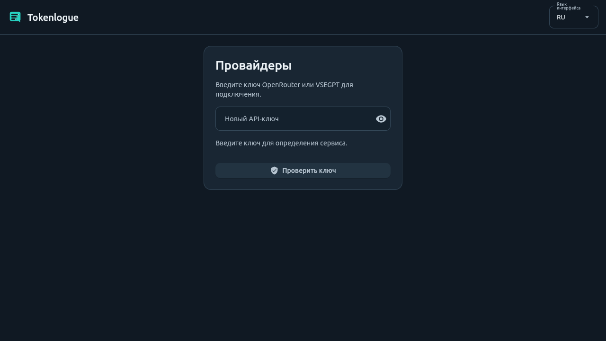</a> | <a href="assets/screenshots/v011-55-android-start-ru.png">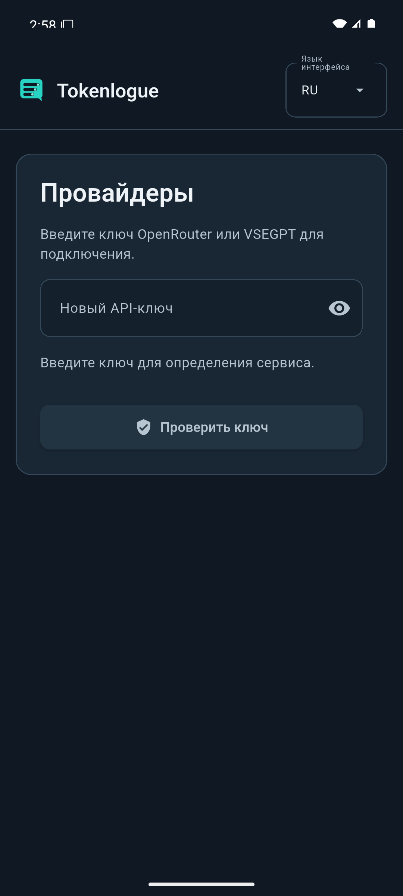</a> |

*Отдельные демонстрационные профили до ввода ключа.*

[Выбор PIN приложения](assets/screenshots/v011-android-pin-setup-ru.png) показывает следующий шаг без раскрытия PIN. Также показана [настройка PIN в Linux](assets/screenshots/v011-55-linux-pin-setup-ru.png).

## Навигация с сохранением места

**Главная**, **Провайдеры**, **Токены** и **Расходы** относятся ко всему приложению. В широком окне Linux они находятся на тёмной боковой панели. Android и узкие окна используют нижнюю навигацию. Отдельная панель чатов относится к Главной.

Переходы сохраняют черновик и текущий чат. Android Back возвращает со вспомогательной страницы на Главную. Уже отправленный запрос может один раз завершиться при открытой другой странице. Навигация не отправляет черновик.

## Создание и действия чата

Через **+** начните создание чата. При **Ручном выборе** сначала выберите OpenRouter или VSEGPT. Явно сохранённый сервис пропускает этот вопрос. OpenRouter предлагает бесплатный и платный режимы. VSEGPT сразу открывает список платных моделей. После выбора модели проверьте лимиты. Политика создания действует только для новых чатов. Для явной смены сервиса существующего чата используйте **Подключение чата**. Для другой модели в том же сервисе создайте отдельный чат.

Бесплатный режим OpenRouter использует автоматический выбор или модели с нулевыми применимыми ценами. Доступ зависит от авторизации, наличия модели и ограничений сервиса. Отрицательный баланс аккаунта может блокировать бесплатные запросы. Ноль и неизвестный баланс являются разными состояниями. См. актуальные [ограничения OpenRouter](https://openrouter.ai/docs/api_reference/limits).

VSEGPT в Tokenlogue работает только в платном режиме. Отдельного шага выбора режима нет. Выберите модель, затем задайте бюджет в RUB и подтвердите условия в форме лимитов. Тарификация может использовать другие единицы, а неизвестная цена не равна нулю. Открытие списка моделей само по себе не создаёт чат и ничего не отправляет.

При ошибке загрузки каталога приложение показывает конкретную причину и действие **Обновить список**. Обновление списка не повторяет сообщение автоматически. Автоматический бесплатный выбор OpenRouter остаётся доступным без списка с теми же ограничениями доступа.

Выберите разговор в списке, чтобы вернуться к нему. **Переименовать** сохраняет историю и черновик. **Удалить чат** запрашивает подтверждение и удаляет этот чат, его черновик и местную статистику. При нехватке высоты из-за клавиатуры действия в шапке могут скрываться. Меню **⋮** содержит сведения о модели, лимиты, данные ключа и действия профиля.

[Новый чат и выбор модели](assets/screenshots/v011-55-android-vsegpt-models-ru.png) · [Переименование](assets/screenshots/v011-55-android-rename-chat-ru.png) · [Удаление чата](assets/screenshots/v011-55-android-delete-chat-ru.png) · [Лимиты чата](assets/screenshots/v011-55-android-paid-limits-ru.png)

*Демонстрационные действия чата в эмуляторе Android. Названия моделей получены из каталога сервиса.*

[Переименование в Linux](assets/screenshots/v011-55-linux-rename-chat-ru.png).

### Выбор провайдера нового чата

| Linux | Эмулятор Android |
| --- | --- |
| <a href="assets/screenshots/v011-55-linux-new-chat-provider-ru.png">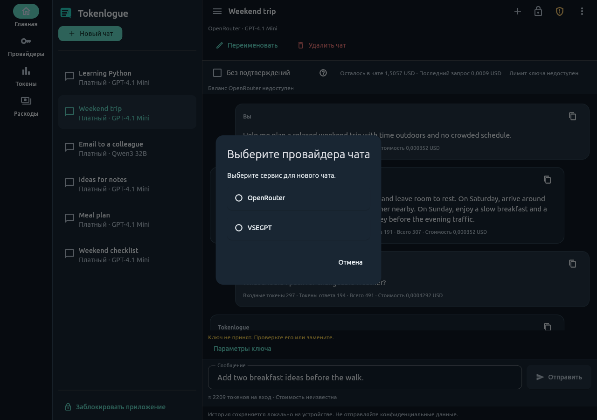</a> | <a href="assets/screenshots/v011-55-android-new-chat-provider-ru.png">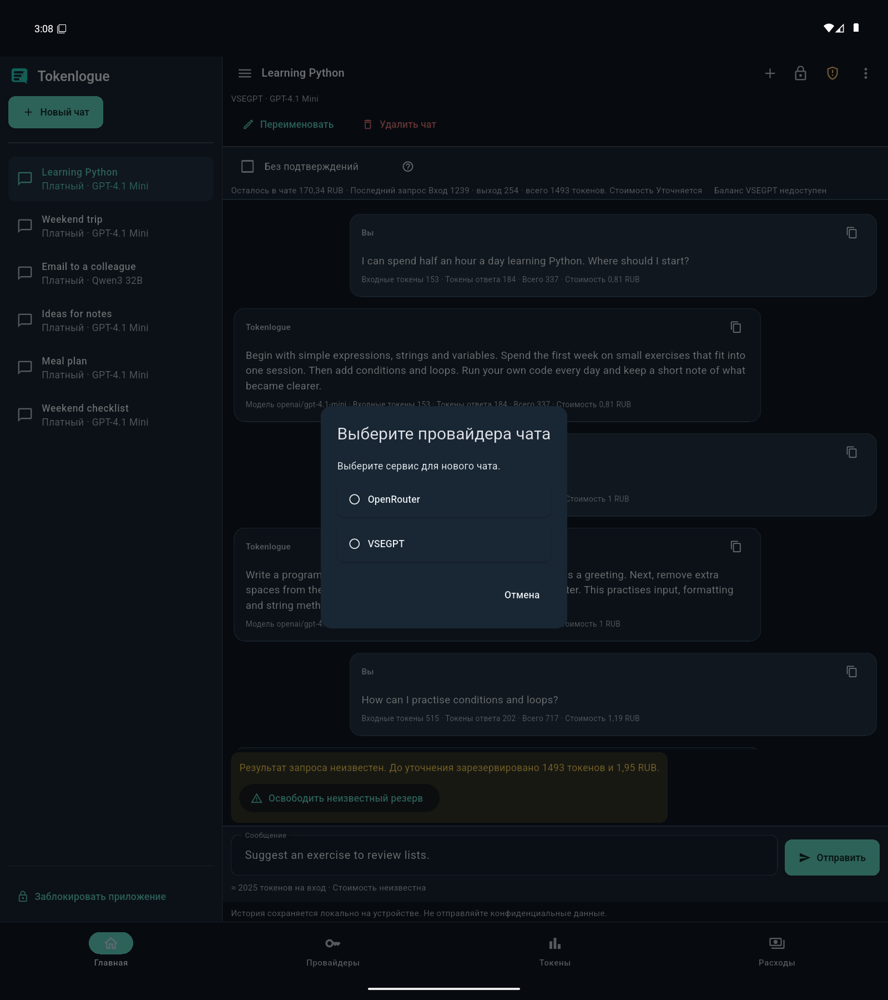</a> |

| Linux | Эмулятор Android |
| --- | --- |
| <a href="assets/screenshots/v011-55-linux-vsegpt-models-search-ru.png">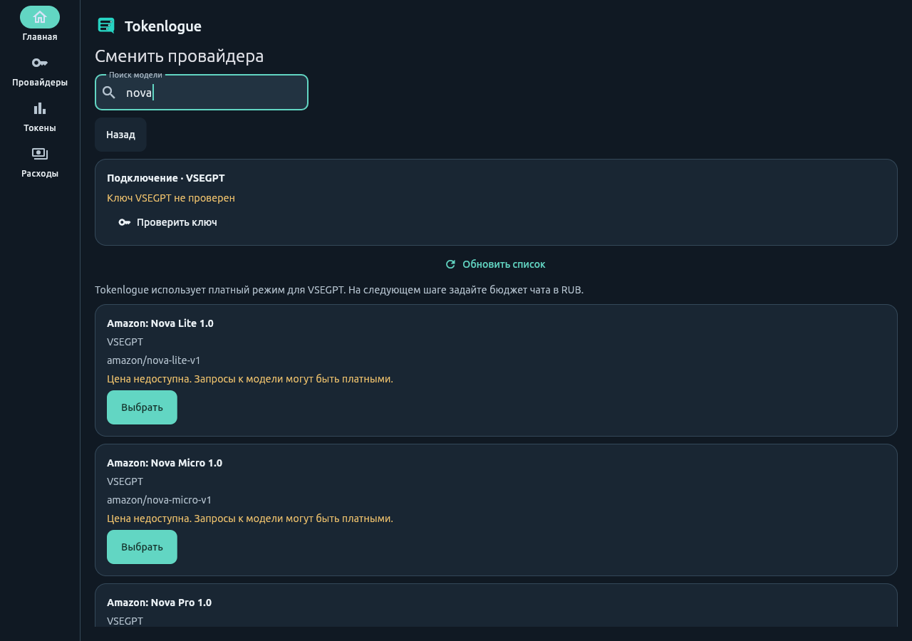</a> | <a href="assets/screenshots/v011-55-android-vsegpt-models-ru.png">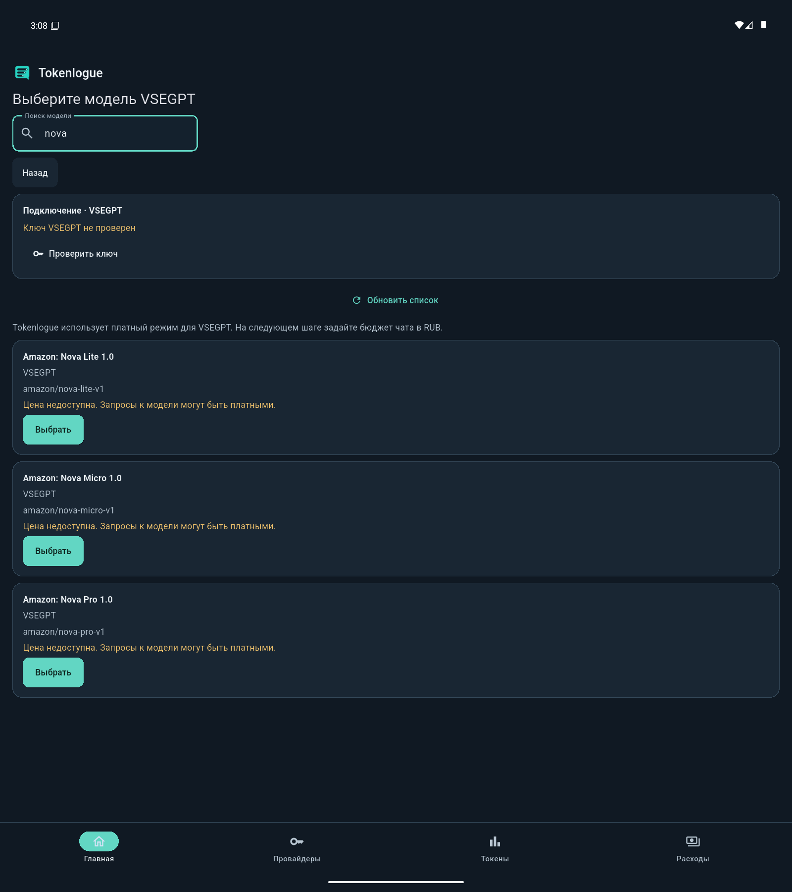</a> |

*Демонстрационные профили. В Linux список моделей показан при смене провайдера, в Android — при создании нового чата. В обоих случаях модели VSEGPT открываются напрямую. Платные запросы не отправлялись.*

### Проверить сохранённый ключ

На экране режимов OpenRouter и в списке моделей VSEGPT нажмите **Проверить ключ** рядом со статусом подключения. Приложение проверит сохранённый ключ выбранного сервиса. Повторно вводить его не нужно. **Обновить список** отдельно загружает каталог моделей и не подтверждает авторизацию.

Во время запроса видны индикатор и надпись **Проверяем ключ…**. При успехе статус и доступные действия обновляются в этом же окне. Сеть, timeout, TLS, отказ доступа и недействительный ключ показаны отдельно. После ошибки проверку можно повторить. Отмена и системный Back продолжают работать, проверка ничего не отправляет в чат и не выбирает модель.

Если доступ к балансу VSEGPT отключён в настройках сервиса, ключ остаётся непроверенным. Успешная проверка авторизации не гарантирует наличие средств или свободной квоты. Недоступный баланс OpenRouter сам по себе не отзывает разрешение ключа на чаты.

| Linux | Эмулятор Android |
| --- | --- |
| <a href="assets/screenshots/v011-linux-openrouter-key-check-ru.png">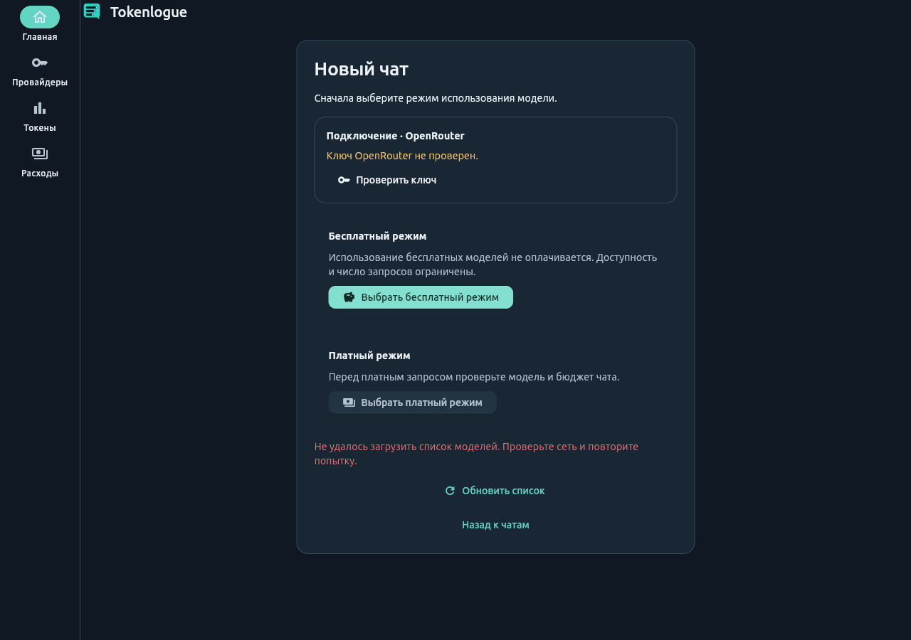</a> | <a href="assets/screenshots/v011-android-openrouter-key-check-ru.png">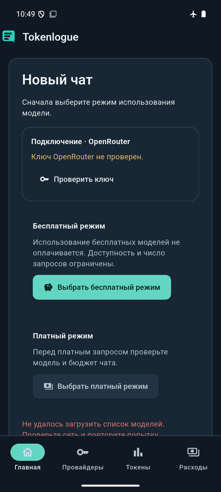</a> |

| Linux | Эмулятор Android |
| --- | --- |
| <a href="assets/screenshots/v011-linux-openrouter-key-result-ru.png">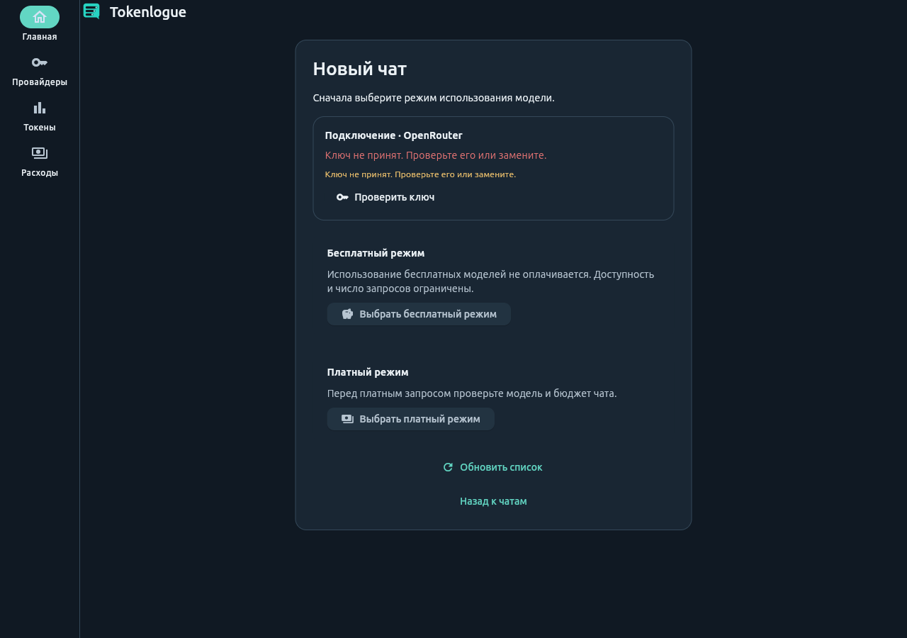</a> | <a href="assets/screenshots/v011-android-openrouter-key-result-ru.png">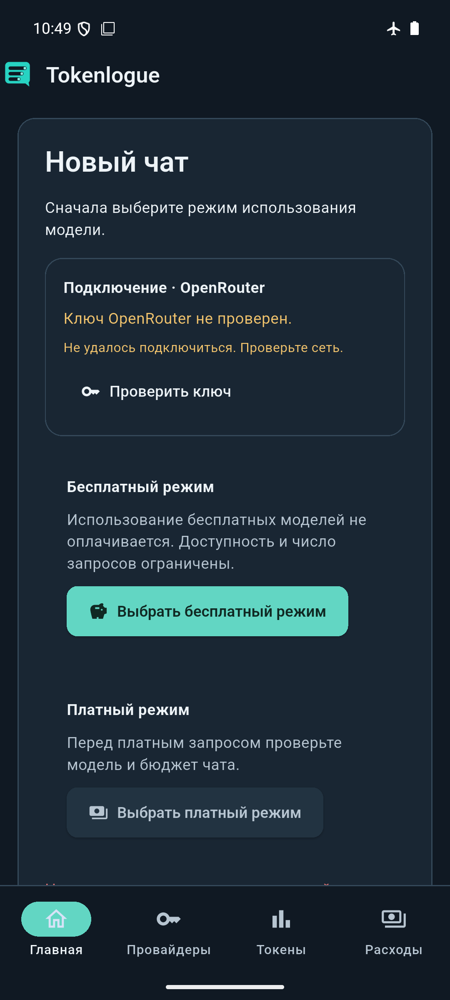</a> |

*Демонстрационные профили. Linux показывает настоящий отказ заведомо поддельному ключу. Android показывает намеренную ошибку без сети. Эти кадры не изображают успешную авторизацию.*

### После успешной проверки сохранённого ключа

<a href="assets/screenshots/v011-55-android-openrouter-accepted-ru.png">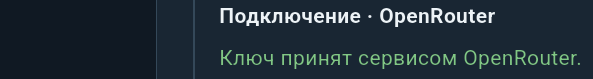</a>

*Фрагменты настоящего приложения после проверки сохранённого ключа. Показаны сервис и результат без личных сумм и лимита ключа. Кнопки показаны в примерах режимов выше.*

При ручном создании Back из списка моделей VSEGPT возвращает к выбору провайдера. При фиксированном VSEGPT он отменяет создание и возвращает к чатам. Во время смены подключения Back возвращает к выбору сервиса, сохраняя прежнее подключение. Из формы лимитов Back возвращает к списку моделей. Отмена сохраняет прежний черновик.

## Подключение чата и смена провайдера

Откройте **⋮** выбранного чата. В блоке **Подключение чата** указаны провайдер и состояние ключа, а для сохранённого ключа показана маска. У каждого сервиса один защищённый ключ, общий для всех его чатов. У достаточно длинного ключа видны только последние четыре символа, короткий скрывается полностью. **Настроить ключ OpenRouter** или **Настроить ключ VSEGPT** открывает соответствующую карточку.

1. Нажмите **Сменить провайдера** и выберите OpenRouter или VSEGPT. Текущий провайдер отмечен.
2. Если ключ целевого сервиса отсутствует, настройте его в предложенной карточке. Вернитесь на Главную и явно выберите провайдера ещё раз, чтобы продолжить.
3. Для OpenRouter выберите бесплатный или платный режим. Для VSEGPT сразу выберите модель. Проверьте лимиты. Для платной модели нужен бюджет в её валюте. Совпадающий ID модели другого сервиса не выбирается автоматически.
4. Нажмите **Проверить изменение**. Сверьте провайдера, модель, валюту, уже потраченную сумму и остаток бюджета, затем нажмите **Сменить провайдера**.

При подтверждении приложение снова проверяет каталог. Если он недоступен или выбранная модель изменилась, прежнее подключение сохраняется. Повторите попытку позже или заново проверьте текущую модель перед подтверждением.

При настройке сообщения не отправляются. При следующем обычном нажатии **Отправить** новый сервис получит новое сообщение и помещающиеся в контекст выбранной модели завершённые пары переписки.

Название, сообщения, черновик и защита чата сохраняются. Токеновый лимит и уже использованные токены остаются общими для обоих сервисов. При смене подключения общий токеновый лимит доступен только для чтения. Денежные лимиты, расходы и резервы USD и RUB хранятся отдельно. При возврате к провайдеру восстанавливается его прежнее денежное состояние. После смены **Без подтверждений** отключается, поэтому для нового сервиса потребуется новое согласие на платный запрос.

До окончательного подтверждения Отмена и Back сохраняют прежнее подключение. Выбор текущего провайдера ничего не меняет. Другие чаты и провайдер новых чатов остаются прежними. Дождитесь завершения активного запроса и урегулируйте неизвестный результат перед сменой. При ошибке приложение не переключает чат на другой сервис автоматически.

| Подключение | Linux | Android |
| --- | --- | --- |
| OpenRouter | <a href="assets/screenshots/v011-55-linux-chat-connection-openrouter-ru.png">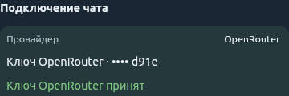</a> | <a href="assets/screenshots/v011-55-android-chat-connection-openrouter-ru.png">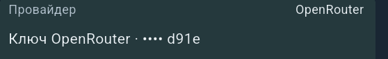</a> |
| VSEGPT | <a href="assets/screenshots/v011-55-linux-chat-connection-vsegpt-ru.png">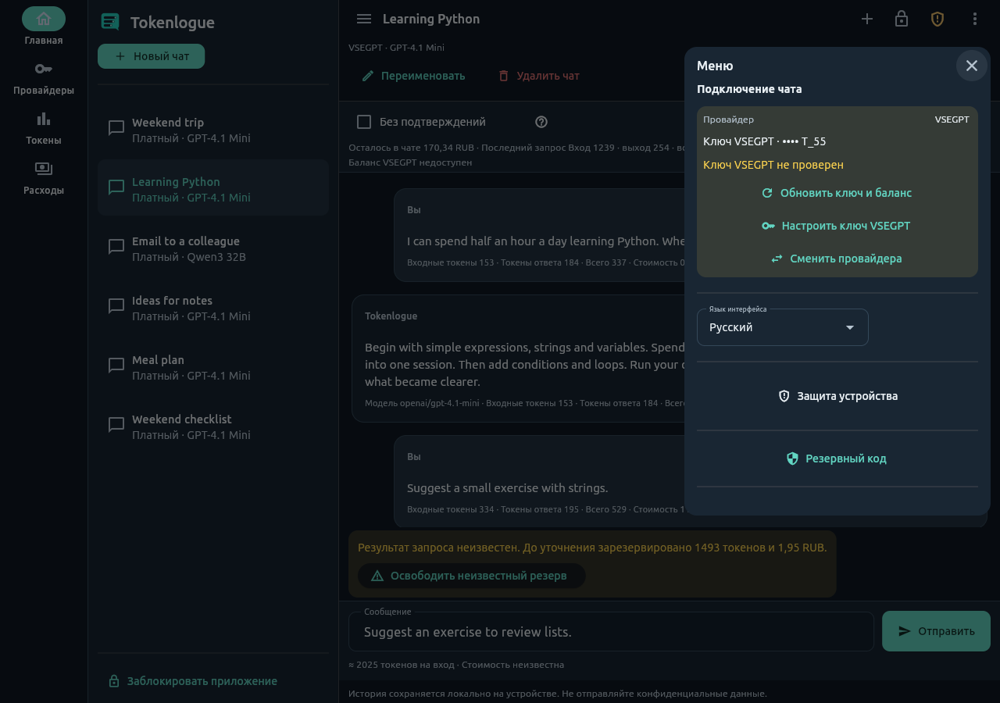</a> | <a href="assets/screenshots/v011-55-android-chat-connection-vsegpt-ru.png">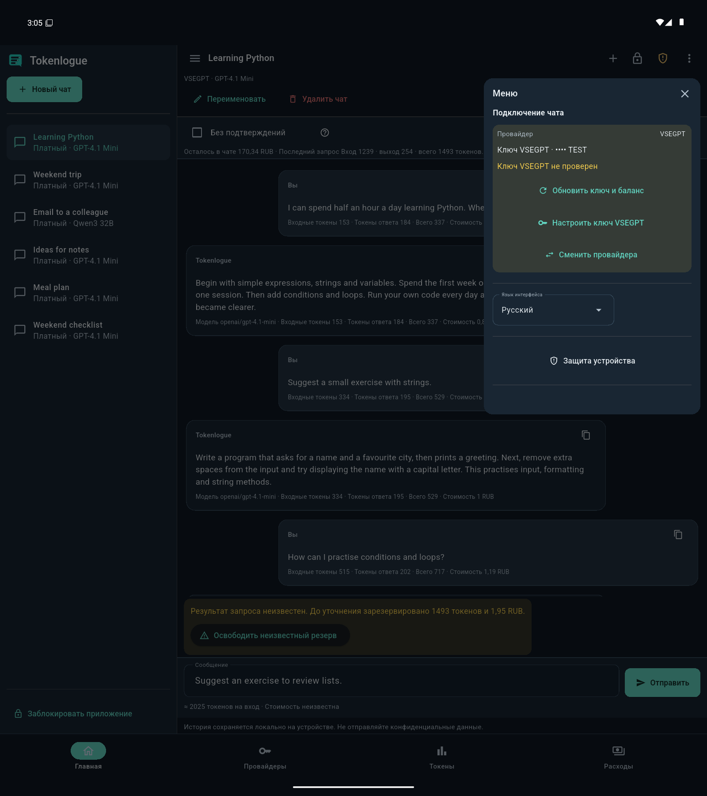</a> |

*Отдельные демонстрационные профили. Показаны только маски ключей. Для отправки нужен действующий ключ выбранного сервиса. Смена языка интерфейса не переводит существующие сообщения.*

- Примеры Linux показывают [выбор провайдера](assets/screenshots/v011-55-linux-chat-provider-picker-ru.png), [окончательную проверку](assets/screenshots/v011-55-linux-chat-connection-review-ru.png) и [чат после смены](assets/screenshots/v011-55-linux-home-ru.png).
- Примеры Android показывают [выбор провайдера](assets/screenshots/v011-55-android-chat-change-provider-ru.png), [окончательную проверку](assets/screenshots/v011-55-android-chat-change-confirm-ru.png) и [чат после смены](assets/screenshots/v011-55-android-chat-after-change-ru.png).

Действия подключения OpenRouter для настройки ключа и смены провайдера

[Linux](assets/screenshots/v011-55-linux-chat-connection-openrouter-actions-ru.png).

## Сообщения и черновики

Введите сообщение и нажмите **Отправить**. На клавиатуре Enter отправляет, а Shift+Enter вставляет перенос. Сообщение и подходящий контекст получает сервис, закреплённый за чатом, и выбранный поставщик модели.

У каждого чата свой черновик. Переходы, изменение размера, блокировка и перезапуск сохраняют его. Черновик не считается отправленным сообщением, контекстом или расходом. После принятия сообщения к отправке его черновик очищается. Новый текст, набранный во время ожидания прежнего запроса, сохраняется после ответа.

Ошибка проверки перед отправкой или отмена подтверждения сохраняют исходный черновик. Перед повтором прерванного запроса проверьте его состояние, поскольку новая отправка может вызвать ещё одно списание.

## Настройка лимитов чата

Откройте **Задать лимиты** или **Изменить лимиты** в **⋮**.

| Настройка | Значение |
| --- | --- |
| Лимит токенов чата | Входные токены и ответы у обоих провайдеров этого чата, включая повторяемый контекст. |
| Максимум ответа | Запрашиваемая верхняя граница токенов ответа. Ответ может быть короче. |
| Денежный лимит чата | Отдельный местный лимит текущего провайдера этого чата в USD или RUB. Увеличение требует подтверждения. |

Остаток бюджета учитывает использованные токены или деньги и активные резервы. Резервы защищают местный бюджет при незавершённом учёте. Они не являются отдельным списанием сервиса. Ограничения провайдера и лимиты ключа OpenRouter продолжают действовать.

## Предупреждение бюджета

Если после платного запроса может остаться не больше 10% денежного лимита чата, появится предупреждение. Нулевой остаток может исчерпать бюджет. Отрицательный может превысить его. Расчёт использует лимит чата, записанные расходы, активные резервы и оценку нового запроса.

| Действие | Результат |
| --- | --- |
| Отмена | Сохраняет черновик и ничего не отправляет. Back, Escape и закрытие диалога тоже отменяют. |
| Отправить | Подтверждает только рассмотренный запрос. Может разрешить превышение без увеличения сохранённого лимита. |
| Изменить лимит чата | Открывает настройки чата. Сохранение не отправляет черновик. Перед отправкой проверьте его снова. |

Неизвестная цена тоже требует явного рассмотрения. Изменение черновика, модели, цены или бюджета может потребовать нового подтверждения. Оценка не гарантирует итоговое списание.

Если цены модели изменились, проверьте прежние и текущие значения. При обычных подтверждениях действие **Подтвердить новые цены** заново проверяет запрос перед его подтверждением. Само оно не отправляет сообщение.

В следующих примерах используются известные текущие цены каталога и демонстрационные бюджеты чатов. Сообщение не отправлялось.

| Прогноз | Linux | Эмулятор Android |
| --- | --- | --- |
| Почти исчерпан | [Открыть](assets/screenshots/v011-55-linux-budget-near-zero-ru.png) | [Открыть](assets/screenshots/v011-55-android-budget-near-zero-ru.png) |
| Возможное превышение | [Открыть](assets/screenshots/v011-55-linux-budget-exceed-ru.png) | [Открыть](assets/screenshots/v011-55-android-budget-exceed-ru.png) |

<a href="assets/screenshots/v011-55-linux-price-unknown-ru.png">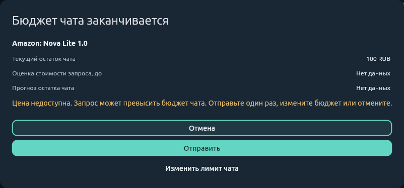</a>

*Демонстрационный чат в Linux. Этот отдельный пример требует рассмотрения из-за недоступной цены модели. Остаток относится к местному бюджету чата.*

[Пример неизвестной цены в Android](assets/screenshots/v011-55-android-price-unknown-ru.png).

## Обычное платное подтверждение

Платные чаты обычно требуют подтверждения перед отправкой. **Без подтверждений** отключает этот обычный диалог для выбранного чата с первого запроса, включая повторы. Известные текущие цены модели могут приниматься без отдельного диалога изменения цен.

Предупреждения бюджета, токеновые лимиты, проверка ключа и защита при неизвестной цене продолжают действовать. Переключатель ничего не отправляет. Отключите его, чтобы снова проверять следующий платный запрос.

Обычное подтверждение перед платным запросом

[Linux](assets/screenshots/v011-55-linux-paid-confirmation-ru.png) · [Эмулятор Android](assets/screenshots/v011-55-android-paid-confirmation-ru.png).

[Linux](assets/screenshots/v011-55-linux-without-confirmation-ru.png) · [Эмулятор Android](assets/screenshots/v011-55-android-without-confirmation-ru.png)

Примеры показывают настройку **Без подтверждений** и её пояснение в демонстрационном чате. Переключение настройки не отправляет сообщение.

## Токены и суммы

Полоса метрик на всю ширину показывает данные открытого чата и его сервиса. Наведение или удержание раскрывает подробности.

| Показатель | Источник |
| --- | --- |
| Осталось в чате | Местный денежный лимит за вычетом записанных расходов и активных резервов. |
| Осталось токенов | Бюджет токенов этого чата, а не общая бесплатная квота сервиса. |
| Последний запрос | Его записанная стоимость или токены и состояние учёта. |
| Баланс OpenRouter | Сумма аккаунта из API credits OpenRouter. |
| Баланс VSEGPT | Сумма в RUB, полученная через доступ к балансу VSEGPT. |
| Остаток лимита ключа | Остаток отдельного ограничения ключа OpenRouter. Для VSEGPT отдельный лимит ключа не поддерживается. |

После смены провайдера последний запрос сохраняет свою исходную валюту.

Известный ноль, отрицательный остаток, незаданный лимит ключа и неизвестная сумма — разные состояния. Незаданный лимит не гарантирует наличие денег. Устаревший баланс сохраняет последнее значение с соответствующей отметкой.

Оценка под редактором учитывает подходящий контекст и максимум ответа. Она местная и приблизительная. Это не точная токенизация модели. При отсутствии цен стоимость недоступна. Расчёт не отправляет запрос и не резервирует деньги.

## Обновление и замена ключа

Используйте **Обновить ключ и баланс** в **⋮** для актуальных данных выбранного сервиса. После завершения отправленного запроса баланс обновляется отдельно. Ответ не ждёт этого обновления. Ошибка доступа к балансу не заменяет ответ и не превращает неизвестную сумму в ноль.

Через [Провайдеры](providers.ru.md) проверяйте и заменяйте ключ нужного сервиса. Прежний ключ сохраняется до принятия и сохранения замены. PIN, чаты, черновики и бюджеты остаются. При необходимости отзовите прежний ключ в аккаунте сервиса.

## Прерванные запросы

Повтор после смены подключения создаёт новую попытку с текущими провайдером и моделью. Перед повтором проверьте текущего получателя. Прежняя попытка сохраняет свой сервис и учёт.

После обрыва связи списание провайдера может остаться неизвестным. Защитный резерв сохраняется в бюджете чата. Перед повтором проверьте запрос и биллинг сервиса. **Освободить неизвестный резерв** освобождает только местный резерв. Это не отменяет удалённый запрос и не возвращает списание.

## Статистика и защита

[Токены и Расходы](analytics.ru.md) показывают сохранённую активность этого устройства. Удаление чата удаляет его статистику. [Защита и восстановление](security.ru.md) описывают блокировку, восстановление PIN и необратимое удаление профиля. Одна копия базы не сохраняет её отдельный ключ шифрования.
