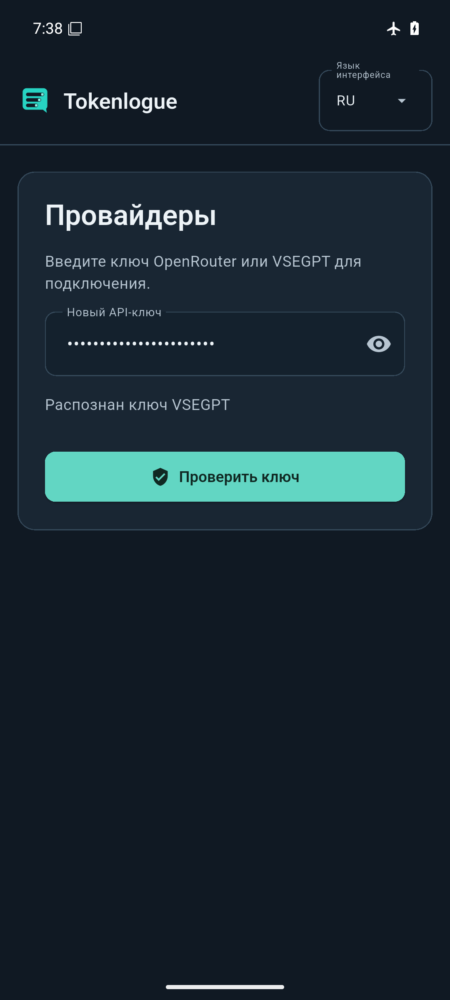
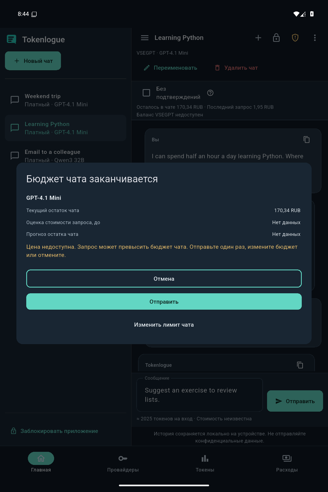

[English](user-guide.md#english) · [Русский](user-guide.ru.md#russian)

# Как пользоваться чатом

[Главная](../README.ru.md) · [Документация](../docs/README.ru.md)

> **0.1.1 доступна локально.** Руководство описывает текущие исходники и локальные сборки. [Опубликованный 0.1.0 Preview](https://github.com/Umichata/tokenlogue/releases/tag/v0.1.0-preview.a981db9) — прежний выпуск. По его ссылкам нельзя скачать 0.1.1.

## Первое подключение

1. Выберите русский или английский язык и введите ключ. OpenRouter начинается с `sk-or-v1-`. VSEGPT начинается с `sk-or-vv-` или `sk-or-vis`. После начала нужно секретное продолжение. Дополнительный дефис после `sk-or-vis` не требуется.
2. Нажмите **Проверить ключ**. Сервис определяется локально, а проверка использует бесплатный запрос. Если VSEGPT не подтверждает авторизацию, можно явно нажать **Сохранить непроверенный ключ**, когда это предложено. Сообщение в чат не отправляется.
3. Выберите четыре цифры, повторите их и сохраните PIN приложения. Начальный ноль допустим. Сохраните PIN отдельно.
4. В Linux пройдите вступление о локальной защите и сохраните предложенный резервный код. Можно продолжить с ручной блокировкой.
5. Создайте чат через **+**.

Для профиля только с VSEGPT ключ OpenRouter не нужен. Другой сервис добавляется позже через [Провайдеры](providers.ru.md). Повторный вход и восстановление используют прежний защищённый профиль и не создают новую регистрацию.

*Демонстрационная настройка с маскированным поддельным ключом.*

[Выбор PIN приложения](assets/screenshots/v011-android-pin-setup-ru.png) показывает следующий шаг без раскрытия PIN.

## Навигация с сохранением места

**Главная**, **Провайдеры**, **Токены** и **Расходы** относятся ко всему приложению. В широком окне Linux они находятся на тёмной боковой панели. Android и узкие окна используют нижнюю навигацию. Отдельная панель чатов относится к Главной.

Переходы сохраняют черновик и текущий чат. Android Back возвращает со вспомогательной страницы на Главную. Уже отправленный запрос может один раз завершиться при открытой другой странице. Навигация не отправляет черновик.

## Создание и действия чата

Через **+** выберите бесплатный или платный режим, доступную модель и лимиты. Провайдер по умолчанию действует только для новых чатов. Прежние разговоры сохраняют свой сервис, модель и валюту. Для другой модели или сервиса создайте отдельный чат.

Бесплатный режим OpenRouter может использовать автоматический выбор или модели с нулевыми применимыми ценами. VSEGPT может использовать другие единицы тарификации. Неизвестная цена не означает бесплатную модель.

Выберите разговор в списке, чтобы вернуться к нему. **Переименовать** сохраняет историю и черновик. **Удалить чат** запрашивает подтверждение и удаляет этот чат, его черновик и местную статистику. При нехватке высоты из-за клавиатуры действия в шапке могут скрываться. Меню **⋮** содержит сведения о модели, лимиты, данные ключа и действия профиля.

[Новый чат и выбор модели](assets/screenshots/v011-android-models-ru.png) · [Переименование](assets/screenshots/v011-android-rename-ru.png) · [Удаление чата](assets/screenshots/v011-android-delete-chat-ru.png) · [Лимиты чата](assets/screenshots/v011-android-chat-limits-ru.png)

*Демонстрационные действия чата в эмуляторе Android. Названия моделей получены из каталога сервиса.*

## Сообщения и черновики

Введите сообщение и нажмите **Отправить**. На клавиатуре Enter отправляет, а Shift+Enter вставляет перенос. Сообщение и подходящий контекст получает сервис, закреплённый за чатом, и выбранный поставщик модели.

У каждого чата свой черновик. Переходы, изменение размера, блокировка и перезапуск сохраняют его. Черновик не считается отправленным сообщением, контекстом или расходом. После принятия сообщения к отправке его черновик очищается. Новый текст, набранный во время ожидания прежнего запроса, сохраняется после ответа.

Ошибка проверки перед отправкой или отмена подтверждения сохраняют исходный черновик. Перед повтором прерванного запроса проверьте его состояние, поскольку новая отправка может вызвать ещё одно списание.

## Настройка лимитов чата

Откройте **Задать лимиты** или **Изменить лимиты** в **⋮**.

| Настройка | Значение |
| --- | --- |
| Лимит токенов чата | Входные токены и ответы этого разговора, включая повторяемый контекст. |
| Максимум ответа | Запрашиваемая верхняя граница токенов ответа. Ответ может быть короче. |
| Денежный лимит чата | Местный бюджет платного чата в USD или RUB. Увеличение требует подтверждения. |

Остаток бюджета учитывает использованные токены или деньги и активные резервы. Резервы защищают местный бюджет при незавершённом учёте. Они не являются отдельным списанием сервиса. Ограничения провайдера и лимиты ключа OpenRouter продолжают действовать.

## Предупреждение бюджета

Если после платного запроса может остаться не больше 10% денежного лимита чата, появится предупреждение. Нулевой остаток может исчерпать бюджет. Отрицательный может превысить его. Расчёт использует лимит чата, записанные расходы, активные резервы и оценку нового запроса.

| Действие | Результат |
| --- | --- |
| Отмена | Сохраняет черновик и ничего не отправляет. Back, Escape и закрытие диалога тоже отменяют. |
| Отправить | Подтверждает только рассмотренный запрос. Может разрешить превышение без увеличения сохранённого лимита. |
| Изменить лимит чата | Открывает настройки чата. Сохранение не отправляет черновик. Перед отправкой проверьте его снова. |

Неизвестная цена тоже требует явного рассмотрения. Изменение черновика, модели, цены или бюджета может потребовать нового подтверждения. Оценка не гарантирует итоговое списание.

*Демонстрационные данные в эмуляторе Android. В этом примере требуется подтверждение из-за неизвестной цены модели. Показанный остаток относится к бюджету чата.*

## Обычное платное подтверждение

Платные чаты обычно требуют подтверждения перед отправкой. **Без подтверждений** отключает этот обычный диалог для выбранного чата с первого запроса, включая повторы. Известные текущие цены модели могут приниматься без отдельного диалога изменения цен.

Предупреждения бюджета, токеновые лимиты, проверка ключа и защита при неизвестной цене продолжают действовать. Переключатель ничего не отправляет. Отключите его, чтобы снова проверять следующий платный запрос.

## Токены и суммы

Полоса метрик на всю ширину показывает данные открытого чата и его сервиса. Наведение или удержание раскрывает подробности.

| Показатель | Источник |
| --- | --- |
| Осталось в чате | Местный денежный лимит за вычетом записанных расходов и активных резервов. |
| Осталось токенов | Бюджет токенов этого чата, а не общая бесплатная квота сервиса. |
| Последний запрос | Его записанная стоимость или токены и состояние учёта. |
| Баланс OpenRouter | Сумма аккаунта из API credits OpenRouter. |
| Баланс VSEGPT | Сумма в RUB, полученная через доступ к балансу VSEGPT. |
| Остаток лимита ключа | Остаток отдельного ограничения ключа OpenRouter. Для VSEGPT отдельный лимит ключа не поддерживается. |

Известный ноль, отрицательный остаток, незаданный лимит ключа и неизвестная сумма — разные состояния. Незаданный лимит не гарантирует наличие денег. Устаревший баланс сохраняет последнее значение с соответствующей отметкой.

Оценка под редактором учитывает подходящий контекст и максимум ответа. Она местная и приблизительная. Это не точная токенизация модели. При отсутствии цен стоимость недоступна. Расчёт не отправляет запрос и не резервирует деньги.

## Обновление и замена ключа

Используйте **Обновить ключ и баланс** в **⋮** для актуальных данных выбранного сервиса. После завершения отправленного запроса баланс обновляется отдельно. Ответ не ждёт этого обновления. Ошибка доступа к балансу не заменяет ответ и не превращает неизвестную сумму в ноль.

Через [Провайдеры](providers.ru.md) проверяйте и заменяйте ключ нужного сервиса. Прежний ключ сохраняется до принятия и сохранения замены. PIN, чаты, черновики и бюджеты остаются. При необходимости отзовите прежний ключ в аккаунте сервиса.

## Прерванные запросы

После обрыва связи списание провайдера может остаться неизвестным. Защитный резерв сохраняется в бюджете чата. Перед повтором проверьте запрос и биллинг сервиса. **Освободить неизвестный резерв** освобождает только местный резерв. Это не отменяет удалённый запрос и не возвращает списание.

## Статистика и защита

[Токены и Расходы](analytics.ru.md) показывают сохранённую активность этого устройства. Удаление чата удаляет его статистику. [Защита и восстановление](security.ru.md) описывают блокировку, восстановление PIN и необратимое удаление профиля. Одна копия базы не сохраняет её отдельный ключ шифрования.
