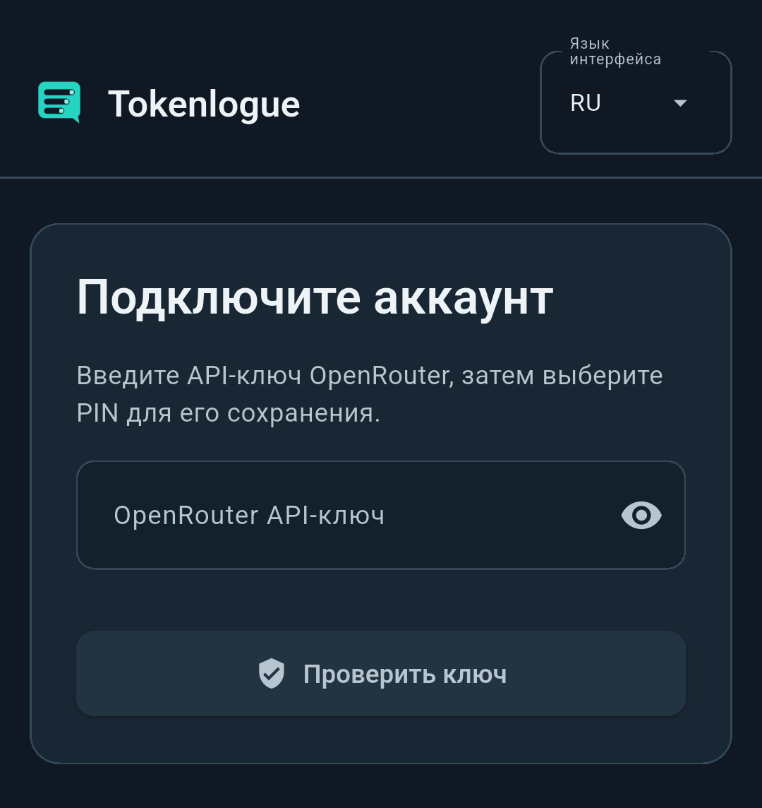

 

# 📘 Руководство

Tokenlogue позволяет общаться с моделями OpenRouter в Linux и Android. Начните с <a href="linux-appimage.ru.md#russian" title="установки в Linux">установки в Linux&nbsp;</a> или <a href="android.ru.md#russian" title="установки в Android">установки в Android&nbsp;</a>.

**Скачать Tokenlogue 0.1.0 Preview**

  <a href="https://github.com/Umichata/tokenlogue/releases/download/v0.1.0-preview.a981db9/SHA256SUMS">SHA256SUMS</a>

Архивы исходников для установки не нужны.

##  Текущие исходники: провайдеры и аналитика

**Этот раздел относится к текущему checkout исходников и новым локальным сборкам из него.** Ссылки выше по-прежнему ведут на опубликованный OpenRouter Preview. Этих изменений в них нет. Следуйте разделу при запуске текущих исходников или нового локального пакета. Миграция сохраняет защиту профиля, чаты, черновики и бюджеты. Обновляйте совместимую установку с прежним защищённым хранилищем. Не удаляйте приложение и не очищайте его данные ради обновления.

После входа доступны **Главная**, **Провайдеры**, **Токены** и **Расходы**. В широком окне Linux используется боковая навигация, в Android и узком окне — нижняя. Главная содержит прежнее рабочее место чатов. Отдельная кнопка списка показывает или скрывает разговоры. Переход между страницами сохраняет черновик и не отправляет его. Уже отправленный запрос может один раз завершиться в фоне и обновить историю и статистику. Back возвращает со вспомогательной страницы на Главную. Шаги создания чата и диалоги сохраняют собственные действия возврата и отмены.

### Подключение OpenRouter или VSEGPT

1. При первой настройке введите ключ из аккаунта сервиса. Полный ключ `sk-or-v1-` определяет **OpenRouter**, а ключ с началом `sk-or-vv-` или `sk-or-vis` — **VSEGPT**. Оба формата VSEGPT требуют секретного продолжения. После `sk-or-vis` дефис не обязателен. Определение выполняется локально до проверки. Неизвестный или неполный префикс отклоняется без сетевого запроса. Удаляются только случайные пробелы по краям. Содержимое и регистр ключа сохраняются.
2. Нажмите **Проверить ключ**. Приложение обращается к бесплатному endpoint сервиса и не запускает платную генерацию для проверки. Префикс сам по себе не подтверждает авторизацию, права и средства. Если бесплатная проверка недоступна, явно выберите **Сохранить непроверенный ключ**, когда это предложено. После этого можно настроить PIN. Сообщение в чат не отправляется.
3. Задайте и повторите PIN приложения, затем пройдите необходимые шаги локальной защиты. Для профиля только с VSEGPT ключ OpenRouter не требуется. При последующих запусках используйте прежний PIN. Смена провайдера не заменяет проверки PIN и восстановления.
4. После входа откройте **Провайдеры**, чтобы подключить второй сервис или заменить ключ. У каждой карточки свои маскированное поле, явное раскрытие, проверка, сохранение/замена, состояние подключения, баланс, время проверки и ручное обновление. Сохранённый ключ не загружается обратно в поле. Если введённый ключ относится к другой карточке, используйте поле соответствующего сервиса до проверки.
5. Проверьте введённый ключ и сохраните его. **Сохранить непроверенный ключ** — отдельное решение для неподтверждённого значения. Неудачная проверка и отмена замены сохраняют прежний рабочий ключ. Оба ключа могут храниться одновременно.
6. Выберите провайдера **новых чатов**. У существующих чатов сохраняются сервис, модель и валюта. Смена выбора или ключа не переименовывает исторические запросы. Если ключ сервиса чата отсутствует, сначала настройте его. Приложение не пересылает историю другому провайдеру автоматически.

OpenRouter использует **USD**, VSEGPT — **RUB**. Баланс аккаунта, лимит API-ключа и остаток бюджета чата — разные величины. Неизвестный баланс не равен нулю. Для полного баланса OpenRouter могут требоваться права management key, хотя обычный ключ работает в чате. Доступ к балансу VSEGPT может требовать включения в настройках аккаунта. Ошибка авторизации, ограничение доступа к балансу, отсутствие подписки, сеть и нехватка средств обозначаются отдельно. Предупреждение о низком балансе само по себе не означает неверный ключ.

### Чат и подтверждение расходов

На Главной создайте чат кнопкой `+`, выберите доступную модель и задайте лимиты токенов/ответа и бюджет платного чата в указанной валюте. Главная показывает провайдера и модель чата. Автоматический бесплатный маршрутизатор OpenRouter принадлежит OpenRouter и не является общей бесплатной моделью VSEGPT. При неподтверждённых цене или единице тарификации оценка стоимости недоступна. Нулевая цена не подставляется. VSEGPT может тарифицировать символы — это не цена за токен.

При прогнозе остатка 10% лимита чата или меньше, нуле и уходе в минус появляется предупреждение. Неизвестная цена тоже требует явного консервативного подтверждения. **Отмена** ничего не отправляет и сохраняет черновик. **Отправить один раз** разрешает только проверенный запрос, не повышая сохранённый бюджет. **Изменить лимит чата** открывает настройки и не отправляет сообщение после сохранения автоматически. Предупреждения сохраняются и при отключённых обычных подтверждениях. Изменение текста, провайдера, модели, тарифов или бюджета отменяет прежнее согласие. Оценка не гарантирует итоговое списание и строгое соблюдение местного лимита.

Ввод, переходы по страницам и обновление статистики не отправляют запросы. Повтор, дошедший до сервиса, является новой попыткой и может вызвать новое списание. После timeout или прерывания неизвестная стоимость остаётся неизвестной, а не превращается в бесплатный запрос. Известные токены API остаются видимыми при неизвестной стоимости. Перед повтором или освобождением местного резерва проверьте неопределённый запрос в аккаунте провайдера.

### Статистика токенов

Откройте **Токены**, выберите **7 дней**, **30 дней** или **Всё время**, затем провайдера и модель. Строки сгруппированы по сочетанию провайдера и модели и отсортированы по использованию. Одинаковые ID моделей разных сервисов остаются разными группами. Показаны число запросов, входные/выходные/суммарные токены, итоги периода и наиболее используемые модели.

Область учёта — **сохранённые чаты на этом устройстве**, а не весь аккаунт и другие клиенты. Usage API, местная оценка и неизвестные значения разделены. Оценки не увеличивают подтверждённый итог. Cached/reasoning не прибавляются повторно к уже включающему их total. Известные токены учитываются и при неизвестной стоимости. Отсутствующие данные не заменяются выдуманными нулями, символы не подписываются фактическими токенами. Исторические попытки без достоверной даты исключены из периода с датами и показаны отдельно в режиме «Всё время».

### Расходы по дням

Откройте **Расходы** и задайте период, провайдера и модель. Локальные дневные столбчатые графики имеют отдельные панели **USD** и **RUB**. У каждой есть доступная таблица «дата — сумма — валюта», подтверждённый итог по датам и подтверждённое среднее за день. Валюты не пересчитываются и не складываются. Расчётные затраты показаны отдельной подписанной серией и итогом.

Источник графика — местный журнал запросов. У дней без записей в выбранном диапазоне нулевые столбцы. Неизвестная стоимость отмечается как неполнота, даже если известная сумма равна нулю. Время отправки хранится в UTC. Группировка идёт в часовом поясе, указанном на странице. Позднее уточнение стоимости остаётся в дне исходной отправки. Исторические суммы без достоверного времени имеют отдельный недатированный итог. Им не придумывается день и они не входят в среднее по дням.

Удаление чата удаляет и его местную статистику. Удаление профиля удаляет ключи обоих сервисов и всю статистику профиля. Блокировка, включая уход Android в фон, закрывает все приватные страницы, очищает введённые/раскрытые ключи и видимую аналитику. Возврат не открывает профиль и не отправляет черновик автоматически.

Дальнейшие инструкции и снимки относятся к опубликованному OpenRouter Preview по ссылкам выше. Его пакеты не получают изменения исходников автоматически.

     

##  Первое подключение

1. Выберите русский или английский язык на экране входа.
2. Введите API-ключ из своего [аккаунта OpenRouter](https://openrouter.ai/settings/keys) и нажмите `Проверить ключ`. Для этого нужен доступ к OpenRouter. Ошибка соединения сама по себе не означает, что ключ неверный.
3. Выберите четырёхзначный PIN, повторите его и нажмите `Сохранить PIN`. Используйте цифры `0`–`9`. Ноль в начале допустим. Кнопка `Предложить PIN` заполняет случайный вариант, который можно изменить. Для сохранения значения обоих полей должны совпадать.
4. Сохраните PIN в надёжном месте. Кнопка с глазом позволяет увидеть его. Tokenlogue не копирует PIN автоматически.
5. В Linux пройдите начальную проверку локальной защиты и сохраните резервный код, когда приложение предложит это. Можно продолжить с ручной блокировкой приложения и проверить автоматическую защиту позднее. Подробнее в разделе <a href="security.ru.md#ru-locking" title="о защите переписки">о защите переписки&nbsp;</a>.
6. Нажмите `+`, чтобы создать чат.

 
 

*Иллюстрация первоначальной настройки Android. Инструкции выше относятся к обеим платформам.*

При следующих запусках введите PIN приложения и нажмите `Войти`. Обновление совместимой установки сохраняет этот PIN. После трёх неверных проверок ввод блокируется на пять минут. Перезапуск не сбрасывает отсчёт. Подробнее в разделе <a href="security.ru.md#ru-pin" title="о входе и восстановлении">о входе и восстановлении&nbsp;</a>.

##  Чаты

Выберите бесплатный или платный режим, найдите модель по названию или ID и задайте лимиты чата. В каждом чате сохраняются его режим и модель. Для другой модели создайте новый чат.

В бесплатном режиме доступны автоматический выбор и модели, у которых все применимые цены равны нулю. При автоматическом выборе модель для каждого запроса определяет OpenRouter. Доступность и ограничения частоты бесплатных запросов сервиса сохраняются. Для платного режима нужны действующий ключ и известные цены модели. Наличие средств OpenRouter проверяет при обработке запросов.

Возвращайтесь к переписке через список чатов. Если хватает места по высоте, под заголовком находятся `Переименовать` и `Удалить чат`. Переименование сохраняет сообщения и черновик. Удаление требует подтверждения и удаляет локальную историю и черновик только этого чата. Весь профиль при этом сохраняется. Эти действия и изменение лимитов недоступны во время отправки.

В меню `⋮` находятся состояние ключа, сведения о модели, цены токенов, подробный бюджет и настройки лимитов. Здесь же доступны язык, замена ключа и действия с профилем. Открытие меню не отправляет сообщение и не обновляет ключ автоматически. Если пункты не помещаются, прокрутите меню.

##  Рабочее пространство

В широком окне Linux верхняя левая кнопка скрывает или показывает список чатов. Tokenlogue запоминает выбор. На узком экране эта кнопка открывает выдвижную панель. Выберите чат, нажмите вне панели или используйте Back либо Escape, чтобы её закрыть. Узкая компоновка не меняет сохранённую настройку широкого окна.

Для переключения русского и английского выберите `Язык интерфейса` в `⋮`. Выбор сохраняется. Названия чатов, ваши сообщения и ответы модели не переводятся. Обычный ввод и черновики сохраняются при смене языка. Незавершённое подтверждение резервного кода или удаления профиля нужно начать заново на выбранном языке.

Длинные названия визуально сокращаются. Когда клавиатура или низкое окно оставляют мало места, кнопки переименования и удаления скрываются. Закройте клавиатуру или увеличьте высоту окна, чтобы они снова появились. Переписка и редактор используют оставшееся пространство.

##  Сообщения и черновики

Введите текст в поле `Сообщение` и нажмите `Отправить`. При работе с клавиатурой Enter отправляет сообщение, а Shift+Enter добавляет перенос строки. Пустые сообщения отправить нельзя. Tokenlogue передаёт сообщение и подходящий контекст переписки в OpenRouter и выбранному поставщику модели.

У каждого чата свой локальный черновик. Сохранённый текст восстанавливается после переключения чатов, изменения размера окна, переименования, блокировки и перезапуска. Черновик существует отдельно от истории. Ввод текста не отправляет его, не расходует средства и не добавляет в контекст модели.

Когда сообщение принято к отправке, отправленный черновик очищается. Пока ответ готовится, можно писать новый. Завершение прошлого запроса не удалит новый текст. Неудачная проверка до отправки или отменённое подтверждение платного запроса сохраняют исходный черновик.

Если ответ неполный или запрос завершился ошибкой, прочитайте его состояние перед повтором. Повтор запроса, уже дошедшего до сервиса, может привести к ещё одному списанию.

##  Лимиты чата

Задайте лимиты до первого запроса. Для изменения откройте `Настроить лимиты` или `Изменить лимиты` в `⋮`.

| Настройка | Что она ограничивает |
| --- | --- |
| Общий лимит токенов чата | Входные токены и ответы во всех запросах чата. Повторная передача контекста тоже расходует токены. |
| Максимум токенов одного ответа | Запрашиваемая верхняя граница ответа. Ответ может быть короче. |
| Денежный лимит чата, USD | Локальный предел расходов платного чата. Повышение требует подтверждения. |

Перед отправкой Tokenlogue резервирует токены, а в платном режиме ещё и деньги. Из доступного бюджета чата вычитаются фактический расход и действующие резервы. Локальный резерв не является списанием OpenRouter. Лимиты токенов, контекста, провайдера и API-ключа действуют для каждого запроса. Неизвестный учёт прежнего запроса нужно уточнить, прежде чем снова использовать бюджет этого чата.

Бюджет чата задаётся локально. Лимит API-ключа относится к этому ключу, а баланс аккаунта OpenRouter поступает из API аккаунта. Баланс аккаунта и лимит ключа не меняют сохранённый денежный лимит чата.

##  Предупреждения о бюджете

Перед платным запросом появляется предупреждение, если верхняя оценка его стоимости положительна, а прогноз остатка чата составляет 10% сохранённого денежного лимита или меньше. Из лимита вычитаются фактические расходы, действующие денежные резервы и верхняя оценка нового запроса. Учитываются передаваемая история, тарифы модели, фиксированная стоимость запроса и лимит ответа.

Риск рассчитывается до того, как денежный лимит чата мог бы сократить ответ и скрыть возможное превышение. Ограничения токенов, контекста, провайдера и API-ключа сохраняются. Предупреждение относится к бюджету чата, а не к балансу аккаунта или лимиту ключа. Для запроса с точно нулевой ценой денежное предупреждение не требуется.

| Действие | Результат |
| --- | --- |
| Отмена | Ничего не отправляет, не создаёт резерв и сохраняет черновик. Закрытие диалога, Escape и Android Back тоже отменяют отправку. |
| Отправить | Разрешает этот конкретный запрос один раз. Можно осознанно превысить локальный денежный лимит чата без его повышения и без отключения будущих предупреждений. |
| Изменить лимит чата | Открывает лимиты этого чата и сохраняет черновик. Сохранение лимита ничего не отправляет. Перед отправкой проверьте новую оценку. |

Нулевой прогноз означает возможное исчерпание бюджета. Отрицательный прогноз означает возможное превышение, о котором диалог сообщает отдельно. После подтверждённого превышения фактический остаток чата может остаться отрицательным. Он не превращается в ноль и не повышает сохранённый лимит. Изменение черновика, модели, лимитов, тарифов или риска отменяет прежнее решение и может потребовать нового предупреждения.

##  Подтверждение платных запросов

В новых платных чатах перед отправкой появляется подтверждение. Проверьте модель, оценку входа, максимум ответа и денежный резерв. Отмена оставляет сообщение неотправленным.

Пункт `Без подтверждений` над перепиской отключает обычный диалог платного запроса для выбранного чата с первого запроса, включая повторы. Он также означает принятие известных актуальных тарифов модели при каждой отправке, включая повышения, без отдельного подтверждения новой цены. Отключите этот пункт, если хотите проверять изменение цены перед отправкой. Предупреждение о бюджете чата, лимиты токенов, проверка ключа, отказ при неизвестной или небезопасной цене и защита при неизвестном учёте сохраняются. Само включение ничего не отправляет. Повышение сохранённого денежного лимита требует отдельного подтверждения.

Отключите этот пункт, чтобы запрашивать подтверждение начиная со следующего запроса. Выбор сохраняется для каждого чата. Блокировка или изменение настройки никогда не отправляют ожидающее сообщение автоматически. Нажмите `Отправить`, когда будете готовы.

##  Баланс OpenRouter

`Баланс OpenRouter` показывает баланс аккаунта, полученный от OpenRouter для текущего API-ключа. Он может быть положительным, нулевым или отрицательным. Эта сумма не вычисляется по локальному учёту стоимости чата.

Баланс виден в бесплатных и платных чатах. Загрузка, актуальное значение, устаревшее значение и `Баланс недоступен` обозначаются по-разному. Полученное значение хранится в текущей сессии со временем получения. При ошибке обновления прежняя сумма явно помечается устаревшей. Без успешного ответа искусственный ноль не появляется.

Баланс обновляется после входа или разблокировки и после завершения отправленного запроса, включая повторы и прерванные запросы. Ответ модели появляется без ожидания обновления баланса. Переход между чатами не прерывает обновление аккаунта.

Для ручного обновления выберите `Обновить ключ и баланс` в `⋮`. Доступ к балансу зависит от разрешений ключа. Недоступность баланса сама по себе не препятствует запросам к модели и не меняет чаты или PIN.

##  Токены и расходы

| Показатель | Значение |
| --- | --- |
| В чате доступно | Остаток бюджета платного чата после фактических расходов и действующих резервов. |
| Осталось токенов | Остаток токенов бесплатного чата после расхода и действующих резервов. Это не общая бесплатная квота OpenRouter. |
| Последний запрос | Подтверждённая стоимость в платном чате или сумма входных токенов и ответа в бесплатном. Повтор считается новой попыткой. |
| Осталось по ключу | Известный остаток лимита расходов текущего API-ключа. Он отличается от бюджета чата и баланса аккаунта. |
| Баланс OpenRouter | Полученное от OpenRouter значение аккаунта с состоянием обновления. |

`Лимит ключа не установлен` означает отсутствие отдельного ограничения ключа. `Данные ключа недоступны` означает неизвестный остаток. Исчерпанный лимит обозначается отдельно. Наведите указатель или удерживайте показатель для пояснения и времени получения данных ключа, если оно известно. Пункт `Обновить ключ и баланс` в `⋮` запрашивает свежие данные. Ввод текста или повторное открытие показателей не обновляет старые сведения.

Состояния `Нет запросов`, `Выполняется`, `Уточняется` и `Неизвестно` различаются. Неизвестный результат не считается нулевой стоимостью.

Оценка под редактором меняется во время ввода. Она учитывает подходящую историю и действующий максимум ответа. Это приблизительная локальная оценка, а не точная токенизация модели и не прогноз длины ответа. Возможная стоимость является верхней оценкой при известных ценах до того, как денежный лимит чата мог бы скрыть риск бюджета. При отсутствующих или устаревших ценах показывается `Стоимость неизвестна`. Фактические токены и стоимость определяются после отправки.

Расчёт оценки не обращается к сети и не резервирует бюджет. При отправке выполняются обычные проверки.

##  Прерванные запросы

После потери соединения может быть неизвестно, обработал ли OpenRouter запрос. Tokenlogue сохраняет защитный резерв, а не считает запрос бесплатным. Перед повтором проверьте запрос и списания в аккаунте OpenRouter.

После проверки пункт `Освободить неизвестный резерв` возвращает локальный резерв в бюджет чата. Он не отменяет удалённый запрос и не возвращает оплату. Повтор может привести к новому списанию.

##  Замена API-ключа

Войдите с прежним PIN, откройте `⋮` и выберите `Заменить ключ OpenRouter`. Это доступно и без выбранного чата. Сначала завершите текущую отправку или проверку ключа.

Старый ключ сохраняется, пока новый не пройдёт проверку и не будет записан. Отмена или неудачная проверка оставляют его. PIN, ключ шифрования, чаты, черновики и бюджеты не меняются. Это действие не восстанавливает забытый PIN и не отзывает старый ключ на стороне OpenRouter. При необходимости отзовите ключ в аккаунте OpenRouter.

##  Защита переписки

Перед тем как оставить устройство, используйте кнопку блокировки в шапке. В Android уход приложения в фон закрывает доступ. В Linux наблюдение за блокировкой экрана и сном зависит от рабочего окружения.

Прочитайте <a href="security.ru.md#russian" title="руководство по защите и восстановлению">руководство по защите и восстановлению&nbsp;</a>, прежде чем полагаться на PIN или менять защиту устройства. Оно объясняет шифруемые поля, резервный код Linux, системное восстановление Android, проверку локальной защиты и необратимое удаление профиля. Копия базы сама по себе не сохраняет отдельный ключ шифрования.

   

