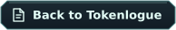

&nbsp;

# Tokenlogue for Linux

Tokenlogue is available as a portable x86_64 AppImage. You do not need to install Python, Flutter or Java to use it.

## 🚀 Get started

Follow the <a href="../../../docs/linux-appimage.md#english" title="Linux installation guide">Linux installation guide&nbsp;</a> for download availability, checksum verification, first launch and updates. Close any running copy before opening a replacement AppImage. The package has no automatic updater and is not digitally signed.

You need an x86-64-v2 processor, a graphical Linux desktop and compatible system libraries. Ubuntu 22.04 is the system-library baseline. GTK3, GLib/GIO and graphics drivers come from your distribution. FUSE is used for the usual launch, with an extract-and-run alternative described in the guide.

## 🔐 Protect your conversations

A working Secret Service in your desktop session is needed for protected key storage. See <a href="../../../docs/security.md#english" title="local protection and recovery">local protection and recovery&nbsp;</a> before changing your key-store settings or moving your profile. An AppImage is the application, not a backup of your conversations.

## 📜 Licenses and sources

<a href="notices.md#english" title="Included notices">Included notices&nbsp;</a> explain the license collection. The <a href="runtime/README.md#english" title="runtime overview">runtime overview&nbsp;</a> describes the included startup component. <a href="../../../docs/source-materials.md#english" title="Source materials">Source materials&nbsp;</a> explain the separate source archives and their limits.

